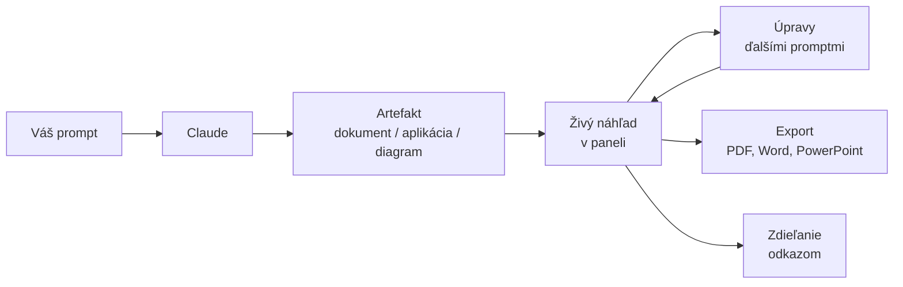
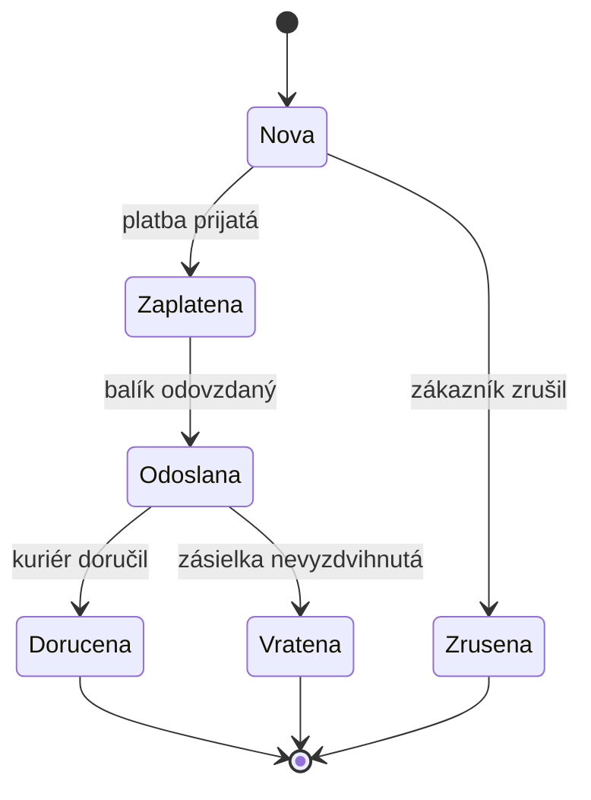
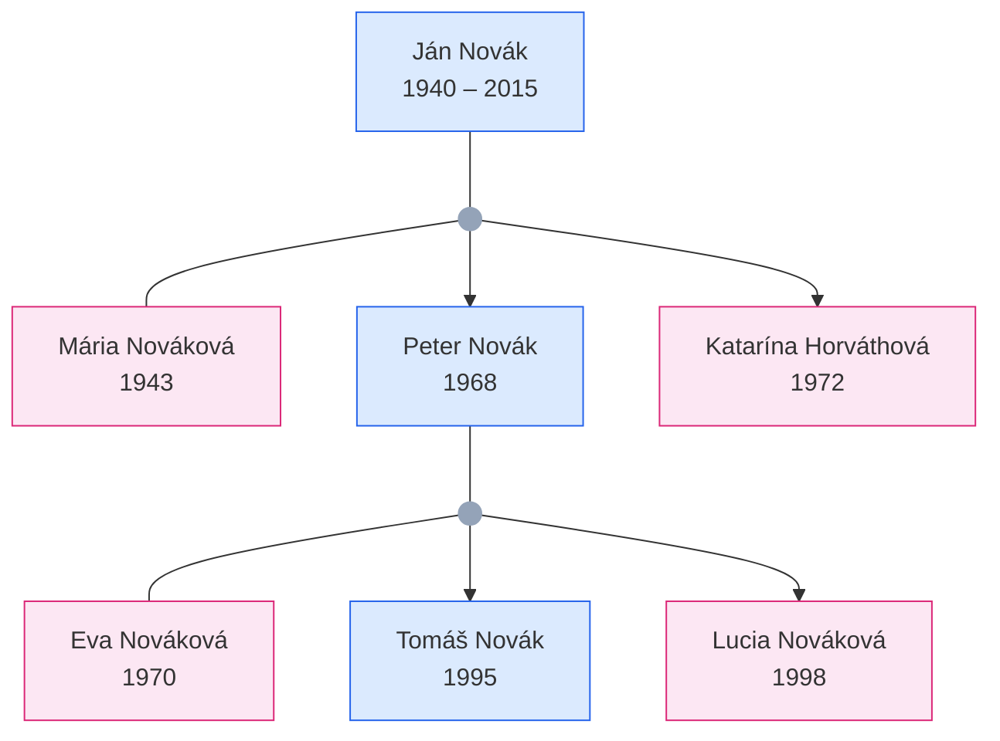
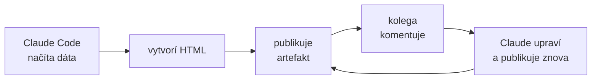

# Claude artefakty: čo vieme zhotoviť a ako ich vyskúšať

*Verzia 1.1 · stav k novembru 2026. Nástroje sa menia rýchlo; pred  
nasadením si overte aktuálnu dokumentáciu.*  

https://claude.ai/share/80e916c6-2825-464c-af5e-61f1725efe53

## 1. Prečo artefakty

Claude dokáže okrem textu vytvoriť aj **artefakt** – samostatný výstup,  
ktorý sa otvorí vedľa konverzácie v samostatnom paneli. Môže to byť  
dokument, prezentácia, návrh obrazovky, dashboard, diagram alebo malá  
interaktívna aplikácia. Artefakt nie je len kód na kopírovanie: Claude  
ho vie upravovať, vy ho vidíte ako živý náhľad a môžete ho zdieľať  
odkazom.  

Typické použitie: potrebujete rýchly nástroj, vizualizáciu alebo  
podklad pre kolegov, ale nechcete zakladať projekt, inštalovať  
závislosti a písať boilerplate (opakujúci sa pomocný kód, ktorý treba  
napísať v každom projekte). Artefakt je hotový za sekundy a ďalej ho  
upravujete promptmi priamo v Claude.  

> **Jednoducho povedané:** Artefakt je ako hotový miniprogram alebo  
> dokument, ktorý Claude napíše a hneď vám ukáže – bez toho, aby ste  
> otvorili editor alebo terminál.  



V roku 2026 sa artefakty výrazne rozšírili. Okrem voľných  
artefaktov (HTML, React, SVG, Mermaid) vznikli **šablóny** na  
dokumenty, prezentácie a návrhy, artefakty si vedia **pamätať dáta**,  
**volať Claude** a **čítať údaje z pripojených aplikácií**. Všetko,  
čo vytvoríte, nájdete na jednom mieste v karte **Artifacts** v bočnom  
paneli.  

## 2. Ako artefakt funguje

Claude vytvorí artefakt vtedy, keď je obsah rozsiahly (podľa pomocníka  
Claude zvyčajne viac ako 15 riadkov), samostatný a pravdepodobne ho  
budete ďalej upravovať alebo zdieľať. O artefakt môžete aj priamo  
požiadať: „vytvor artefakt…“.  

### 2.1 Šablóny: dokumenty, prezentácie, návrhy

Šablóna (template) je hotový typ artefaktu s vlastným editorom.  
Artefakt v šablóne môžete upravovať priamo myšou a klávesnicou,  
nielen promptmi, a exportovať do bežných formátov.  

| Šablóna | Na čo slúži | Export |  
|---|---|---|  
| Docs | spoločné dokumenty | Word, PDF, Markdown, Google Docs |  
| Slides | prezentácie | PowerPoint, PDF, Google Slides |  
| Design | návrhy, prototypy, letáky | .zip, PDF, PowerPoint, HTML |  
| Dashboards (beta) | grafy z dát a aplikácií | – |  
| Motion (beta) | animované vysvetlenia | MP4 |  

Šablónu zvolíte tromi spôsobmi: požiadate o ňu v chate („sprav z toho  
prezentáciu“), kliknete na **Output** v poli na písanie správy a  
vyberiete šablónu, alebo ju vyberiete v karte **Artifacts**.  

> **Pozor:** Docs, Slides a Design sú dostupné na všetkých plánoch.  
> Dashboards je v beta verzii na platených plánoch, Motion len na  
> plánoch Team a Enterprise. Na pláne Enterprise niektoré šablóny  
> zapína vlastník organizácie.  

### 2.2 Voľné artefakty: formáty

Keď nepotrebujete šablónu, Claude zvolí formát podľa obsahu:  

| Typ obsahu | Formát | Čo sa zobrazí |  
|---|---|---|  
| webová stránka, aplikácia | HTML + CSS + JS | živý náhľad |  
| komponent s logikou | React (JSX) | interaktívny komponent |  
| vektorová grafika | SVG | obrázok |  
| diagram | Mermaid | vykreslený diagram |  
| dokument | Markdown | formátovaný text |  
| ukážka kódu | Python, SQL a iné | kód so zvýraznením |  

Kód v Pythone sa v artefakte iba zobrazí, nespustí. Spustiť ho vie  
Claude vo svojom cloudovom prostredí, ak máte zapnutú funkciu na  
vytváranie súborov. Výsledok, napríklad graf ako  
obrázok alebo tabuľku v Exceli, vám potom dá na stiahnutie.  

Voľný artefakt je **single-file** (jednosúborový): všetko je v jednom  
súbore bez build kroku, teda bez prekladu a balenia kódu. Knižnice  
ako Tailwind CSS, React, Chart.js, D3 alebo Three.js sa načítajú z  
CDN (siete serverov, ktoré knižnice rozdávajú).  

> **Tip:** Keď chcete konkrétnu technológiu, povedzte to v prompte  
> („použi React a Tailwind“). Inak Claude zvolí najjednoduchší  
> variant, často čisté HTML.  

### 2.3 Staršie artefakty (legacy)

Artefakty vytvorené v chate pred 16. septembrom 2026 sú tzv.  
**legacy artefakty**. Naďalej fungujú, dajú sa publikovať a zdieľať,  
ale nové v tomto režime už nevytvoríte. Majú niekoľko odlišností:  
zdieľajú sa tlačidlom **Publish**, ukladanie dát funguje až po  
publikovaní a zrušenie publikovania uložené dáta natrvalo zmaže.  

### 2.4 Kde artefakty vznikajú

| Prostredie | Čo tam urobíte |  
|---|---|  
| web a Claude Desktop | vytvoriť, upraviť, zdieľať, šablóny |  
| iOS a Android | vytvoriť, upraviť, prezerať v karte Artifacts |  
| Claude Code | publikovať výstup relácie ako stránku |  

Nastavenia zdieľania na mobile nezmeníte; použite web alebo Claude  
Desktop.  

### 2.5 Hranice artefaktu

Artefakt je jedna samostatná stránka. Nemá vlastný server (backend),  
takže nemôže sám overovať používateľov ani mať viac podstránok. Pre  
interný nástroj s databázou a prihlasovaním potrebujete klasické  
nasadenie, napríklad podľa kapitoly `web-zaklady.md`.  

| Obmedzenie | Hodnota |  
|---|---|  
| ukladanie dát | 20 MB textu na artefakt |  
| veľkosť stránky (Claude Code) | najviac 16 MiB |  
| externé skripty (Claude Code) | len z piatich povolených CDN |  
| externé obrázky (Claude Code) | blokované, vkladajú sa priamo |  
| sťahovanie súborov | len cez schopnosť downloads |  

Povolené CDN pre artefakty z Claude Code sú cdnjs, unpkg, jsDelivr  
(cesta `/npm/`), Tailwind CDN a jQuery CDN. Písma sa môžu načítať z  
Google Fonts.  

## 3. Čo môžeme zhotoviť

### 3.1 Interaktívne webové aplikácie

- jednostránkové aplikácie (HTML, CSS, JavaScript) bez build kroku,  
- React komponenty (s hooks, state, props),  
- kalkulačky a konvertory (jednotky, meny, dátumy),  
- formuláre s validáciou,  
- zoznamy úloh a poznámkové bloky,  
- kvízy a testy s vyhodnotením,  
- časovače, stopky, pomodoro,  
- hry (had, pexeso, piškvorky, vedomostné hry),  
- interaktívne dashboardy s filtrami.  

### 3.2 Vizualizácie dát

- grafy (čiarové, stĺpcové, koláčové, bodové),  
- heatmapy a tabuľky,  
- interaktívne mapy a grafy súvislostí,  
- animácie a vizuálne simulácie,  
- SVG grafika (logá, ikony, ilustrácie),  
- diagramy (Mermaid: flowchart, sekvenčné, triedne).  

### 3.3 Dokumenty a texty

- dokumenty v šablóne Docs s exportom do Wordu a PDF,  
- prezentácie v šablóne Slides s exportom do PowerPointu,  
- Markdown dokumenty s formátovaním,  
- reporty, súhrny, porovnávacie tabuľky,  
- životopisy a motivačné listy,  
- návody a tutoriály.  

### 3.4 Kód a vývoj

- ukážky kódu so zvýraznením syntaxe,  
- algoritmy a dátové štruktúry s vizualizáciou krokov,  
- parsery a transformátory dát (JSON, CSV),  
- regex testery,  
- kódové ukážky so živým náhľadom,  
- prechod zmenami v kóde s poznámkami (v Claude Code).  

### 3.5 Kreatívne a multimediálne

- SVG ilustrácie a logá,  
- notový zápis v ABC notácii (vykreslený napríklad knižnicou abcjs),  
- 3D scény (Three.js),  
- animácie na plátne (canvas),  
- farebné palety a dizajnové systémy,  
- návrhy obrazoviek, letákov a úvodných stránok v šablóne Design,  
- animované vysvetlenia v šablóne Motion (export MP4).  

### 3.6 Nástroje a utility

- generátory hesiel,  
- dekodéry a enkodéry (Base64, URL, HTML),  
- formátovače kódu (JSON, SQL),  
- konvertory (Markdown ↔ HTML),  
- nástroje na porovnanie dvoch textov (diff),  
- regex tester s vysvetlením.  

### 3.7 Vzdelávacie

- interaktívne vysvetlenia pojmov,  
- animované vysvetlenia algoritmov,  
- jazykové kartičky a slovníky,  
- matematické vizualizácie (grafy funkcií),  
- fyzikálne simulácie (kyvadlo, gravitácia).  

### 3.8 Diagramy (Mermaid a SVG)

- rodokmene (strom predkov, potomkov),  
- organizačné schémy (hierarchia firmy, tímy),  
- flowcharty (procesy, rozhodovacie stromy, algoritmy),  
- sekvenčné diagramy (komunikácia medzi systémami, volania API),  
- ER diagramy (databázové tabuľky a vzťahy),  
- stavové diagramy (stavy objektu, prechody),  
- Gantt diagramy (časové plány projektov),  
- myšlienkové mapy (mind map),  
- sieťové diagramy (topológia, infraštruktúra),  
- diagramy tried (UML),  
- diagramy prípadov použitia (use case, aktéri),  
- diagramy nasadenia (servery, kontajnery).  

Podrobný úvod do zápisu diagramov nájdete v kapitole `mermaid.md`.  

### 3.9 Ako diagramy vytvoriť

| Spôsob | Kedy ho použiť |  
|---|---|  
| Mermaid | rýchly textový zápis, Claude ho vykreslí sám |  
| SVG | plná kontrola nad farbami, pozíciami a animáciou |  
| HTML + CSS | stromy a schémy s flexboxom alebo gridom |  
| React + knižnice | interaktívne diagramy (D3, React Flow) |  

> **Tip:** Pre rodokmene je najlepší Mermaid `flowchart TB`  
> (zhora nadol) alebo vlastné SVG či HTML s CSS gridom, kde môžete  
> pridať fotografie a dátumy narodenia.  

### 3.10 Pracovné a firemné použitie

- interná kalkulačka cien alebo ponúk,  
- kontrolný zoznam pre zaškolenie nového kolegu,  
- anketa alebo hlasovanie tímu so spoločnými výsledkami,  
- prihlasovací hárok na školenie či službu,  
- tabuľa úloh s prioritami „teraz, neskôr, zrušiť“,  
- prehľad otvorených úloh z pripojenej aplikácie (napríklad Asana),  
- porovnanie viacerých návrhov vedľa seba,  
- stavová stránka dlhšej práce, ktorú Claude priebežne dopĺňa.  

### 3.11 Aplikácie s pamäťou a AI

- denník alebo zoznam úloh, ktorý si dáta pamätá aj po zatvorení,  
- tréner slovíčok, ktorý si pamätá, čo už viete,  
- pomocník na písanie e-mailov, ktorý volá Claude,  
- generátor otázok na kvíz z vloženého textu,  
- prekladač s vysvetlením gramatiky,  
- súhrn kalendára na týždeň z pripojeného Google Calendar.  

## 4. Príklady od jednoduchých po zložité

Príklady sú zoradené od najjednoduchšieho. Každý obsahuje prompt,  
popis toho, čo by ste mali dostať, a ďalšie prompty na úpravu. Kód  
nemusíte čítať ani písať; ak vás zaujíma, kliknite v paneli  
artefaktu na zobrazenie kódu.  

Pri diagramoch (príklad 5) a grafike (príklad 6) je ukázaný aj  
výsledný zápis, pretože je krátky a ľahko ho upravíte aj sami.  

### Príklad 1: tlačidlo, ktoré mení farbu

Prompt:  

> Vytvor artefakt s tlačidlom, ktoré po kliknutí zmení farbu. Farby  
> sa striedajú dokola: modrá, zelená, červená, fialová.  

Čo by ste mali dostať: v paneli sa zobrazí jedno tlačidlo. Každé  
kliknutie zmení jeho farbu a po poslednej farbe sa začne znova od  
prvej. Je to zároveň test, či vám artefakty fungujú.  

### Vyskúšajte

1. „Pridaj piatu farbu: oranžovú.“  
2. „Nech tlačidlo zobrazuje aj počet kliknutí.“  
3. „Prepíš to do Reactu.“ Potom si v paneli porovnajte oba kódy.  

### Príklad 2: kalkulačka DPH

Prompt:  

> Sprav kalkulačku DPH pre Slovensko so sadzbami 23, 19 a 5 %.  
> Výsledok prepočítaj pri každej zmene a sumy zobraz po slovensky  
> (desatinná čiarka, symbol €).  

Čo by ste mali dostať: pole na sumu bez DPH, výber sadzby a výsledok  
„DPH“ a „Spolu s DPH“, ktorý sa mení už počas písania. Pri sume 100 €  
a sadzbe 23 % má vyjsť DPH 23,00 € a spolu 123,00 €.  

> **Pozor:** Sadzby DPH sa menia. Na Slovensku platia od januára  
> 2025 sadzby 23 %, 19 % a 5 %. Pred použitím vo firme si ich  
> overte na stránke Finančnej správy.  

### Vyskúšajte

1. Overte výpočet na sumách 0, 100 a 99,99 €.  
2. „Pridaj opačný výpočet: zo sumy s DPH na sumu bez DPH.“  
3. „Pridaj tlačidlo Kopírovať výsledok.“  
4. „Čo sa stane, keď zadám zápornú sumu? Ošetri to.“  

### Príklad 3: graf rozpočtu s knižnicou z CDN

Prompt:  

> Zobraz koláčový graf mesačného rozpočtu: bývanie 40 %, jedlo 25 %,  
> doprava 15 %, ostatné 20 %. Použi Chart.js s pevnou verziou.  

Čo by ste mali dostať: farebný koláčový (alebo prstencový) graf so  
štyrmi časťami a legendou. Po prejdení myšou nad časťou sa zobrazí  
názov a percento. Knižnica Chart.js sa načíta z CDN, takže nič  
neinštalujete.  

### Vyskúšajte

1. „Zmeň graf na stĺpcový.“  
2. „Pridaj položku Úspory a uprav percentá tak, aby dali 100 %.“  
3. „Pridaj polia na zadanie súm v eurách a percentá vypočítaj.“  

### Príklad 4: kvíz s vyhodnotením

Prompt:  

> Sprav kvíz o hlavných mestách Európy, 10 otázok, vyhodnotenie na  
> konci. Pri každej otázke 3 možnosti. Podporuj tmavý režim  
> a ovládanie klávesnicou.  

Čo by ste mali dostať: jednu otázku naraz s ukazovateľom priebehu,  
upozornenie, ak nevyberiete odpoveď, a na konci skóre so zoznamom  
správnych a nesprávnych odpovedí. Tmavý režim sa zapne podľa  
nastavenia vášho systému.  

### Vyskúšajte

1. „Pridaj jedenástu otázku o hlavnom meste Nórska.“  
2. „Zamiešaj poradie otázok pri každom spustení.“  
3. „Ulož najlepší výsledok, aby zostal aj po zatvorení.“  

### Príklad 5: stavový diagram v Markdowne

Prompt:  

> Zobraz stavový diagram objednávky v Mermaid: nová, zaplatená,  
> odoslaná, doručená, zrušená a vrátená.  

Výsledok môže vyzerať takto.  



Mermaid diagram je obyčajný text, preto ho ľahko upravíte aj sami.  
Názvy stavov sú bez diakritiky, lebo slúžia ako identifikátory; popisy  
prechodov za dvojbodkou diakritiku mať môžu.  

### Vyskúšajte

1. Pridajte sami stav „Reklamovana“ za stavom „Dorucena“.  
2. „Nakresli rovnaký proces ako flowchart.“ Porovnajte oba diagramy.  
3. Vložte zápis do súboru `.md` na GitHube; diagram sa vykreslí  
   aj tam.  

### Príklad 6: logo v SVG

Prompt:  

> Vytvor SVG logo pre firmu Severná hviezda – hviezda a text na  
> tmavom pozadí.  

Výsledok môže vyzerať takto.  

```xml
<svg xmlns="http://www.w3.org/2000/svg" viewBox="0 0 320 120"
     role="img" aria-label="Logo Severná hviezda">
  <!-- tmavé pozadie ako nočná obloha -->
  <rect width="320" height="120" rx="16" fill="#0f172a"/>
  <!-- päťcípa hviezda -->
  <polygon fill="#facc15"
           points="60,18 70,46 100,46 76,64 85,94 60,76 35,94 44,64 20,46 50,46"/>
  <!-- názov firmy -->
  <text x="120" y="58" fill="#f8fafc" font-family="Georgia, serif"
        font-size="26">Severná</text>
  <text x="120" y="88" fill="#facc15" font-family="Georgia, serif"
        font-size="26">hviezda</text>
</svg>
```

SVG je vektorový formát, takže logo je ostré pri akejkoľvek veľkosti.  
Atribút `viewBox` určuje súradnice kresby, `polygon` je hviezda  
zadaná desiatimi bodmi a `aria-label` popisuje obrázok pre čítačky.  

### Vyskúšajte

1. Zmeňte sami farbu hviezdy z `#facc15` na inú.  
2. „Sprav svetlú verziu loga pre biele pozadie.“  
3. „Pridaj animáciu, pri ktorej hviezda jemne bliká.“  

### Príklad 7: tabuľa úloh, ktorá vráti prompt

Prompt:  

> Sprav tabuľu úloh: Opraviť chybu v prihlasovaní, Doplniť tmavý  
> režim, Aktualizovať návod, Zrýchliť úvodnú stránku. Každej úlohe  
> priraď prioritu Teraz, Neskôr alebo Zrušiť a tlačidlom vytvor  
> text, ktorý vložím späť do chatu.  

Čo by ste mali dostať: zoznam úloh s výberom priority a tlačidlo,  
ktoré vytvorí text v tvare „Teraz: …, Neskôr: …, Zrušiť: …“. Text  
skopírujete a vložíte späť do konverzácie.  

Tento vzor je užitočný najmä v Claude Code: artefakt slúži ako  
jednoduchý editor rozhodnutia a výsledok sa vráti do konverzácie ako  
text.  

### Vyskúšajte

1. „Pridaj možnosť napísať vlastnú úlohu.“  
2. „Nech sa úlohy dajú presúvať myšou medzi stĺpcami.“  
3. Výsledný text vložte do Claude a nechajte ho pracovať podľa neho.  

### Príklad 8: AI pomocník, ktorý volá Claude

Prompt:  

> Sprav artefakt, ktorý z krátkej poznámky napíše zdvorilý e-mail  
> v slovenčine s oslovením a podpisom. Na prepis použi Claude.  

Čo by ste mali dostať: pole na poznámku, tlačidlo „Navrhnúť e-mail“  
a miesto, kde sa e-mail postupne vypisuje. Pri prvom použití artefakt  
požiada o povolenie volať Claude. Spotreba sa počíta do limitov toho,  
kto artefakt práve používa.  

V Claude Code funguje rovnaký prompt. Claude pri publikovaní ohlási,  
že stránka bude volať Claude, a vy publikovanie schválite.  

> **Pozor:** Kolega, ktorý otvorí artefakt cez odkaz bez prihlásenia,  
> časť s volaním Claude neuvidí. Požiadajte Claude, nech pre takého  
> používateľa zobrazí zrozumiteľnú správu.  

### Vyskúšajte

1. „Pridaj výber tónu e-mailu: formálny, priateľský, stručný.“  
2. „Pridaj tlačidlo, ktoré e-mail skráti na polovicu.“  
3. Zdieľajte artefakt s kolegom a overte, že ho používa vlastným  
   účtom.  

## 5. Prompty na skúšku

Každý prompt skopírujte do Claude a sledujte výsledok v paneli  
artefaktov. Po prvom výsledku pokračujte ďalšími promptmi („pridaj  
tmavý režim“, „zmeň farby na modré“).  

### 5.1 Webové aplikácie

1. Vytvor kalkulačku BMI so vstupmi výška a váha, výsledok zobraz  
   farebne podľa kategórie.  
2. Sprav zoznam úloh s možnosťou pridávať, odškrtávať a mazať  
   položky. Ulož ich tak, aby zostali aj po zatvorení.  
3. Vytvor pomodoro časovač (25 min práca, 5 min prestávka) so  
   zvukovým signálom.  
4. Sprav kvíz o hlavných mestách Európy, 10 otázok, vyhodnotenie  
   na konci.  
5. Vytvor jednoduchú hru had ovládanú šípkami.  

### 5.2 Vizualizácie dát

6. Zobraz koláčový graf rozdelenia mesačného rozpočtu domácnosti  
   (bývanie 40 %, jedlo 25 %, doprava 15 %, ostatné 20 %).  
7. Vytvor interaktívny graf funkcií sin(x) a cos(x) na intervale  
   0 až 2π s posuvníkom pre amplitúdu.  
8. Sprav heatmapu týždenného rozvrhu: riadky dni, stĺpce hodiny,  
   farba podľa vyťaženia.  
9. Vytvor SVG logo pre firmu „Severná hviezda“ – hviezda a text.  
10. Zobraz časovú os projektu ako Gantt diagram (Mermaid).  

### 5.3 Dokumenty, prezentácie a návrhy

11. Vytvor životopis v HTML s miestom na fotku, skúsenosťami  
    a vzdelaním.  
12. Sprav prezentáciu o 5 slajdoch o bezpečnosti hesiel pre nových  
    zamestnancov. Použi šablónu Slides.  
13. Vytvor porovnávaciu tabuľku 3 cloudových poskytovateľov  
    (AWS, Azure, Google Cloud).  
14. Napíš návod v Markdowne, ako nastaviť Git vo Windows.  
15. Navrhni úvodnú stránku pre kaviareň „Pod lipou“ v šablóne  
    Design, vo verzii pre mobil aj počítač.  

### 5.4 Kód a vývoj

16. Vytvor regex tester: vstup regex, vstup text, zvýrazni zhody.  
17. Sprav JSON formátovač s možnosťou zbalenia a rozbalenia.  
18. Napíš Python skript, ktorý vykreslí histogram náhodných čísel,  
    spusti ho a ukáž mi graf.  
19. Sprav nástroj na porovnanie dvoch textov s farebnými rozdielmi.  

### 5.5 Kreatívne a multimediálne

20. Vytvor SVG ilustráciu horskej krajiny (hory, slnko, jazero).  
21. Vygeneruj farebnú paletu 5 farieb s názvami a hex kódmi.  
22. Vytvor jednoduchú 3D scénu (Three.js): kocka rotujúca v priestore.  
23. Napíš krátku melódiu v ABC notácii (16 taktov) a zobraz ju  
    ako noty.  

### 5.6 Nástroje a utility

24. Vytvor generátor bezpečných hesiel (dĺžka, veľké a malé písmená,  
    čísla, symboly).  
25. Sprav konvertor Markdown na HTML s náhľadom.  
26. Vytvor nástroj na kódovanie a dekódovanie Base64.  
27. Sprav regex tester s vysvetlením každého znaku.  

### 5.7 Vzdelávacie

28. Vytvor interaktívne vysvetlenie binárneho vyhľadávania  
    (animácia krokov).  
29. Sprav kartičky na učenie slovíčok (anglicko-slovensky)  
    s otočením.  
30. Vytvor graf kvadratickej funkcie y = ax² + bx + c s posuvníkmi  
    a, b, c.  
31. Animuj kyvadlo a zobraz jeho pohyb v čase.  

### 5.8 Diagramy

32. Vytvor rodokmeň (Mermaid flowchart) pre 3 generácie rodiny  
    Novákovcov.  
33. Sprav organizačnú schému firmy s riaditeľom, 3 oddeleniami  
    a tímami.  
34. Vytvor ER diagram jednoduchej databázy: používatelia,  
    objednávky, produkty.  
35. Zobraz stavový diagram objednávky (nová → zaplatená →  
    odoslaná → doručená).  
36. Vytvor myšlienkovú mapu témy „umelá inteligencia“ s podvetvami.  
37. Sprav sekvenčný diagram prihlásenia používateľa (klient,  
    server, databáza).  
38. Vytvor diagram nasadenia: prehliadač → Cloudflare → API →  
    databáza.  
39. Sprav organizačnú schému ako SVG s miestom na fotky a menami.  

### 5.9 Pracovné nástroje

40. Sprav kalkulačku cenovej ponuky: hodiny, hodinová sadzba,  
    zľava, DPH 23 %. Výsledok zobraz ako prehľadnú tabuľku.  
41. Vytvor kontrolný zoznam na prvý týždeň nového kolegu, rozdelený  
    podľa dní.  
42. Sprav plánovač porady: témy, čas na každú tému a odpočet.  
43. Vytvor porovnanie troch ponúk dodávateľov s váhami kritérií  
    a výsledným skóre.  

### 5.10 Pamäť, AI a pripojené aplikácie

44. Sprav anketu „Kam na teambuilding?“ so spoločnými výsledkami  
    pre všetkých, ktorí artefakt otvoria.  
45. Vytvor tréner slovíčok, ktorý si pamätá, ktoré slová už viem.  
46. Sprav pomocníka, ktorý z vloženého textu vytvorí 5 otázok  
    na kvíz. Na tvorbu otázok použi Claude.  
47. Vytvor prehľad mojich stretnutí na tento týždeň z Google  
    Calendar s celkovým časom na poradách.  

## 6. Praktický projekt: rodinný rodokmeň

Cieľ: vytvoriť interaktívny rodokmeň s dátami, fotkami a možnosťou  
pridať novú osobu, a potom ho bezpečne zdieľať s rodinou.  

Kroky:  

1. **Zber dát** – pripravte zoznam osôb (meno, priezvisko, rok  
   narodenia, rok úmrtia, rodičia, partner).  
2. **Prvý prompt** – „Vytvor rodokmeň pre rodinu s 3 generáciami.  
   Použi Mermaid flowchart TB. Každú osobu zobraz ako uzol s menom  
   a rokmi. Manželov spoj malým uzlom, z ktorého vedú šípky k deťom.  
   Mužov a ženy odlíš farbou.“  
3. **Kontrola** – porovnajte výsledok so súborom nižšie a overte,  
   či sedia vzťahy.  
4. **Interaktivita** – „Prepíš rodokmeň do HTML. Po kliknutí na  
   osobu zobraz detail v bočnom paneli.“  
5. **Pamäť** – „Pridaj formulár na novú osobu a ulož rodokmeň tak,  
   aby zostal aj po zatvorení.“ (vyžaduje platený plán).  
6. **Export** – stiahnite výsledok alebo požiadajte o tlačidlo na  
   uloženie diagramu ako SVG.  
7. **Zdieľanie** – cez **Share** pozvite rodinu e-mailom s úrovňou  
   **Can view**.  

Výsledok kroku 2 môže vyzerať takto.  



Uzly `JM` a `PE` sú malé kruhy, ktoré predstavujú manželský pár.  
Čiara `---` spája partnerov, šípka `-->` vedie od páru k deťom.  
Riadky `classDef` určujú farby pre mužov, ženy a páry.  

> **Pozor:** Mermaid je pri veľkých rodokmeňoch (viac ako približne  
> 30 osôb) neprehľadný. Vtedy prejdite na vlastné SVG alebo HTML  
> riešenie.  

> **Pozor:** Rodokmeň obsahuje osobné údaje žijúcich ľudí. Na  
> zdieľanie použite pozvánky konkrétnym ľuďom, nie  
> **Anyone with the link**.  

## 7. Automatizácia a AI uhol

Artefakty sa dobre kombinujú s ostatnými nástrojmi z tohto kurzu:  

| Nástroj | Ako pomôže pri artefaktoch |  
|---|---|  
| Claude Code | publikuje výstup relácie, aktualizuje ho priebežne |  
| konektory (MCP) | artefakt číta živé dáta pri každom otvorení |  
| subagenti | jeden pripraví dáta, druhý z nich spraví artefakt |  
| skills | osvedčený prompt na artefakt uložíte ako príkaz |  
| komentáre | kolegovia píšu `@claude`, Claude v relácii odpovie |  

Podrobnosti nájdete v kapitolách `mcp.md`, `subagenti.md` a  
`skills.md`.  

Príklad postupu v Claude Code:  



Každé publikovanie vytvorí novú verziu. V ponuke **Share** zvolíte,  
ktorú verziu vidia ostatní.  

> **Tip:** Ak máte funkčný artefakt z chatu a chcete ho nasadiť na  
> vlastný web, požiadajte Claude: „Prepíš tento artefakt ako  
> samostatný HTML súbor pripravený na nasadenie.“ Postup nasadenia  
> nájdete v kapitole `web-zaklady.md`.  

## 8. Bezpečnosť

- artefakty sú na začiatku súkromné; pred zdieľaním si overte, čo  
  obsahujú, najmä osobné údaje (GDPR),  
- nikdy nevkladajte do artefaktu API kľúče ani heslá; artefakt  
  volajúci Claude kľúč nepotrebuje,  
- pred zadaním citlivých údajov overte, či artefakt nepoužíva  
  spoločné úložisko,  
- cudzie artefakty kopírujte a otvárajte len od ľudí, ktorým  
  dôverujete,  
- pri pripojených aplikáciách povoľte len nástroje, ktoré artefakt  
  naozaj potrebuje; akcie (napríklad poslanie správy) sa vykonajú  
  pod vaším účtom,  
- pre **Anyone with the link** platí, že odkaz môže ktokoľvek  
  preposlať ďalej,  
- knižnice z CDN načítavajte s pevnou verziou v adrese,  
- pri hrách a animáciách sledujte výkon na slabších zariadeniach.  

## 9. Časté chyby

| Problém | Príčina | Riešenie |  
|---|---|---|  
| artefakt nevznikne | vypnuté vytváranie súborov | zapnite v Capabilities |  
| prázdny náhľad | chyba v JavaScripte | **Try fixing with Claude** |  
| knižnica sa nenačíta | CDN nie je povolené | použite cdnjs s verziou |  
| dáta sa po zatvorení stratia | artefakt neukladá | „ulož dáta“ (Pro a vyššie) |  
| kolega nevidí dáta | osobné úložisko | požiadajte o spoločné |  
| hosť nevidí živé časti | nie je prihlásený | pozvite ho e-mailom |  
| Claude Code nepublikuje | prihlásenie API kľúčom | `/login` účtom claude.ai |  
| nová relácia robí kópiu | artefakt nie je pripojený | `/artifacts` a `Enter` |  
| tlačidlo stiahnutia nejde | priamy odkaz `blob:` | požiadajte o downloads |  
| diagram je príliš veľký | veľa uzlov | rozdeľte na viac diagramov |  

## 10. Úlohy na precvičenie

1. Vyskúšajte príklad 1 a potom požiadajte o verziu v Reacte.  
2. Vytvorte kalkulačku DPH a otestujte ju na sumách 0, 100 a 99,99 €.  
3. Vytvorte rodokmeň vašej rodiny (aspoň 3 generácie) v Mermaid.  
4. Vytvorte SVG logo pre vymyslenú firmu a stiahnite ho.  
5. Spravte prezentáciu o 5 slajdoch v šablóne Slides a exportujte  
   ju do PowerPointu.  
6. Spravte zoznam úloh, ktorý si dáta pamätá, a overte to po  
   zatvorení a opätovnom otvorení.  
7. Zdieľajte artefakt s kolegom s úrovňou **Commenter** a nechajte  
   ho pridať komentár.  
8. Vytvorte anketu so spoločným úložiskom a hlasujte z dvoch účtov.  
9. Spravte AI pomocníka, ktorý volá Claude, a overte, že kolega ho  
   používa vlastným účtom.  
10. V Claude Code vytvorte príklad 7, upravte ho z novej relácie  
    cez `/artifacts` a skontrolujte, že odkaz zostal rovnaký.  

## 11. Zhrnutie

- **Artefakt** je samostatný výstup vedľa konverzácie, ktorý môžete  
  upravovať, exportovať a zdieľať,  
- **šablóny** Docs, Slides a Design majú vlastný editor a export do  
  Wordu, PDF a PowerPointu,  
- **voľné artefakty** sú single-file stránky v HTML, Reacte, SVG,  
  Mermaid alebo Markdowne,  
- artefakty sú na začiatku **súkromné**; zdieľate ich cez **Share**  
  s úrovňami **Can view**, **Commenter** a **Can edit**,  
- **ukladanie dát** je osobné alebo spoločné, do 20 MB textu,  
- artefakt môže **volať Claude** na účet používateľa a čítať  
  **pripojené aplikácie** v jeho mene,  
- **Claude Code** publikuje výstup relácie; `/artifacts` ich nájde,  
  `Ctrl+]` otvorí posledný,  
- na produkciu zafixujte verzie knižníc a neukladajte tajné kľúče.  

## 12. Slovníček

| Anglicky | Slovensky | Význam |  
|---|---|---|  
| artifact | artefakt | samostatný výstup v paneli vedľa chatu |  
| template | šablóna | typ artefaktu s editorom a exportom |  
| legacy artifact | starší artefakt | artefakt z chatu pred 16. 9. 2026 |  
| share | zdieľať | sprístupniť artefakt iným odkazom |  
| access level | úroveň prístupu | prezerať, komentovať, upravovať |  
| storage | úložisko | dáta, ktoré si artefakt pamätá |  
| connector | konektor | prepojenie Claude s aplikáciou (MCP) |  
| capability | schopnosť | povolenie stránky, napr. volať Claude |  
| remix | remix | vlastná kópia cudzieho artefaktu |  
| sandbox | sandbox | izolované prostredie na bezpečný beh |  
| CDN | CDN | sieť serverov, ktorá rozdáva knižnice |  
| single-file | jednosúborový | všetko v jednom súbore |  
| live preview | živý náhľad | okamžité zobrazenie výsledku |  
| Mermaid | Mermaid | jazyk na textový zápis diagramov |  
| SVG | SVG | vektorový grafický formát |  

## Zdroje

- Artefakty v Claude (pomocník):  
  https://support.claude.com/en/articles/17153992-what-are-artifacts-and-how-do-i-use-them  
- Zdieľanie artefaktov:  
  https://support.claude.com/en/articles/9547008-share-artifacts  
- Artefakty v Claude Code:  
  https://code.claude.com/docs/en/artifacts  
- Claude Design:  
  https://support.claude.com/en/articles/14604416-get-started-with-claude-design  
- Claude Docs:  
  https://support.claude.com/en/articles/16923645-get-started-with-claude-docs  
- Mermaid: https://mermaid.js.org/  
- SVG (MDN): https://developer.mozilla.org/en-US/docs/Web/SVG  
- Chart.js: https://www.chartjs.org/docs/latest/  
- React: https://react.dev/  
- Tailwind CSS (Play CDN): https://tailwindcss.com/docs/installation/play-cdn  
