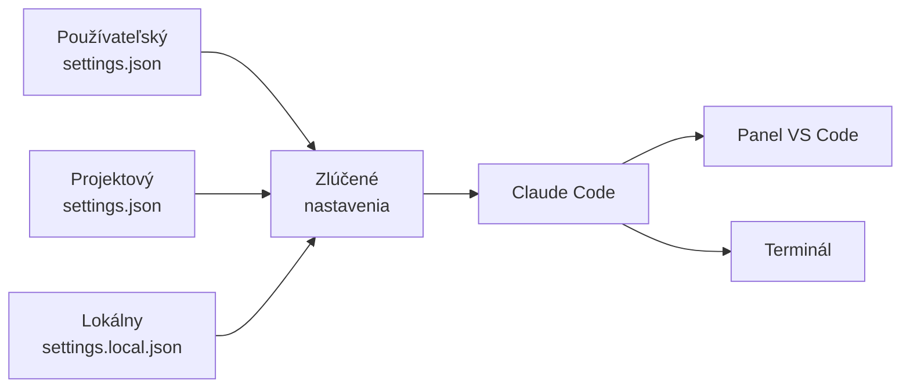
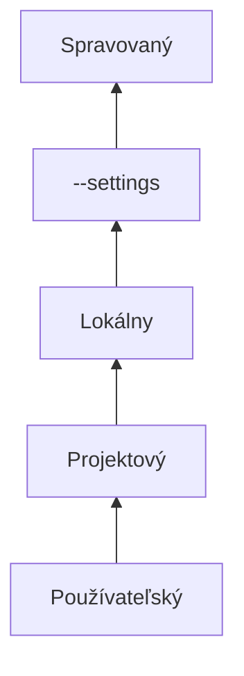

# Nastavenia Claude Code: súbor settings.json

*Verzia 1.0 · stav k novembru 2026. Nástroje sa menia rýchlo; pred  
nasadením si overte aktuálnu dokumentáciu.*  

## 1. Prečo súbor nastavení

Agent v paneli VS Code sa neriadi iba vaším promptom. Prompt hovorí, čo  
chcete urobiť teraz. Súbor nastavení určuje, čo platí pri každej relácii:  
aký model sa použije, ktoré príkazy prejdú bez otázky, ktoré súbory agent  
neuvidí a ktoré hooky – skripty spúšťané pri udalostiach – sa spustia.  

`settings.json` je textový súbor vo formáte JSON. JSON je zápis  
štruktúrovaných údajov pomocou dvojíc kľúč – hodnota. Kľúč je názov  
nastavenia, napríklad `"model"`. Hodnota je jeho obsah, napríklad  
`"sonnet"`. JSON nepovoľuje komentáre ani čiarku za poslednou položkou.  

Nastavenia nie sú to isté ako pamäť agenta. Rozdelenie je užitočné poznať  
skôr, než začnete niečo hľadať v nesprávnom súbore:  

| Čo chcete zmeniť | Kam to patrí |  
| --- | --- |  
| model, pravidlá, premenné, hooky | `settings.json` |  
| pokyny pre model, štýl a znalosti projektu | `CLAUDE.md` |  
| externé nástroje cez MCP | konfigurácia MCP |  
| osobnú výnimku v jednom projekte | `settings.local.json` |  

MCP (Model Context Protocol) je spôsob, ako agentovi pripojiť externé  
nástroje.  

Prompt je jednorazový. Nastavenie pretrvá aj po zatvorení relácie a platí  
v paneli VS Code rovnako ako v príkazovom riadku. Práve preto sa vyplatí  
vedieť, ktorý súbor ktorú vec riadi.  



> **Jednoducho povedané:** prompt je pokyn spolujazdca „teraz choď  
> vľavo“. Súbor nastavení je jazdný režim auta. Platí, kým ho nezmeníte,  
> a vodič ho nemôže obísť jednou vetou.  

> **Pozor:** Nastavenia nie sú len odporúčanie pre model. Program ich  
> číta a riadi sa nimi. Preto sem nepatria experimenty „na skúšku“ bez  
> toho, aby ste vedeli, ako ich neskôr odstránite.  

## 2. Ako nastavenia fungujú

### 2.1 Štyri súbory a ich dosah

Claude Code číta štyri súbory nastavení. Každý má iný dosah a iný účel.  
Inštalácia sama žiadny z nich nevytvorí; vznikajú pri prvom použití alebo  
ich vytvoríte ručne.  

| Rozsah | Súbor na Windows | Koho sa týka |  
| --- | --- | --- |  
| Používateľský | `%USERPROFILE%\.claude\settings.json` | všetky projekty |  
| Projektový | `<projekt>\.claude\settings.json` | celý tím |  
| Lokálny | `<projekt>\.claude\settings.local.json` | len vy v projekte |  
| Spravovaný | `managed-settings.json` | celá organizácia |  

> **Tip:** Projektový súbor sa číta z priečinka, v ktorom reláciu  
> spustíte. Ak vo VS Code otvoríte len podpriečinok, Claude Code nemusí  
> nájsť `.claude/settings.json` z koreňa. Otvorte koreň projektu alebo  
> reláciu spustite tam.  

`%USERPROFILE%` je premenná Windows, ktorá ukazuje na váš domovský  
priečinok, napríklad `C:\Users\jano`. V dokumentácii sa ten istý priečinok  
píše ako `~/.claude`; na Windows ide o to isté miesto.  

Používateľský súbor je váš osobný. Projektový súbor je spoločný a jeho  
zmeny vidia kolegovia po naklonovaní repozitára. Lokálny súbor je vaša  
výnimka, ktorá nepatrí do gitu. Spravovaný súbor nasadzuje organizácia  
a vy ho needitujete.  

Claude Code si okrem toho drží piaty súbor `~/.claude.json`. Ten si píše  
sám a nepatrí do rúk: obsahuje údaje o účte, zoznam MCP serverov, dôveru  
v priečinky a globálne voľby. Ak niektoré nastavenie v `settings.json`  
nenájdete, možno patrí práve sem.  

> **Tip:** Ak chcete mať konfiguráciu inde než v profile, nastavte  
> premennú `CLAUDE_CONFIG_DIR` v shelli alebo v používateľskom súbore na  
> absolútnu cestu. Claude Code potom používa tento priečinok pre  
> nastavenia, históriu relácií a pluginy.  

### 2.2 Prednosť a spájanie

Keď je ten istý kľúč vo viacerých súboroch, rozhoduje poradie. Vyhráva  
najvyššia vrstva, ktorá kľúč nastavuje. Ostatné vrstvy pod ňou sa pre ten  
istý kľúč ignorujú.  

| Poradie | Vrstva | Príklad |  
| --- | --- | --- |  
| 1. najvyššie | spravované nastavenia | firemná politika |  
| 2. | príkazový riadok | `claude --settings ...` |  
| 3. | lokálny súbor | `.claude/settings.local.json` |  
| 4. | projektový súbor | `.claude/settings.json` |  
| 5. najnižšie | používateľský súbor | `~/.claude/settings.json` |  



Šípka smeruje k vrstve, ktorá prebíja. Keď teda používateľský súbor  
nastaví model `sonnet` a projektový `opus`, relácia v projekte použije  
`opus`. Lokálny súbor s hodnotou `sonnet` prebije aj projekt.  

Pri zoznamoch to neplatí doslova. Zoznamy pravidiel `allow`, `ask` a `deny`  
sa z viacerých súborov **spájajú**, nie nahrádzajú. Každý súbor tak môže  
pridať pravidlo bez toho, aby vymazal pravidlá ostatných. Vyhodnotenie  
potom postupuje v poradí `deny`, `ask`, `allow` a rozhodne prvá zhoda.  
Podrobný opis nájdete v [guardrails.md](guardrails.md).  

> **Pozor:** Povoľujúce pravidlo v osobnom súbore nemá prednosť pred  
> pravidlom `ask` z projektového súboru. Pravidlá sa najprv spoja a až  
> potom sa vyhodnotia. Ak sa agent stále pýta, hľadajte zdroj v inom  
> súbore, nie v tom, ktorý ste práve upravili.  

### 2.3 Kľúč musí povoliť aj rozsah

Každý kľúč má okrem typu aj povolený rozsah. Niektoré kľúče zámerne  
nefungujú z projektového alebo lokálneho súboru, aby repozitár nemohol  
ovládať bezpečnosť celého počítača.  

| Kľúč alebo hodnota | Kde ho nastaviť |  
| --- | --- |  
| `defaultMode`: `auto`, `bypassPermissions` | používateľský/managed |  
| `claudeCode.initialPermissionMode` | nastavenia VS Code |  
| telemetrické premenné v `env` | používateľský/managed |  
| `CLAUDE_CONFIG_DIR` | shell alebo profil |  
| `model`, `permissions.allow`, bežné `env` | ktorýkoľvek súbor |  

Od verzie 2.1.257 sa `bypassPermissions` z projektového a lokálneho súboru  
ignoruje; hodnota `auto` sa z týchto súborov neberie vôbec. Pri určení  
počiatočného režimu panel VS Code nečíta projektový ani lokálny súbor  
vôbec; rozhoduje používateľský súbor, spravované nastavenia alebo  
parameter `--settings`.  

### 2.4 Kedy sa zmena prejaví

Claude Code sleduje súbory nastavení a väčšinu zmien načíta do bežiacej  
relácie bez reštartu. Platí to pre pravidlá oprávnení, hooky aj pomocníkov  
na prístupové údaje. Súbor vytvorený počas relácie sa načíta vtedy, ak  
jeho priečinok existoval už pri štarte. Výnimkou je projektový priečinok  
`.claude`, ktorý sa načíta aj vtedy, keď ho vytvoríte počas relácie.  

Niektoré kľúče sa čítajú iba raz, pri spustení relácie. Model a úroveň  
úsilia zmeňte počas práce príkazom `/model` alebo `/effort`, nie úpravou  
súboru. Ak odoberiete `permissions.blockReadsOutsideWorkingDirectories`,  
bežiaca relácia obmedzenie ponechá; pomôže až reštart po odstránení kľúča  
zo všetkých súborov.  

Keď je JSON neplatný alebo hodnota nezodpovedá schéme, Claude Code ohlási  
**Settings Error** a ponúkne súbor opraviť, ukončiť reláciu alebo  
pokračovať bez poškodených nastavení. Ak zlyhá len jednotlivá položka,  
napríklad zlé pravidlo alebo neznáma udalosť hooku, dostanete **Settings  
Warning**; Claude Code položku preskočí a zvyšok súboru ponechá.  

## 3. Príprava vo VS Code na Windows

### 3.1 Vytvorte prvý súbor

1. Otvorte domovský priečinok alebo projekt v Prieskumníkovi VS Code.  
2. Vytvorte priečinok `.claude`; v PowerShelli stačí  
   `New-Item -ItemType Directory -Force .claude`.  
3. V ňom vytvorte súbor `settings.json`.  
4. Vložte zatiaľ len riadok so schémou.  
5. Uložte a overte, že editor nehlási chybu JSON.  

Súbor `%USERPROFILE%\.claude\settings.json`:  

```json
{
  "$schema": "https://json.schemastore.org/claude-code-settings.json"
}
```

Riadok `"$schema"` nie je nastavenie správania. Ukazuje editoru, kde nájde  
popis všetkých kľúčov. VS Code potom ponúka automatické dopĺňanie a  
podčiarkne preklepy v názvoch. Schéma môže za novou verziou Claude Code  
mierne zaostávať; varovanie pri novom kľúči ešte neznamená, že je kľúč  
neplatný.  

JSON overíte aj v PowerShelli. Keď príkaz nevypíše chybu, súbor je  
syntakticky v poriadku:  

```powershell
Get-Content $HOME\.claude\settings.json -Raw | ConvertFrom-Json | Out-Null
```

> **Pozor:** Súbor nesmie obsahovať komentár ani koncovú čiarku. Obe chyby  
> vyzerajú v editore nenápadne, ale Claude Code ich odmietne ako neplatný  
> JSON.  

### 3.2 Dva druhy nastavení vo VS Code

Vo VS Code sa stretnete s dvoma súbormi `settings.json`, ktoré spolu  
nesúvisia. Zámena je častá príčina „nefungujúceho“ nastavenia.  

| Čo nastavujete | Súbor | Príklad |  
| --- | --- | --- |  
| správanie editora | `.vscode/settings.json` | písmo |  
| správanie Claude Code | `.claude/settings.json` | model, pravidlá |  
| ovládanie rozšírenia | `claudeCode.*` | režim, terminál |  

Nastavenia rozšírenia otvoríte cez `Ctrl+,` a časť **Extensions > Claude  
Code**. V paneli môžete namiesto toho napísať `/` a zvoliť **General  
config…**. Príkaz `/config` patrí terminálovému rozhraniu; panel VS Code  
ho neotvára.  

| Nastavenie (za `claudeCode.`) | Predvolené | Význam |  
| --- | --- | --- |  
| `useTerminal` | `false` | spustí Claude v termináli |  
| `initialPermissionMode` | – | počiatočný režim konverzácie |  
| `allowDangerouslySkipPermissions` | `false` | ponúkne režim Bypass |  
| `environmentVariables` | `[]` | premenné pre proces Claude |  
| `autosave` | `true` | uloží súbory pred prácou |  

Pre spoločnú konfiguráciu použite `env` v `settings.json`;  
`environmentVariables` platí len pre proces rozšírenia a nezdieľa sa  
s terminálom.  

`initialPermissionMode` číta VS Code iba z používateľských nastavení, nie  
z nastavení priečinka. Prijíma hodnoty `default` (alebo `manual`), `plan`,  
`acceptEdits` a `bypassPermissions`; neakceptuje `auto`. Režim novej  
konverzácie v paneli sa vyberá v tomto poradí:  

1. `claudeCode.initialPermissionMode`,  
2. naposledy zvolený režim, ak to bol Manual, Edit automatically alebo Auto,  
3. `permissions.defaultMode` z používateľského alebo spravovaného súboru,  
4. vstavaný predvolený režim pre váš účet a organizáciu.  

Voľba Plan alebo Bypass platí len pre konkrétnu konverzáciu. Od verzie  
2.1.283 je vstavaným predvoleným režimom v termináli aj v paneli `auto`,  
ak organizácia nevyžaduje iné; ak chcete iný režim, nastavte ho  
výslovne.  

> **Tip:** Keď v paneli VS Code povolíte pravidlo na karte povolenia,  
> karta ponúkne, do ktorého súboru ho uložiť. V termináli sa voľba „Áno,  
> a už sa nepýtať“ uloží do lokálneho súboru. Rozdiel je dôležitý pri  
> tímovom projekte.  

### 3.3 Overte, že súbor sa načítal

Úprava súboru ešte neznamená, že ho Claude Code použil. Overenie je  
rýchle a robí sa tromi spôsobmi:  

1. V paneli napíšte `/status` alebo zvoľte **Customize > Status**; riadok  
   **Setting sources** vypíše načítané súbory.  
2. V termináli spustite `claude doctor`; zobrazí odmietnuté položky a  
   podrobnosti chýb.  
3. Pravidlá si pozrite v **Customize > Permissions** v paneli alebo  
   príkazom `/permissions` v termináli.  

`/status` potvrdí, ktoré súbory sa načítali, ale nepovie, ktorý kľúč  
prišiel z ktorého súboru. Pri ladení preto kombinujte `/status`  
s pohľadom na konkrétny súbor a s `claude doctor`.  

### Vyskúšajte

1. Vytvorte používateľský súbor s riadkom `"$schema"`,  
2. do PowerShelli overte JSON príkazom `ConvertFrom-Json`,  
3. otvorte `/status` a nájdite riadok **Setting sources**,  
4. spustite `claude doctor` a prečítajte si, či niečo odmietol.  

## 4. Prehľad kľúčov

Celý zoznam má stovky položiek. Na bežnú prácu stačí poznať niekoľko  
skupín. Tabuľka ukazuje tie najčastejšie; podrobnosť ku každému kľúču  
nájdete v oficiálnom prehľade nastavení.  

| Kľúč | Čo robí | Rozsah |  
| --- | --- | --- |  
| `model` | model pre nové relácie | všetky súbory |  
| `outputStyle` | štýl odpovedí | všetky súbory |  
| `permissions` | pravidlá a režim oprávnení | všetky súbory |  
| `env` | premenné prostredia | všetky súbory |  
| `hooks` | skripty pri udalostiach | všetky súbory |  
| `enabledPlugins` | zapnuté pluginy | všetky súbory |  
| `sandbox` | izolácia príkazov shellu | všetky súbory |  
| `enableAllProjectMcpServers` | schválenie MCP serverov | všetky súbory |  
| `autoUpdatesChannel` | kanál aktualizácií | všetky súbory |  
| `cleanupPeriodDays` | ako dlho držať históriu | všetky súbory |  
| `attribution` | podpis v commitoch a PR | všetky súbory |  
| `statusLine` | stavový riadok v termináli | všetky súbory |  

### 4.1 Model a odpovede

Kľúč `model` určuje model nových relácií. Namiesto celého identifikátora  
môžete použiť alias, ktorý sa časom posúva na novšiu verziu: `sonnet`,  
`opus`, `haiku`, `fable`, `best` alebo `opusplan`. Ak potrebujete presnú  
verziu, uveďte celý identifikátor, napríklad `claude-sonnet-5`.  

Súbor `~/.claude/settings.json`:  

```json
{
  "model": "sonnet",
  "outputStyle": "Explanatory",
  "fallbackModel": ["haiku"]
}
```

`outputStyle` mení rolu, tón a formát odpovedí. Vstavané sú  
`Explanatory` a `Learning`. `fallbackModel` je záložný reťazec pre prípad,  
že primárny model neodpovie. Na rozdiel od väčšiny zoznamov sa needí;  
platí celý reťazec z najvyššej vrstvy, ktorá ho nastaví.  

### 4.2 Práva a súbory

Objekt `permissions` je najčastejšie upravovaná časť súboru. Podrobné  
pravidlá a príklady pre Bash aj PowerShell nájdete v  
[guardrails.md](guardrails.md); tu je prehľad kľúčov.  

| Podkľúč | Význam |  
| --- | --- |  
| `allow` | spustí sa bez otázky |  
| `ask` | vždy sa opýta |  
| `deny` | zakázané, vrátane režimu Bypass |  
| `defaultMode` | režim na začiatku relácie |  
| `additionalDirectories` | ďalšie pracovné priečinky |  
| `blockReadsOutsideWorkingDirectories` | zákaz čítania mimo projektu |  
| `blockWritesOutsideWorkingDirectories` | zákaz zápisu mimo projektu |  
| `disableBypassPermissionsMode` | vypne režim Bypass |  

Súbor `.claude/settings.json`:  

```json
{
  "permissions": {
    "defaultMode": "default",
    "allow": ["Bash(git status)"],
    "ask": ["Bash(git push *)"],
    "deny": ["Read(./.env)"]
  }
}
```

Hodnoty `defaultMode` sú `default` (Manual), `acceptEdits`, `plan`,  
`auto`, `dontAsk` a `bypassPermissions`.  

`blockReadsOutsideWorkingDirectories` vyžaduje Claude Code 2.1.257 alebo  
novší, `blockWritesOutsideWorkingDirectories` verziu 2.1.314. Ani jedno  
z obmedzení neplatí pre príkazy shellu; na tie slúži sandbox, izolácia  
na úrovni operačného systému. Na Windows sa cesty v pravidlách prevádzajú  
na tvar s lomkami dopredu (POSIX), takže absolútna cesta začína `//c/...`;  
podrobnosť je v kapitole o guardrails.  

### 4.3 Premenné prostredia

Kľúč `env` nastaví premenné pre reláciu a pre všetky procesy, ktoré  
Claude Code z nej spustí. Hodnoty sa preberajú doslova: shell ich  
nespracúva, takže `~` ani `%USERPROFILE%` sa nedoplnia. Cesty píšte celé  
a v JSON na Windows zdvojte spätné lomky, napríklad `C:\\certs\\ca.pem`.  

Súbor `.claude/settings.json`:  

```json
{
  "env": {
    "NODE_ENV": "test",
    "BASH_DEFAULT_TIMEOUT_MS": "300000"
  }
}
```

Hodnoty musia byť reťazce, aj keď ide o číslo. `BASH_DEFAULT_TIMEOUT_MS`  
určuje predvolený časový limit pre príkaz v Bash aj PowerShell; predvolene  
je to 120 000 ms. Premenná z `env` prebije tú istú premennú exportovanú  
v shelli. Výnimky sa rozhodujú po dvojiciach: napríklad `ANTHROPIC_MODEL`  
zo shellu prebije kľúč `model`, kým `ANTHROPIC_DEFAULT_MODEL` sa použije  
len vtedy, keď žiadny súbor `model` nenastavuje.  

> **Pozor:** Premenná v `env` je dostupná každému príkazu, ktorý agent  
> spustí. Agent sa k nej vie dostať cez shell. Tajomstvá preto do  
> `settings.json` nepatria; používajte správcu tajomstiev alebo  
> `apiKeyHelper`, príkaz, ktorý údaj vygeneruje alebo načíta z trezora.  

### 4.4 Hooky, pluginy a MCP

Hook je váš skript, ktorý Claude Code spustí pri udalosti. Kľúč `hooks`  
ho registruje; samotný skript je obyčajný súbor v projekte alebo  
v profile. Plugin je balík zručností (skills), príkazov alebo hookov.  
Podrobný opis hookov vrátane vstupov a výstupov nájdete v  
[hooks.md](hooks.md).  

Súbor `.claude/settings.json`:  

```json
{
  "hooks": {
    "PreToolUse": [
      {
        "matcher": "Bash|PowerShell",
        "hooks": [
          { "type": "command", "command": "node .claude/hooks/blokuj.js" }
        ]
      }
    ]
  }
}
```

| Kľúč | Význam |  
| --- | --- |  
| `disableAllHooks` | dočasne vypne hooky, stavový riadok aj dopĺňanie súborov |  
| `enabledPlugins` | zapne alebo vypne plugin podľa `nazov@marketplace` |  
| `enableAllProjectMcpServers` | schváli všetky servery z `.mcp.json` |  
| `enabledMcpjsonServers` | schváli konkrétne servery |  
| `disabledMcpjsonServers` | zamietne konkrétne servery |  

Hooky z projektového súboru sa v interaktívnej relácii spustia až po  
prijatí dialógu dôvery pre priečinok. Pri behu `claude -p` sa dialóg  
nezobrazuje a priečinok sa považuje za dôveryhodný; tomu sa venuje časť  
o bezpečnosti.  

### 4.5 Sandbox

Sandbox obmedzí súbory a sieť pre príkazy shellu na úrovni operačného  
systému. Kľúč `sandbox` ho zapína a nastavuje výnimky. Na natívnom  
Windows sandbox nefunguje; použite WSL2.  

Súbor `.claude/settings.json` v prostredí WSL2:  

```json
{
  "sandbox": {
    "enabled": true,
    "failIfUnavailable": true
  }
}
```

`failIfUnavailable` zabráni tichému spusteniu bez ochrany, keď sandbox  
nie je dostupný. Podrobnosti a príklad siete nájdete v  
[guardrails.md](guardrails.md).  

### 4.6 Vzhľad, údržba a atribúcia

| Kľúč | Predvolené | Význam |  
| --- | --- | --- |  
| `theme` | `dark` | farebná téma terminálového rozhrania |  
| `editorMode` | `normal` | klávesy vstupu: `normal` alebo `vim` |  
| `statusLine` | – | vlastný stavový riadok v termináli |  
| `autoUpdatesChannel` | `latest` | `stable` mešká približne týždeň |  
| `cleanupPeriodDays` | `30` | koľko dní držať prepisy relácií |  
| `attribution` | – | podpis v commitoch a pull requestoch |  

Kľúče `theme` a `statusLine` opisujú terminálové rozhranie. V paneli  
VS Code sa vzhľad riadi nastaveniami VS Code; stavový riadok uvidíte  
v terminálovom režime, ktorý zapnete voľbou `claudeCode.useTerminal`.  

`attribution` nahradil starší kľúč `includeCoAuthoredBy`. Nastavením  
`false` potlačíte podpis úplne; hodnota vyžaduje verziu 2.1.281 alebo  
novšiu. V tímovom projekte sa o podpise rozhodujte vedome, nie ako  
o náhodnom dôsledku konfigurácie.  

### 4.7 Čo do settings.json nepatrí

- Systémový prompt Claude Code nie je verejný; trvalé pokyny píšte do  
  `CLAUDE.md`, nie do nastavení,  
- globálne voľby ako `autoConnectIde` patria do `~/.claude.json`, ktorý  
  si Claude Code spravuje sám,  
- heslá, tokeny a súkromné kľúče nepatria do žiadneho `settings.json`,  
- absolútne cesty k vášmu počítaču nepatria do projektového súboru, ktorý  
  commitnete,  
- obsah hooku ani kód pluginu nepatrí do JSON; v nastaveniach je len  
  cesta alebo názov.  

### Vyskúšajte

1. Pridajte do používateľského súboru kľúč `model` s aliasom `sonnet`,  
2. overte v `/status`, ktorý model relácia používa,  
3. zmeňte hodnotu na `opus` počas relácie a všimnite si, že sa nič  
   nezmení, kým nepoužijete `/model`,  
4. vráťte súbor do pôvodného stavu.  

## 5. Príklady

Príklady sú v priečinku `nastavenia-priklady/`. Každý podpriečinok  
zodpovedá jednému použitiu; obsah súborov sa zhoduje s kapitolou.  

### 5.1 Osobný súbor

Osobný súbor platí vo všetkých projektoch. Preto v ňom nemajú byť príkazy  
jedného projektu ani cesty k jednému repozitáru. V ukážke je uložený ako  
`nastavenia-priklady/01-osobne/settings.json`; v praxi ho skopírujte do  
`%USERPROFILE%\.claude\settings.json`.  

Súbor `nastavenia-priklady/01-osobne/settings.json`:  

```json
{
  "$schema": "https://json.schemastore.org/claude-code-settings.json",
  "model": "sonnet",
  "outputStyle": "Explanatory",
  "autoUpdatesChannel": "stable",
  "cleanupPeriodDays": 20,
  "permissions": {
    "allow": [
      "Bash(git status)",
      "Bash(git diff *)"
    ]
  }
}
```

`autoUpdatesChannel` na hodnote `stable` znamená, že aktualizácie  
prichádzajú o niečo neskôr, ale obchádzajú vydania s väčšími chybami.  
`cleanupPeriodDays` na hodnote 20 zmaže prepisy relácií staršie ako  
20 dní; predvolených je 30 a nula neprejde validáciou.  

Pravidlá `allow` pokrývajú len čítanie stavu a rozdielov v gite. Sú  
bezpečné pre väčšinu projektov a zároveň šetria otázky. Príkaz na lint  
alebo testy sem nepatrí, ak sa v každom projekte volá inak.  

### Vyskúšajte

1. Skopírujte súbor do `%USERPROFILE%\.claude\settings.json`,  
2. otvorte novú reláciu a overte model cez `/status`,  
3. požiadajte agenta o `git status` a všimnite si, že sa neopýta,  
4. požiadajte o `git push` a vysvetlite, prečo sa opýta.  

### 5.2 Projektový súbor

Projektový súbor je spoločný. Commituje sa do repozitára a platí pre  
každého, kto v projekte pracuje. V ukážke je na ceste  
`nastavenia-priklady/02-projekt/.claude/settings.json`; v projekte je to  
`.claude/settings.json`.  

Súbor `nastavenia-priklady/02-projekt/.claude/settings.json`:  

```json
{
  "$schema": "https://json.schemastore.org/claude-code-settings.json",
  "permissions": {
    "blockReadsOutsideWorkingDirectories": true,
    "blockWritesOutsideWorkingDirectories": true,
    "allow": [
      "Bash(git status)",
      "Bash(git diff *)",
      "Bash(npm run test *)",
      "PowerShell(Get-ChildItem *)"
    ],
    "ask": [
      "Bash(git commit *)",
      "Bash(git push *)",
      "PowerShell(git push *)"
    ],
    "deny": [
      "Bash(rm *)",
      "Bash(curl *)",
      "PowerShell(Remove-Item *)",
      "PowerShell(Invoke-WebRequest *)",
      "Read(./.env)",
      "Read(./.env.*)",
      "Read(./secrets/**)"
    ]
  },
  "env": {
    "NODE_ENV": "test"
  }
}
```

Súbor pokrýva oba nástroje, Bash aj PowerShell. Pravidlá pre oba sú  
potrebné; `Remove-Item` nie je to isté ako `rm`. Obe pravidlá na uzavretie  
pracovného priečinka obmedzia nástroje na prácu so súbormi. `Read(./.env)`  
a `Read(./secrets/**)` chránia tajomstvá.  

`env` nastaví `NODE_ENV` na `test` pre testy aj pre ďalšie procesy.  
Projektový `env` sa uplatní až po prijatí dôvery v priečinok. To isté  
platí pre pravidlá `allow`; pravidlá `deny` a `ask` sa uplatňujú hneď.  

### Vyskúšajte

1. Vytvorte v projekte priečinok `.claude` a vložte súbor,  
2. prijmite dialóg dôvery a otvorte **Customize > Permissions**,  
3. overte, že pravidlá sú v zoznamoch Allow, Ask a Deny,  
4. požiadajte agenta o `git status` a o `git push`,  
5. všimnite si rozdiel medzi tichým spustením a otázkou.  

### 5.3 Lokálny súbor

Lokálny súbor je vaša výnimka. Claude Code ho necommituje a pri prvom  
zápise ho pridá do globálneho zoznamu ignorovaných súborov gitu. Ak ho  
vytvoríte ručne, pridajte si ho do `.gitignore` sami.  

Súbor `nastavenia-priklady/03-lokalne/.claude/settings.local.json`:  

```json
{
  "$schema": "https://json.schemastore.org/claude-code-settings.json",
  "model": "opus",
  "permissions": {
    "allow": ["Bash(npm run lint *)"]
  }
}
```

`model` v lokálnom súbore prebije model z projektového aj používateľského  
súboru. Pravidlo `allow` sa pridá k pravidlám z ostatných súborov;  
nezruší žiadne `deny`. Takto si môžete na svojom počítači zapnúť silnejší  
model alebo povoliť lint bez toho, aby sa zmenilo správanie kolegov.  

Na Windows zostáva lokálny súbor pri `.claude/settings.json` v priečinku,  
z ktorého reláciu spúšťate. Nepresúva sa do koreňa repozitára tak ako na  
iných platformách. Ak pracujete v podpriečinku, skontrolujte, ktorý súbor  
sa naozaj načítal.  

### Vyskúšajte

1. Vytvorte lokálny súbor s iným modelom, než má projekt,  
2. otvorte novú reláciu a overte model,  
3. požiadajte o `npm run lint` a o `git push`,  
4. zistite, či je súbor v `.gitignore`, a ak nie, doplňte ho.  

### 5.4 Stavový riadok v termináli

Stavový riadok sa zobrazuje pod promptom v terminálovom režime. Na Windows  
ho spúšťajte cez `powershell` a v ceste používajte dopredu smerujúce  
lomky. Nahraďte `jmeno` svojím používateľským menom.  

Súbor `nastavenia-priklady/04-statusline/settings.json`:  

```json
{
  "statusLine": {
    "type": "command",
    "command": "powershell -NoProfile -File C:/Users/jmeno/.claude/statusline.ps1"
  }
}
```

Súbor `%USERPROFILE%\.claude\statusline.ps1`:  

```powershell
$input_json = $input | Out-String | ConvertFrom-Json
$cwd = $input_json.cwd
$model = $input_json.model.display_name
$used = $input_json.context_window.used_percentage
$dirname = Split-Path $cwd -Leaf

if ($used) {
    Write-Host "$dirname [$model] ctx: $used%"
} else {
    Write-Host "$dirname [$model]"
}
```

Skript dostane na vstup JSON s údajmi o relácii a vypíše názov priečinka,  
model a využiteľnosť kontextu. Claude Code na Windows použije Git Bash,  
ak je nainštalovaný, inak PowerShell; príkaz cez `powershell` funguje  
v oboch prípadoch. Bez `useTerminal` stavový riadok v paneli neuvidíte.  

### Vyskúšajte

1. Uložte skript do `%USERPROFILE%\.claude\statusline.ps1`,  
2. nastavte cestu v `settings.json` a zapnite terminálový režim,  
3. spustite novú reláciu a skontrolujte stavový riadok,  
4. zmeňte formát výpisu a overte, že sa zmena prejaví.  

## 6. Praktický projekt: nastavenia pre tím

Cieľ: malý projekt `kalkulacka` má mať spoločné pravidlá, ktoré fungujú  
v paneli VS Code na Windows, chránia tajomstvá a nechajú agentovi dosť  
priestoru na prácu.  

1. **Zistite, čo agent denne potrebuje.** Vypíšte príkazy, ktoré sa  
   v projekte opakujú, a pri každom určte, či ide o čítanie, alebo  
   o zmenu.  
2. **Vytvorte štruktúru.** V koreni projektu vznikne priečinok `.claude`  
   so súborom `settings.json`. Lokálny súbor zatiaľ nevytvárajte.  
3. **Napíšte spoločné pravidlo.** Do `allow` dajte len čítanie a testy,  
   do `ask` commit a push, do `deny` mazanie, sťahovanie a súbory  
   s tajomstvami.  
4. **Uzavrite pracovný priečinok.** Zapnite obe pravidlá na obmedzenie  
   čítania a zápisu mimo pracovného priečinka.  
5. **Pridajte premennú.** Nastavte `NODE_ENV` na `test`, aby testy  
   nezáviseli od prostredia počítača.  
6. **Overte súbor.** Skontrolujte JSON a otvorte `/status`.  
7. **Vytvorte osobnú výnimku.** Až teraz pridajte lokálny súbor s modelom  
   alebo lintom, ktorý chcete iba vy.  

Štruktúra projektu:  

```text
kalkulacka/
├── .claude/
│   ├── settings.json
│   └── settings.local.json   (v .gitignore)
├── src/
└── package.json
```

Spoločný súbor `.claude/settings.json` je rovnaký ako príklad 5.2:  

```json
{
  "$schema": "https://json.schemastore.org/claude-code-settings.json",
  "permissions": {
    "blockReadsOutsideWorkingDirectories": true,
    "blockWritesOutsideWorkingDirectories": true,
    "allow": [
      "Bash(git status)",
      "Bash(git diff *)",
      "Bash(npm run test *)",
      "PowerShell(Get-ChildItem *)"
    ],
    "ask": [
      "Bash(git commit *)",
      "Bash(git push *)",
      "PowerShell(git push *)"
    ],
    "deny": [
      "Bash(rm *)",
      "Bash(curl *)",
      "PowerShell(Remove-Item *)",
      "PowerShell(Invoke-WebRequest *)",
      "Read(./.env)",
      "Read(./.env.*)",
      "Read(./secrets/**)"
    ]
  },
  "env": {
    "NODE_ENV": "test"
  }
}
```

Po uložení overte správanie. Testujte po jednom a výsledok porovnajte  
s tabuľkou; pravidlo, ktoré ste nevideli zabrať, nemáte overené.  

| Žiadosť agentovi | Očakávaný výsledok |  
| --- | --- |  
| „Spusti `git status`.“ | prebehne bez otázky |  
| „Spusti testy.“ | prebehne bez otázky cez `npm run test` |  
| „Vypíš obsah `.env`.“ | zamietnuté pravidlom `deny` |  
| „Vykonaj `git push`.“ | agent sa opýta |  
| „Zmaž priečinok `build`.“ | zamietnuté, agent navrhne iný postup |  
| „Prečítaj súbor mimo projektu.“ | nástroj na súbory odmietne |  

Obmedzenie sa týka nástrojov na súbory. Ak agent skúsi prečítať súbor  
cez shell, rozhodnú pravidlá pre Bash alebo PowerShell a prípadný  
sandbox.  

Ak sa niečo správa inak, otvorte **Customize > Permissions** a zistite,  
ktoré pravidlo sa uplatnilo. Pri nejasnosti pomôže `claude doctor`  
v termináli.  

> **Tip:** Spoločný súbor commitnite spolu s krátkym vysvetlením v  
> `CLAUDE.md`. Kolega tak vidí nielen pravidlo, ale aj dôvod, prečo tam  
> je. Bez dôvodu sa pravidlá časom hromadia a nikto ich neodstraňuje.  

## 7. Automatizácia a AI

### 7.1 Agent, ktorý mení vlastné nastavenia

Agent vie `settings.json` upraviť rovnako ako každý iný súbor. Je to  
praktické: požiadate ho, aby pridal pravidlo pre nový príkaz, a on  
pripraví zmenu. Zároveň je to citlivé miesto, pretože agent mení pravidlá,  
ktoré ho obmedzujú.  

Používajte postup ako pri kóde:  

1. požiadajte o návrh zmeny a vysvetlenie,  
2. prečítajte si diff pred uložením,  
3. zmenu commitnite samostatne,  
4. overte ju v novej relácii.  

Do projektového súboru môžete pridať pravidlo, ktoré agentovi zakáže  
čítať a meniť samotné nastavenia a hooky. Pravidlo `Read(cesta)` zablokuje  
aj nástroje Edit a Write na tej istej ceste:  

```json
{
  "permissions": {
    "deny": [
      "Read(./.claude/settings.json)",
      "Read(./.claude/hooks/**)"
    ]
  }
}
```

Agent tak súbor neuvidí a neprepíše ho vstavanými nástrojmi. Stále však  
platí, že skript v Pythone alebo Node, ktorý súbor otvorí sám, pravidlo  
neobíde; na to slúžia spravované nastavenia, sandbox alebo práva  
operačného systému.  

### 7.2 Jednorazové nastavenia a CI

Na vyskúšanie modelu bez zmeny súboru použite parameter `--model`.  
Platí len pre tú reláciu a neprepíše žiadny súbor:  

```powershell
claude --model haiku
```

Parameter `--settings` prijme JSON alebo cestu k súboru. Na Windows sa  
vyhnete problémom s úvodzovkami tak, že JSON uložíte do súboru. Pre CI  
pripravte `.claude/ci-settings.json`:  

```json
{
  "disableAllHooks": true
}
```

Potom spustite neinteraktívny beh. Použijú sa projektové nastavenia, ale  
nezobrazí sa dialóg dôvery ani dialóg chyby:  

```powershell
claude -p "prejdi testy" --settings .claude/ci-settings.json
```

Poškodený súbor sa v režime `-p` preskočí a beh pokračuje; preto po  
zlyhaní spustite `claude doctor`.  

V CI (continuous integration, priebežná integrácia) nad cudzím  
repozitárom nečakajte, že vás ochráni dialóg. Hooky z repozitára sa  
v režime `-p` spustia bez otázky. Pred behom si prečítajte  
`.claude/settings.json` alebo hooky vypnite; vyššie uvedený súbor  
`ci-settings.json` ich vypne.  

Nastavenia sú tak súčasťou „konfigurácie ako kódu“. Verzionujte ich,  
kontrolujte v pull requestoch a pri zmene správania agenta najprv hľadajte  
zmenu v nich, nie v prompte.  

## 8. Bezpečnosť

Nastavenia znižujú riziko, ale samy nie sú neprekonateľná hranica.  
Dodržte tieto zásady:  

- **Žiadne tajomstvá v súbore.** `settings.json` je obyčajný text a  
  commitnutý súbor vidí každý, kto má prístup k repozitáru.  
- **Pozor na `env`.** Premenná je dostupná každému procesu, ktorý agent  
  spustí. API kľúč získavajte cez `apiKeyHelper` alebo správcu  
  tajomstiev, nie zápisom do súboru.  
- **Chráňte lokálny súbor.** Ak ho vytvoríte ručne, pridajte  
  `.claude/settings.local.json` do `.gitignore`. Automaticky ho ignoruje  
  len vtedy, keď ho zapíše Claude Code.  
- **Kontrolujte zmeny pravidiel.** Agent môže upraviť vlastné mantinely;  
  zmeny `settings.json` a hookov prechádzajte ako kód.  
- **Cudzí repozitár nie je dôveryhodný.** Projektový súbor môže meniť  
  `env` a spúšťať hooky. V interaktívnej relácii hooky čakajú na dôveru,  
  ale `claude -p` ju nevyžaduje.  
- **Používajte spravované nastavenia.** Ak potrebujete pravidlo, ktoré  
  používateľ nesmie obísť, nasaďte ho cez `managed-settings.json` alebo  
  politiku organizácie.  
- **Zálohujte a verzujte.** História v gite je najlepšia ochrana pred  
  omylom; platí to aj pre konfiguráciu.  
- **Bypass len v izolácii.** `bypassPermissions` patrí do kontajnera  
  alebo virtuálneho počítača, nie na pracovný počítač.  

## 9. Časté chyby

| Problém | Príčina | Riešenie |  
| --- | --- | --- |  
| Zmena sa neprejaví | prebíja ju vyššia vrstva | pozrite `/status` |  
| `defaultMode` v paneli | projekt sa nečíta | nastavte v profile |  
| Súbor sa nenačíta | neplatný JSON | spustite `claude doctor` |  
| Nový kľúč je podčiarknutý | schéma zaostáva | overte kľúč v dokumentácii |  
| Cesta v `env` nefunguje | hodnoty sa nespracúvajú | píšte absolútnu cestu |  
| Spätné lomky v JSON | neplatná escape sekvencia | zdvojte ich alebo použite `/` |  
| Tajomstvo uniklo | bolo v commitnutom `env` | odstráňte a otočte kľúč |  
| Lokálny súbor je v gite | vytvorili ste ho ručne | doplňte ho do `.gitignore` |  
| Model sa nezmenil | `model` sa číta pri štarte | použite `/model` |  
| `allow` nestačí | platí `ask` alebo `deny` | zúžte pravidlo |  

## 10. Úlohy na precvičenie

1. Vytvorte používateľský súbor s `"$schema"` a overte dopĺňanie kľúčov  
   vo VS Code.  
2. Pridajte do používateľského súboru model `sonnet` a overte ho cez  
   `/status` v novej relácii.  
3. Vytvorte projektový súbor s pravidlom `allow` pre `git status`,  
   `ask` pre `git push` a `deny` pre `Read(./.env)`. Otestujte všetky tri.  
4. Vytvorte lokálny súbor s iným modelom a vysvetlite, ktorý model  
   relácia použije a prečo.  
5. Úmyselne pokazte JSON koncovou čiarkou. Zistite, čo Claude Code  
   urobí, nájdite chybu pomocou `claude doctor` a súbor opravte.  
6. Pridajte do projektového `env` premennú a požiadajte agenta, aby  
   vypísal jej hodnotu. Potom premennú odstráňte a overte, že zmizla.  
7. Pripravte tri verzie nastavení: osobnú, projektovú a lokálnu. Pri  
   každej napíšte, čo má obsahovať a čo naopak nie.  
8. Spustite `claude --model` s iným modelom a overte, že sa žiadny  
   súbor nezmenil.  

## 11. Zhrnutie

- **`settings.json`** je trvalá konfigurácia programu, nie prompt pre  
  model.  
- Existujú štyri vrstvy: **používateľská**, **projektová**, **lokálna**  
  a **spravovaná**.  
- Prednosť má **spravovaná vrstva**, potom príkazový riadok, lokálny,  
  projektový a používateľský súbor.  
- Zoznamy pravidiel sa **spájajú**; rozhoduje poradie **deny, ask,  
  allow**.  
- Projektový súbor je **spoločný a verzovaný**, lokálny je **osobný a  
  necommitovaný**.  
- Panel VS Code a terminál čítajú **rovnaké súbory**, ale panel má  
  vlastné nastavenia rozšírenia a neotvára `/config`.  
- Po každej zmene overte **`/status`**, **`claude doctor`** a správanie  
  pravidiel.  
- Nastavenia nie sú bezpečnostná hranica; tajomstvá do nich nepatria a  
  cudzí repozitár si pred behom `-p` prečítajte.  

## 12. Slovníček

| Anglicky | Slovensky | Význam |  
| --- | --- | --- |  
| settings file | súbor nastavení | JSON súbor s konfiguráciou Claude Code |  
| key | kľúč | názov nastavenia v JSON |  
| scope | rozsah | súbory, v ktorých kľúč platí |  
| precedence | prednosť | ktorá vrstva vyhrá pri rovnakom kľúči |  
| merge | spájanie | kombinovanie zoznamov z viacerých súborov |  
| schema | schéma | popis kľúčov pre dopĺňanie v editore |  
| managed settings | spravované nastavenia | politika od organizácie |  
| environment variable | premenná prostredia | hodnota dostupná procesom |  
| hook | háčik | skript spustený pri udalosti agenta |  
| plugin | rozšírenie | balík skillov, príkazov alebo hookov |  
| workspace trust | dôvera v priečinok | potvrdenie, že projektu dôverujete |  
| Settings Error | chyba nastavení | neplatný JSON alebo odmietnutá hodnota |  

## Zdroje

- Claude Code – Settings files and precedence:  
  code.claude.com/docs/en/settings  
- Claude Code – All settings:  
  code.claude.com/docs/en/settings-reference  
- Claude Code – Example settings files:  
  code.claude.com/docs/en/settings-example  
- Claude Code – Use Claude Code in VS Code:  
  code.claude.com/docs/en/vs-code  
- Claude Code – Configure permissions:  
  code.claude.com/docs/en/permissions  
- Claude Code – Environment variables:  
  code.claude.com/docs/en/env-vars  
- Claude Code – Debug your configuration:  
  code.claude.com/docs/en/debug-your-config  
- Claude Code – Sandboxing:  
  code.claude.com/docs/en/sandboxing  
