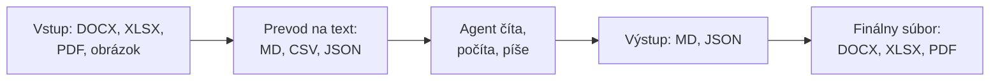
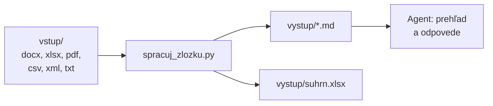

# Formáty súborov v agentickej práci

*Verzia 1.0 · stav k novembru 2026. Nástroje sa menia rýchlo; pred  
nasadením si overte aktuálnu dokumentáciu.*  

## 1. Prečo na formáte záleží

Agent pracuje s textom. Prompt je text, odpoveď je text a väčšina nástrojov,  
ktoré agent volá, vracia text. Firemné dáta však často prichádzajú ako zmluva  
vo Worde, tabuľka v Exceli alebo naskenovaná faktúra v PDF. Kým s nimi agent  
môže pracovať, musí sa z nich dostať text v čitateľnej podobe.  

Formát súboru preto rozhoduje o tom, či agent súbor prečíta priamo, či  
potrebuje nástroj na prevod a koľko informácií sa pri prevode stratí. Ovplyvní  
aj spotrebu tokenov (častí textu, za ktoré sa pri modeli platí) a to, či sa dá  
zmena v súbore bezpečne skontrolovať.  

> **Jednoducho povedané:** formát je obal. Niektoré obaly sú priehľadné  
> a obsah vidno hneď (TXT, Markdown, JSON). Iné treba najprv rozbaliť (DOCX,  
> XLSX) a pri niektorých ide skôr o fotografiu obsahu než o obsah samotný  
> (PDF, sken).  

Typický tok dokumentov v agentickej práci vyzerá takto:  



Pravidlo, ktoré sa v kapitole bude opakovať: agent má pracovať v textových  
formátoch a do binárneho formátu sa výsledok prevedie až na konci.  

V kapitole sa dozviete:  

- ako sa líšia textové a binárne súbory,  
- čo je ktorý formát, na čo sa používa a ako s ním pracuje agent,  
- ako vyzerá DOCX, XLSX a PDF zvnútra,  
- ako prevádzať súbory z jedného formátu do druhého,  
- ako pripraviť zložku zmiešaných dokumentov pre agenta.  

O formátoch JSON a XML sú v kurze samostatné kapitoly `json.md`  
a `xml-zaklady.md`. Tu ich opisujeme len v súvislosti s ostatnými formátmi.  

## 2. Ako sa formáty líšia

### Textové a binárne súbory

**Textový súbor** obsahuje len znaky, ktoré sa dajú zobraziť, a konce  
riadkov. Otvoríte ho v ľubovoľnom editore a prečítate ho. Patria sem TXT,  
Markdown, CSV, JSON, YAML, XML aj HTML.  

**Binárny súbor** obsahuje bajty, ktoré nie sú určené na priame čítanie.  
Môžu to byť komprimované dáta, písma, obrázky alebo čísla v strojovom tvare.  
Patria sem DOCX, XLSX, PPTX, PDF, PNG a JPG. Otvorenie v textovom editore  
ukáže len nečitateľné znaky.  

Rozdiel je pre agenta zásadný. Textový súbor prečíta jedným nástrojom  
a upraví ho nahradením časti textu. Binárny súbor musí najprv previesť alebo  
na neho použiť knižnicu, ktorá formátu rozumie.  

| Vlastnosť | Textový súbor | Binárny súbor |  
|---|---|---|  
| Čítanie v editore | áno | nie |  
| Agent ho číta | priamo | cez knižnicu, nástroj, skill |  
| Porovnanie zmien v gite | riadok po riadku | len „súbor sa zmenil“ |  
| Riziko pri úprave | nízke | poškodenie štruktúry |  
| Príklady | MD, CSV, JSON, XML | DOCX, XLSX, PDF, PNG |  

### Kódovanie a konce riadkov

Aj textový súbor je v počítači uložený ako bajty. **Kódovanie** určuje,  
ktorý bajt alebo skupina bajtov znamená ktorý znak. Dnešný štandard je  
**UTF-8**, ktoré zvládne diakritiku aj znaky všetkých jazykov.  

Staršie slovenské súbory, najmä exporty z Excelu a účtovných programov, bývajú  
v kódovaní **Windows-1250**. Ak ich program číta ako UTF-8, namiesto  
„Školenie“ sa zobrazí chyba alebo nezmyselné znaky. Niektoré programy pridávajú  
na začiatok súboru neviditeľnú značku **BOM** (byte order mark), podľa ktorej  
Excel spozná UTF-8.  

Konce riadkov sa líšia podľa systému: Linux a macOS používajú znak LF,  
Windows dvojicu CR LF. Väčšina nástrojov si s tým poradí, ale v skriptoch  
a pri porovnávaní súborov to môže spôsobiť nečakané rozdiely.  

> **Pozor:** Claude Code odmietne upraviť súbor, ktorý nie je v UTF-8  
> (výnimkou je UTF-16 so značkou BOM). Súbor vo Windows-1250 najprv preveďte,  
> napríklad príkazom `iconv -f cp1250 -t utf-8 stary.csv > novy.csv`.  

### Presná a voľná štruktúra

Niektoré formáty majú **presnú štruktúru**: JSON, XML, YAML alebo CSV. Program  
v nich vie nájsť konkrétnu hodnotu, napríklad cenu tretej položky. Ich obsah sa  
dá overiť automaticky.  

Iné formáty majú **voľnú štruktúru**: TXT, Markdown, DOCX alebo PDF. Obsahujú  
text pre človeka a štruktúru tvoria nadpisy, odseky a tabuľky. Na to, aby  
z nich agent vytiahol údaje, potrebuje model.  

> **Tip:** keď má agent z dokumentu vytiahnuť údaje, nechajte ho zapísať ich  
> do JSON alebo CSV. Výsledok potom môže skontrolovať program, nielen človek.  

### Prípona nie je formát

Prípona `.pdf` je len časť názvu. Skutočný formát určuje obsah súboru.  
Binárne formáty sa zvyčajne začínajú niekoľkými charakteristickými bajtmi,  
takzvaným **podpisom** (magic bytes). PDF sa začína textom `%PDF-`, ZIP  
archív bajtmi `PK` a obrázok PNG bajtom `0x89` a textom `PNG`. Príklad 6.1  
ukazuje, ako formát rozpoznať podľa obsahu.  

### Hexeditor: pohľad na jednotlivé bajty

Textový editor ukazuje bajty už prevedené na znaky. Ak súbor nie je text,  
zobrazí nezmysly. **Hexeditor** ukazuje súbor tak, ako je naozaj uložený:  
bajt po bajte, bez akéhokoľvek prevodu. Otvoríte v ňom akýkoľvek súbor, aj  
binárny.  

Každý bajt má hodnotu od 0 do 255. V hexeditore sa zapisuje  
v **šestnástkovej (hexadecimálnej) sústave** dvoma znakmi od `00` po `FF`.  
Odtiaľ pochádza aj názov nástroja. Napríklad písmeno `P` má hodnotu 80, čo je  
šestnástkovo `50`.  

Hexeditor zobrazuje súbor v troch stĺpcoch:  

```text
00000000: 2550 4446 2d31 2e34 0a31 2030 206f 626a  %PDF-1.4.1 0 obj
└ posun ┘ └──────── bajty šestnástkovo ─────────┘  └── ako text ───┘
```

| Stĺpec | Význam |  
|---|---|  
| posun (offset) | poradie prvého bajtu v riadku od začiatku súboru |  
| bajty | hodnoty bajtov, zvyčajne 16 v jednom riadku |  
| text | tie isté bajty ako znaky; nezobraziteľné sú bodky |  

Na čo sa hexeditor hodí:  

- zistiť skutočný formát súboru podľa podpisu na začiatku,  
- zistiť kódovanie textu, napríklad či ide o UTF-8 alebo Windows-1250,  
- nájsť neviditeľné znaky: BOM, konce riadkov CR LF, tabulátory,  
  nezlomiteľné medzery,  
- skontrolovať, či sa súbor nepoškodil, napríklad či nie je prázdny alebo  
  orezaný,  
- porovnať dva súbory, ktoré vyzerajú rovnako, ale programy ich čítajú inak.  

> **Jednoducho povedané:** textový editor je prekladateľ, ktorý vám bajty  
> prerozpráva ako text. Hexeditor vám ukáže pôvodný zápis bez prekladu.  

> **Pozor:** hexeditor vie súbor aj upravovať. Stačí jeden zmenený alebo  
> vymazaný bajt a DOCX, XLSX či PDF sa už nemusí dať otvoriť. Na prezeranie  
> ho používajte bez obáv, upravujte len kópie.  

V kurze používame rozšírenie **Hex Editor** od Microsoftu pre VS Code.  
Inštalácia je v časti 5, praktické ukážky v časti 6.6.  

## 3. Prehľad formátov

Pri každom formáte uvádzame, čo to je, na čo sa používa a ako s ním pracuje  
agent.  

### 3.1 Textové formáty

Agent ich číta priamo, bez ďalších nástrojov. Zmeny v nich sa dajú porovnať  
v gite.  

#### TXT – čistý text

- *Čo to je:* text bez formátovania, len znaky a konce riadkov.  
- *Použitie:* logy, poznámky, jednoduché exporty z rôznych systémov.  
- *Agent:* číta ho priamo. Problémom býva kódovanie, ak starší súbor nie je  
  v UTF-8.  

#### MD – Markdown

- *Čo to je:* text s jednoduchými značkami, napríklad `#` pre nadpis, `-` pre  
  zoznam a `**tučné**` pre zvýraznenie. Čitateľný je aj bez prevodu.  
- *Použitie:* dokumentácia, súbory README, CLAUDE.md a AGENTS.md, skills,  
  poznámky a kapitoly tohto kurzu.  
- *Agent:* pre jazykové modely je to prirodzený formát. Väčšinou v ňom aj  
  odpovedajú. Je dobrou medzistanicou pri prevode z DOCX alebo HTML.  

Markdown má viac variantov. Najrozšírenejší je **CommonMark** a jeho rozšírenie  
**GitHub Flavored Markdown** (GFM), ktoré pridáva tabuľky a zoznamy úloh.  

#### CSV – hodnoty oddelené čiarkou

- *Čo to je:* tabuľka zapísaná ako text. Každý riadok je jeden záznam a stĺpce  
  sú oddelené čiarkou alebo bodkočiarkou.  
- *Použitie:* exporty z bánk, e-shopov a účtovníctva, výmena dát medzi  
  systémami.  
- *Agent:* číta ho priamo, ale musí poznať oddeľovač a kódovanie.  

Slovenský Excel ukladá CSV s **bodkočiarkou**, pretože čiarka slúži ako  
desatinný oddeľovač. CSV navyše nepozná dátové typy. Hodnoty `90,50` aj  
`1.6.2026` sú v ňom len text, z ktorého treba číslo a dátum vyrobiť.  

```text
Kód;Názov;Cena bez DPH;Platí od
A01;Školenie AI – základy;450,00;1.1.2026
```

#### JSON – JavaScript Object Notation

- *Čo to je:* štruktúrované dáta: dvojice kľúč – hodnota, zoznamy a vnorené  
  objekty.  
- *Použitie:* API, konfigurácia (`settings.json`, `.mcp.json`), štruktúrovaný  
  výstup modelu, definície nástrojov pre agentov.  
- *Agent:* číta ho priamo a vie ho aj spoľahlivo vytvárať. Výstup treba overiť,  
  či je platný. Podrobnosti sú v kapitole `json.md`.  

#### JSONL – JSON Lines

- *Čo to je:* súbor, v ktorom je na každom riadku jeden samostatný JSON  
  objekt.  
- *Použitie:* záznamy relácií Claude Code, vstupy a výsledky dávkových API,  
  logy a tréningové dáta.  
- *Agent:* súbor sa dá spracúvať riadok po riadku, takže nemusí byť celý  
  v pamäti. Vhodné sú nástroje `jq`, `grep` alebo krátky skript.  

```json
{"cas": "2026-11-02T09:15:04", "typ": "nastroj", "nazov": "Read"}
{"cas": "2026-11-02T09:15:09", "typ": "nastroj", "nazov": "Write"}
```

Celý súbor JSONL nie je platný JSON. Každý riadok však platný JSON je.  

#### YAML

- *Čo to je:* zápis štruktúrovaných dát, v ktorom štruktúru určuje odsadenie,  
  nie zátvorky.  
- *Použitie:* hlavička (frontmatter) v súboroch SKILL.md a v pamäťových  
  súboroch agentov, GitHub Actions, Docker Compose.  
- *Agent:* ľahko sa číta, ale ľahko sa v ňom aj chybuje. Tabulátor na  
  odsadenie nie je povolený a nesprávne odsadenie zmení význam.  

```yaml
name: suhrn-faktur
description: Zhrnie faktúry v PDF do tabuľky.
allowed-tools: Read, Write
```

#### TOML

- *Čo to je:* konfiguračný formát s oddielmi v hranatých zátvorkách  
  a riadkami `kluc = hodnota`.  
- *Použitie:* `pyproject.toml` v Pythone, konfigurácia niektorých nástrojov  
  a agentov pre príkazový riadok.  
- *Agent:* číta ho priamo. Patrí k najmenej problémovým formátom.  

#### .env – premenné prostredia

- *Čo to je:* riadky v tvare `NAZOV=hodnota`. Nemá oficiálnu špecifikáciu.  
- *Použitie:* API kľúče, heslá a nastavenia, ktoré sa líšia podľa prostredia.  
- *Agent:* tento súbor by nemal čítať ani posielať modelu. Patrí do  
  `.gitignore` a prístup k nemu sa má v nastaveniach agenta zakázať.  

#### XML – Extensible Markup Language

- *Čo to je:* dáta v značkách `<prvok>`, s atribútmi a mennými priestormi.  
  Pravidlá štruktúry môže určovať schéma XSD.  
- *Použitie:* elektronické faktúry, podania štátnej správe, vnútro súborov  
  DOCX a XLSX, XML tagy v promptoch.  
- *Agent:* číta ho priamo, ale značky spotrebujú veľa tokenov. Podrobnosti  
  sú v kapitole `xml-zaklady.md`.  

#### HTML – HyperText Markup Language

- *Čo to je:* značkovací jazyk webových stránok.  
- *Použitie:* web, e-mailové šablóny, reporty a artefakty.  
- *Agent:* pred spracovaním ho zvyčajne prevedie na Markdown. Okrem obsahu  
  obsahuje stránka navigáciu, skripty a štýly, ktoré len míňajú tokeny.  

### 3.2 Kancelárske formáty

Ide o binárne súbory. Agent na ne potrebuje knižnicu, nástroj alebo skill.  

#### DOCX – dokument Word

- *Čo to je:* formát **Office Open XML** (OOXML), štandard ECMA-376  
  a ISO/IEC 29500. Súbor je ZIP archív, v ktorom je text dokumentu v súbore  
  `word/document.xml` a štýly, obrázky a nastavenia v ďalších súboroch.  
- *Použitie:* zmluvy, ponuky, úradné listy, šablóny.  
- *Agent:* na čítanie stačí prevod na Markdown, napríklad nástrojom `pandoc`.  
  Úprava je náročnejšia, lebo jednoduchý prevod stratí štýly, sledované zmeny  
  a komentáre.  

DOCX je pomerne nový formát. Do roku 2007 Word ukladal dokumenty v binárnom  
formáte **DOC**, ktorého popis Microsoft nezverejňoval. Ostatné programy ho  
preto čítali len odhadom. Tlak na otvorený formát prichádzal najmä z verejnej  
správy, ktorá nechcela mať archívy závislé od jedného dodávateľa.  

| Rok | Udalosť |  
|---|---|  
| 2004 | program EÚ IDABC odporučil štandardizovať XML formáty Office |  
| 2005 | OASIS schválila konkurenčný otvorený formát ODF |  
| 2005 | Microsoft predložil formát na štandardizáciu do Ecma International |  
| 2006 | Ecma schválila štandard ECMA-376, ODF sa stal normou ISO/IEC 26300 |  
| 2007 | Office 2007 ukladá štandardne do DOCX, XLSX a PPTX |  
| 2008 | OOXML sa stal normou ISO/IEC 29500 po sporom hlasovaní |  

Presnejšie teda nejde o formát, ktorý by EÚ Microsoftu nariadila zákonom.  
Odporúčanie EÚ z roku 2004 a požiadavky štátov na otvorené formáty však  
k jeho zverejneniu a štandardizácii výrazne prispeli. Pre agenta z toho  
vyplýva praktická výhoda: vnútro DOCX je zdokumentované XML, ktoré sa dá  
prečítať aj bez Wordu.  

#### XLSX – zošit Excel

- *Čo to je:* tiež Office Open XML a ZIP archív. Každý hárok je samostatný XML  
  súbor a texty buniek sú v spoločnej tabuľke reťazcov.  
- *Použitie:* financie, reporty, evidencie, plány, kalkulácie.  
- *Agent:* pracuje s ním cez knižnice `openpyxl` alebo `pandas`, prípadne cez  
  skill.  

Najčastejšia pasca je rozdiel medzi **vzorcom** a **hodnotou**. V bunke je  
uložený vzorec `=B2*C2` a vedľa neho posledná vypočítaná hodnota. Tú však  
uloží len program, ktorý vzorce počíta, napríklad Excel alebo LibreOffice  
Calc. Ak súbor vytvoril skript, vypočítané hodnoty v ňom chýbajú (príklad  
6.4).  

#### XLSX a Google Sheets

Google Sheets (Tabuľky Google) vyzerá podobne ako Excel, ale z pohľadu agenta  
je to úplne iný svet. XLSX je **súbor**, Google Sheets je **služba**.  

| Vlastnosť | XLSX | Google Sheets |  
|---|---|---|  
| Kde je | súbor na disku alebo v prílohe | dokument na serveroch Google |  
| Agent pristupuje | čítaním súboru | cez API alebo MCP konektor |  
| Prihlásenie | netreba | účet Google, OAuth |  
| Spolupráca | posielanie kópií | viac ľudí naraz v reálnom čase |  
| História zmien | len ak ju vediete sami | automatická história verzií |  
| Makrá | VBA (XLSM) | Apps Script |  
| Veľkosť | 1 048 576 riadkov na hárok | 20 miliónov buniek na zošit |  
| Vlastné funkcie | napr. `XLOOKUP`, Power Query | napr. `QUERY`, `IMPORTRANGE` |  
| Funguje bez internetu | áno | len obmedzene |  

Pre agenta z toho vyplývajú dva rozdielne postupy:  

- **XLSX:** agent súbor prečíta, upraví kópiu a uloží nový súbor. Zmena sa  
  nikoho nedotkne, kým súbor neodošlete,  
- **Google Sheets:** agent zapisuje priamo do živého dokumentu, ktorý môžu mať  
  otvorený aj kolegovia. Zmena platí okamžite.  

> **Pozor:** pri Google Sheets dávajte agentovi len oprávnenie, ktoré  
> potrebuje. Na analýzu stačí čítanie, prípadne export do XLSX alebo CSV.  
> Zápis povoľte len do konkrétneho dokumentu a radšej po schválení.  

Google Sheets vie zošit exportovať do XLSX, ODS, CSV aj PDF. Pri prevode  
z Excelu sa však nie všetko prenesie: makrá VBA nefungujú a niektoré funkcie  
sa správajú inak.  

#### PPTX – prezentácia PowerPoint

- *Čo to je:* Office Open XML, každá snímka je samostatný XML súbor  
  (`ppt/slides/slide1.xml` a ďalšie).  
- *Použitie:* prezentácie, školiace materiály.  
- *Agent:* text a poznámky prečíta knižnicou `python-pptx` alebo skillom.  
  Rozloženie snímky však z textu nespozná. Na kontrolu vzhľadu potrebuje  
  snímku vidieť ako obrázok.  

#### ODT, ODS – OpenDocument

- *Čo to je:* otvorený formát kancelárskych dokumentov (**ODF**, norma  
  ISO/IEC 26300). Je to tiež ZIP archív s XML súbormi.  
- *Použitie:* LibreOffice, inštitúcie, ktoré nechcú závisieť od jedného  
  dodávateľa. Slovenská vyhláška č. 78/2020 Z. z. o štandardoch pre  
  informačné technológie verejnej správy uvádza ODF aj OOXML (aktuálne  
  znenie si overte na slov-lex.sk).  
- *Agent:* `pandoc` vie čítať ODT. ODS je jednoduchšie previesť najprv na  
  XLSX alebo CSV, napríklad pomocou LibreOffice.  

#### PDF – Portable Document Format

- *Čo to je:* formát na verné zobrazenie a tlač dokumentu. Vytvorila ho  
  firma Adobe v roku 1993, dnes je to norma ISO 32000. Pre dlhodobú archiváciu  
  slúži variant **PDF/A**.  
- *Použitie:* hotové dokumenty, faktúry, výpisy, zmluvy na podpis, skeny.  
- *Agent:* textové PDF prečíta, z naskenovaného PDF musí text získať  
  rozpoznávaním (OCR) alebo ako z obrázka. Tabuľky sa pri prevode na text  
  často rozpadnú. Na úpravy PDF vhodné nie je.  

PDF je **binárny formát**. Kostru súboru tvoria síce čitateľné kľúčové slová,  
ale obsah strán, písma a obrázky sú takmer vždy komprimované. Dôležitejšie  
však je, čo v ňom je. PDF neobsahuje odseky, vety ani tabuľky. Obsahuje  
**matematický popis vzhľadu strany**:  

- na súradniciach 72, 720 nakresli tieto znaky písmom veľkosti 24,  
- nakresli čiaru z bodu 72, 700 do bodu 540, 700,  
- nakresli krivku z bodu 72, 560 s riadiacimi bodmi … do bodu 400, 560.  

Krivky sú **Bézierove krivky**, teda krivky dané rovnicou (polynómom tretieho  
stupňa) a niekoľkými bodmi. Rovnakými krivkami sú opísané aj tvary písmen  
v písmach. Preto sa PDF dá zväčšiť bez straty kvality: prehliadač pri každom  
zväčšení stranu prepočíta z rovníc znova.  

Pre agenta z toho vyplýva hlavný problém. Prehliadač vidí na strane tabuľku,  
lebo čiary a texty ležia pod sebou. V súbore však žiadna tabuľka nie je, sú  
tam len texty na súradniciach. Program, ktorý text z PDF vyťahuje, musí  
poradie slov, riadky a stĺpce odhadnúť. Ako to vyzerá zvnútra, ukazuje  
príklad 6.3.  

> **Jednoducho povedané:** DOCX je recept („nadpis, odsek, tabuľka s tromi  
> stĺpcami“). PDF je presný nákres hotového jedla, z ktorého recept musíte  
> spätne odhadnúť.  

### 3.3 Obrázky

#### PNG

- *Čo to je:* obrázok s bezstratovou kompresiou, podporuje priehľadnosť.  
- *Použitie:* snímky obrazovky, diagramy, grafy.  
- *Agent:* model ho číta ako obrázok (schopnosť **vision**). Je vhodný na  
  kontrolu vzhľadu webu alebo chybového hlásenia.  

#### JPG

- *Čo to je:* obrázok so stratovou kompresiou, určený najmä pre fotografie.  
- *Použitie:* fotografie dokladov, skeny z mobilu.  
- *Agent:* číta ho ako obrázok. Metadáta **EXIF** môžu obsahovať polohu GPS  
  a typ zariadenia, preto ich pred zdieľaním odstráňte.  

#### SVG – vektorový obrázok

- *Čo to je:* obrázok zapísaný ako XML, teda tvary a krivky namiesto pixelov.  
- *Použitie:* ikony, logá, diagramy.  
- *Agent:* číta ho a upravuje ako text. Môže však obsahovať skripty, preto je  
  SVG z neznámych zdrojov rizikové.  

### 3.4 Ostatné formáty

#### EML – e-mail

- *Čo to je:* e-mailová správa s hlavičkami (norma RFC 5322). Prílohy sú  
  zakódované podľa štandardu MIME.  
- *Použitie:* archív pošty, vstup pre agentov, ktorí spracúvajú e-maily.  
- *Agent:* v Pythone ho prečíta štandardný modul `email`. Prílohy treba  
  spracovať zvlášť podľa ich formátu.  

#### ZIP – archív

- *Čo to je:* viac súborov zabalených a komprimovaných do jedného.  
- *Použitie:* posielanie viacerých súborov naraz. ZIP je aj vnútri DOCX,  
  XLSX, PPTX, ODT a ODS.  
- *Agent:* najprv ho rozbalí, potom spracuje jednotlivé súbory.  

> **Pozor:** archív z neznámeho zdroja rozbaľujte do prázdneho priečinka.  
> Môže obsahovať takzvanú **zip bombu** (malý archív, ktorý sa rozbalí na  
> obrovské množstvo dát) alebo súbory s cestou typu `../../`, ktoré sa  
> pokúsia zapísať mimo cieľového priečinka.  

## 4. Kde sa ktorý formát používa

| Formát | Typ | Kde sa najčastejšie používa | Agent ho číta |  
|---|---|---|---|  
| TXT | text | logy, poznámky | priamo |  
| MD | text | dokumentácia, prompty, skills | priamo |  
| CSV | text | exporty, výmena dát | priamo |  
| JSON | text | API, konfigurácia | priamo |  
| JSONL | text | záznamy relácií, dávky, logy | priamo, po riadkoch |  
| YAML | text | frontmatter, CI/CD | priamo |  
| TOML | text | konfigurácia Pythonu | priamo |  
| .env | text | tajné kľúče | nemá čítať |  
| XML | text | e-faktúry, štátna správa | priamo, veľa tokenov |  
| HTML | text | web, reporty | po prevode na MD |  
| DOCX | binárny | zmluvy, listy | pandoc, skill |  
| XLSX | binárny | financie, reporty | openpyxl, skill |  
| Sheets | služba | spoločné tabuľky | API, MCP konektor |  
| PPTX | binárny | prezentácie | python-pptx, skill |  
| ODT/ODS | binárny | LibreOffice, úrady | pandoc, prevod |  
| PDF | binárny | hotové dokumenty, skeny | priamo alebo OCR |  
| PNG/JPG | binárny | snímky obrazovky, fotky | ako obrázok |  
| SVG | text | ikony, diagramy | priamo ako XML |  
| EML | text | e-maily | modul `email` |  
| ZIP | binárny | archívy | po rozbalení |  

Formát má zmysel vyberať aj podľa toho, čo s dátami agent robí:  

| Úloha | Vstup pre agenta | Výstup od agenta |  
|---|---|---|  
| zhrnutie zmluvy | DOCX prevedený na MD | MD |  
| vytiahnutie údajov z faktúr | PDF | JSON, potom XLSX |  
| analýza predajov | XLSX prevedený na CSV | CSV, graf PNG |  
| úprava konfigurácie | JSON, YAML, TOML | ten istý formát |  
| kontrola vzhľadu stránky | snímka PNG | zoznam chýb v MD |  
| podklad pre klienta | MD | DOCX alebo PDF |  

Na veľkosti tiež záleží. Tá istá tabuľka so štyrmi riadkami z príkladu 6.4  
zaberá v rôznych formátoch toľkoto bajtov:  

| Formát | Veľkosť |  
|---|---|  
| CSV | 110 B |  
| Markdown tabuľka | 205 B |  
| JSON s odsadením | 358 B |  
| XML hárka vo vnútri XLSX | 3 014 B |  
| celý súbor XLSX | 5 291 B |  

Pri malej tabuľke to nevadí. Pri tisícoch riadkov je však rozdiel medzi CSV  
a XML veľký a premietne sa do ceny aj do toho, koľko sa zmestí do kontextu  
modelu.  

## 5. Príprava prostredia

Skripty v Pythone spúšťame nástrojom **uv**, ktorý si potrebné knižnice  
stiahne sám podľa hlavičky skriptu. Skripty bez hlavičky stačí spustiť  
príkazom `python`. Okrem toho budete potrebovať programy na prevody  
a hexeditor:  

| Program | Na čo slúži |  
|---|---|  
| uv | spúšťanie skriptov v Pythone s knižnicami |  
| pandoc | prevody medzi MD, DOCX, HTML, ODT a ďalšími |  
| LibreOffice | prevody kancelárskych formátov, výpočet vzorcov |  
| poppler-utils | `pdftotext` a `pdftoppm` na prácu s PDF |  
| VS Code + Hex Editor | prezeranie súborov bajt po bajte |  

Inštalácia:  

| Systém | Príkaz |  
|---|---|  
| Ubuntu, Debian | `sudo apt install pandoc libreoffice poppler-utils` |  
| macOS | `brew install pandoc poppler` a `brew install --cask libreoffice` |  
| Windows | `winget install --source winget --exact --id JohnMacFarlane.Pandoc` |  

Na Windows nainštalujte LibreOffice z libreoffice.org. Balík poppler nemá  
oficiálny inštalátor; ak `pdftotext` nemáte, príklady s ním vynechajte.  

> **Tip:** verzia pandocu v balíkoch Ubuntu býva staršia. Ak niektorý prevod  
> nefunguje podľa očakávania, stiahnite si aktuálnu verziu z pandoc.org.  

Overenie inštalácie:  

```bash
uv --version
pandoc --version
soffice --version
pdftotext -v
```

Program LibreOffice sa z príkazového riadku volá ako `soffice`. Na Windows  
je v priečinku `program` v mieste inštalácie LibreOffice. Ak `soffice` nie je  
v ceste `PATH`, volajte ho celou cestou.  

Rozšírenie Hex Editor (identifikátor `ms-vscode.hexeditor`) nainštalujete  
v paneli Extensions vo VS Code alebo z príkazového riadku:  

```bash
code --install-extension ms-vscode.hexeditor
code --list-extensions | grep hexeditor
```

Na Windows v PowerShell použite namiesto `grep` príkaz `findstr hexeditor`.  

Použité knižnice Pythonu:  

| Knižnica | Na čo slúži |  
|---|---|  
| openpyxl | čítanie a zápis XLSX |  
| python-docx | čítanie a zápis DOCX |  
| pypdf | čítanie PDF |  
| pyyaml | čítanie YAML |  
| csv, json, zipfile, xml | štandardná knižnica Pythonu |  

## 6. Príklady

### 6.1 Rozpoznanie formátu podľa obsahu

Skript prečíta začiatok súboru a porovná ho so známymi podpismi. Pri ZIP  
archíve sa pozrie dovnútra, lebo podľa súborov v archíve sa pozná DOCX, XLSX  
aj PPTX. Pri texte skúsi, či ide o platné UTF-8.  

```python
# Rozpoznanie formátu podľa obsahu súboru, nie podľa prípony
import sys
import zipfile
from pathlib import Path

# Prvé bajty, ktorými sa začínajú známe binárne formáty
PODPISY = [
    (b"%PDF-", "PDF"),
    (b"\x89PNG\r\n\x1a\n", "PNG"),
    (b"\xff\xd8\xff", "JPG"),
    (b"PK\x03\x04", "ZIP"),
]

# Podľa súboru vo vnútri ZIP archívu sa pozná kancelársky formát
VNUTRO_ZIPU = [
    ("word/document.xml", "DOCX"),
    ("xl/workbook.xml", "XLSX"),
    ("ppt/presentation.xml", "PPTX"),
]


def druh_zipu(cesta):
    with zipfile.ZipFile(cesta) as archiv:
        mena = archiv.namelist()
        if "mimetype" in mena:
            return "OpenDocument (" + archiv.read("mimetype").decode() + ")"
    for meno, druh in VNUTRO_ZIPU:
        if meno in mena:
            return druh + " (ZIP s XML súbormi)"
    return "ZIP archív"


def druh_textu(data):
    if b"\x00" in data:
        return "neznámy binárny súbor"
    if data.startswith(b"\xef\xbb\xbf"):
        return "text v UTF-8 s BOM"
    try:
        data.decode("utf-8")
    except UnicodeDecodeError:
        return "text, ale nie v UTF-8 (napríklad Windows-1250)"
    return "text v UTF-8"


def rozpoznaj(cesta):
    data = cesta.read_bytes()
    for podpis, druh in PODPISY:
        if data.startswith(podpis):
            return druh_zipu(cesta) if druh == "ZIP" else druh
    return druh_textu(data)


for meno in sys.argv[1:]:
    cesta = Path(meno)
    print(f"{cesta.name:22} {rozpoznaj(cesta)}")
```

Skript spustite so súbormi z ďalších príkladov (najprv ich vytvorte podľa  
častí 6.2 až 6.5):  

```bash
python rozpoznaj.py ponuka.docx objednavky.xlsx objednavky.ods rucne.pdf \
  objednavky.csv cennik.csv udalosti.jsonl
```

```text
ponuka.docx            DOCX (ZIP s XML súbormi)
objednavky.xlsx        XLSX (ZIP s XML súbormi)
objednavky.ods         OpenDocument (application/vnd.oasis.opendocument.spreadsheet)
rucne.pdf              PDF
objednavky.csv         text v UTF-8 s BOM
cennik.csv             text, ale nie v UTF-8 (napríklad Windows-1250)
udalosti.jsonl         text v UTF-8
```

Na Linuxe a macOS robí podobnú prácu príkaz `file`, napríklad  
`file ponuka.docx`.  

### Vyskúšajte

- Skopírujte `ponuka.docx` ako `faktura.pdf` a spustite skript. Čo ukáže?  
- Pridajte do zoznamu `PODPISY` formát GIF, ktorý sa začína textom `GIF8`.  
- Zistite, aký podpis má súbor `.doc` zo starého Wordu a doplňte ho.  

### 6.2 Vnútro súboru DOCX

Najprv vytvoríme dokument s nadpisom, odsekom a tabuľkou.  

```python
# /// script
# requires-python = ">=3.10"
# dependencies = ["python-docx>=1.2"]
# ///
# Vytvorenie jednoduchého dokumentu Word s nadpisom, textom a tabuľkou
from docx import Document

dokument = Document()
dokument.add_heading("Cenová ponuka č. 42", level=1)

odsek = dokument.add_paragraph("Ponuku pripravila firma ")
odsek.add_run("Alfa s.r.o.").bold = True
odsek.add_run(" a platí 30 dní.")

polozky = [("Školenie AI", "2", "450,00"), ("Konzultácia", "3", "90,00")]
tabulka = dokument.add_table(rows=1, cols=3)
tabulka.style = "Table Grid"
for bunka, text in zip(tabulka.rows[0].cells, ["Položka", "Počet", "Cena"]):
    bunka.text = text
for polozka in polozky:
    riadok = tabulka.add_row()
    for bunka, text in zip(riadok.cells, polozka):
        bunka.text = text

dokument.save("ponuka.docx")
print("Uložené: ponuka.docx")
```

```bash
uv run vytvor_docx.py
unzip -l ponuka.docx
```

```text
Archive:  ponuka.docx
  Length      Date    Time    Name
---------  ---------- -----   ----
     1738  2026-11-02 16:46   [Content_Types].xml
      734  2026-11-02 16:46   _rels/.rels
      721  2026-11-02 16:46   docProps/core.xml
     1132  2026-11-02 16:46   docProps/app.xml
     3092  2026-11-02 16:46   word/document.xml
     ...
   349458  2026-11-02 16:46   word/styles.xml
```

Samotný text dokumentu má len 3 kB. Štýly zaberajú stovky kilobajtov. Druhý  
skript archív otvorí štandardným modulom `zipfile` a text vytiahne priamo  
z XML, bez knižnice python-docx.  

```python
# Pohľad do vnútra DOCX: ZIP archív, XML a text bez knižnice python-docx
import sys
import xml.etree.ElementTree as ET
import zipfile

W = "{http://schemas.openxmlformats.org/wordprocessingml/2006/main}"
subor = sys.argv[1] if len(sys.argv) > 1 else "ponuka.docx"

with zipfile.ZipFile(subor) as archiv:
    print("Súbory v archíve:")
    for meno in archiv.namelist():
        print("  " + meno)
    xml = archiv.read("word/document.xml")

print(f"\nword/document.xml má {len(xml)} bajtov. Text v ňom:")
koren = ET.fromstring(xml)
for odsek in koren.iter(W + "p"):
    text = "".join(t.text or "" for t in odsek.iter(W + "t"))
    if text:
        print("  " + text)
```

```bash
python ukaz_vnutro.py
```

```text
word/document.xml má 3092 bajtov. Text v ňom:
  Cenová ponuka č. 42
  Ponuku pripravila firma Alfa s.r.o. a platí 30 dní.
  Položka
  Počet
  Cena
  Školenie AI
  ...
```

Text sa vo Worde ukladá do prvkov `<w:t>` vnútri odsekov `<w:p>`. Jeden  
odsek môže byť rozdelený na viac častí (`<w:r>`, run), napríklad keď je časť  
vety tučná. Preto skript spája všetky `<w:t>` v odseku.  

> **Pozor:** priama úprava `document.xml` je možná, ale ľahko poškodí  
> dokument. Ak sa slovo, ktoré hľadáte, delí medzi dve časti, obyčajné  
> nahradenie textu ho nenájde.  

### Vyskúšajte

- Otvorte `ponuka.docx` vo Worde alebo LibreOffice, zmeňte jedno slovo,  
  uložte a znova spustite `ukaz_vnutro.py`.  
- Rozbaľte dokument príkazom `unzip ponuka.docx -d rozbalene` a pozrite si  
  súbor `docProps/core.xml`. Aké metadáta obsahuje?  
- Upravte skript tak, aby vypísal aj počet tabuliek (prvok `<w:tbl>`).  

### 6.3 PDF zvnútra

Aby bolo vidieť, z čoho sa PDF skladá, zostavíme jednoduché PDF ručne, bez  
knižnice. Strana obsahuje nadpis, čiaru a Bézierovu krivku.  

```python
# Ručne zostavené PDF: strana je zoznam príkazov na kreslenie so súradnicami
from pathlib import Path

# Obsah strany. Súradnice sú v bodoch (1/72 palca) od ľavého dolného rohu.
kreslenie = b"""BT
/F1 24 Tf
72 720 Td
(Ponuka c. 42) Tj
ET
72 700 m
540 700 l
S
72 560 m
150 680 300 440 400 560 c
S
"""

objekty = [
    b"<< /Type /Catalog /Pages 2 0 R >>",
    b"<< /Type /Pages /Kids [3 0 R] /Count 1 >>",
    b"<< /Type /Page /Parent 2 0 R /MediaBox [0 0 612 792]"
    b" /Resources << /Font << /F1 4 0 R >> >> /Contents 5 0 R >>",
    b"<< /Type /Font /Subtype /Type1 /BaseFont /Helvetica >>",
    b"<< /Length %d >>\nstream\n" % len(kreslenie) + kreslenie + b"endstream",
]

pdf = bytearray(b"%PDF-1.4\n")
pozicie = []
for cislo, objekt in enumerate(objekty, start=1):
    pozicie.append(len(pdf))
    pdf += b"%d 0 obj\n" % cislo + objekt + b"\nendobj\n"

# Tabuľka xref: kde v súbore (na ktorom bajte) začína každý objekt
zaciatok_xref = len(pdf)
pdf += b"xref\n0 %d\n0000000000 65535 f \n" % (len(objekty) + 1)
for pozicia in pozicie:
    pdf += b"%010d 00000 n \n" % pozicia
pdf += b"trailer\n<< /Size %d /Root 1 0 R >>\n" % (len(objekty) + 1)
pdf += b"startxref\n%d\n%%%%EOF\n" % zaciatok_xref

Path("rucne.pdf").write_bytes(pdf)
print(f"Uložené: rucne.pdf ({len(pdf)} bajtov)")
```

Príkazy na kreslenie v premennej `kreslenie`:  

| Príkaz | Význam |  
|---|---|  
| `BT` … `ET` | začiatok a koniec textu |  
| `/F1 24 Tf` | písmo F1 vo veľkosti 24 bodov |  
| `72 720 Td` | presun na súradnice x = 72, y = 720 |  
| `(Ponuka c. 42) Tj` | vykresli tieto znaky |  
| `72 700 m` | presun pera na bod |  
| `540 700 l` | čiara do bodu |  
| `x1 y1 x2 y2 x3 y3 c` | Bézierova krivka cez dva riadiace body |  
| `S` | obtiahni nakreslenú cestu |  

Ručné PDF používa len základné písmo bez diakritiky, preto je v nadpise  
„c.“ namiesto „č.“. Bežné programy do PDF vkladajú vlastné písma a text  
kódujú inak, ako ukážeme nižšie.  

Druhý skript vytiahne z PDF text a vypíše príkazy na kreslenie.  

```python
# /// script
# requires-python = ">=3.10"
# dependencies = ["pypdf>=6.0"]
# ///
# Text z PDF a príkazy na kreslenie, z ktorých sa strana skladá
import sys

from pypdf import PdfReader

subor = sys.argv[1] if len(sys.argv) > 1 else "rucne.pdf"
citac = PdfReader(subor)
strana = citac.pages[0]

print(f"Počet strán: {len(citac.pages)}")
print("\nText, ktorý z prvej strany vytiahne knižnica:")
print(strana.extract_text())

# get_data() vráti rozbalený obsah, aj keď je v súbore komprimovaný
prikazy = strana.get_contents().get_data().decode("latin-1")
print("\nPrvých 12 riadkov príkazov na kreslenie:")
for riadok in prikazy.splitlines()[:12]:
    print("  " + riadok)
```

```bash
python vytvor_pdf.py
uv run citaj_pdf.py
```

```text
Počet strán: 1

Text, ktorý z prvej strany vytiahne knižnica:
Ponuka c. 42

Prvých 12 riadkov príkazov na kreslenie:
  BT
  /F1 24 Tf
  72 720 Td
  (Ponuka c. 42) Tj
  ET
  72 700 m
  540 700 l
  S
  72 560 m
  150 680 300 440 400 560 c
  S
```

Teraz porovnajte skutočné PDF. Skopírujte si `ponuka.docx` z príkladu 6.2  
a preveďte ho do PDF programom LibreOffice:  

```bash
soffice --headless --convert-to pdf ponuka.docx
uv run citaj_pdf.py ponuka.pdf
```

```text
Text, ktorý z prvej strany vytiahne knižnica:
Cenová ponuka č. 42
Ponuku pripravila firma Alfa s.r.o. a platí 30 dní.
Položka Počet Cena
Školenie AI 2 450,00
Konzultácia 3 90,00

Prvých 12 riadkov príkazov na kreslenie:
  0.1 w
  q 0 0.028 611.971 791.971 re
  W* n
  q 0.2117647058 0.3725490196 0.5686274509 rg
  BT
  90.1 682.4 Td /F1 14 Tf[<0102>3<0304>1<05>2<06>-6<07>-2<0804>1<03090A0B>-6<07>5<0C>-2<0D>3<07>-2<0E0F>]TJ
  ...
```

Všimnite si dve veci:  

- text nie je uložený ako písmená, ale ako čísla znakov v písme (`<0102>`).  
  Na písmená ich knižnica prevedie podľa prevodovej tabuľky uloženej v PDF.  
  Ak tabuľka chýba, z PDF vypadne nečitateľný text,  
- z tabuľky zostali len slová oddelené medzerami. Stĺpce a čiary sa stratili.  

Súbor `ponuka.pdf` otvorený v hexeditore ukáže kostru s kľúčovými slovami  
a medzi nimi komprimované bajty (`/Filter/FlateDecode`), ktoré ako text  
nedávajú zmysel.  

### Vyskúšajte

- Zmeňte v `vytvor_pdf.py` súradnice krivky a pozrite sa na výsledok  
  v prehliadači PDF.  
- Pridajte príkaz `72 400 200 100 re S`, ktorý nakreslí obdĺžnik.  
- Spustite `pdftotext -layout ponuka.pdf -` a porovnajte výstup s pypdf.  
  Ktorý lepšie zachová tabuľku?  
- Otvorte `ponuka.pdf` v Claude Code a požiadajte agenta, aby z neho vytvoril  
  tabuľku v Markdowne. Agent PDF číta aj ako obrázok strany, preto tabuľku  
  zvyčajne rozpozná lepšie ako samotná knižnica.  

### 6.4 XLSX: vzorce a hodnoty

Prvý skript vytvorí zošit so vzorcami.  

```python
# /// script
# requires-python = ">=3.10"
# dependencies = ["openpyxl>=3.1"]
# ///
# Zošit so vzorcami: openpyxl zapíše vzorec, ale nevypočíta ho
from openpyxl import Workbook

zosit = Workbook()
harok = zosit.active
harok.title = "Objednávky"

harok.append(["Produkt", "Počet", "Cena", "Spolu"])
polozky = [("Školenie AI", 2, 450), ("Konzultácia", 3, 90), ("Licencia", 5, 20)]
for riadok, (produkt, pocet, cena) in enumerate(polozky, start=2):
    harok.append([produkt, pocet, cena, f"=B{riadok}*C{riadok}"])

posledny = len(polozky) + 1
harok.append(["Spolu", None, None, f"=SUM(D2:D{posledny})"])

zosit.save("objednavky.xlsx")
print("Uložené: objednavky.xlsx")
```

Druhý skript načíta ten istý stĺpec dvakrát: raz vzorce, raz hodnoty.  

```python
# /// script
# requires-python = ">=3.10"
# dependencies = ["openpyxl>=3.1"]
# ///
# Vzorec verzus hodnota: ten istý stĺpec načítaný dvoma spôsobmi
import sys

from openpyxl import load_workbook

subor = sys.argv[1] if len(sys.argv) > 1 else "objednavky.xlsx"

vzorce = load_workbook(subor)["Objednávky"]
# data_only=True vráti hodnotu, ktorú do súboru uložil Excel alebo Calc
hodnoty = load_workbook(subor, data_only=True)["Objednávky"]

print(f"{'Bunka':6} {'Vzorec':14} Hodnota")
for riadok in range(2, vzorce.max_row + 1):
    bunka = f"D{riadok}"
    print(f"{bunka:6} {str(vzorce[bunka].value):14} {hodnoty[bunka].value}")
```

```bash
uv run vytvor_xlsx.py
uv run citaj_xlsx.py
```

```text
Bunka  Vzorec         Hodnota
D2     =B2*C2         None
D3     =B3*C3         None
D4     =B4*C4         None
D5     =SUM(D2:D4)    None
```

Hodnoty chýbajú, pretože knižnica openpyxl vzorce nepočíta. Nechajme zošit  
otvoriť a uložiť LibreOffice, ktorý vzorce pri tom prepočíta:  

```bash
soffice --headless --convert-to xlsx --outdir prepocitane objednavky.xlsx
uv run citaj_xlsx.py prepocitane/objednavky.xlsx
```

```text
Bunka  Vzorec         Hodnota
D2     =B2*C2         900
D3     =B3*C3         270
D4     =B4*C4         100
D5     =SUM(D2:D4)    1270
```

Prepočítaný zošit už môžeme previesť na CSV pre Excel a JSON pre agenta.  

```python
# /// script
# requires-python = ">=3.10"
# dependencies = ["openpyxl>=3.1"]
# ///
# Prevod hárka XLSX na CSV pre Excel a na JSON pre agenta
import csv
import json
import sys
from pathlib import Path

from openpyxl import load_workbook

subor = Path(sys.argv[1] if len(sys.argv) > 1 else "prepocitane/objednavky.xlsx")
harok = load_workbook(subor, data_only=True)["Objednávky"]

riadky = list(harok.iter_rows(values_only=True))
hlavicka, data = riadky[0], riadky[1:]

# CSV pre slovenský Excel: bodkočiarka a UTF-8 s BOM
with open("objednavky.csv", "w", newline="", encoding="utf-8-sig") as f:
    zapisovac = csv.writer(f, delimiter=";")
    zapisovac.writerow(hlavicka)
    zapisovac.writerows(data)

# JSON: zoznam objektov, kľúčmi sú názvy stĺpcov
zaznamy = [dict(zip(hlavicka, riadok)) for riadok in data]
Path("objednavky.json").write_text(
    json.dumps(zaznamy, ensure_ascii=False, indent=2), encoding="utf-8"
)
print(f"Uložené: objednavky.csv a objednavky.json (riadkov: {len(zaznamy)})")
```

```bash
uv run xlsx_na_csv_json.py
```

```text
Uložené: objednavky.csv a objednavky.json (riadkov: 4)
```

Obsah súboru `objednavky.csv`:  

```text
Produkt;Počet;Cena;Spolu
Školenie AI;2;450;900
Konzultácia;3;90;270
Licencia;5;20;100
Spolu;;;1270
```

> **Pozor:** keď agent vytvorí XLSX so vzorcami a hneď z neho číta výsledky,  
> dostane `None`. Buď nech výsledok vypočíta v Pythone, alebo nech zošit  
> prepočíta LibreOffice, ako v tomto príklade.  

### Vyskúšajte

- Otvorte `objednavky.csv` v Exceli. Zobrazí sa diakritika správne? Potom  
  zmeňte v skripte `utf-8-sig` na `utf-8` a skúste znova.  
- Doplňte do zošita druhý hárok „Zákazníci“ a upravte prevod tak, aby  
  spracoval všetky hárky.  
- Odstráňte zo súboru JSON riadok „Spolu“. Prečo do dát pre agenta  
  nepatrí?  

### 6.5 Prevody z formátu do formátu

Prevod je najčastejšia úloha pri práci s dokumentmi. Prehľad bežných prevodov:  

| Z | Do | Nástroj | Čo sa stratí |  
|---|---|---|---|  
| DOCX | MD | `pandoc` | farby, písma, sledované zmeny |  
| MD | DOCX | `pandoc` | nič, štýl určí šablóna |  
| HTML | MD | `pandoc` | skripty, štýly, rozloženie |  
| DOCX | PDF | `soffice` | možnosť ďalších úprav |  
| PDF | TXT | `pdftotext`, pypdf | tabuľky, stĺpce, obrázky |  
| XLSX | CSV | openpyxl, `soffice` | vzorce, formáty, ďalšie hárky |  
| XLSX | ODS | `soffice` | niektoré funkcie a makrá |  
| CSV | JSON | Python | nič, pribudnú dátové typy |  
| JSONL | CSV | Python | vnorené objekty |  
| YAML | JSON | pyyaml | komentáre |  
| XML | JSON | Python | menné priestory, poradie prvkov |  
| obrázok | text | model (vision), OCR | rozloženie |  

#### CSV zo slovenského Excelu na JSON

Súbor `cennik.csv` je v kódovaní Windows-1250, s bodkočiarkou, desatinnou  
čiarkou a slovenským zápisom dátumu. Skript z neho urobí JSON s číslami  
a dátumami vo formáte ISO 8601 (`2026-06-01`).  

```python
# Prevod CSV zo slovenského Excelu (Windows-1250, bodkočiarka) na JSON
import csv
import json
from datetime import datetime
from pathlib import Path

with open("cennik.csv", encoding="cp1250", newline="") as f:
    riadky = list(csv.DictReader(f, delimiter=";"))

polozky = []
for riadok in riadky:
    polozky.append({
        "kod": riadok["Kód"],
        "nazov": riadok["Názov"],
        # desatinná čiarka -> bodka, text -> číslo
        "cena": float(riadok["Cena bez DPH"].replace(",", ".")),
        # 1.6.2026 -> 2026-06-01 (formát ISO 8601)
        "plati_od": datetime.strptime(riadok["Platí od"], "%d.%m.%Y")
        .date()
        .isoformat(),
    })

Path("cennik.json").write_text(
    json.dumps(polozky, ensure_ascii=False, indent=2), encoding="utf-8"
)
print(json.dumps(polozky[0], ensure_ascii=False))
```

```bash
python csv_na_json.py
```

```text
{"kod": "A01", "nazov": "Školenie AI – základy", "cena": 450.0, "plati_od": "2026-01-01"}
```

#### JSONL na CSV

Záznamy v JSONL nemusia mať rovnaké kľúče. Stĺpce tabuľky preto vzniknú  
zjednotením všetkých kľúčov.  

```jsonl
{"cas": "2026-11-02T09:15:00", "typ": "prompt", "text": "Zhrň faktúry"}
{"cas": "2026-11-02T09:15:04", "typ": "nastroj", "nazov": "Read", "subor": "faktura.pdf"}
{"cas": "2026-11-02T09:15:09", "typ": "nastroj", "nazov": "Write", "subor": "suhrn.md"}
{"cas": "2026-11-02T09:15:12", "typ": "odpoved", "text": "Súhrn je v suhrn.md"}
```

```python
# Prevod JSONL (jeden JSON objekt na riadok) na CSV tabuľku
import csv
import json

zaznamy = []
with open("udalosti.jsonl", encoding="utf-8") as f:
    for riadok in f:
        if riadok.strip():
            zaznamy.append(json.loads(riadok))

# Riadky nemusia mať rovnaké kľúče, stĺpce sú zjednotením všetkých kľúčov
stlpce = []
for zaznam in zaznamy:
    for kluc in zaznam:
        if kluc not in stlpce:
            stlpce.append(kluc)

with open("udalosti.csv", "w", encoding="utf-8", newline="") as f:
    zapisovac = csv.DictWriter(f, fieldnames=stlpce)
    zapisovac.writeheader()
    zapisovac.writerows(zaznamy)

print(f"Stĺpce: {', '.join(stlpce)}")
print(f"Riadkov: {len(zaznamy)}")
```

```bash
python jsonl_na_csv.py
```

```text
Stĺpce: cas, typ, text, nazov, subor
Riadkov: 4
```

#### YAML na JSON

Skill pre Claude Code má na začiatku hlavičku v YAML. Skript ju oddelí od  
textu a prevedie na JSON.  

```markdown
---
name: suhrn-faktur
description: Zhrnie faktúry v PDF do tabuľky. Použi, keď používateľ chce prehľad faktúr.
allowed-tools: Read, Write
---

# Súhrn faktúr

Prečítaj všetky PDF v priečinku `faktury/` a vytvor tabuľku v `suhrn.md`.
```

```python
# /// script
# requires-python = ">=3.10"
# dependencies = ["pyyaml>=6.0"]
# ///
# Hlavička YAML (frontmatter) zo SKILL.md prevedená na JSON
import json
from pathlib import Path

import yaml

text = Path("SKILL.md").read_text(encoding="utf-8")

# Frontmatter je medzi prvými dvoma riadkami s ---
_, hlavicka, telo = text.split("---\n", 2)
udaje = yaml.safe_load(hlavicka)

print(json.dumps(udaje, ensure_ascii=False, indent=2))
print(f"Telo skillu má {len(telo.split())} slov.")
```

```bash
uv run yaml_na_json.py
```

```text
{
  "name": "suhrn-faktur",
  "description": "Zhrnie faktúry v PDF do tabuľky. Použi, keď používateľ chce prehľad faktúr.",
  "allowed-tools": "Read, Write"
}
Telo skillu má 14 slov.
```

> **Tip:** `yaml.safe_load` vytvára len bežné dáta. Funkcia `yaml.load`  
> s nebezpečným loaderom by vedela vytvoriť aj objekty Pythonu, čo je pri  
> súboroch z neznámeho zdroja riziko.  

#### XML na JSON

Pri prevode z XML treba rozhodnúť, čo bude kľúč a aký typ bude mať hodnota.  
Všeobecný prevod to nevie, preto je lepšie napísať ho pre konkrétny formát.  

```xml
<?xml version="1.0" encoding="UTF-8"?>
<faktura cislo="2026-0042" mena="EUR">
  <odberatel>Beta a.s.</odberatel>
  <polozka mnozstvo="2">
    <nazov>Školenie AI</nazov>
    <cena>450.00</cena>
  </polozka>
  <polozka mnozstvo="3">
    <nazov>Konzultácia</nazov>
    <cena>90.00</cena>
  </polozka>
</faktura>
```

```python
# Prevod XML faktúry na JSON: atribúty a prvky sa stanú kľúčmi
import json
import xml.etree.ElementTree as ET

koren = ET.parse("faktura.xml").getroot()

faktura = {
    "cislo": koren.get("cislo"),
    "mena": koren.get("mena"),
    "odberatel": koren.findtext("odberatel"),
    "polozky": [
        {
            "nazov": polozka.findtext("nazov"),
            "mnozstvo": int(polozka.get("mnozstvo")),
            "cena": float(polozka.findtext("cena")),
        }
        for polozka in koren.findall("polozka")
    ],
}

print(json.dumps(faktura, ensure_ascii=False, indent=2))
```

```bash
python xml_na_json.py
```

```text
{
  "cislo": "2026-0042",
  "mena": "EUR",
  "odberatel": "Beta a.s.",
  "polozky": [
    {
      "nazov": "Školenie AI",
      "mnozstvo": 2,
      "cena": 450.0
    },
    ...
```

#### Dokumenty: pandoc a LibreOffice

Prevody dokumentov sa robia nástrojmi z príkazového riadku. Webová stránka  
na Markdown:  

```html
<!doctype html>
<html lang="sk">
<head>
  <meta charset="utf-8">
  <title>Novinky</title>
  <script src="analytika.js"></script>
</head>
<body>
  <nav><a href="/">Domov</a> | <a href="/kontakt">Kontakt</a></nav>
  <main>
    <h1>Nový kurz o AI agentoch</h1>
    <p>Kurz začína <strong>1. decembra</strong> a trvá šesť týždňov.</p>
    <ul>
      <li>práca s Claude Code,</li>
      <li>formáty súborov,</li>
      <li>automatizácia workflowov.</li>
    </ul>
  </main>
  <footer>© 2026 Alfa s.r.o.</footer>
</body>
</html>
```

```bash
pandoc clanok.html -t gfm -o clanok.md
```

```markdown
# Nový kurz o AI agentoch

Kurz začína **1. decembra** a trvá šesť týždňov.

- práca s Claude Code,
- formáty súborov,
- automatizácia workflowov.
```

Pandoc vo verzii 3.9 vynechal skript, navigáciu aj pätičku a ponechal obsah.  
Markdown má oproti HTML zhruba tretinovú dĺžku.  

Markdown na Word a späť:  

```markdown
# Zápisnica z porady

**Dátum:** 2. 11. 2026

## Rozhodnutia

1. Kurz o AI agentoch začne 1. decembra.
2. Materiály budú v Markdowne a do Wordu sa prevedú až na konci.

| Úloha | Zodpovedá | Termín |
|---|---|---|
| Osnova kurzu | Eva | 10. 11. |
| Príklady | Peter | 20. 11. |
```

```bash
pandoc zapisnica.md -o zapisnica.docx
pandoc zapisnica.docx -t gfm
```

```markdown
# Zápisnica z porady

**Dátum:** 2. 11. 2026

## Rozhodnutia

1.  Kurz o AI agentoch začne 1. decembra.
2.  Materiály budú v Markdowne a do Wordu sa prevedú až na konci.

| Úloha        | Zodpovedá | Termín   |
|--------------|-----------|----------|
| Osnova kurzu | Eva       | 10\. 11. |
| Príklady     | Peter     | 20\. 11. |
```

Obsah prešiel celou cestou, ale zápis sa zmenil. Pandoc pridal medzery  
v zozname, zarovnal tabuľku a pred bodku v „10. 11.“ vložil `\`, aby sa text  
nezmenil na číslovaný zoznam.  

Word na PDF a PDF na text:  

```bash
soffice --headless --convert-to pdf zapisnica.docx
pdftotext -layout zapisnica.pdf -
```

```text
Zápisnica z porady
Dátum: 2. 11. 2026

Rozhodnutia
   1. Kurz o AI agentoch začne 1. decembra.
   2. Materiály budú v Markdowne a do Wordu sa prevedú až na konci.
Úloha                 Zodpovedá          Termín
Osnova kurzu         Eva                 10. 11.
Príklady             Peter               20. 11.
```

Prepínač `-layout` zachová rozmiestnenie textu na strane, takže stĺpce  
tabuľky zostanú pod sebou. Spoľahnúť sa na to však nedá, najmä pri  
zložitejších tabuľkách.  

Zošit Excel z príkladu 6.4 na OpenDocument:  

```bash
soffice --headless --convert-to ods objednavky.xlsx
```

> **Tip:** LibreOffice nespustí prevod, kým je ten istý používateľ prihlásený  
> v otvorenom okne LibreOffice. Pred prevodom z príkazového riadku ho zavrite.  

### Vyskúšajte

- Preveďte `zapisnica.md` na ODT (`pandoc zapisnica.md -o zapisnica.odt`)  
  a otvorte ho v LibreOffice.  
- Upravte `csv_na_json.py` tak, aby pri neplatnej cene vypísal riadok  
  s chybou a pokračoval ďalej.  
- Stiahnite si ľubovoľnú stránku z webu a porovnajte veľkosť HTML a MD po  
  prevode.  
- Preveďte `zapisnica.pdf` späť na DOCX  
  (`soffice --headless --infilter="writer_pdf_import" --convert-to docx  
  zapisnica.pdf`) a otvorte výsledok. Čo sa stalo s tabuľkou?  

### 6.6 Binárne súbory v hexeditore

Súbory z predchádzajúcich príkladov si teraz pozrieme bajt po bajte  
v rozšírení Hex Editor vo VS Code.  

Súbor v hexeditore otvoríte jedným z týchto spôsobov:  

| Spôsob | Postup |  
|---|---|  
| z panela Explorer | pravým tlačidlom na súbor, **Open With…**, **Hex Editor** |  
| paleta príkazov | `F1`, **Hex Editor: Open Active File in Hex Editor** |  
| otvorený súbor | `F1`, **Reopen Editor With…**, **Hex Editor** |  

Užitočné funkcie rozšírenia:  

| Funkcia | Na čo slúži |  
|---|---|  
| Data Inspector | hodnota označeného bajtu ako číslo alebo znak |  
| Find (`Ctrl+F`) | hľadanie textu alebo bajtov v šestnástkovom zápise |  
| Go To Offset | skok na zadaný posun v súbore |  
| Switch Edit Mode | prepnutie medzi prepisovaním a vkladaním bajtov |  

> **Tip:** rovnaký pohľad dostanete v termináli na Linuxe a macOS príkazom  
> `xxd`, napríklad `xxd -l 32 rucne.pdf` vypíše prvých 32 bajtov. Ukážky  
> nižšie sú z neho, v hexeditore vyzerajú rovnako.  

#### PDF: podpis a čitateľná kostra

Otvorte `rucne.pdf` z príkladu 6.3:  

```text
00000000: 2550 4446 2d31 2e34 0a31 2030 206f 626a  %PDF-1.4.1 0 obj
00000010: 0a3c 3c20 2f54 7970 6520 2f43 6174 616c  .<< /Type /Catal
```

Súbor sa začína podpisom `25 50 44 46 2D`, teda textom `%PDF-`, a verziou  
formátu. Bajt `0A` je koniec riadku (LF), v textovom stĺpci sa zobrazí ako  
bodka. Potom otvorte `ponuka.pdf`, nájdite (`Ctrl+F`) slovo `stream`  
a pozrite sa, ako vyzerajú komprimované dáta za ním.  

#### DOCX: v skutočnosti ZIP

Otvorte `ponuka.docx` z príkladu 6.2:  

```text
00000000: 504b 0304 1400 0000 0800 c785 625d ad52  PK..........b].R
00000010: a591 9501 0000 ca06 0000 1300 0000 5b43  ..............[C
00000020: 6f6e 7465 6e74 5f54 7970 6573 5d2e 786d  ontent_Types].xm
```

Prvé štyri bajty `50 4B 03 04` sú podpis ZIP archívu (`PK` sú iniciály  
autora formátu ZIP Phila Katza). Hneď za nimi je čitateľný názov prvého  
súboru v archíve, `[Content_Types].xml`. Rovnako sa začína XLSX aj PPTX.  

#### CSV: kódovanie podľa diakritiky

Otvorte `cennik.csv` z príkladu 6.5. Súbor je vo Windows-1250:  

```text
00000000: 4bf3 643b 4ee1 7a6f 763b 4365 6e61 2062  K.d;N.zov;Cena b
00000010: 657a 2044 5048 3b50 6c61 74ed 206f 640a  ez DPH;Plat. od.
00000020: 4130 313b 8a6b 6f6c 656e 6965 2041 4920  A01;.kolenie AI
```

Ten istý text v UTF-8:  

```text
00000000: 4bc3 b364 3b4e c3a1 7a6f 763b 4365 6e61  K..d;N..zov;Cena
00000010: 2062 657a 2044 5048 3b50 6c61 74c3 ad20   bez DPH;Plat..
00000020: 6f64 0a41 3031 3bc5 a06b 6f6c 656e 6965  od.A01;..kolenie
```

Rozdiel je v písmenách s diakritikou:  

| Znak | Windows-1250 | UTF-8 |  
|---|---|---|  
| ó | `F3` | `C3 B3` |  
| á | `E1` | `C3 A1` |  
| í | `ED` | `C3 AD` |  
| Š | `8A` | `C5 A0` |  

Vo Windows-1250 má každý znak jeden bajt. V UTF-8 majú písmená s diakritikou  
dva bajty, ktoré sa začínajú hodnotou `C3`, `C4` alebo `C5`. Keď v súbore  
uvidíte takéto dvojice, je takmer isto v UTF-8.  

#### CSV: BOM a konce riadkov

Otvorte `objednavky.csv` z príkladu 6.4:  

```text
00000000: efbb bf50 726f 6475 6b74 3b50 6fc4 8d65  ...Produkt;Po..e
00000010: 743b 4365 6e61 3b53 706f 6c75 0d0a c5a0  t;Cena;Spolu....
```

Na začiatku sú tri bajty `EF BB BF`, teda BOM. V textovom editore ich  
nevidno, ale Excel podľa nich spozná UTF-8. Na konci prvého riadku je  
dvojica `0D 0A` (CR LF). Modul `csv` v Pythone ju zapisuje predvolene na  
každom systéme, lebo ju vyžaduje špecifikácia CSV (RFC 4180).  

Najčastejšie bajty, ktoré sa oplatí poznať:  

| Bajty | Význam |  
|---|---|  
| `25 50 44 46` | `%PDF`, začiatok PDF |  
| `50 4B 03 04` | `PK`, ZIP, DOCX, XLSX, PPTX, ODT |  
| `89 50 4E 47` | začiatok PNG |  
| `FF D8 FF` | začiatok JPG |  
| `EF BB BF` | BOM pre UTF-8 |  
| `0A` | koniec riadku LF (Linux, macOS) |  
| `0D 0A` | koniec riadku CR LF (Windows) |  
| `09` | tabulátor |  
| `20` | medzera |  
| `C2 A0` | nezlomiteľná medzera v UTF-8 |  

### Vyskúšajte

- Otvorte v hexeditore súbor PNG, napríklad snímku obrazovky, a nájdite  
  podpis `89 50 4E 47`.  
- Uložte v Poznámkovom bloku krátky text raz s koncami riadkov Windows  
  a raz Unix. V hexeditore nájdite rozdiel.  
- Kliknite v `cennik.csv` na bajt `8A` a pozrite sa, čo o ňom ukáže Data  
  Inspector.  
- Vytvorte kópiu `rucne.pdf`, zmeňte v hexeditore jeden bajt v texte  
  `Ponuka` (napríklad `50` na `51`) a otvorte kópiu v prehliadači PDF.  
  Potom zmeňte bajt v tabuľke `xref` a porovnajte výsledok.  
- Vložte do kópie `ponuka.docx` jeden bajt navyše a skúste ju otvoriť vo  
  Worde.  

## 7. Projekt: zložka zmiešaných dokumentov

Situácia z praxe: dostanete zložku s ponukou vo Worde, objednávkami v Exceli,  
zápisnicou v PDF, cenníkom v CSV a faktúrou v XML. Chcete, aby agent zo  
všetkého pripravil prehľad.  

Ak agentovi dáte zložku priamo, bude každý súbor otvárať inak a časť  
z nich možno neprečíta. Lepšie je pripraviť mu podklady: každý súbor  
previesť na Markdown a vytvoriť súhrnnú tabuľku.  



### Krok 1: pripravte vstup

Vytvorte priečinok `projekt/` a v ňom priečinok `vstup/`. Do `vstup/`  
skopírujte súbory z predchádzajúcich príkladov: `ponuka.docx` (6.2),  
prepočítaný `objednavky.xlsx` (6.4), `zapisnica.pdf`, `cennik.csv`  
a `faktura.xml` (6.5). Pridajte aj krátke poznámky v texte:  

```bash
printf 'Zavolať Petrovi kvôli licenciám.\nSkontrolovať cenník do piatku.\n' \
   > vstup/poznamky.txt
```

```text
projekt/
├── spracuj_zlozku.py
└── vstup/
    ├── cennik.csv
    ├── faktura.xml
    ├── objednavky.xlsx
    ├── ponuka.docx
    ├── poznamky.txt
    └── zapisnica.pdf
```

### Krok 2: skript na prevod

Skript má pre každú príponu jednu funkciu, ktorá vráti text v Markdowne.  
Tabuľky z CSV, DOCX a XLSX prevedie na tabuľky Markdownu, JSON a XML vloží  
ako blok kódu. Chyba v jednom súbore nezastaví spracovanie ostatných.  

```python
# /// script
# requires-python = ">=3.10"
# dependencies = ["openpyxl>=3.1", "python-docx>=1.2", "pypdf>=6.0"]
# ///
"""Prevedie zmiešané súbory zo zložky na Markdown a vytvorí súhrn v XLSX.

Použitie:
    uv run spracuj_zlozku.py
    uv run spracuj_zlozku.py --vstup ina-zlozka
"""

import argparse
import csv
from pathlib import Path

from docx import Document
from openpyxl import Workbook, load_workbook
from pypdf import PdfReader


def tabulka_md(riadky):
    riadky = [["" if h is None else str(h) for h in r] for r in riadky]
    hlavicka, *data = riadky
    vystup = ["| " + " | ".join(hlavicka) + " |"]
    vystup.append("|" + "---|" * len(hlavicka))
    vystup += ["| " + " | ".join(r) + " |" for r in data]
    return "\n".join(vystup)


def citaj_text(cesta):
    data = cesta.read_bytes()
    try:
        return data.decode("utf-8-sig")
    except UnicodeDecodeError:
        return data.decode("cp1250")


def z_csv(cesta):
    text = citaj_text(cesta)
    oddelovac = ";" if text.count(";") > text.count(",") else ","
    return tabulka_md(list(csv.reader(text.splitlines(), delimiter=oddelovac)))


def z_docx(cesta):
    dokument = Document(cesta)
    casti = [o.text for o in dokument.paragraphs if o.text.strip()]
    for tabulka in dokument.tables:
        casti.append(tabulka_md([[b.text for b in r.cells] for r in tabulka.rows]))
    return "\n\n".join(casti)


def z_xlsx(cesta):
    zosit = load_workbook(cesta, data_only=True)
    casti = []
    for harok in zosit.worksheets:
        casti.append(f"## {harok.title}")
        casti.append(tabulka_md(harok.iter_rows(values_only=True)))
    return "\n\n".join(casti)


def z_pdf(cesta):
    return "\n\n".join(s.extract_text() for s in PdfReader(cesta).pages)


def ako_kod(jazyk):
    return lambda cesta: f"```{jazyk}\n{citaj_text(cesta).strip()}\n```"


PREVODY = {
    ".txt": citaj_text,
    ".md": citaj_text,
    ".csv": z_csv,
    ".json": ako_kod("json"),
    ".xml": ako_kod("xml"),
    ".docx": z_docx,
    ".xlsx": z_xlsx,
    ".pdf": z_pdf,
}

parser = argparse.ArgumentParser(description=__doc__.splitlines()[0])
parser.add_argument("--vstup", default="vstup")
parser.add_argument("--vystup", default="vystup")
args = parser.parse_args()

vystup = Path(args.vystup)
vystup.mkdir(exist_ok=True)

suhrn = Workbook()
harok = suhrn.active
harok.title = "Súhrn"
harok.append(["Súbor", "Formát", "Veľkosť (kB)", "Slov", "Stav"])

for cesta in sorted(Path(args.vstup).iterdir()):
    pripona = cesta.suffix.lower()
    velkost = round(cesta.stat().st_size / 1024, 1)
    prevod = PREVODY.get(pripona)
    if prevod is None:
        harok.append([cesta.name, pripona, velkost, 0, "nepodporovaný"])
        continue
    try:
        text = prevod(cesta)
    except Exception as chyba:
        harok.append([cesta.name, pripona, velkost, 0, f"chyba: {chyba}"])
        continue
    md = f"# {cesta.name}\n\n{text.strip()}\n"
    (vystup / (cesta.stem + ".md")).write_text(md, encoding="utf-8")
    harok.append([cesta.name, pripona, velkost, len(text.split()), "ok"])

suhrn.save(vystup / "suhrn.xlsx")
for riadok in harok.iter_rows(values_only=True):
    print(f"{riadok[0]:18} {riadok[1]:12} {riadok[2]:>12} {riadok[3]:>5}  {riadok[4]}")
```

### Krok 3: spustite prevod

Skript `spracuj_zlozku.py` uložte do priečinka `projekt/` a spustite:  

```bash
uv run spracuj_zlozku.py
```

```text
Súbor              Formát       Veľkosť (kB)  Slov  Stav
cennik.csv         .csv                  0.1    45  ok
faktura.xml        .xml                  0.3    22  ok
objednavky.xlsx    .xlsx                 5.2    47  ok
ponuka.docx        .docx                36.0    36  ok
poznamky.txt       .txt                  0.1     8  ok
zapisnica.pdf      .pdf                 23.4    41  ok
```

Výsledok pre Word, súbor `vystup/ponuka.md`:  

```markdown
# ponuka.docx

Cenová ponuka č. 42

Ponuku pripravila firma Alfa s.r.o. a platí 30 dní.

| Položka | Počet | Cena |
|---|---|---|
| Školenie AI | 2 | 450,00 |
| Konzultácia | 3 | 90,00 |
```

Výsledok pre PDF, súbor `vystup/zapisnica.md`:  

```markdown
# zapisnica.pdf

Zápisnica z porady
Dátum: 2. 11. 2026
Rozhodnutia
1. Kurz o AI agentoch začne 1. decembra.
2. Materiály budú v Markdowne a do Wordu sa prevedú až na konci.
Úloha Zodpovedá Termín
Osnova kurzu Eva 10. 11.
Príklady Peter 20. 11.
```

Tabuľka z Wordu prešla bez straty. Z PDF zostal len text a tabuľka sa  
rozpadla na riadky. Pri dôležitých PDF preto skontrolujte výsledok, alebo  
nechajte agenta prečítať PDF ako obrázok.  

### Krok 4: odovzdajte podklady agentovi

V priečinku `projekt/` spustite Claude Code a zadajte:  

```text
V priečinku vystup/ sú dokumenty prevedené na Markdown. Prečítaj ich
a vytvor súbor prehlad.md s týmito časťami:
1. Ponuky a ich celková suma.
2. Objednávky a faktúry – porovnaj položky a ceny s cenníkom.
3. Úlohy a termíny zo zápisnice a poznámok.
Ak sa údaje medzi dokumentmi nezhodujú, uveď to. Pri tabuľke zo zápisnice
v PDF si over stĺpce v pôvodnom súbore vstup/zapisnica.pdf.
```

Agent pracuje s textom, ktorý sa ľahko číta, a pôvodné súbory zostanú  
nezmenené. Ak chcete výsledok vo Worde, preveďte ho na konci:  

```bash
pandoc prehlad.md -o prehlad.docx
```

## 8. Formáty a Claude Code

### Čo Claude Code prečíta priamo

Nástroj **Read**, ktorým Claude Code číta súbory, zvláda tieto druhy súborov:  

| Druh | Ako ho Read spracuje |  
|---|---|  
| textové súbory | ako text, veľké súbory po častiach |  
| obrázky PNG, JPEG, GIF, WebP | ako obrázok; veľké zmenší |  
| PDF | krátke celé, pri viac ako 10 stranách po najviac 20 stranách |  
| Jupyter notebooky (`.ipynb`) | bunky aj ich výstupy |  

Čítanie PDF po stranách potrebuje program `pdftoppm` z balíka poppler-utils.  
Bez neho čítanie rozsahu strán zlyhá s hlásením, že `pdftoppm` nie je  
nainštalovaný.  

DOCX, XLSX ani PPTX nástroj Read nečíta. Agent na ne použije terminál  
a skript, nástroj ako `pandoc`, alebo skill.  

### Skills pre dokumenty

Anthropic zverejňuje skills pre DOCX, XLSX, PPTX a PDF v repozitári  
`anthropics/skills`. Do Claude Code ich nainštalujete ako plugin:  

```text
/plugin marketplace add anthropics/skills
/plugin install document-skills@anthropic-agent-skills
```

Skill obsahuje návod a skripty, ako s formátom pracovať: ako zachovať štýly  
vo Worde, ako prepočítať vzorce v Exceli alebo ako vyplniť formulár v PDF.  
Agent si ho načíta, keď úloha zodpovedá jeho popisu.  

### Google Sheets a Google Docs

Dokumenty Google nie sú súbory na disku. Agent k nim pristupuje cez MCP  
konektor (napríklad pre Google Drive) alebo cez API. Platí pre ne to isté  
ako pre Google Sheets v časti 3.2: zmeny sa prejavia hneď a vidia ich všetci,  
s ktorými je dokument zdieľaný.  

### Pravidlá pre agenta v CLAUDE.md

Postup z tejto kapitoly môžete agentovi zapísať do súboru CLAUDE.md alebo  
AGENTS.md:  

```markdown
## Práca so súbormi

- Pôvodné súbory v priečinku vstup/ nikdy neupravuj.
- DOCX, XLSX a PDF najprv preveď na Markdown, CSV alebo JSON
  a pracuj s prevedenou kópiou.
- Údaje vyťahuj do JSON a over ich skriptom.
- Výsledok priprav v Markdowne. Do DOCX alebo PDF ho preveď až na konci
  príkazom pandoc.
- Súbory .env a priečinky s kľúčmi nečítaj.
```

> **Tip:** textové výstupy dávajte do gitu. Pri ďalšom behu agenta hneď  
> uvidíte, čo presne zmenil. Pri DOCX a XLSX by ste videli len informáciu,  
> že sa binárny súbor zmenil.  

## 9. Bezpečnosť

Dokument, ktorý agent číta, môže obsahovať pokyny. Model ich ľahko považuje  
za súčasť zadania. Tomuto útoku sa hovorí **prompt injection**. Pri  
kancelárskych formátoch je o to nebezpečnejší, že pokyn človek v dokumente  
nemusí vôbec vidieť.  

| Riziko | Kde sa vyskytuje | Ochrana |  
|---|---|---|  
| skrytý text | biele písmo v PDF a DOCX, komentáre | čítať prevod, nie vzhľad |  
| prompt injection | akýkoľvek dokument z vonku | agent bez zápisu a siete |  
| makrá | XLSM, DOCM, staré XLS a DOC | neotvárať, prevod bez makier |  
| XXE, XML bomba | XML z neznámeho zdroja | bezpečný parser (`defusedxml`) |  
| skripty | SVG, HTML, PDF | neotvárať v prehliadači |  
| zip bomba, `../` cesty | ZIP, DOCX, XLSX | rozbaľovať do prázdneho priečinka |  
| metadáta | autor v DOCX, GPS v JPG | odstrániť pred zdieľaním |  
| tajné kľúče | `.env`, konfigurácia | zakázať čítanie v nastaveniach |  

Bezpečné predvolené nastavenia:  

- dokumenty z neznámych zdrojov spracúvajte v samostatnom priečinku, kde agent  
  nemá prístup k ostatným súborom,  
- pri ich čítaní agentovi nepovoľujte odosielanie e-mailov ani zápis do  
  zdieľaných dokumentov,  
- pôvodné súbory nechajte nezmenené a pracujte s kópiami,  
- výstup s číslami overte skriptom, nie len pohľadom,  
- súbory `.env` vylúčte z gitu aj z prístupu agenta.  

> **Pozor:** pri prevode PDF na text sa skrytý text objaví rovnako ako  
> viditeľný. To je výhoda pre kontrolu, ale aj dôvod, prečo text z cudzieho  
> PDF nie je dôveryhodné zadanie.  

## 10. Časté chyby

| Problém | Príčina | Riešenie |  
|---|---|---|  
| zlá diakritika v CSV | súbor je vo Windows-1250 | `encoding="cp1250"` |  
| CSV v Exceli v jednom stĺpci | oddeľovač čiarka | bodkočiarka, UTF-8 s BOM |  
| `90,50` nie je číslo | desatinná čiarka | `replace(",", ".")` |  
| `None` namiesto hodnoty | vzorce sa neprepočítali | prepočet cez LibreOffice |  
| prázdny text z PDF | PDF je sken | OCR alebo čítanie ako obrázok |  
| nečitateľný text z PDF | chýba prevodová tabuľka písma | OCR, iný nástroj |  
| rozpadnutá tabuľka z PDF | PDF nemá tabuľky | `-layout`, kontrola, vision |  
| Edit odmietne súbor | súbor nie je v UTF-8 | previesť cez `iconv` |  
| Read nevie čítať DOCX | binárny formát | `pandoc`, skill |  
| `soffice` nič neurobí | beží okno LibreOffice | zavrieť LibreOffice |  
| chyba v YAML | tabulátor, odsadenie | medzery, kontrola parserom |  
| JSONL nejde načítať | čítaný ako jeden JSON | čítať po riadkoch |  
| po prevode chýbajú štýly | MD nepozná štýly Wordu | `pandoc --reference-doc` |  
| súbor po úprave nejde otvoriť | zmenený bajt | upravovať len kópiu |  
| v CSV je neviditeľný znak | BOM alebo `C2 A0` | nájsť v hexeditore |  

## 11. Úlohy na precvičenie

1. Pre desať súborov zo svojho počítača určte formát, typ (textový,  
   binárny) a spôsob, akým by ich čítal agent.  
2. Vyexportujte z Excelu tabuľku do CSV a skriptom `rozpoznaj.py` zistite jej  
   kódovanie.  
3. Preveďte jeden svoj dokument z Wordu na Markdown a zapíšte, čo sa  
   stratilo.  
4. Doplňte do `rozpoznaj.py` rozpoznanie formátov GIF a GZIP. Podpisy  
   zistite v hexeditore zo skutočných súborov.  
5. Upravte `xlsx_na_csv_json.py` tak, aby vynechal riadok „Spolu“ a prázdne  
   riadky.  
6. Doplňte do `spracuj_zlozku.py` podporu pre PPTX pomocou knižnice  
   `python-pptx`.  
7. Projekt prepíše výsledok, ak sú vo vstupe `zapisnica.md`  
   aj `zapisnica.pdf`. Opravte to.  
8. Vložte do `ponuka.docx` biely text s pokynom pre agenta. Overte, či ho  
   prevod zobrazí, a navrhnite, ako agenta pred takým pokynom chrániť.  
9. Napíšte skill, ktorý z faktúr v PDF vytiahne údaje do JSON, overí súčty  
   skriptom a vytvorí súhrnný XLSX.  

## 12. Zhrnutie

- **Textové formáty** (TXT, MD, CSV, JSON, YAML, XML) agent číta priamo,  
  **binárne** (DOCX, XLSX, PPTX, PDF) potrebujú knižnicu, nástroj alebo skill.  
- Formát určuje obsah súboru a jeho **podpis**, nie prípona.  
- **Hexeditor** ukáže súbor bajt po bajte. Odhalí formát, kódovanie, BOM  
  a konce riadkov.  
- **Kódovanie** UTF-8 je štandard. Staršie slovenské súbory bývajú  
  vo Windows-1250.  
- **DOCX, XLSX a PPTX** sú ZIP archívy s XML súbormi podľa normy **OOXML**.  
- **XLSX** obsahuje vzorce aj vypočítané hodnoty. Skript hodnoty nevypočíta.  
- **Google Sheets** je služba, nie súbor. Agent v nej mení živý dokument.  
- **PDF** je matematický popis vzhľadu strany: texty na súradniciach, čiary  
  a **Bézierove krivky**. Odseky ani tabuľky v ňom nie sú.  
- Agent má pracovať v **Markdowne, CSV a JSON**. Do DOCX, XLSX alebo PDF sa  
  výsledok prevedie až na konci.  
- Bežné prevody robia **pandoc**, **LibreOffice** a **pdftotext**.  
- Dokumenty z neznámych zdrojov môžu obsahovať **prompt injection**, makrá  
  alebo skrytý text.  

## 13. Slovníček

| Anglicky | Slovensky | Význam |  
|---|---|---|  
| file format | formát súboru | spôsob, akým sú dáta v súbore uložené |  
| plain text | čistý text | text bez formátovania |  
| binary file | binárny súbor | súbor, ktorý nie je určený na čítanie |  
| encoding | kódovanie | prevod medzi znakmi a bajtmi |  
| BOM | BOM | značka UTF-8 na začiatku súboru |  
| magic bytes | podpis súboru | prvé bajty, podľa ktorých sa pozná formát |  
| byte | bajt | najmenšia jednotka súboru, hodnota 0 až 255 |  
| hexadecimal | šestnástkový | zápis čísla znakmi 0–9 a A–F |  
| hex editor | hexeditor | program na prezeranie súboru po bajtoch |  
| offset | posun | poradie bajtu od začiatku súboru |  
| line ending | koniec riadku | znak LF alebo dvojica CR LF |  
| delimiter | oddeľovač | znak medzi stĺpcami v CSV |  
| frontmatter | hlavička | údaje v YAML na začiatku MD súboru |  
| OOXML | Office Open XML | formát DOCX, XLSX a PPTX |  
| ODF | OpenDocument | otvorený formát ODT a ODS |  
| formula | vzorec | výpočet v bunke tabuľky |  
| content stream | obsah strany | príkazy na kreslenie strany v PDF |  
| Bézier curve | Bézierova krivka | krivka daná rovnicou a riadiacimi bodmi |  
| OCR | rozpoznávanie textu | prevod obrázka textu na text |  
| vision | vision | schopnosť modelu čítať obrázky |  
| conversion | prevod | zmena súboru do iného formátu |  
| metadata | metadáta | údaje o súbore, napríklad autor |  
| macro | makro | program uložený v dokumente |  
| prompt injection | prompt injection | podvrhnuté pokyny v dátach |  
| skill | skill | balík návodu a skriptov pre agenta |  
| MCP connector | MCP konektor | prepojenie agenta so službou |  

## Zdroje

- Claude Code – Tools reference: code.claude.com/docs/en/tools-reference  
- Anthropic – skills: github.com/anthropics/skills  
- Ecma – ECMA-376 Office Open XML:  
  ecma-international.org/publications-and-standards/standards/ecma-376  
- OASIS – OpenDocument: oasis-open.org/committees/office  
- ISO 32000 – PDF: pdfa.org/resource/iso-32000-pdf  
- CommonMark: commonmark.org  
- GitHub Flavored Markdown: github.github.com/gfm  
- JSON Lines: jsonlines.org  
- YAML: yaml.org  
- TOML: toml.io  
- Google – limity súborov v Disku: support.google.com/drive/answer/37603  
- pandoc – inštalácia a manuál: pandoc.org  
- VS Code – Hex Editor:  
  marketplace.visualstudio.com/items?itemName=ms-vscode.hexeditor  
- RFC 4180 – formát CSV: rfc-editor.org/rfc/rfc4180  
- LibreOffice – prevody z príkazového riadku:  
  help.libreoffice.org/latest/en-US/text/shared/guide/convertfilters.html  
- openpyxl: openpyxl.readthedocs.io  
- python-docx: python-docx.readthedocs.io  
- pypdf: pypdf.readthedocs.io  
- Vyhláška 78/2020 Z. z.: slov-lex.sk  
- Wikipedia – Standardization of Office Open XML:  
  en.wikipedia.org/wiki/Standardization_of_Office_Open_XML  
