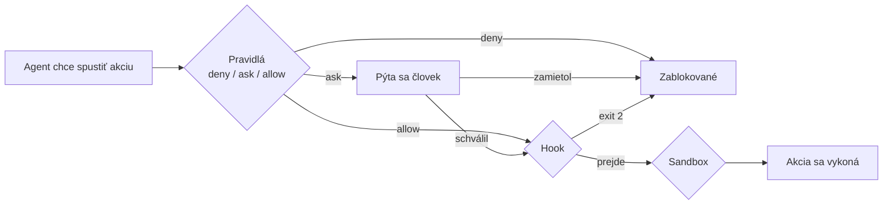

# Guardrails: ochranné mantinely pre AI agenta

*Verzia 1.0 · stav k novembru 2026. Nástroje sa menia rýchlo; pred nasadením  
si overte aktuálnu dokumentáciu.*  

## 1. Prečo guardrails

AI agent v editore, ako je Claude Code vo Visual Studio Code, nielen radí.  
Číta súbory, upravuje ich a spúšťa príkazy v príkazovom riadku. Jeden nepresný  
príkaz môže zmazať priečinok, odoslať tajný kľúč na internet alebo prepísať  
konfiguráciu, ktorú ste nechceli meniť.  

**Guardrail** (doslova „zvodidlo“, po slovensky ochranný mantinel) je  
pravidlo, ktoré vymedzuje, čo agent smie a čo nesmie. Nejde o prosbu v texte  
promptu. Dobrý guardrail je pravidlo, ktoré vynucuje samotný program, takže ho  
agent nemôže „prehovoriť“ ani zabudnúť.  

> **Jednoducho povedané:** Prompt je ako ústna inštrukcia „nechoďte do  
> skladu“. Guardrail je zamknuté dvere. Inštrukciu možno prehliadnuť,  
> zámok nie.  

Rozdiel je zásadný. Text v prompte alebo v súbore s pokynmi ovplyvňuje, čo sa  
agent *pokúsi* urobiť. Pravidlá oprávnení určujú, čo mu Claude Code *dovolí*  
urobiť.  



## 2. Vrstvy ochrany

Žiadna jedna vrstva nestačí. Spoľahlivá ochrana vzniká kombináciou viacerých,  
z ktorých každá chráni niečo iné.  

| Vrstva | Čo robí | Čo nepokryje |  
| --- | --- | --- |  
| Oprávnenia (`permissions`) | Povoľujú, pýtajú sa alebo zakazujú nástroje, príkazy, súbory a adresy | Nie sú bezpečnostnou hranicou okolo programu; iná podoba príkazu môže pravidlo obísť |  
| Režim oprávnení | Určuje, ako často sa agent pýta | Nenahrádza konkrétne pravidlá |  
| Hook | Vlastný skript skontroluje akciu pred vykonaním | Musíte ho napísať a udržiavať |  
| Sandbox | Operačný systém obmedzí súbory a sieť pre príkazy shellu | Nepokrýva nástroje Read a Edit; na Windows len cez WSL2 |  
| Človek | Schvaľuje rizikové akcie | Únava z klikania na „Povoliť“ |  

Pravidlá oprávnení sa vyhodnocujú v poradí **deny, potom ask, potom allow**.  
Rozhoduje prvá zhoda v tomto poradí, nie to, ktoré pravidlo je konkrétnejšie.  
Povoľujúce pravidlo teda nemôže urobiť výnimku zo zakazujúceho.  

> **Pozor:** Zakazujúce pravidlo `Bash(rm *)` zablokuje aj príkaz, ktorý  
> by inak povolilo úzke pravidlo `Bash(rm temp.txt)`. Výnimky z  
> `deny` neexistujú; zakaz preto formulujte tak úzko, ako je potrebné.  

## 3. Príprava vo VS Code na Windows

### Kde sa nastavenia nachádzajú

Rozšírenie Claude Code vo VS Code a samostatný nástroj v príkazovom riadku  
(CLI, z angl. command-line interface) zdieľajú rovnaké súbory `settings.json`.  
Pravidlá, ktoré napíšete raz, platia v oboch.  

| Rozsah | Súbor (Windows) | Použitie |  
| --- | --- | --- |  
| Používateľský | `%USERPROFILE%\.claude\settings.json` | Vaše osobné pravidlá pre všetky projekty |  
| Projektový | `.claude\settings.json` v projekte | Spoločné pravidlá tímu, ukladajú sa do repozitára |  
| Lokálny | `.claude\settings.local.json` v projekte | Vaše úpravy pre jeden projekt, mimo repozitára |  

Pravidlo, ktoré uložíte voľbou „Áno, a už sa nepýtať“, sa uloží do lokálneho  
súboru. Na Windows však Claude Code nemusí použiť koreň repozitára; ak  
potrebujete presné umiestnenie, pozrite stránku o nastaveniach v zdrojoch.  

> **Tip:** Na začiatok súboru pridajte riadok `"$schema"`. VS Code potom  
> ponúka automatické dopĺňanie a upozorní na preklepy v názvoch kľúčov.  

Súbor `%USERPROFILE%\.claude\settings.json`:  

```json
{
  "$schema": "https://json.schemastore.org/claude-code-settings.json"
}
```

### Nastavenia samotného rozšírenia

Nastavenia rozšírenia nájdete cez `Ctrl+,` v časti **Extensions > Claude  
Code**.  

| Nastavenie | Význam |  
| --- | --- |  
| `claudeCode.initialPermissionMode` | Režim nových konverzácií: `default`, `plan`, `acceptEdits` alebo `bypassPermissions`. VS Code ho číta len z používateľských nastavení, nie z nastavení priečinka projektu |  
| `claudeCode.allowDangerouslySkipPermissions` | Pridá do výberu režimov možnosť obísť oprávnenia (predvolene vypnuté). Dokumentácia odporúča len pre izolované prostredia bez internetu |  

### Kontrola pravidiel

Do poľa na písanie zadajte `/permissions`. Zobrazí sa zoznam všetkých  
pravidiel aj so súborom, z ktorého pochádzajú. Pridanie alebo odobratie  
pravidla sa prejaví hneď pri ďalšom volaní nástroja.  

> **Pozor:** V súboroch JSON na Windows zdvojte spätné lomky:  
> `"C:\\certs\\ca.pem"`. Cesty k certifikátom píšte celé, bez `~`.  
> V pravidlách `Read` a `Edit` je naopak `~/` bežný zápis domovského  
> priečinka (pozri časť 5).  

## 4. Ktoré príkazy smú a nesmú bežať

### Zápis pravidiel

Pravidlo má tvar `Nástroj(vzor)`. Hviezdička `*` zastupuje ľubovoľný text.  
Pravidlá patria do troch zoznamov: `allow` (spustí sa bez opýtania), `ask`  
(vždy sa opýta) a `deny` (zakázané).  

| Pravidlo | Význam |  
| --- | --- |  
| `Bash(git status)` | Presne tento príkaz |  
| `Bash(npm run *)` | `npm run` s ľubovoľnými argumentmi |  
| `Bash(git push *)` | Každý `git push` |  
| `PowerShell(Get-ChildItem *)` | Výpis priečinka v PowerShelli |  
| `Bash` | Nástroj ako celok (v `deny` ho agent vôbec neuvidí) |  

Na Windows má Claude Code okrem nástroja Bash aj nástroj PowerShell. Pravidlá  
pre PowerShell majú rovnaký tvar, nezáleží v nich na veľkosti písmen a bežné  
aliasy sa premenia na pôvodný názov cmdletu. Pravidlo pre `Get-ChildItem`  
preto platí aj pre `gci`, `ls` a `dir`.  

### Zložené príkazy

Claude Code rozpoznáva operátory `&&`, `||`, `;` a `|`. Pravidlo `Bash(npm  
test *)` preto nepovolí príkaz `npm test && curl ...`. Každá časť zloženého  
príkazu musí byť povolená samostatne. Zakazujúce a pýtajúce sa pravidlá sa  
uplatnia, keď im zodpovedá čo i len jedna časť.  

### Príklad: bežný vývoj

Súbor `.claude\settings.json`:  

```json
{
  "permissions": {
    "allow": [
      "Bash(git status)",
      "Bash(git diff *)",
      "Bash(npm run test *)",
      "PowerShell(Get-ChildItem *)",
      "PowerShell(git commit *)"
    ],
    "ask": [
      "Bash(git push *)",
      "PowerShell(git push *)"
    ],
    "deny": [
      "Bash(rm *)",
      "Bash(curl *)",
      "PowerShell(Remove-Item *)",
      "PowerShell(Invoke-WebRequest *)"
    ]
  }
}
```

### Čo pravidlo príkazu nezachytí

Pravidlo porovnáva text príkazu tak, ako ho agent napísal. Ten istý program  
však možno zavolať inak, a tak pravidlo obísť.  

| Pravidlo v `deny` | Zastaví | Nezastaví |  
| --- | --- | --- |  
| `Bash(curl *)` | `curl https://example.com` | `/usr/bin/curl ...`, `sh -c 'curl ...'` |  
| `Bash(rm *)` | `rm -rf build/` | `/bin/rm -rf build/`, `bash -c 'rm ...'` |  
| `Bash(git push *)` | `git push origin main` | `git -C . push origin main` |  

Tieto príkazy potom posúdia ostatné pravidlá a režim oprávnení. Zakazujúce  
pravidlo je preto spoľahlivá poistka proti bežným omylom, ale nie je hranicou  
okolo programu. Pri skutočne kritických veciach ho doplňte hookom (časť 9),  
sandboxom (časť 8) alebo tým, že program na počítači vôbec nemáte.  

> **Tip:** Neuvádzajte pravidlá `allow` pre nástroje, ktoré spúšťajú  
> ďalšie príkazy (`npx`, `docker exec`, `devbox run`). Pravidlo  
> `Bash(devbox run *)` povolí všetko, čo za `run` nasleduje. Napíšte  
> radšej celý konkrétny príkaz.  

## 5. Ktoré adresáre a súbory sú dostupné

### Pracovný adresár

Agent predvolene číta súbory v priečinku, v ktorom ste ho spustili (pracovný  
adresár). Ďalšie priečinky môžete sprístupniť trvalo v nastaveniach:  

```json
{
  "permissions": {
    "additionalDirectories": ["D:\\data\\vstupy"]
  }
}
```

Alternatívou je príkaz `/add-dir` počas relácie. Pre súbory v pridaných  
priečinkoch platia rovnaké pravidlá ako v pracovnom adresári. Pridanie  
priečinka dáva prístup k súborom, nie ku konfigurácii (hooks, pravidlá)  
uloženej v ňom.  

Aby nástroje na prácu so súbormi odmietli čítať alebo zapisovať mimo  
pracovných adresárov vo všetkých režimoch, nastavte:  

```json
{
  "permissions": {
    "blockReadsOutsideWorkingDirectories": true,
    "blockWritesOutsideWorkingDirectories": true
  }
}
```

Druhý kľúč vyžaduje Claude Code verzie 2.1.314 alebo novšej. Žiadny z nich  
neobmedzuje príkazy shellu; na to slúži sandbox.  

### Zákaz konkrétnych súborov

Pravidlá `Read` a `Edit` používajú zápis ako súbor `.gitignore`. Pozor na  
začiatok cesty, od ktorého závisí, kde pravidlo platí:  

| Zápis | Význam | Príklad |  
| --- | --- | --- |  
| `//cesta` | Absolútna cesta od koreňa disku | `Read(//c/Users/jano/tajne/**)` |  
| `~/cesta` | Od domovského priečinka | `Read(~/.ssh/**)` |  
| `/cesta` | Od priečinka súboru s nastaveniami | `Edit(/src/**)` |  
| `cesta` alebo `./cesta` | Od aktuálneho priečinka | `Read(./.env)` |  

Na Windows sa cesty pred porovnaním prevedú na tvar POSIX: `C:\Users\jano` sa  
zmení na `/c/Users/jano`. Súbory `.env` kdekoľvek na disku `C:` preto zachytí  
`//c/**/.env`; na všetkých diskoch `//**/.env`.  

> **Pozor:** Zápis `/Users/jano/subor` nie je absolútna cesta. Jedno  
> počiatočné lomítko znamená „od priečinka súboru s nastaveniami“.  
> Absolútnu cestu začnite dvoma lomítkami.  

Súbor `.claude\settings.json`:  

```json
{
  "permissions": {
    "deny": [
      "Read(./.env)",
      "Read(./.env.*)",
      "Read(./secrets/**)",
      "Read(~/.ssh/**)",
      "Read(~/.aws/**)",
      "Edit(./.github/workflows/**)",
      "Edit(./package-lock.json)"
    ]
  }
}
```

Zakazujúce pravidlo `Read` zablokuje aj nástroje Edit a Write na tej istej  
ceste. Pravidlá `Write(cesta)`, `NotebookEdit(cesta)` a `Glob(cesta)` sa s  
cestami nikdy nezhodujú; používajte `Edit(cesta)` a `Read(cesta)`.  

> **Pozor:** Pravidlá `Read` a `Edit` platia pre vstavané nástroje na  
> súbory, pre rozpoznané príkazy ako `cat` alebo `tail` v Bash a pre  
> presmerovania. Nezachytia skript v Pythone alebo Node, ktorý súbor  
> otvorí sám. Úplné obmedzenie vynúti až sandbox.  

### Sieťové cesty (UNC)

Cesta v tvare `\\server\zdielane\subor` môže pri prístupe odoslať vaše  
prihlasovacie údaje Windows na vzdialený počítač. Claude Code sa preto pri  
takejto ceste vždy opýta a UNC priečinok nemožno pridať ako pracovný adresár.  
Zdieľanie pripojte ako písmeno disku (napríklad `Z:`) a spustite `claude  
--add-dir Z:\`.  

## 6. Sieť, MCP a subagenti

### Webové adresy

Pravidlá `WebFetch` používajú predponu `domain:` a porovnávajú názov servera.  

| Pravidlo | Význam |  
| --- | --- |  
| `WebFetch(domain:docs.python.org)` | Len tento server |  
| `WebFetch(domain:*.example.com)` | Všetky subdomény, nie však `example.com` |  
| `WebFetch` v `deny` | Nástroj sa odstráni, agent nič nestiahne |  

### Servery MCP

MCP (Model Context Protocol) je spôsob, ako agentovi pripojiť externé  
nástroje. Pravidlo `mcp__server` alebo `mcp__server__*` platí pre všetky  
nástroje servera, `mcp__server__nastroj` pre jeden. Znaky ako bodka alebo  
medzera v názve servera sa v pravidle menia na `_`.  

### Subagenti

Pravidlom `Agent(Nazov)` v zozname `deny` vypnete konkrétneho subagenta,  
napríklad `Agent(Explore)`.  

## 7. Režimy oprávnení

Režim určuje, ako často sa agent pýta. Predvolený režim nastavíte kľúčom  
`defaultMode`.  

| Režim | Správanie |  
| --- | --- |  
| `default` | Pýta sa pri prvom použití každého nástroja (vo VS Code označený Manual) |  
| `acceptEdits` | Úpravy súborov a bežné príkazy ako `mkdir` či `mv` v pracovnom adresári prijme sám |  
| `plan` | Agent skúma a plánuje, zdrojové súbory neupravuje |  
| `auto` | Bez bežných otázok; akcie kontroluje pomocný klasifikátor |  
| `dontAsk` | Všetko, čo by vyvolalo otázku, automaticky zamietne |  
| `bypassPermissions` | Preskočí otázky okrem akcií, ktoré nepovolí žiadny režim |  

Režim `bypassPermissions` preskakuje otázky aj pri zápisoch do chránených  
ciest ako `.git` a `.claude`. Použite ho len v izolovanom prostredí, napríklad  
v kontajneri alebo virtuálnom počítači.  

Ak chcete nebezpečné režimy vypnúť úplne, vložte do nastavení:  

```json
{
  "permissions": {
    "defaultMode": "plan",
    "disableBypassPermissionsMode": "disable",
    "disableAutoMode": "disable"
  }
}
```

> **Tip:** Pre prvé zoznámenie s novým projektom použite režim `plan`.  
> Agent najprv navrhne postup a nič nezmení, kým ho neschválite.  

## 8. Sandbox (stručne)

**Sandbox** (z angl. pieskovisko) je ochrana na úrovni operačného systému.  
Obmedzí súbory a sieť pre príkazy shellu a všetky procesy, ktoré spustia.  
Keďže ho vynucuje systém, funguje aj vtedy, keď sa agent pokúsi pravidlá  
obísť.  

Na platformu záleží:  

| Platforma | Podpora sandboxu |  
| --- | --- |  
| macOS, Linux | Áno |  
| WSL2 (Linux vo Windows) | Áno; WSL1 nie |  
| Natívny Windows | **Nie**; príkazy bežia bez sandboxu |  

Na natívnom Windows teda sandbox nezískate. Vtedy sú vaše hlavné vrstvy  
pravidlá oprávnení a hooks. Ak chcete sandbox, otvorte projekt vo VS Code cez  
rozšírenie pre WSL a Claude Code spúšťajte vnútri WSL2. Sandbox je predvolene  
vypnutý; zapnete ho príkazom `/sandbox` alebo v nastaveniach:  

```json
{
  "sandbox": {
    "enabled": true,
    "failIfUnavailable": true,
    "filesystem": {
      "denyRead": ["~/.ssh"]
    },
    "network": {
      "allowedDomains": ["github.com", "*.npmjs.org"]
    }
  }
}
```

Kľúč `failIfUnavailable` zabráni tichému spusteniu bez ochrany, keď sandbox  
nie je dostupný. V sandboxových nastaveniach sa cesty píšu obvyklým spôsobom  
(`~/.ssh` je domovský priečinok), na rozdiel od pravidiel `Read` a `Edit`.  

## 9. Hook ako dodatočná poistka

**Hook** je váš vlastný skript, ktorý Claude Code spustí pri určitej udalosti.  
Udalosť `PreToolUse` nastane tesne pred použitím nástroja. Skript dostane  
popis akcie vo formáte JSON na štandardnom vstupe a môže ju zablokovať: vypíše  
rozhodnutie `deny` alebo skončí s kódom 2.  

Dva dôležité fakty o vzťahu hooku a pravidiel:  

- hook nemôže obísť pravidlo `deny`: zakazujúce aj pýtajúce sa pravidlá platia  
  bez ohľadu na to, čo hook vráti,  
- blokujúci hook (kód 2) zastaví akciu aj vtedy, keď by ju pravidlo `allow`  
  povolilo.  

Hook preto hodí tam, kde potrebujete logiku, ktorú vzor pravidla nevyjadrí,  
napríklad kontrolu celého textu príkazu.  

Súbor `.claude\hooks\blokuj.js`:  

```js
// Hook PreToolUse: zablokuje rizikové príkazy a súbory s tajomstvami.
const NEBEZPECNE_PRIKAZY = [
  [/\bgit\s+push\b.*(--force|\s-f\b)/i, "Vynútený push je zakázaný."],
  [/\bRemove-Item\b.*-Recurse/i, "Rekurzívne mazanie je zakázané."],
  [/\brm\s+-[a-z]*r[a-z]*f|\brm\s+-[a-z]*f[a-z]*r/i, "rm -rf je zakázané."],
  [/\bcurl\b.*\|\s*(ba)?sh\b/i, "Spúšťanie skriptov z internetu je zakázané."],
];

function jeEnvSubor(cesta) {
  const nazov = cesta.replace(/\\/g, "/").split("/").pop();
  if (nazov === ".env.example") return false;
  return nazov === ".env" || nazov.startsWith(".env.");
}

function zamietni(dovod) {
  console.log(
    JSON.stringify({
      hookSpecificOutput: {
        hookEventName: "PreToolUse",
        permissionDecision: "deny",
        permissionDecisionReason: dovod,
      },
    })
  );
  process.exit(0);
}

let vstup = "";
process.stdin.on("data", (cast) => (vstup += cast));
process.stdin.on("end", () => {
  const udalost = JSON.parse(vstup);
  const nastroj = udalost.tool_name || "";
  const parametre = udalost.tool_input || {};

  if (nastroj === "Bash" || nastroj === "PowerShell") {
    const prikaz = parametre.command || "";
    for (const [vzor, dovod] of NEBEZPECNE_PRIKAZY) {
      if (vzor.test(prikaz)) zamietni(dovod);
    }
  } else if (["Read", "Edit", "Write"].includes(nastroj)) {
    if (jeEnvSubor(parametre.file_path || "")) {
      zamietni("Súbory .env obsahujú tajomstvá, nepracujte s nimi.");
    }
  }
  // Bez výstupu: rozhodnú bežné oprávnenia.
});
```

Skript nič výslovne nepovoľuje. Ak akciu nezamietne, rozhodnú bežné pravidlá a  
prípadne sa opýta človek.  

Registrácia v súbore `.claude\settings.json`:  

```json
{
  "hooks": {
    "PreToolUse": [
      {
        "matcher": "Bash|PowerShell|Read|Edit|Write",
        "hooks": [
          {
            "type": "command",
            "command": "node .claude/hooks/blokuj.js"
          }
        ]
      }
    ]
  }
}
```

Na spustenie je potrebný nainštalovaný Node.js. Overte ho príkazom `node  
--version`.  

## 10. Praktický projekt: bezpečný `settings.json` pre projekt

Cieľom je zostaviť súbor s pravidlami pre jeden projekt, v ktorom agent pomáha  
s kódom a nemá siahať na tajomstvá ani nič zničiť.  

**Krok 1: Zistite, čo agent skutočne potrebuje.** Spíšte si príkazy, ktoré  
denne používate (testy, výpis zmien, formátovanie). Tie pôjdu do `allow`.  

**Krok 2: Zakážte, čo nepotrebuje nikdy.** Mazanie, sťahovanie a spúšťanie  
cudzích skriptov, čítanie `.env` a kľúčov. Tieto položky patria do `deny`.  

**Krok 3: Rizikové, ale občas potrebné veci dajte do `ask`.** Typicky `git  
push` a inštalácia balíkov.  

**Krok 4: Uzavrite adresáre.** Zapnite `blockReadsOutsideWorkingDirectories` a  
`blockWritesOutsideWorkingDirectories`.  

**Krok 5: Zamknite režimy.** Nastavte `defaultMode` a vypnite  
`bypassPermissions`.  

Výsledný súbor `.claude\settings.json`:  

```json
{
  "$schema": "https://json.schemastore.org/claude-code-settings.json",
  "permissions": {
    "defaultMode": "default",
    "disableBypassPermissionsMode": "disable",
    "blockReadsOutsideWorkingDirectories": true,
    "blockWritesOutsideWorkingDirectories": true,
    "allow": [
      "Bash(git status)",
      "Bash(git diff *)",
      "Bash(git log *)",
      "Bash(npm run test *)",
      "PowerShell(Get-ChildItem *)"
    ],
    "ask": [
      "Bash(git commit *)",
      "Bash(git push *)",
      "Bash(npm install *)",
      "PowerShell(git push *)"
    ],
    "deny": [
      "Bash(rm *)",
      "Bash(curl *)",
      "PowerShell(Remove-Item *)",
      "PowerShell(Invoke-WebRequest *)",
      "Read(./.env)",
      "Read(./.env.*)",
      "Read(./secrets/**)",
      "Read(~/.ssh/**)",
      "Edit(./.github/workflows/**)"
    ]
  }
}
```

**Krok 6: Otestujte každé pravidlo.** Pravidlá, ktoré ste nikdy nevideli  
zabrať, nemáte overené. Do poľa na písanie zadajte po jednej žiadosti:  

| Žiadosť agentovi | Očakávaný výsledok |  
| --- | --- |  
| „Ukáž obsah súboru `.env`.“ | Zamietnuté pravidlom `deny` |  
| „Zmaž priečinok `build`.“ | Zamietnuté, agent navrhne iný postup |  
| „Vykonaj `git push`.“ | Opýta sa vás |  
| „Spusti `git status`.“ | Prebehne bez otázky |  
| „Prečítaj súbor z `C:\Windows`.“ | Zamietnuté, je mimo pracovného adresára |  

Ak niektorá žiadosť dopadne inak, otvorte `/permissions` a zistite, ktoré  
pravidlo a z ktorého súboru sa uplatnilo.  

## 11. Bezpečnosť

Guardrails znižujú riziko, nie ho odstraňujú. Pri návrhu dodržte tieto zásady:  

- **Najmenšie potrebné práva.** Začnite prísne a povoľujte až keď vás agent  
  zdrží. Opačný postup vedie k pravidlám, ktoré nikto nekontroloval.  
- **Prompt injection.** Škodlivý pokyn môže byť ukrytý v súbore, na webovej  
  stránke alebo v odpovedi nástroja a agent ho môže vziať ako vašu požiadavku.  
  Pravidlá a sandbox platia aj vtedy, keď sa to podarí.  
- **Tajomstvá mimo dosahu.** Kľúče uložte do premenných prostredia alebo  
  správcu hesiel a súbory s nimi zakážte pravidlom `Read`. Najlepšia ochrana  
  je, keď tajomstvo agent nikdy nevidel.  
- **Nepoužívajte `bypassPermissions` na pracovnom počítači.** Patrí len do  
  izolovaného prostredia.  
- **Skontrolujte, čo ste povolili.** Voľba „Áno, a už sa nepýtať“ vytvára  
  trvalé pravidlo. Občas ich skontrolujte v `/permissions` a nepotrebné  
  odstráňte.  
- **Záloha a verzovanie.** Pravidlá obmedzujú škody, nezaručia ich nulu.  
  Pracujte v repozitári s históriou zmien.  

## 12. Časté chyby

| Problém | Príčina | Riešenie |  
| --- | --- | --- |  
| Povolenie nefunguje, hoci pravidlo `allow` existuje | Zhoduje sa aj pravidlo `deny` alebo `ask`, ktoré má prednosť | Skontrolujte `/permissions` a zúžte zakazujúce pravidlo |  
| Zákaz `Bash(rm *)` nezabránil mazaniu | Mazanie prebehlo cez PowerShell (`Remove-Item`) alebo inou podobou príkazu | Pridajte pravidlá aj pre `PowerShell(...)` a doplňte hook |  
| Pravidlo `Read` sa nikdy neuplatní | Cesta začína jedným `/` a smeruje inam, než ste čakali | Absolútnu cestu začnite `//`, napríklad `//c/...` |  
| Pravidlo `Write(cesta)` nič nerobí | Pravidlá `Write`, `Glob` a `NotebookEdit` sa s cestami nezhodujú | Použite `Edit(cesta)` a `Read(cesta)` |  
| Súbor `settings.json` sa ignoruje | Neplatný JSON, napríklad chýbajúca čiarka alebo jedna spätná lomka | Zdvojte lomky `\\`, zapnite `$schema` a skontrolujte v editore |  
| Pravidlo zadané počas relácie nepôsobí | Pravidlo je v inom súbore, než ste mysleli | Pozrite `/permissions`, kde je uvedený zdroj každého pravidla |  
| Sandbox nefunguje na Windows | Natívny Windows ho nepodporuje | Použite WSL2 alebo sa spoľahnite na pravidlá a hooks |  
| Hook nič neblokuje | Zlá cesta k skriptu alebo `matcher` nepokrýva nástroj | Spustite skript ručne s ukážkovým JSON a skontrolujte `matcher` |  
| Neustále otázky na `Get-ChildItem` | Pravidlo je len pre `Bash`, nie pre `PowerShell` | Pridajte zodpovedajúce pravidlo `PowerShell(...)` |  

## 13. Úlohy na precvičenie

1. V používateľskom `settings.json` pridajte riadok `"$schema"` a overte, že  
   VS Code ponúka dopĺňanie kľúčov.  
2. Zakážte agentovi príkaz `git push --force` a vyskúšajte, že ho po vašej  
   žiadosti odmietne.  
3. Vypíšte pomocou `/permissions` všetky pravidlá a pri troch z nich zistite,  
   z ktorého súboru pochádzajú.  
4. Zakážte čítanie súboru `.env` a požiadajte agenta, aby ho prečítal. Potom  
   vyskúšajte, či ho dokáže prečítať obchádzkou cez PowerShell, a opíšte, čo  
   pravidlo pokrylo a čo nie.  
5. Pridajte do projektu hook z časti 9 a overte ho ručne: skript spustite s  
   ukážkovým vstupom JSON a skontrolujte výpis.  
6. Pripravte tri profily nastavení (čítanie a analýza, vývoj, automatizácia) a  
   pri každom určte režim oprávnení a zoznamy `allow`, `ask`, `deny`.  
7. Nainštalujte WSL2, otvorte projekt vo VS Code cez rozšírenie pre WSL,  
   zapnite sandbox a overte, že zakázaný adresár sa z príkazu nedá prečítať.  

## 14. Zhrnutie

- **Guardrail** je pravidlo vynucované programom, nie prosba v prompte.  
- Ochrana má viac vrstiev: **oprávnenia**, **režim**, **hook**, **sandbox** a  
  človek.  
- Pravidlá sa vyhodnocujú v poradí **deny, ask, allow**; výnimka z `deny`  
  neexistuje.  
- Pravidlá pre príkazy píšte osobitne pre **Bash** aj **PowerShell**.  
- Pri súboroch dávajte pozor na začiatok cesty: **`//`** je absolútna cesta,  
  **`~/`** domovský priečinok.  
- Na Windows sa cesty prevádzajú na tvar POSIX (`//c/...`) a sieťové cesty UNC  
  vždy vyvolajú otázku.  
- **Sandbox** na natívnom Windows nefunguje; použite **WSL2**.  
- Režim **`bypassPermissions`** používajte len v izolovanom prostredí a  
  vypnite ho cez `disableBypassPermissionsMode`.  
- Každé pravidlo **otestujte**, inak neviete, či funguje.  

## 15. Slovníček

| Anglicky | Slovensky | Význam |  
| --- | --- | --- |  
| guardrail | ochranný mantinel | Vynútené pravidlo, ktoré obmedzuje akcie agenta |  
| permission | oprávnenie | Povolenie použiť nástroj, príkaz alebo súbor |  
| allow / ask / deny | povoliť / opýtať sa / zakázať | Tri zoznamy pravidiel |  
| permission mode | režim oprávnení | Určuje, ako často sa agent pýta |  
| sandbox | pieskovisko | Obmedzenie súborov a siete na úrovni systému |  
| hook | háčik | Vlastný skript spúšťaný pri udalosti agenta |  
| matcher | výber nástrojov | Vzor, ktorý určuje, na ktoré nástroje sa hook vzťahuje |  
| working directory | pracovný adresár | Priečinok, v ktorom agent smie pracovať |  
| UNC path | sieťová cesta | Cesta v tvare `\\server\zdielane` |  
| WSL2 | Linux vo Windows | Linuxové prostredie bežiace vo Windows |  
| prompt injection | vsunutý pokyn | Škodlivý pokyn ukrytý v údajoch, ktoré agent číta |  
| MCP | protokol MCP | Spôsob pripojenia externých nástrojov k agentovi |  

## Zdroje

- Claude Code – Configure permissions: code.claude.com/docs/en/permissions  
- Claude Code – Permission modes: code.claude.com/docs/en/permission-modes  
- Claude Code – Sandboxing: code.claude.com/docs/en/sandboxing  
- Claude Code – Settings: code.claude.com/docs/en/settings  
- Claude Code – Use Claude Code in VS Code: code.claude.com/docs/en/vs-code  
- Claude Code – Hooks guide: code.claude.com/docs/en/hooks-guide  
