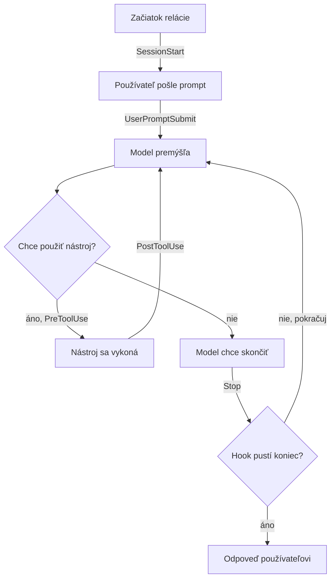

# Hooks

*Verzia 1.0 · stav k októbru 2026. Nástroje sa menia rýchlo; pred  
nasadením si overte aktuálnu dokumentáciu.*  

## 1. Prečo hooks

Pokyn v súbore `CLAUDE.md` alebo v prompte je prosba. Model ju väčšinou  
splní, ale nie vždy: zabudne, nepochopí ju alebo ju v dlhej relácii vytlačí  
iný kontext. Pri bežnej práci to nevadí. Pri pravidlách typu „nikdy nečítaj  
súbor s heslami“ alebo „po každej úprave spusti testy“ to vadí veľmi.  

Hook (po slovensky háčik) je program, ktorý nástroj spustí sám v presne  
danom okamihu práce agenta. Neriadi ho model, ale konfigurácia. Ak hook  
povie „tento príkaz nepustím“, príkaz sa nevykoná bez ohľadu na to, čo si  
model myslí.  

> **Jednoducho povedané:** pokyn v `CLAUDE.md` je cedulka „Zatvárajte  
> dvere“. Hook je samozatvárač na dverách. Cedulku si niekto nevšimne,  
> samozatvárač funguje vždy.  

Bežné použitia:  

- zablokovanie nebezpečných príkazov ešte pred ich spustením,  
- automatické formátovanie alebo kontrola kódu po každej úprave súboru,  
- notifikácia, keď agent čaká na vaše povolenie alebo skončil,  
- doplnenie kontextu na začiatku relácie (vetva, posledné zmeny, dátum),  
- auditný záznam o tom, čo agent robil,  
- kontrola, že agent pred koncom naozaj spustil testy.  

Jedna relácia agenta prechádza niekoľkými bodmi, v ktorých sa hook môže  
spustiť:  



Názvy pri šípkach sú udalosti z Claude Code. Ostatné nástroje majú podobné  
udalosti, len inak pomenované.  

## 2. Ako hooks fungujú

### Udalosť, filter a obsluha

Každý hook má tri časti:  

| Časť | Anglicky | Čo určuje | Príklad |  
|---|---|---|---|  
| udalosť | event | kedy sa hook spustí | `PreToolUse` |  
| filter | matcher | pri ktorom nástroji | `Bash` alebo `Edit\|Write` |  
| obsluha | handler | čo sa spustí | skript `ochrana.py` |  

Udalosť je okamih v živote agenta: začiatok relácie, odoslanie promptu,  
volanie nástroja, koniec odpovede. Filter zúži udalosť, napríklad len na  
príkazy v termináli. Obsluha je najčastejšie príkaz v shelli (príkazovom  
riadku), ktorý dostane údaje o udalosti a vráti rozhodnutie.  

### Vstup a výstup

Hook komunikuje s nástrojom cez tri kanály:  

| Kanál | Smer | Obsah |  
|---|---|---|  
| stdin | nástroj → hook | JSON s údajmi o udalosti |  
| stdout | hook → nástroj | JSON s rozhodnutím alebo text |  
| exit kód | hook → nástroj | číslo, ktorým program skončí |  

JSON je textový formát pre štruktúrované dáta, napríklad  
`{"tool_name": "Bash"}`. Exit kód (návratový kód) je číslo, ktorým každý  
program oznamuje, ako skončil. Nula znamená úspech.  

Pri volaní príkazu `rm -rf build` dostane hook v Claude Code na stdin  
približne toto:  

```json
{
  "session_id": "abc123",
  "cwd": "/home/jana/projekt",
  "hook_event_name": "PreToolUse",
  "tool_name": "Bash",
  "tool_input": { "command": "rm -rf build" }
}
```

Význam exit kódov v Claude Code:  

| Exit kód | Význam | Čo sa stane |  
|---|---|---|  
| `0` | úspech | platí JSON zo stdout, ak nejaký je |  
| `2` | blokujúca chyba | akcia sa zastaví, stderr dostane Claude |  
| iný | neblokujúca chyba | akcia pokračuje, vy uvidíte upozornenie |  

Stderr je druhý výstupný kanál programu, určený na chybové hlásenia.  

> **Pozor:** exit kód `1` v Claude Code akciu nezastaví. Ak má hook  
> niečo vynútiť, použite `exit 2` alebo JSON s rozhodnutím `deny`.  

### Kde hooks nájdete

Hooks dnes ponúka viacero nástrojov. Myšlienka je rovnaká, technické  
detaily sa líšia.  

| Nástroj | Forma hooku | Konfigurácia |  
|---|---|---|  
| Claude Code | príkaz, HTTP, MCP, prompt | `.claude/settings.json` |  
| claude.ai (chat) | iba Inference hooks pre firmy | nastavenia organizácie |  
| Claude Cowork | hooks z pluginov | plugin |  
| OpenCode | plugin v JavaScripte | `.opencode/plugins/` |  
| Copilot vo VS Code | príkaz | `.github/hooks/*.json` |  

Plugin je balík rozšírení, ktorý môže obsahovať skills, príkazy, agentov,  
MCP servery aj hooks naraz. MCP (Model Context Protocol) je štandard na  
pripájanie nástrojov k AI; podrobne ho opisuje kapitola `mcp.md`.  

### Hooks a claude.ai

Na claude.ai treba rozlíšiť tri situácie:  

- **Bežný chat** na webe, v Claude Desktop a v mobile vlastné hooks  
  nespúšťa. Ak pridáte plugin s hooks, jeho hooks sú v chate zošedené.  
  Fungujú v Claude Cowork a v Claude Code.  
- **Claude Code na webe** (claude.ai/code) spúšťa hooks z  
  `.claude/settings.json` v repozitári. Váš lokálny  
  `~/.claude/settings.json` sa do cloudovej relácie neprenáša.  
- **Inference hooks** sú funkcia pre organizácie s plánom Claude  
  Enterprise. Bežia na serveroch Anthropic a pred každou odpoveďou  
  modelu sa pýtajú vášho servera „povoliť, alebo zamietnuť?“. Platia pre  
  všetky produkty organizácie vrátane chatu. Venuje sa im časť 7.  

### Hooks verzus iné možnosti

| Potrebujete | Vhodný nástroj |  
|---|---|  
| poradiť modelu, ako pracovať | `CLAUDE.md`, `AGENTS.md` |  
| zakázať nástroj alebo súbor napevno | oprávnenia (permissions) |  
| vlastnú logiku pri udalosti | hook |  
| nový postup na zavolanie | skill, slash príkaz |  
| prístup k externému systému | MCP server |  

Hook nie je náhrada oprávnení. Oprávnenia sú jednoduché a spoľahlivé  
pravidlá typu „nikdy nečítaj `.env`“. Hook pridáva logiku, ktorú  
pravidlom nevyjadríte: kontrolu obsahu, spustenie testov, záznam.  

## 3. Príprava

Príklady v tejto kapitole používajú Python 3, Node.js a pre notifikácie  
aj `jq` (nástroj na prácu s JSON v príkazovom riadku). Overte si  
inštaláciu:  

```bash
claude --version
python3 --version
node --version
jq --version
```

Príklady ležia v priečinku `hooks-priklady/`:  

```text
hooks-priklady/
├── 01-claude-ochrana/        blokovanie príkazov a .env
├── 02-claude-kontrola-js/    kontrola syntaxe po úprave
├── 03-claude-notifikacie/    notifikácie na ploche
├── 04-claude-kontext/        kontext na začiatku a kontrola promptu
├── 05-claude-prompt-hook/    hook, ktorý posudzuje model
├── 06-opencode/              plugin pre OpenCode
├── 07-copilot/               hook pre Copilot vo VS Code
├── 08-inference-hook/        server pre Inference hooks
└── projekt/                  Stop hook s testami a auditom
```

Každý príklad vyskúšate tak, že otvoríte jeho priečinok v nástroji, alebo  
skopírujete jeho skrytý priečinok (`.claude`, `.opencode`, `.github`) do  
svojho projektu:  

```bash
cd hooks-priklady/01-claude-ochrana
claude
```

V Claude Code potom zadajte `/hooks`. Otvorí sa prehľad všetkých  
načítaných hooks a toho, z ktorého súboru pochádzajú. Hooks sa načítajú  
až po tom, ako priečinku potvrdíte dôveru (workspace trust).  

Kde môžu hooks pre Claude Code ležať:  

| Súbor | Platí pre | Zdieľa sa cez Git |  
|---|---|---|  
| `~/.claude/settings.json` | všetky vaše projekty | nie |  
| `.claude/settings.json` | jeden projekt | áno |  
| `.claude/settings.local.json` | jeden projekt, len vy | nie |  
| `hooks/hooks.json` v plugine | keď je plugin zapnutý | áno |  

> **Tip:** skript hooku si vždy najprv vyskúšajte ručne. Pošlite mu  
> vzorový JSON cez rúru (`|`) a pozrite sa na výstup a exit kód. Ušetríte  
> si hľadanie chyby priamo v relácii.  

Na ladenie spustite Claude Code s `claude --debug-file ladenie.txt`.  
Do súboru sa zapíše, ktoré hooks sa spustili, ako dlho trvali a čo  
vrátili. Na Windows píšte namiesto `python3` príkaz `python`, ak  
`python3` nemáte.  

## 4. Príklady pre Claude Code

### 4.1 Blokovanie nebezpečných príkazov

Prvý hook sa spustí pred každým volaním nástrojov `Bash`, `Read`, `Edit`  
a `Write`. Zablokuje rekurzívne mazanie, vynútený push, spúšťanie  
skriptov stiahnutých z internetu a prácu so súbormi `.env`.  

Súbor `hooks-priklady/01-claude-ochrana/.claude/settings.json`:  

```json
{
  "hooks": {
    "PreToolUse": [
      {
        "matcher": "Bash|Read|Edit|Write",
        "hooks": [
          {
            "type": "command",
            "command": "python3 \"$CLAUDE_PROJECT_DIR/.claude/hooks/ochrana.py\"",
            "timeout": 10
          }
        ]
      }
    ]
  }
}
```

Premenná `$CLAUDE_PROJECT_DIR` obsahuje koreňový priečinok projektu.  
Vďaka nej hook nájde skript, aj keď agent medzitým zmenil pracovný  
priečinok. Úvodzovky okolo cesty chránia pred medzerami v názve.  

Súbor `hooks-priklady/01-claude-ochrana/.claude/hooks/ochrana.py`:  

```python
#!/usr/bin/env python3
"""PreToolUse hook: zablokuje nebezpečné príkazy a prístup k súborom .env."""
import json
import re
import sys

NEBEZPECNE_PRIKAZY = [
    (r"\brm\s+-[a-zA-Z]*(rf|fr)", "Rekurzívne mazanie (rm -rf) je zakázané."),
    (r"\bgit\s+push\b.*(--force|-f\b)", "Vynútený push je zakázaný."),
    (r"\b(curl|wget)\b.*\|\s*(ba)?sh\b", "Spúšťanie skriptov z internetu je zakázané."),
    (r"(^|[\s/])\.env(\s|$)", "Práca so súborom .env je zakázaná."),
]


def je_env_subor(cesta):
    nazov = cesta.replace("\\", "/").rsplit("/", 1)[-1]
    if nazov == ".env.example":
        return False
    return nazov == ".env" or nazov.startswith(".env.")


def zamietni(dovod):
    vystup = {
        "hookSpecificOutput": {
            "hookEventName": "PreToolUse",
            "permissionDecision": "deny",
            "permissionDecisionReason": dovod,
        }
    }
    print(json.dumps(vystup, ensure_ascii=False))
    sys.exit(0)


vstup = json.load(sys.stdin)
nastroj = vstup.get("tool_name", "")
parametre = vstup.get("tool_input", {})

if nastroj == "Bash":
    prikaz = parametre.get("command", "")
    for vzor, dovod in NEBEZPECNE_PRIKAZY:
        if re.search(vzor, prikaz):
            zamietni(dovod)
elif nastroj in ("Read", "Edit", "Write"):
    if je_env_subor(parametre.get("file_path", "")):
        zamietni("Súbory .env obsahujú tajomstvá, nečítajte ich ani neupravujte.")

# Bez výstupu: rozhodnutie ostáva na bežných oprávneniach.
sys.exit(0)
```

Skript nikdy nič výslovne nepovoľuje. Keď neskončí zamietnutím, rozhodnú  
bežné oprávnenia a prípadne sa vás Claude Code opýta. Hook teda môže  
pravidlá len sprísniť. Dôvod zamietnutia dostane Claude a môže zvoliť iný  
postup.  

Ručný test bez spustenia agenta:  

```bash
cd hooks-priklady/01-claude-ochrana
echo '{"tool_name":"Bash","tool_input":{"command":"rm -rf build"}}' \
  | python3 .claude/hooks/ochrana.py
```

> **Pozor:** regulárne výrazy sa dajú obísť, napríklad príkazom zapísaným  
> inak alebo skriptom, ktorý mazanie urobí za agenta. Hook je ďalšia  
> vrstva ochrany, nie jediná. Súbory `.env` zakážte aj v oprávneniach  
> (`permissions.deny`) a dôležité veci držte mimo dosahu agenta.  

### Vyskúšajte

- Požiadajte Clauda, aby zmazal priečinok príkazom `rm -rf`. Sledujte,  
  ako zareaguje na zamietnutie.  
- Vytvorte súbor `.env` a požiadajte o jeho obsah.  
- Doplňte do zoznamu `NEBEZPECNE_PRIKAZY` príkaz `sudo`.  

### 4.2 Kontrola syntaxe po úprave súboru

Hook po udalosti `PostToolUse` sa spustí až po vykonaní nástroja. Akciu  
už nezastaví, ale môže dať Claudovi spätnú väzbu. Tento hook po každej  
úprave súboru `.js` spustí `node --check`. Ak súbor obsahuje syntaktickú  
chybu, skončí kódom 2 a Claude dostane chybové hlásenie.  

Súbor `hooks-priklady/02-claude-kontrola-js/.claude/settings.json`:  

```json
{
  "hooks": {
    "PostToolUse": [
      {
        "matcher": "Edit|Write",
        "hooks": [
          {
            "type": "command",
            "command": "python3 \"$CLAUDE_PROJECT_DIR/.claude/hooks/kontrola_js.py\"",
            "timeout": 30
          }
        ]
      }
    ]
  }
}
```

Súbor `hooks-priklady/02-claude-kontrola-js/.claude/hooks/kontrola_js.py`:  

```python
#!/usr/bin/env python3
"""PostToolUse hook: po úprave .js súboru skontroluje syntax cez node --check."""
import json
import subprocess
import sys

vstup = json.load(sys.stdin)
cesta = vstup.get("tool_input", {}).get("file_path", "")

if not cesta.endswith((".js", ".mjs", ".cjs")):
    sys.exit(0)

vysledok = subprocess.run(
    ["node", "--check", cesta], capture_output=True, text=True
)

if vysledok.returncode != 0:
    # Exit kód 2: Claude dostane stderr a môže chybu hneď opraviť.
    print(f"Syntaktická chyba v {cesta}:\n{vysledok.stderr}", file=sys.stderr)
    sys.exit(2)

sys.exit(0)
```

Filter `Edit|Write` znamená „Edit alebo Write“. Claude Code ho porovná  
s presným názvom nástroja. Rovnakým spôsobom môžete po úprave spustiť  
formátovač, linter (nástroj na kontrolu štýlu a chýb) alebo testy.  

> **Tip:** `PostToolUse` sa nespustí, keď súbor prepíše príkaz v `Bash`.  
> Ak potrebujete zachytiť každú zmenu súboru, pozrite si udalosť  
> `FileChanged` v dokumentácii.  

### Vyskúšajte

- Požiadajte Clauda, aby vytvoril súbor `test.js` so zámernou chybou,  
  napríklad bez zatváracej zátvorky. Mal by chybu sám opraviť.  
- Upravte skript tak, aby kontroloval aj súbory `.py` cez  
  `python3 -m py_compile`.  

### 4.3 Notifikácie na ploche

Keď necháte agenta pracovať a prepnete sa inam, oplatí sa vedieť, kedy  
čaká na povolenie a kedy skončil. Na to slúžia udalosti `Notification`  
a `Stop`. Tieto hooks nič nerozhodujú, iba upozorňujú.  

Súbor `hooks-priklady/03-claude-notifikacie/.claude/settings.json`:  

```json
{
  "hooks": {
    "Notification": [
      {
        "hooks": [
          {
            "type": "command",
            "command": "notify-send 'Claude Code' \"$(jq -r '.message')\""
          }
        ]
      }
    ],
    "Stop": [
      {
        "hooks": [
          {
            "type": "command",
            "command": "notify-send 'Claude Code' 'Odpoveď je hotová'"
          }
        ]
      }
    ]
  }
}
```

Príkaz `jq -r '.message'` vyberie zo vstupu text upozornenia, napríklad  
„Claude needs your permission“. Udalosti bez filtra (`matcher`) sa  
spustia pri každom výskyte.  

Príkaz `notify-send` funguje na Linuxe. Na iných systémoch ho nahraďte:  

| Systém | Príkaz na notifikáciu |  
|---|---|  
| Linux | `notify-send 'Claude Code' 'Text'` |  
| macOS | `osascript -e 'display notification "Text"'` |  
| Windows | vlastný skript v PowerShelli |  

Takýto hook patrí skôr do `~/.claude/settings.json`, aby fungoval vo  
všetkých projektoch. Do projektu ho dávajte len vtedy, keď ho chcete  
zdieľať s kolegami na rovnakom systéme.  

### Vyskúšajte

- Spustite úlohu, pri ktorej sa Claude bude pýtať na povolenie, a prepnite  
  sa do iného okna.  
- Pridajte k hooku `Stop` zvuk, napríklad `paplay` s ľubovoľným súborom.  

### 4.4 Kontext na začiatku a kontrola promptu

Udalosť `SessionStart` nastane pri začiatku alebo obnovení relácie. Čo  
hook vypíše na stdout ako obyčajný text, to Claude dostane ako kontext.  
Udalosť `UserPromptSubmit` nastane po odoslaní promptu, ešte predtým, ako  
ho dostane model. Hook ho môže zablokovať.  

Súbor `hooks-priklady/04-claude-kontext/.claude/settings.json`:  

```json
{
  "hooks": {
    "SessionStart": [
      {
        "matcher": "startup|resume",
        "hooks": [
          {
            "type": "command",
            "command": "bash \"$CLAUDE_PROJECT_DIR/.claude/hooks/kontext.sh\""
          }
        ]
      }
    ],
    "UserPromptSubmit": [
      {
        "hooks": [
          {
            "type": "command",
            "command": "python3 \"$CLAUDE_PROJECT_DIR/.claude/hooks/kontrola_promptu.py\""
          }
        ]
      }
    ]
  }
}
```

Súbor `hooks-priklady/04-claude-kontext/.claude/hooks/kontext.sh`:  

```bash
#!/bin/bash
# SessionStart hook: čistý text na stdout dostane Claude ako kontext.
echo "Dnešný dátum: $(date +%Y-%m-%d)"
if git rev-parse --is-inside-work-tree >/dev/null 2>&1; then
  echo "Aktuálna vetva: $(git branch --show-current)"
  echo "Posledné commity:"
  git log --oneline -5
  echo "Neuložené zmeny:"
  git status --short
else
  echo "Priečinok nie je Git repozitár."
fi
```

Súbor `hooks-priklady/04-claude-kontext/.claude/hooks/kontrola_promptu.py`:  

```python
#!/usr/bin/env python3
"""UserPromptSubmit hook: nepustí prompt, ktorý obsahuje API kľúč."""
import json
import re
import sys

VZORY_KLUCOV = [
    r"sk-ant-[A-Za-z0-9_-]{20,}",  # Anthropic
    r"sk-[A-Za-z0-9]{32,}",  # OpenAI a podobné
    r"ghp_[A-Za-z0-9]{30,}",  # GitHub token
    r"AKIA[0-9A-Z]{16}",  # AWS access key
]

vstup = json.load(sys.stdin)
prompt = vstup.get("prompt", "")

for vzor in VZORY_KLUCOV:
    if re.search(vzor, prompt):
        print(
            "Prompt obsahuje niečo, čo vyzerá ako API kľúč. "
            "Odstráňte ho a kľúč radšej zneplatnite.",
            file=sys.stderr,
        )
        sys.exit(2)

sys.exit(0)
```

Prvý hook ušetrí úvodné otázky typu „na akej vetve sme?“. Druhý zachytí  
chybu, ktorá sa stáva často: vloženie API kľúča do promptu. Exit kód 2  
prompt zablokuje a text zo stderr uvidíte vy. Model prompt nedostane.  

> **Tip:** statické informácie (pravidlá projektu, štýl kódu) patria do  
> `CLAUDE.md`. Hook `SessionStart` použite na to, čo sa mení: vetva,  
> otvorené úlohy, dnešný dátum.  

### Vyskúšajte

- Spustite Claude Code v Git repozitári a opýtajte sa „aké sú posledné  
  zmeny?“. Odpoveď by mala vychádzať z kontextu z hooku.  
- Pošlite prompt s vymysleným kľúčom `sk-ant-` a dvadsiatimi znakmi.  
- Doplňte vzor pre slovenské rodné číslo.  

### 4.5 Hook, ktorý posudzuje model

Okrem skriptov podporuje Claude Code aj hooks typu `prompt`. Namiesto  
skriptu sa údaje o udalosti pošlú malému modelu s vašou otázkou. Model  
vráti JSON s poľom `ok` (`true` alebo `false`) a `reason`.  

Súbor `hooks-priklady/05-claude-prompt-hook/.claude/settings.json`:  

```json
{
  "hooks": {
    "Stop": [
      {
        "hooks": [
          {
            "type": "prompt",
            "prompt": "Posúď, či môže Claude skončiť. Vstup: $ARGUMENTS. Ak v poslednej odpovedi sľúbil krok, ktorý neurobil, alebo zmenil kód bez spustenia testov, vráť ok: false a do reason napíš, čo má ešte urobiť.",
            "timeout": 30
          }
        ]
      }
    ]
  }
}
```

Zástupný text `$ARGUMENTS` sa nahradí vstupným JSON. Ak model vráti  
`ok: false`, Claude neskončí a dostane `reason` ako ďalší pokyn. Ďalšie  
typy obsluhy sú `http` (pošle JSON na webovú adresu), `mcp_tool` (zavolá  
nástroj MCP servera) a experimentálny `agent`.  

> **Pozor:** každé spustenie hooku typu `prompt` stojí tokeny a pridáva  
> oneskorenie. Na pravidlá, ktoré sa dajú overiť skriptom, použite skript.  

### Vyskúšajte

- Požiadajte Clauda o malú zmenu kódu a sledujte, či ho hook pošle  
  spustiť testy.  
- Prepíšte prompt tak, aby kontroloval, či Claude odpovedal po slovensky.  

## 5. Hooks v OpenCode

OpenCode je open-source agent pre terminál. Hooks v ňom nepíšete ako  
samostatné skripty, ale ako plugin v JavaScripte alebo TypeScripte.  
Plugin je funkcia, ktorá vráti objekt s obsluhami udalostí.  

| Umiestnenie | Platí pre |  
|---|---|  
| `.opencode/plugins/` | jeden projekt |  
| `~/.config/opencode/plugins/` | všetky projekty |  
| pole `plugin` v `opencode.json` | balíky z npm |  

Najdôležitejšie obsluhy:  

| Obsluha | Kedy | Zodpovedá v Claude Code |  
|---|---|---|  
| `tool.execute.before` | pred nástrojom | `PreToolUse` |  
| `tool.execute.after` | po nástroji | `PostToolUse` |  
| `event` so `session.idle` | agent skončil | `Stop` |  
| `event` so `file.edited` | súbor sa zmenil | `FileChanged` |  
| `shell.env` | pred príkazom v shelli | nemá priamu obdobu |  

Súbor `hooks-priklady/06-opencode/.opencode/plugins/strazca.js`:  

```js
// OpenCode plugin: blokuje nebezpečné príkazy, chráni .env a hlási koniec práce.
const NEBEZPECNE = [
  [/\brm\s+-[a-zA-Z]*(rf|fr)/, "Rekurzívne mazanie (rm -rf) je zakázané."],
  [/\bgit\s+push\b.*(--force|-f\b)/, "Vynútený push je zakázaný."],
  [/\b(curl|wget)\b.*\|\s*(ba)?sh\b/, "Spúšťanie skriptov z internetu je zakázané."],
];

function jeEnvSubor(cesta) {
  const nazov = String(cesta).replaceAll("\\", "/").split("/").pop();
  if (nazov === ".env.example") return false;
  return nazov === ".env" || nazov.startsWith(".env.");
}

export const Strazca = async ({ $ }) => {
  return {
    "tool.execute.before": async (input, output) => {
      if (input.tool === "bash") {
        const prikaz = String(output.args.command ?? "");
        for (const [vzor, dovod] of NEBEZPECNE) {
          if (vzor.test(prikaz)) throw new Error(dovod);
        }
      }
      if (["read", "edit", "write"].includes(input.tool)) {
        if (jeEnvSubor(output.args.filePath ?? "")) {
          throw new Error("Súbory .env obsahujú tajomstvá, nečítajte ich.");
        }
      }
    },
    event: async ({ event }) => {
      if (event.type === "session.idle") {
        await $`notify-send OpenCode "Odpoveď je hotová"`.nothrow();
      }
    },
  };
};
```

Rozdiely oproti Claude Code:  

- akciu zablokujete vyhodením chyby (`throw new Error(...)`), nie exit  
  kódom,  
- argumenty nástroja sú v `output.args` a môžete ich aj zmeniť,  
- názvy nástrojov sú malými písmenami (`bash`, `read`, `edit`, `write`),  
  cesta k súboru je v `filePath`,  
- `$` je shell z prostredia Bun, ktorým plugin spúšťa príkazy.  

Plugin vyskúšate tak, že spustíte `opencode` v priečinku  
`hooks-priklady/06-opencode`. Pluginy z priečinka sa načítajú pri štarte.  

> **Tip:** ak plugin potrebuje balíky z npm, pridajte do `.opencode/`  
> súbor `package.json`. OpenCode ich pri štarte nainštaluje sám.  

### Vyskúšajte

- Požiadajte OpenCode o obsah súboru `.env`.  
- Pridajte obsluhu `tool.execute.after`, ktorá cez `client.app.log()`  
  zapíše názov každého použitého nástroja.  

## 6. Hooks v GitHub Copilot vo VS Code

Hooks pre agenta Copilot sú vo VS Code v režime Preview (ukážka), takže  
formát sa ešte môže meniť. Platia v zobrazení Chat aj v okne Agents.  
Firma ich môže zakázať cez správu podnikových nastavení.  

Vo VS Code si vyberáte, ktoré jadro (harness) reláciu poháňa. Robí sa to  
ovládacím prvkom Session Target. Každé jadro má vlastné hooks:  

| Session Target | Formát hooks |  
|---|---|  
| Copilot | spoločný s Copilot CLI, udalosti `preToolUse` a pod. |  
| Claude | formát Claude Code |  
| Codex | formát Codexu |  
| Local (staršie) | pôvodný formát VS Code, len na migráciu |  

Táto časť opisuje jadro Copilot. Rovnaké hooks používa aj Copilot CLI.  

| Umiestnenie | Platí pre |  
|---|---|  
| `.github/hooks/*.json` | repozitár |  
| `~/.copilot/hooks/` | všetky vaše projekty |  
| `hooks` vo frontmatter `.agent.md` | jeden vlastný agent |  

Frontmatter je hlavička súboru Markdown medzi riadkami `---`.  

Udalosti majú názvy v tvare camelCase:  

| Copilot | Claude Code | Kedy |  
|---|---|---|  
| `sessionStart` | `SessionStart` | začiatok alebo obnovenie relácie |  
| `userPromptSubmitted` | `UserPromptSubmit` | odoslanie promptu |  
| `preToolUse` | `PreToolUse` | pred nástrojom |  
| `postToolUse` | `PostToolUse` | po nástroji |  
| `agentStop` | `Stop` | agent končí ťah |  
| `sessionEnd` | `SessionEnd` | koniec relácie |  

Súbor `hooks-priklady/07-copilot/.github/hooks/bezpecnost.json`:  

```json
{
  "version": 1,
  "hooks": {
    "preToolUse": [
      {
        "type": "command",
        "command": "node .github/hooks/strazca.cjs",
        "timeoutSec": 10
      }
    ]
  }
}
```

Súbor `hooks-priklady/07-copilot/.github/hooks/strazca.cjs`:  

```js
// Copilot preToolUse hook: blokuje rm -rf a prístup k súborom .env.
const fs = require("node:fs");

const udalost = JSON.parse(fs.readFileSync(0, "utf8"));

// toolArgs môže prísť ako JSON reťazec, preto ho podľa potreby rozparsujeme.
let argumenty = udalost.toolArgs ?? {};
if (typeof argumenty === "string") {
  try {
    argumenty = JSON.parse(argumenty);
  } catch {
    argumenty = {};
  }
}

function zamietni(dovod) {
  process.stdout.write(
    JSON.stringify({ permissionDecision: "deny", permissionDecisionReason: dovod })
  );
  process.exit(0);
}

function jeEnvSubor(cesta) {
  const nazov = String(cesta).replaceAll("\\", "/").split("/").pop();
  if (nazov === ".env.example") return false;
  return nazov === ".env" || nazov.startsWith(".env.");
}

const nastroj = udalost.toolName;

if (nastroj === "bash" || nastroj === "powershell") {
  const prikaz = String(argumenty.command ?? "");
  if (/\brm\s+-[a-zA-Z]*(rf|fr)/.test(prikaz)) {
    zamietni("Rekurzívne mazanie (rm -rf) je zakázané.");
  }
}

if (jeEnvSubor(argumenty.path ?? argumenty.filePath ?? "")) {
  zamietni("Súbory .env obsahujú tajomstvá, nečítajte ich.");
}

// Prázdny objekt: žiadne rozhodnutie, platia bežné oprávnenia.
process.stdout.write("{}");
```

Na čo si dať pozor oproti Claude Code:  

- vstup má polia `toolName` a `toolArgs`, pričom `toolArgs` býva JSON  
  reťazec, ktorý treba ešte raz rozparsovať,  
- nástroje sa volajú `bash`, `powershell`, `view`, `create`, `edit`,  
- rozhodnutie `permissionDecision` je priamo v koreni JSON, nie  
  v `hookSpecificOutput`,  
- pole `version: 1` je povinné, časový limit je `timeoutSec`  
  (predvolene 30 sekúnd),  
- keď skript `preToolUse` spadne, volanie nástroja sa zamietne; keď  
  vyprší čas, volanie pokračuje bežným schvaľovaním,  
- výstup z `userPromptSubmitted` sa ignoruje, prompt teda hook  
  nezablokuje.  

Hooks spravujete v editore Agent Customizations. V Chate ho otvoríte  
príkazom `/hooks` alebo tlačidlom Open Customizations a kartou Hooks.  
V okne Agents zvoľte v bočnom paneli Customizations a potom Hooks.  

> **Pozor:** jadro Copilot číta aj `.claude/settings.json` z repozitára.  
> Hooks pre Claude Code tak môžu bežať aj v Copilote, ale s inými názvami  
> nástrojov a inými poľami vo vstupe. Pred zdieľaním hooku medzi  
> nástrojmi ho v každom z nich otestujte.  

### Vyskúšajte

- Otvorte `hooks-priklady/07-copilot` vo VS Code, zvoľte Session Target  
  Copilot a požiadajte agenta o príkaz `rm -rf`.  
- Ručne otestujte skript príkazom nižšie.  
- Pridajte udalosť `agentStop`, ktorá vráti `decision: "block"`, kým  
  neprejdú testy. Nezabudnite na pole `stop_hook_active`.  

```bash
cd hooks-priklady/07-copilot
echo '{"toolName":"bash","toolArgs":"{\"command\":\"rm -rf /\"}"}' \
  | node .github/hooks/strazca.cjs
```

## 7. Inference hooks na claude.ai

Inference hooks sú určené firmám s plánom Claude Enterprise. Nastavuje  
ich vlastník organizácie (rola Owner alebo Primary owner). Na rozdiel od  
ostatných hooks nebežia na vašom počítači. Anthropic pred spracovaním  
každej požiadavky pošle prepis konverzácie na server vašej firmy a čaká  
na odpoveď „povoliť“ alebo „zamietnuť“.  

Platia jednotne pre claude.ai, Claude Desktop, mobilné aplikácie, Cowork,  
Claude Code a ďalšie produkty organizácie. Typické použitie je DLP (data  
loss prevention, ochrana pred únikom dát): zamietnuť prompt s číslom  
karty, s rodným číslom alebo s dôverným dokumentom.  

| Vlastnosť | Hodnota |  
|---|---|  
| udalosti | `prompt`, voliteľne `tool_call` |  
| odpoveď servera | HTTP 200 a JSON s `action` |  
| časový limit | predvolene 5 000 ms, najviac 10 000 ms |  
| pri výpadku servera | podľa nastavenia povoliť alebo blokovať |  
| skúšobný režim | Shadow mode, nič neblokuje |  

Zapnutie: claude.ai > Organization settings > Data and privacy, sekcia  
Inference hooks, prepínač Allow for your organization. Potom zadáte  
adresu servera, uložíte podpisové tajomstvo a otestujete spojenie.  

Server odpovedá jedným z dvoch tvarov:  

```json
{ "action": "allow" }
```

```json
{ "action": "deny", "deny_reason": "Správa obsahuje číslo karty." }
```

Ukážkový server overí podpis požiadavky a zamietne správu s IBAN.  

Súbor `hooks-priklady/08-inference-hook/server.py`:  

```python
#!/usr/bin/env python3
"""Ukážkový server pre Inference hooks (Claude Enterprise).

Overí podpis požiadavky a zamietne prompt, ktorý obsahuje IBAN.
Tajomstvo na podpis čaká v premennej prostredia PODPISOVE_TAJOMSTVO.
"""
import base64
import hashlib
import hmac
import json
import os
import re
import time
from http.server import BaseHTTPRequestHandler, ThreadingHTTPServer

TAJOMSTVO = os.environ.get("PODPISOVE_TAJOMSTVO", "")
TOLERANCIA_SEKUND = 300
VZOR_IBAN = re.compile(r"\b[A-Z]{2}\d{2}(?:\s?[A-Z0-9]{4}){3,7}\b")


def podpis_sedi(hlavicky, telo):
    hlavicky = {k.lower(): v for k, v in hlavicky.items()}
    try:
        id_spravy = hlavicky["webhook-id"]
        cas = hlavicky["webhook-timestamp"]
        podpisy = hlavicky["webhook-signature"]
        if abs(time.time() - int(cas)) > TOLERANCIA_SEKUND:
            return False
        kluc = base64.b64decode(TAJOMSTVO.removeprefix("whsec_"), validate=True)
    except (KeyError, ValueError):
        return False
    obsah = f"{id_spravy}.{cas}.".encode() + telo
    ocakavany = b"v1," + base64.b64encode(
        hmac.new(kluc, obsah, hashlib.sha256).digest()
    )
    return any(hmac.compare_digest(ocakavany, p.encode()) for p in podpisy.split())


def texty_z_prepisu(poziadavka):
    for sprava in poziadavka.get("messages", []):
        for blok in sprava.get("content", []):
            text = blok.get("text") or blok.get("content")
            if isinstance(text, str):
                yield text


def rozhodni(poziadavka):
    if poziadavka.get("type") != "prompt":
        return {"action": "allow"}  # neznáme udalosti nepreverujeme
    for text in texty_z_prepisu(poziadavka):
        if VZOR_IBAN.search(text):
            return {
                "action": "deny",
                "deny_reason": "Správa obsahuje číslo účtu (IBAN). "
                "Podľa smernice firmy ho do AI nevkladajte.",
            }
    return {"action": "allow"}


class Overovac(BaseHTTPRequestHandler):
    protocol_version = "HTTP/1.1"

    def do_POST(self):
        telo = self.rfile.read(int(self.headers.get("Content-Length", 0)))
        if not podpis_sedi(dict(self.headers), telo):
            self.send_response(401)
            self.send_header("Content-Length", "0")
            self.end_headers()
            return
        odpoved = json.dumps(rozhodni(json.loads(telo)), ensure_ascii=False)
        data = odpoved.encode("utf-8")
        self.send_response(200)
        self.send_header("Content-Type", "application/json")
        self.send_header("Content-Length", str(len(data)))
        self.end_headers()
        self.wfile.write(data)


if __name__ == "__main__":
    ThreadingHTTPServer(("", 8000), Overovac).serve_forever()
```

Podpis funguje podľa špecifikácie Standard Webhooks. Server tak overí, že  
požiadavku naozaj poslal Anthropic a nikto ju cestou nezmenil. Lokálne  
server otestujete týmto skriptom, ktorý požiadavku podpíše rovnako.  

Súbor `hooks-priklady/08-inference-hook/test.sh`:  

```bash
#!/bin/bash
# Pošle lokálnemu serveru podpísanú požiadavku, ako by ju poslal Anthropic.
# Použitie: PODPISOVE_TAJOMSTVO=whsec_... ./test.sh 'text správy'
set -euo pipefail

text="${1:-Zhrň priložený report.}"
telo=$(jq -nc --arg t "$text" \
  '{type: "prompt", messages: [{role: "user", content: [{type: "text", text: $t}]}]}')
id="req_test_1"
cas=$(date +%s)
kluc=$(printf '%s' "${PODPISOVE_TAJOMSTVO#whsec_}" | base64 -d | xxd -p -c 256)
podpis=$(printf '%s' "$id.$cas.$telo" \
  | openssl dgst -sha256 -mac HMAC -macopt "hexkey:$kluc" -binary | base64)

curl -s -w '\nHTTP %{http_code}\n' http://localhost:8000 \
  -H "webhook-id: $id" \
  -H "webhook-timestamp: $cas" \
  -H "webhook-signature: v1,$podpis" \
  -d "$telo"
```

Spustenie testu v dvoch termináloch:  

```bash
export PODPISOVE_TAJOMSTVO="whsec_$(head -c 32 /dev/urandom | base64)"
python3 server.py
```

```bash
./test.sh 'Pošlite to na SK31 1200 0000 1987 4263 7541'
```

> **Pozor:** pre skutočné nasadenie musí server bežať na verejnej adrese  
> `https://` na porte 443. Tunely typu ngrok nie sú podporované. Zamietnutie  
> vždy vracajte ako HTTP 200 s `"action": "deny"`; iný stavový kód sa  
> považuje za výpadok, nie za zamietnutie.  

## 8. Praktický projekt: agent, ktorý neskončí s chybnými testami

Cieľ: v malom projekte zariadiť, aby Claude Code nemohol ukončiť odpoveď,  
kým neprejdú testy, a aby sa každá jeho akcia zapísala do denníka.  

### Krok 1: projekt s testami

Súbor `hooks-priklady/projekt/kalkulacka.js`:  

```js
function sucet(a, b) {
  return a + b;
}

function priemer(cisla) {
  if (cisla.length === 0) return 0;
  return cisla.reduce(sucet, 0) / cisla.length;
}

module.exports = { sucet, priemer };
```

Súbor `hooks-priklady/projekt/kalkulacka.test.js`:  

```js
const test = require("node:test");
const assert = require("node:assert");
const { sucet, priemer } = require("./kalkulacka.js");

test("sucet sčíta dve čísla", () => {
  assert.strictEqual(sucet(2, 3), 5);
});

test("priemer prázdneho zoznamu je 0", () => {
  assert.strictEqual(priemer([]), 0);
});

test("priemer vypočíta aritmetický priemer", () => {
  assert.strictEqual(priemer([2, 4, 6]), 4);
});
```

Overte, že testy prechádzajú:  

```bash
cd hooks-priklady/projekt
node --test
```

### Krok 2: konfigurácia hooks

Súbor `hooks-priklady/projekt/.claude/settings.json`:  

```json
{
  "hooks": {
    "PostToolUse": [
      {
        "matcher": "Bash|Edit|Write",
        "hooks": [
          {
            "type": "command",
            "command": "python3 \"$CLAUDE_PROJECT_DIR/.claude/hooks/zaznam.py\"",
            "async": true
          }
        ]
      }
    ],
    "Stop": [
      {
        "hooks": [
          {
            "type": "command",
            "command": "python3 \"$CLAUDE_PROJECT_DIR/.claude/hooks/testy.py\"",
            "timeout": 120,
            "statusMessage": "Spúšťam testy..."
          }
        ]
      }
    ]
  }
}
```

Záznam beží s `"async": true`, teda na pozadí a agenta nezdržiava. Hook  
`Stop` beží synchrónne, lebo jeho výsledok rozhoduje, či Claude skončí.  
Pole `statusMessage` určuje text, ktorý uvidíte počas behu hooku.  

### Krok 3: auditný záznam

Súbor `hooks-priklady/projekt/.claude/hooks/zaznam.py`:  

```python
#!/usr/bin/env python3
"""PostToolUse hook: zapíše do denníka, čo agent urobil (bez obsahu súborov)."""
import json
import os
import sys
from datetime import datetime

vstup = json.load(sys.stdin)
nastroj = vstup.get("tool_name", "")
parametre = vstup.get("tool_input", {})

zaznam = {
    "cas": datetime.now().isoformat(timespec="seconds"),
    "relacia": vstup.get("session_id", ""),
    "nastroj": nastroj,
}
if nastroj == "Bash":
    # Iba prvé slovo príkazu, aby sa do denníka nedostali tajomstvá.
    zaznam["prikaz"] = parametre.get("command", "").split(" ", 1)[0]
else:
    zaznam["subor"] = parametre.get("file_path", "")

projekt = os.environ.get("CLAUDE_PROJECT_DIR", ".")
with open(os.path.join(projekt, ".claude", "audit.jsonl"), "a", encoding="utf-8") as f:
    f.write(json.dumps(zaznam, ensure_ascii=False) + "\n")
```

Denník zapisuje len názov nástroja, súbor a prvé slovo príkazu. Celé  
príkazy a obsah súborov môžu obsahovať heslá, preto ich nezapisuje.  

### Krok 4: kontrola testov pred koncom

Súbor `hooks-priklady/projekt/.claude/hooks/testy.py`:  

```python
#!/usr/bin/env python3
"""Stop hook: nedovolí Claudovi skončiť, kým neprejdú testy."""
import json
import os
import subprocess
import sys

vstup = json.load(sys.stdin)

# Ochrana pred nekonečnou slučkou: druhýkrát za sebou už neblokujeme.
if vstup.get("stop_hook_active"):
    sys.exit(0)

projekt = os.environ.get("CLAUDE_PROJECT_DIR", ".")
vysledok = subprocess.run(
    ["node", "--test"], cwd=projekt, capture_output=True, text=True, timeout=100
)

if vysledok.returncode != 0:
    print(json.dumps({
        "decision": "block",
        "reason": "Testy neprešli. Opravte chyby a spustite node --test:\n"
        + vysledok.stdout[-2000:],
    }, ensure_ascii=False))

sys.exit(0)
```

Keď testy zlyhajú, hook vráti `decision: "block"` a v poli `reason`  
pošle Claudovi výstup testov. Claude pokračuje a chybu opravuje. Pole  
`stop_hook_active` je `true`, keď Claude už pokračuje kvôli Stop hooku.  
Vtedy hook koniec pustí, aby nevznikla nekonečná slučka. Claude Code  
navyše po ôsmich blokovaniach za sebou ukončí ťah sám.  

### Krok 5: denník mimo Gitu

Súbor `hooks-priklady/projekt/.gitignore`:  

```text
.claude/audit.jsonl
.claude/settings.local.json
```

### Krok 6: vyskúšanie

1. Otvorte priečinok `hooks-priklady/projekt` v Claude Code a potvrďte  
   dôveru priečinku.  
2. Zadajte `/hooks` a overte, že vidíte hooks `PostToolUse` a `Stop`.  
3. Požiadajte: „Zmeň funkciu sucet tak, aby odčítala.“  
4. Claude zmenu urobí a pri pokuse skončiť dostane chybu z testov.  
5. Pozrite sa do `.claude/audit.jsonl`, čo všetko agent urobil.  

Hooks sa dajú vyskúšať aj bez agenta:  

```bash
echo '{"stop_hook_active": false}' | python3 .claude/hooks/testy.py
```

## 9. Bezpečnosť

Hook je obyčajný program, ktorý beží s vašimi právami. Môže čítať,  
meniť a mazať všetko, k čomu máte prístup vy. Preto:  

- hooks z cudzieho repozitára si pred otvorením projektu prečítajte,  
  hlavne `.claude/settings.json`, `.github/hooks/` a `.opencode/plugins/`,  
- v režime `claude -p` (neinteraktívne spustenie) sa dôvera priečinku  
  nepýta a hooks z repozitára sa spustia hneď; pri cudzom kóde použite  
  `--settings '{"disableAllHooks": true}'`,  
- nedovoľte agentovi upravovať skripty hookov bez vášho schválenia,  
  inak si môže ochranu sám vypnúť,  
- vstup hooku berte ako nedôveryhodný; nevkladajte ho bez kontroly do  
  príkazu v shelli,  
- premenné v shelli dávajte do úvodzoviek (`"$PREMENNA"`),  
- tajomstvá nepíšte do skriptov ani do denníkov; používajte premenné  
  prostredia,  
- pre tvrdé zákazy použite oprávnenia (`permissions.deny`) a hook berte  
  ako ďalšiu vrstvu,  
- hook, ktorý má niečo vynútiť, otestujte aj na zlyhanie: čo sa stane,  
  keď skript spadne alebo nenájde `python3`.  

> **Pozor:** v Claude Code skript, ktorý spadne s kódom 1, akciu  
> nezastaví. Ak má byť ochrana tvrdá, nastavte v novších verziách  
> `"onFailure": "block"` (od Claude Code v2.1.295). V Copilote je to  
> naopak: pád hooku `preToolUse` volanie zamietne, vypršanie času nie.  

## 10. Časté chyby

| Problém | Príčina | Riešenie |  
|---|---|---|  
| hook sa nespustí | chýba dôvera priečinku | potvrďte ju, overte `/hooks` |  
| hook sa nespustí | preklep v udalosti | dodržte veľké a malé písmená |  
| filter nič nezachytí | `mcp__server` bez `.*` | `mcp__server__.*` |  
| blokovanie nefunguje | skript končí kódom 1 | `exit 2` alebo `deny` |  
| JSON sa ignoruje | na stdout je aj text | vypíšte len jeden JSON |  
| skript sa nenájde | relatívna cesta | `$CLAUDE_PROJECT_DIR` |  
| agent sa zacyklí | Stop hook stále blokuje | `stop_hook_active` |  
| Copilot hook spadne | `toolArgs` je reťazec | najprv `JSON.parse` |  
| hook z Claude v Copilote | iné názvy nástrojov | testujte v každom |  
| hook je pomalý | beží pri každom nástroji | užší filter, `async` |  
| plugin OpenCode mlčí | zlý názov obsluhy | overte dokumentáciu |  

## 11. Úlohy na precvičenie

1. Nakreslite, ktoré udalosti Claude Code nastanú, keď agent prečíta  
   súbor, upraví ho a skončí.  
2. Pridajte do `~/.claude/settings.json` notifikáciu z príkladu 4.3 tak,  
   aby fungovala vo všetkých projektoch.  
3. Upravte hook z príkladu 4.1 tak, aby zamietol aj príkaz `sudo` a zápis  
   do priečinka `/etc`.  
4. Napíšte `PostToolUse` hook, ktorý po úprave súboru `.py` spustí  
   `python3 -m py_compile`.  
5. Prepíšte ochranu `.env` z príkladu 4.1 do pluginu pre OpenCode a do  
   hooku pre Copilot. Porovnajte, čo bolo treba zmeniť.  
6. Do projektu z časti 8 pridajte hook `SessionStart`, ktorý Claudovi  
   povie, koľko testov je v projekte.  
7. Rozšírte server z časti 7 o kontrolu udalosti `tool_call`. Zamietnite  
   volania nástrojov, ktorých názov obsahuje `delete`.  
8. Navrhnite sadu hooks pre tím: čo pôjde do repozitára, čo do  
   používateľských nastavení a čo do správy organizácie. Zdôvodnite to.  

## 12. Zhrnutie

- **Hook** je program, ktorý nástroj spustí sám v danom okamihu. Na  
  rozdiel od pokynu v prompte ho model nemôže vynechať.  
- Hook má **udalosť** (kedy), **filter** (pri čom) a **obsluhu** (čo  
  spustí). Údaje dostane cez **stdin**, odpovedá cez **stdout** a **exit  
  kód**.  
- **PreToolUse** dokáže akciu zastaviť, **PostToolUse** dáva spätnú väzbu,  
  **Stop** môže agenta poslať pracovať ďalej.  
- **Claude Code** má najbohatšiu sadu udalostí a päť typov obsluhy.  
  **OpenCode** používa pluginy v JavaScripte. **Copilot vo VS Code** má  
  vlastný formát s udalosťami v tvare camelCase.  
- Bežný chat na **claude.ai** vlastné hooks nespúšťa. Firmy s Claude  
  Enterprise môžu použiť **Inference hooks** na serveri.  
- Hook beží s vašimi právami. Cudzie hooks si prečítajte, tvrdé zákazy  
  dajte do **oprávnení** a hooks berte ako ďalšiu vrstvu ochrany.  

## 13. Slovníček

| Anglicky | Slovensky | Význam |  
|---|---|---|  
| hook | háčik, hook | program spustený pri udalosti |  
| event | udalosť | okamih, v ktorom sa hook spustí |  
| matcher | filter | zúženie udalosti, napr. na nástroj |  
| handler | obsluha | príkaz alebo skript, ktorý sa spustí |  
| stdin | štandardný vstup | kanál, ktorým hook dostane JSON |  
| stdout | štandardný výstup | kanál, ktorým hook odpovedá |  
| stderr | chybový výstup | kanál pre chybové hlásenia |  
| exit code | návratový kód | číslo, ktorým program skončí |  
| permission decision | rozhodnutie | `allow`, `deny` alebo `ask` |  
| plugin | plugin, rozšírenie | balík skills, hooks a nástrojov |  
| harness | jadro agenta | časť, ktorá riadi reláciu agenta |  
| workspace trust | dôvera priečinku | potvrdenie, že projektu veríte |  
| verdict | verdikt | odpoveď servera allow alebo deny |  
| DLP | ochrana pred únikom dát | kontrola citlivých údajov |  
| shadow mode | skúšobný režim | verdikty sa zbierajú, nič sa neblokuje |  
| async | na pozadí | hook nečaká na dokončenie |  

## Zdroje

- Claude Code – Hooks reference: code.claude.com/docs/en/hooks  
- Claude Code – Hooks guide: code.claude.com/docs/en/hooks-guide  
- Claude Help Center – Use plugins in Claude: support.claude.com  
- Anthropic – Inference hooks:  
  platform.claude.com/docs/en/manage-claude/inference-hooks  
- OpenCode – Plugins: opencode.ai/docs/plugins  
- VS Code – Configure agent hooks:  
  code.visualstudio.com/docs/agent-customization/hooks  
- GitHub – Copilot hooks reference:  
  docs.github.com/en/copilot/reference/hooks-reference  
- Standard Webhooks – špecifikácia podpisov: standardwebhooks.com  
