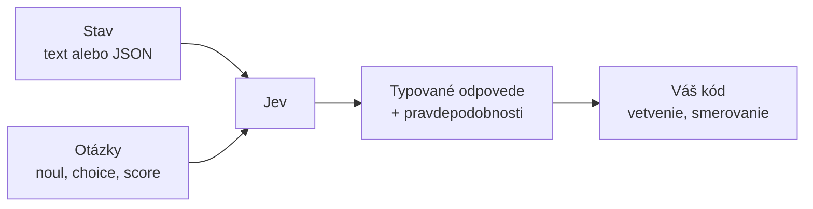
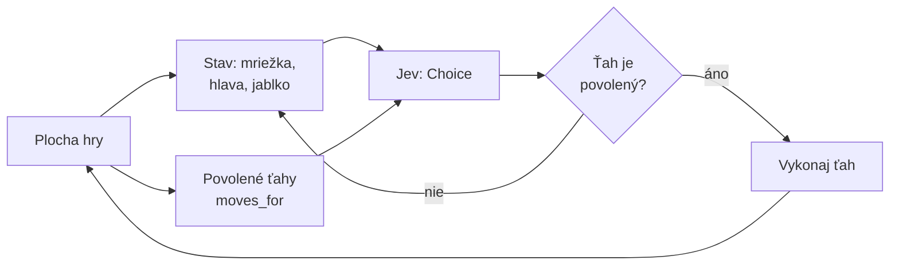

# Jev: model na rýchle rozhodnutia

*Verzia 1.0 · stav k novembru 2026. Nástroje sa menia rýchlo; pred  
nasadením si overte aktuálnu dokumentáciu TypeSafe.*  

## 1. Prečo Jev

Väčšina AI modelov, s ktorými ste sa doteraz stretli, píše text. ChatGPT,  
Claude alebo Gemini odpovedajú vetami, odsekmi a kódom. Lenže v mnohých  
programoch text vôbec nechcete. Chcete jedno rozhodnutie: je e-mail spam,  
ktorý tím vybaví požiadavku, aká vážna je chyba.  

**Jev** je model spoločnosti TypeSafe AI, ktorý robí presne toto. Nepíše  
text, ale vracia **typované rozhodnutia**, teda hodnoty presne určeného  
druhu: jednu možnosť zo zoznamu, číslo na stupnici alebo pravdepodobnosť  
odpovede áno. Spoločnosť ho zverejnila 15. septembra 2026 ako prvý model  
typu **System One**. Aktuálna verzia je Jev 1.14 zo 14. októbra 2026.  

Názov odkazuje na ekonóma Williama Stanleyho Jevonsa a jeho **Jevonsov  
paradox**: keď niečo zlacnie, ľudia to začnú používať oveľa viac. TypeSafe  
stavia na tom, že lacné a rýchle AI rozhodnutia sa dostanú do bežného  
softvéru vo veľkom množstve.  



> **Jednoducho povedané:** Bežný jazykový model je spisovateľ, ktorý vám  
> napíše esej. Jev je skúsený referent, ktorý si prečíta spis a zaškrtne  
> políčko na formulári. Formulár, teda možné odpovede, pripravíte vy.  

## 2. Ako sa Jev líši od bežných LLM

**LLM** (large language model, veľký jazykový model) generuje text slovo  
po slove, presnejšie **token** po tokene. Token je kúsok textu, približne  
časť slova. Keď od LLM chcete štruktúrované rozhodnutie, musíte ho prosiť,  
aby odpovedal v určitom formáte, a výsledok potom v kóde rozoberať.  
Model sa môže od formátu odchýliť alebo si vymyslieť možnosť, ktorá  
neexistuje.  

Jev text negeneruje. Vyhodnotí vstup a vráti hodnotu, ktorej tvar je daný  
vopred. Ak mu dáte na výber štyri tímy, odpovie jedným z nich, nič iné  
vrátiť nemôže. Odpoveď môže byť nesprávna, ale vždy má správny tvar.  

| Vlastnosť | Bežný LLM (System Two) | Jev (System One) |  
|---|---|---|  
| výstup | voľný text | typovaná hodnota |  
| rýchlosť | sekundy | asi 70 – 500 ms |  
| cena | platíte vstup aj výstup | len vstup, výstup zadarmo |  
| formát odpovede | treba kontrolovať | zaručený |  
| istota | len odhadom | pravdepodobnosti |  
| vhodný na | písanie, kód, analýzu | triedenie, smerovanie |  

### System One a System Two

Pomenovanie pochádza z knihy Daniela Kahnemana *Myslenie, rýchle  
a pomalé*. **Systém 1** je rýchle, intuitívne myslenie, napríklad keď  
okamžite spoznáte nahnevanú tvár. **Systém 2** je pomalé a premyslené  
uvažovanie, napríklad keď počítate daňové priznanie.  

Jev je rýchly „systém 1“ pre softvér. Modely ako Claude či GPT, najmä  
pri dlhšom uvažovaní, zodpovedajú „systému 2“. Navzájom sa dopĺňajú:  
Jev rýchlo roztriedi tisíce požiadaviek a tie zložité pošle ďalej  
človeku alebo veľkému modelu.  

### Stav a otázky

Každá požiadavka na Jev má dve hlavné časti:  

- **stav** (state) – vstupné údaje, ktoré model posudzuje: text, JSON  
  objekt alebo pole,  
- **otázky** (questions) – pomenované otázky, každá určitého typu.  

Všetky otázky sa vyhodnotia **paralelne** (súbežne) a **nezávisle** proti  
tomu istému stavu. Pridanie ďalšej otázky preto odpoveď takmer nespomalí.  

### Typy otázok (primitíva)

Dokumentácia typy otázok volá **primitíva**, teda základné stavebné  
kamene, z ktorých skladáte väčšie riešenia.  

| Typ | Pýta sa | Vráti |  
|---|---|---|  
| `noul` | Je to pravda? | `noul` – pravdepodobnosť áno, 0 až 1 |  
| `choice` | Ktorá možnosť? | `choice`, `probabilities`, `confidence` |  
| `score` | Koľko na stupnici? | `score`, `probabilities`, `confidence` |  
| `box` | Kde je to na obrázku? | `box` – štyri okraje, `confidence` |  

- **Noul** (z angl. no/null, áno-nie) odpovedá na otázku áno alebo nie.  
  Hodnota `0.95` znamená 95 % pravdepodobnosť odpovede áno.  
- **Choice** vyberie jednu možnosť z vašich `criteria`. Kľúče sú názvy  
  možností, hodnoty ich krátky opis.  
- **Score** posúdi stav na stupnici. Úrovne zadáte ako zoznam od najnižšej  
  (0) po najvyššiu. Výsledok môže padnúť aj medzi úrovne, napríklad `1.4`.  
- **Box** nájde objekt na obrázku a vráti jeho ohraničujúci obdĺžnik.  
  Je zatiaľ v skúšobnom režime, pozri časť 4.  

### Istota (confidence)

Odpovede typu Choice, Score a Box obsahujú **confidence**, číslo od 0  
do 1. Hovorí, ako jednoznačne sa model rozhodol. Hodnota 1 znamená, že  
všetka pravdepodobnosť je na jednej možnosti; 0 znamená, že je rovnomerne  
rozložená. Pri Noul samostatná istota nie je, hodnota blízko `0.5`  
sama znamená neistotu.  

Istota je hlavný rozdiel oproti LLM v praxi. Váš kód môže povedať: pri  
vysokej istote konaj automaticky, pri strednej sa opýtaj človeka, pri  
nízkej nerob nič.  

> **Tip:** Dokumentácia odporúča ako východisko pre Noul prahy 0,7 pre  
> „áno“ a 0,3 pre „nie“. Hodnoty medzi nimi je rozumné poslať na  
> kontrolu človeku.  

### Čo Jev nedokáže

- Nepíše text: e-maily, zhrnutia, preklady ani kód.  
- Nevysvetľuje, prečo sa rozhodol.  
- Najlepšie funguje po anglicky. Slovenčinu spracuje, ale TypeSafe  
  odporúča overiť si presnosť na vlastných údajoch.  
- Podľa dokumentácie má verzia 1.13 slabiny pri počítaní, aritmetike  
  a porovnávaní dátumov. Výpočty preto nechajte na kód.  
- Kontext je obmedzený na 64 000 tokenov na požiadavku a 32 000 tokenov  
  na jednu otázku.  

> **Jednoducho povedané:** Pýtajte sa Jev na veci, ktoré by skúsený človek  
> posúdil za pár sekúnd. Zložitejšiu otázku rozdeľte na viac jednoduchých  
> a výsledky spojte v kóde.  

## 3. Príprava

Budete potrebovať:  

- účet v konzole TypeSafe na `console.typesafe.ai`,  
- **API kľúč** – tajný reťazec, ktorým sa program prihlási k službe,  
- **Python** 3.10 alebo novší,  
- nástroj **uv** na správu Python projektov,  
- pre hru v časti 6 aj knižnicu **Arcade**.  

### Účet a API kľúč

1. Prihláste sa na `console.typesafe.ai`.  
2. V ľavom menu otvorte **API Keys** a vytvorte nový kľúč.  
3. Kľúč si hneď uložte, napríklad do správcu hesiel.  
4. V položke **Usage** sledujete spotrebu, zostatok kreditu vidíte  
   vľavo dole (**Balance**).  

Cena je 0,042 USD za milión vstupných tokenov, výstup je zadarmo.  
Jedna krátka otázka stojí zlomok centu.  

### Premenná prostredia

Kľúč nikdy nepíšte priamo do kódu. Uložte ho do **premennej prostredia**,  
teda hodnoty, ktorú operačný systém sprístupní spusteným programom.  
Príklady v tejto kapitole čítajú premennú `JEV_API_KEY`:  

```bash
export JEV_API_KEY="váš-kľúč"
```

> **Pozor:** SDK samo od seba hľadá premennú `TYPESAFE_API_KEY`. Naše  
> príklady odovzdávajú kľúč explicitne cez `api_key=`, preto stačí  
> `JEV_API_KEY`. Ak kľúč do klienta neodovzdáte, nastavte `TYPESAFE_API_KEY`.  

### Projekt s príkladmi

Kód z tejto kapitoly máte celý v texte, takže si súbory vytvoríte sami.  
Vytvorte priečinok `jev-priklady` s touto štruktúrou:  

```text
jev-priklady/
├── pyproject.toml
├── 01-noul/naliehavost.py
├── 02-choice/tikety.py
├── 03-score/hodnotenie.py
├── 04-viac-otazok/triedenie.py
├── 05-rest/rest.py
├── 06-snake/
│   ├── snake_game3.py
│   ├── head32.png
│   ├── dot32.png
│   └── apple32.png
└── 07-jev-table/
    ├── vzorka.csv
    └── pack.yaml
```

```toml
[project]
name = "jev-priklady"
version = "0.1.0"
description = "Príklady ku kapitole o modeli Jev"
requires-python = ">=3.10"
dependencies = [
    "arcade>=3.3.3",
    "requests>=2.32",
    "typesafe-sdk>=0.7.5",
]
```

Knižnica `typesafe-sdk` je oficiálny Python **SDK** (software development  
kit, súprava na vývoj), ktorý zjednodušuje volanie API. Verzia 0.7.5  
pridala podporu obrázkov a typu Box.  

Inštalácia a overenie:  

```bash
cd jev-priklady
uv sync
uv run python -c "import typesafe_sdk; print(typesafe_sdk.__version__)"
```

Výstup má byť `0.7.5` alebo vyššie číslo.  

## 4. Playground: Jev v prehliadači

**Playground** je stránka v konzole TypeSafe, kde Jev skúšate bez  
programovania. Nájdete ho na `console.typesafe.ai/playground` alebo  
v ľavom menu konzoly. Opis nižšie zodpovedá podobe zo začiatku  
novembra 2026.  

### Ako vyzerá

| Časť | Čo v nej robíte |  
|---|---|  
| **State** (hore) | vložíte stav, teda text alebo JSON |  
| **Questions** (dole) | zadáte otázky ako JSON |  
| karty `noul`, `score`, `choice`, `box` | vložia šablónu otázky |  
| **Format** | upraví odsadenie JSON |  
| počítadlo s ikonou `!` | ukáže počet chýb v zápise |  
| **Click to upload assets** | nahrá obrázok |  
| výber modelu (dole) | `jev-latest` alebo `jev-preview` |  
| **Run** | odošle požiadavku |  
| **Clear** a **Share** (hore) | vymaže zadanie, zdieľa ho |  

Prázdny editor otázok ponúka štyri karty s typmi otázok. Kliknutím  
na kartu dostanete hotovú šablónu, ktorú len upravíte.  

> **Tip:** Alias `jev-preview` ukazuje na najnovšie vydanie vrátane  
> skúšobných verzií, `jev-latest` na posledné stabilné. Momentálne  
> oba ukazujú na `jev-1.14.0`.  

### Príklad A: je správa naliehavá? (Noul)

State:  

```json
{
  "sprava": "Naše API od rána vracia chybu 500 a nevieme spracovať objednávky."
}
```

Questions:  

```json
{
  "naliehave": {
    "type": "noul",
    "instructions": "Does this message express urgency?"
  }
}
```

Stlačte **Run**. Odpoveď `noul` by mala byť vysoká, blízko 1.  

### Príklad B: komu patrí e-mail? (Choice)

State:  

```json
{
  "predmet": "Dvojitá platba",
  "text": "Za septembrovú faktúru mi strhli peniaze dvakrát."
}
```

Questions:  

```json
{
  "tim": {
    "type": "choice",
    "instructions": "Which team should handle this email?",
    "criteria": {
      "fakturacia": "Payments, invoices, refunds",
      "technicka": "Bugs, crashes, errors",
      "obchod": "Prices, offers, new contracts"
    }
  }
}
```

V odpovedi uvidíte vybranú možnosť, pravdepodobnosť každej možnosti  
a istotu.  

### Príklad C: aká vážna je chyba? (Score)

State:  

```json
{
  "hlasenie": "Po kliknutí na Uložiť sa stratí celý rozpísaný dokument."
}
```

Questions:  

```json
{
  "zavaznost": {
    "type": "score",
    "instructions": "How severe is this bug for the user?",
    "criteria": [
      "Cosmetic, no impact",
      "Minor inconvenience, easy workaround",
      "Major problem, no easy workaround",
      "Critical, data loss or security risk"
    ]
  }
}
```

Úrovne sú očíslované od 0. Strata dát by mala dostať hodnotu blízko 3.  

### Príklad D: viac otázok naraz

Do jednej požiadavky môžete dať ľubovoľnú zmes otázok. State môžete  
ponechať z príkladu B, alebo vložiť vlastný. Otázky nahraďte týmito:  

State:  

```json
{
  "predmet": "Dvojitá platba",
  "text": "Za septembrovú faktúru mi strhli peniaze dvakrát."
}
```

Questions:  

```json
{
  "vratenie": {
    "type": "noul",
    "instructions": "Does the customer ask for a refund?"
  },
  "slusnost": {
    "type": "noul",
    "instructions": "Is the message polite?",
    "criteria": {
      "true": "Neutral or friendly wording",
      "false": "Rude, insulting or threatening wording"
    }
  },
  "hnev": {
    "type": "score",
    "instructions": "How frustrated is the customer?",
    "criteria": ["Calm", "Annoyed", "Frustrated", "Very angry"]
  }
}
```

Pri Noul môžete v `criteria` voliteľne opísať, čo znamená „áno“ (`true`)  
a čo „nie“ (`false`). Model potom presnejšie vie, čo hľadáte.  

### Príklad E: kde je objekt na obrázku? (Box)

Obrázky a otázky typu Box sú podľa TypeSafe zatiaľ **dreamer-ready**:  
vhodné na pokusy a prototypy, nie na ostrú prevádzku. Formát aj presnosť  
sa môžu meniť.  

  

1. Kliknite na **Click to upload assets** a nahrajte fotografiu vo  
   formáte PNG alebo JPEG, napríklad stôl s jablkom.  
2. V editore State napíšte `/` a vyberte nahraný obrázok. Do stavu sa  
   vloží odkaz naň, napríklad pod kľúč `foto`.  
3. Vložte otázky:  

```json
{
  "je_tam": {
    "type": "noul",
    "instructions": "Is there an apple in `foto`?"
  },
  "jablko": {
    "type": "box",
    "instructions": "the apple in `foto`"
  }
}
```

Box vráti štyri okraje `top`, `bottom`, `left`, `right` ako zlomky  
šírky a výšky obrázka, merané od ľavého horného rohu. Hodnota  
`left: 0.44` znamená 44 % šírky zľava.  

> **Pozor:** Box vráti obdĺžnik vždy, aj keď objekt na obrázku nie je.  
> Preto sa vedľa neho pýtajte Noul otázkou, či tam objekt vôbec je.  

### Príklad F: poškodenie telefónu na fotke (Score)

Zákazník pošle fotku telefónu. Jev odhadne rozsah poškodenia na stupnici  
od 0 po 3. Ide o príklad s obrázkom, preto platí rovnaké upozornenie ako  
pri Box.  

Fotka *Rozbitý telefón na dlažbe*

1. Nahrajte fotku cez **Click to upload assets**.  
2. V editore State napíšte `/` a vyberte fotku. Kľúč nech je `foto`.  
3. Vložte otázku:  

```json
{
  "poskodenie": {
    "type": "score",
    "instructions": "How badly is the phone in `foto` damaged?",
    "criteria": [
      "No visible damage",
      "Small scratches only",
      "Cracked screen or case",
      "Broken screen, phone unusable"
    ]
  }
}
```

Hodnota blízko 0 znamená bez poškodenia, blízko 3 nepoužiteľný telefón.  
Hodnoty medzi tým ukazujú, že model váha medzi dvoma úrovňami.  

> **Pozor:** Obrázky sú zatiaľ v skúšobnom režime. Dokumentácia pre API  
> vyžaduje hlavičku `TypeSafe-Danger-Zone-Images: true`. Či ju Playground  
> nastaví sám, sme neoverili.  

### Príklad G: čo leží na poličke? (Choice a Noul s obrázkom)

Jedna fotka môže slúžiť viacerým otázkam naraz. Obe otázky sa vyhodnotia  
nad tým istým obrázkom.  

Fotka: *Regál s nápojmi a konzervami*

1. Nahrajte fotku regála a v State ju odkážte cez `/` pod kľúčom `polica`.  
2. Vložte otázky:  

```json
{
  "vyrobok": {
    "type": "choice",
    "instructions": "What kind of product is most visible in `polica`?",
    "criteria": {
      "napoje": "Bottles, cans or cartons of drinks",
      "konzervy": "Canned or jarred food",
      "pecivo": "Bread, pastry or baked goods",
      "ine": "Anything else"
    }
  },
  "mlieko": {
    "type": "noul",
    "instructions": "Is there a carton of milk in `polica`?"
  }
}
```

### Príklad H: najnegatívnejšia recenzia (JSON ako stav)

Stav nemusí byť text. Môže to byť JSON objekt s viacerými položkami.  
Otázka sa potom pýta na konkrétnu položku.  

1. Do State vložte tento JSON:  

```json
{
  "recenzie": [
    "Výborný produkt, doručenie bolo rýchle.",
    "Tovar prišiel poškodený a nikto mi neodpovedal na e-mail.",
    "Vo všeobecnosti v pohode, len balenie mohlo byť lepšie."
  ]
}
```

2. Vložte otázku:  

```json
{
  "najhorsia": {
    "type": "choice",
    "instructions": "Which review in `recenzie` is the most negative?",
    "criteria": {
      "prva": "The first review",
      "druha": "The second review",
      "tretia": "The third review"
    }
  }
}
```

Pri overení s modelom `jev-1.14.0` vrátil `druha` s istotou 100 %.  
Ak chcete, aby model vracal čitateľnejšie názvy, upravte kľúče v `criteria`.  

### Príklad I: je e-mail podvod? (Noul a Score)

Jev môže posúdiť aj podozrivú správu. State ponechajte z príkladu B,  
alebo vložte vlastný e-mail. Obe otázky sa vyhodnotia nad tým istým  
textom.  

State:  

```json
{
  "predmet": "URGENT: overte si účet",
  "text": "Váš účet bude zablokovaný do 24 hodín. Kliknite na odkaz a zadajte prihlasovacie údaje."
}
```

Questions:  

```json
{
  "podvod": {
    "type": "noul",
    "instructions": "Is this email a phishing or scam attempt?"
  },
  "riziko": {
    "type": "score",
    "instructions": "How risky is this email for the recipient?",
    "criteria": ["Harmless", "Suspicious", "Likely scam", "Clear phishing"]
  }
}
```

### Príklad J: v akom jazyku je správa? (Choice)

Model môže rozpoznať jazyk správy. Úrovne zadáte ako možnosti.  

State:  

```json
{
  "text": "Dobrý deň, potrebujem pomoc s objednávkou."
}
```

Questions:  

```json
{
  "jazyk": {
    "type": "choice",
    "instructions": "What language is this message written in?",
    "criteria": {
      "sk": "Slovak",
      "en": "English",
      "de": "German",
      "ina": "Any other language"
    }
  }
}
```

### Príklad K: je text vulgárny? (Noul s opisom)

Pri Noul môžete v `criteria` opísať, čo znamená „áno“ a „nie“.  
Model potom presnejšie vie, čo hľadáte.  

State:  

```json
{
  "komentar": "Tento produkt je úplne zbytočný a predajca je hlupák."
}
```

Questions:  

```json
{
  "vulgarny": {
    "type": "noul",
    "instructions": "Is the comment abusive or vulgar?",
    "criteria": {
      "true": "Insulting, vulgar or threatening wording",
      "false": "Neutral or constructive wording"
    }
  }
}
```

### Vyskúšajte  
  ako hodnota `noul` klesne.  
- V príklade B pridajte možnosť `ina` s opisom „Anything else“ a pošlite  
  e-mail, ktorý nepatrí nikomu. Ako sa zmení istota?  
- Napíšte otázku v príklade C po slovensky a porovnajte výsledok  
  s anglickou verziou.  
- Pošlite v príklade D zdvorilú a potom hrubú verziu správy.  
- V príklade F nahrajte fotku nepoškodeného telefónu. Aký bude výsledok?  
- V príklade G pridajte otázku Choice s možnosťou `ovocie`. Ako sa zmení  
  rozdelenie pravdepodobností?  
- V príklade H zmeňte poradie recenzií. Mení sa odpoveď, alebo len názov  
  položky?  
- V príklade I zmeňte správu na bežnú faktúru. Ako sa zmení skóre  
  rizika?  
- V príklade J pošlite správu v angličtine a sledujte istotu výberu.  
- V príklade K upravte opis v `criteria` a porovnajte výsledok.  

## 5. Jev v Pythone

Playground je dobrý na skúšanie, v praxi však Jev voláte z programu.  
Všetky príklady spúšťate z priečinka `jev-priklady`:  

```bash
uv run python 01-noul/naliehavost.py
```

Uvedené výstupy pochádzajú zo skutočného behu s modelom `jev-1.14.0`.  
Vaše čísla sa môžu mierne líšiť.  

### Príklad 1: Noul

Program posúdi tri správy a podľa prahov 0,7 a 0,3 rozhodne „áno“, „nie“  
alebo „neisté“.  

```python
"""Noul: je správa naliehavá? Jev vráti pravdepodobnosť odpovede áno."""

import os
import sys

from typesafe_sdk import Noul, TypeSafeClient

kluc = os.getenv("JEV_API_KEY")
if not kluc:
    sys.exit("Premenná JEV_API_KEY nie je nastavená.")

spravy = [
    "Ďakujem, už to funguje.",
    "Ako si zmením heslo?",
    "Platba trikrát zlyhala a výplaty musíme poslať ešte dnes.",
]

otazky = {
    "naliehave": Noul(instructions="Does this message need urgent attention?"),
}

with TypeSafeClient(api_key=kluc, model="jev-latest") as klient:
    for sprava in spravy:
        odpoved = klient.system_one(state=sprava, questions=otazky)
        p = odpoved.nouls["naliehave"].noul
        # Prahy 0,7 a 0,3 odporúča dokumentácia ako východisko.
        if p >= 0.7:
            verdikt = "áno"
        elif p <= 0.3:
            verdikt = "nie"
        else:
            verdikt = "neisté"
        print(f"{p:5.0%}  {verdikt:7}  {sprava}")
```

Výstup:  

```text
   4%  nie      Ďakujem, už to funguje.
  12%  nie      Ako si zmením heslo?
  96%  áno      Platba trikrát zlyhala a výplaty musíme poslať ešte dnes.
```

`TypeSafeClient` je klient, ktorý posiela požiadavky. Konštrukcia `with`  
zaručí, že sa sieťové spojenie na konci zatvorí. Metóda `system_one()`  
pošle stav a otázky, odpovede typu Noul sú v slovníku `odpoved.nouls`.  

### Vyskúšajte

- Pridajte do zoznamu správu, pri ktorej čakáte neistý výsledok,  
  napríklad „Kedy mi konečne niekto odpíše?“.  
- Zmeňte prah 0,7 na 0,9. Koľko správ sa ešte označí ako naliehavé?  

### Príklad 2: Choice

Program zaradí štyri požiadavky zákazníkov do tímov.  

```python
"""Choice: ktorý tím má vybaviť požiadavku zákazníka?"""

import os
import sys

from typesafe_sdk import Choice, TypeSafeClient

kluc = os.getenv("JEV_API_KEY")
if not kluc:
    sys.exit("Premenná JEV_API_KEY nie je nastavená.")

tikety = [
    "Faktúra za október mi neprišla, hoci platba odišla.",
    "Aplikácia na Androide spadne hneď po spustení.",
    "Balík je podľa sledovania doručený, ale nemám ho.",
    "Potrebujem previesť správu účtu na kolegu.",
]

timy = {
    "fakturacia": "Payments, invoices, refunds, subscription charges",
    "technicka": "Bugs, crashes, errors, login problems",
    "doprava": "Deliveries, packages, tracking, missing items",
    "ucet": "Profile settings, personal data, ownership transfer",
}

otazka = Choice(
    instructions="Which team should handle this support ticket?",
    criteria=timy,
)

with TypeSafeClient(api_key=kluc, model="jev-latest") as klient:
    for tiket in tikety:
        odpoved = klient.system_one(state=tiket, questions={"tim": otazka})
        vyber = odpoved.choices["tim"]
        print(f"{vyber.choice:11} istota {vyber.confidence:4.0%}  {tiket}")
```

Výstup:  

```text
fakturacia  istota 100%  Faktúra za október mi neprišla, hoci platba odišla.
technicka   istota 100%  Aplikácia na Androide spadne hneď po spustení.
doprava     istota 100%  Balík je podľa sledovania doručený, ale nemám ho.
ucet        istota 100%  Potrebujem previesť správu účtu na kolegu.
```

Otázku `otazka` vytvoríte raz a použijete pre všetky tikety. Kľúče  
v `timy` sú zároveň hodnoty, ktoré model môže vrátiť v `vyber.choice`.  

### Vyskúšajte

- Pridajte tiket, ktorý patrí do dvoch tímov naraz, napríklad  
  „Po zmene karty mi aplikácia hlási chybu platby“. Aká je istota?  
- Vypíšte aj `vyber.probabilities` a pozrite si rozdelenie  
  pravdepodobností medzi tímy.  

### Príklad 3: Score

Program ohodnotí nespokojnosť zákazníka na stupnici 0 až 3.  

```python
"""Score: ako veľmi je zákazník nespokojný? Úrovne idú od 0 vyššie."""

import os
import sys

from typesafe_sdk import Score, TypeSafeClient

kluc = os.getenv("JEV_API_KEY")
if not kluc:
    sys.exit("Premenná JEV_API_KEY nie je nastavená.")

recenzie = [
    "Všetko prišlo včas a funguje výborne.",
    "Tovar je v poriadku, ale doprava trvala týždeň.",
    "Už tretí raz mi poslali zlý kus a nikto neodpovedá!",
]

urovne = [
    "Calm or satisfied, no complaint",
    "Mild annoyance, small complaint",
    "Clearly frustrated, firm complaint",
    "Very angry, repeated or escalating complaint",
]

otazka = Score(
    instructions="How frustrated is the customer?",
    criteria=urovne,
)

with TypeSafeClient(api_key=kluc, model="jev-latest") as klient:
    for text in recenzie:
        odpoved = klient.system_one(state=text, questions={"hnev": otazka})
        hodnota = odpoved.scores["hnev"]
        najblizsia = urovne[round(hodnota.score)]
        print(f"{hodnota.score:4.2f} / 3  ({najblizsia})  {text}")
```

Výstup:  

```text
0.00 / 3  (Calm or satisfied, no complaint)  Všetko prišlo včas a funguje výborne.
1.01 / 3  (Mild annoyance, small complaint)  Tovar je v poriadku, ale doprava trvala týždeň.
3.00 / 3  (Very angry, repeated or escalating complaint)  Už tretí raz mi poslali zlý kus a nikto neodpovedá!
```

Hodnota `score` je vážený priemer úrovní. Ak model dá polovicu  
pravdepodobnosti úrovni 1 a polovicu úrovni 2, výsledok bude `1.5`.  
Funkcia `round()` ho zaokrúhli na najbližšiu úroveň.  

### Vyskúšajte

- Opíšte úrovne podrobnejšie a sledujte, či sa výsledky zmenia.  
- Pridajte piatu úroveň a upravte výpis z „/ 3“ na „/ 4“.  

### Príklad 4: viac otázok a rozhodovanie podľa istoty

Jedna požiadavka obsahuje štyri otázky rôznych typov. O ďalšom kroku  
potom rozhoduje obyčajný kód, nie model.  

```python
"""Viac otázok v jednej požiadavke a rozhodnutie podľa istoty."""

import os
import sys

from typesafe_sdk import Choice, Noul, Score, TypeSafeClient

kluc = os.getenv("JEV_API_KEY")
if not kluc:
    sys.exit("Premenná JEV_API_KEY nie je nastavená.")

sprava = (
    "Dobrý deň, včera ste mi dvakrát strhli platbu za predplatné. "
    "Prosím o vrátenie jednej sumy, inak predplatné zruším."
)

otazky = {
    "tema": Choice(
        instructions="What is this message mainly about?",
        criteria={
            "fakturacia": "Payments, charges, refunds",
            "technicka": "Bugs and errors",
            "ina": "Anything else",
        },
    ),
    "vratenie": Noul(instructions="Does the customer ask for a refund?"),
    "odchod": Noul(instructions="Does the customer threaten to cancel?"),
    "hnev": Score(
        instructions="How frustrated is the customer?",
        criteria=["Calm", "Annoyed", "Frustrated", "Very angry"],
    ),
}

with TypeSafeClient(api_key=kluc, model="jev-latest") as klient:
    odpoved = klient.system_one(state=sprava, questions=otazky)

tema = odpoved.choices["tema"]
vratenie = odpoved.nouls["vratenie"].noul
odchod = odpoved.nouls["odchod"].noul
hnev = odpoved.scores["hnev"].score

print(f"téma:      {tema.choice} (istota {tema.confidence:.0%})")
print(f"vrátenie:  {vratenie:.0%}")
print(f"odchod:    {odchod:.0%}")
print(f"hnev:      {hnev:.2f} / 3")
print(f"model:     {odpoved.model}, vstupné tokeny {odpoved.usage.input_tokens}")

# O ďalšom kroku rozhoduje kód, nie model.
if tema.confidence < 0.5:
    print("Ďalší krok: poslať človeku, model si nie je istý.")
elif odchod > 0.7 or hnev >= 2:
    print("Ďalší krok: prednostne, hrozí odchod zákazníka.")
else:
    print(f"Ďalší krok: bežná fronta tímu {tema.choice}.")
```

Výstup:  

```text
téma:      fakturacia (istota 100%)
vrátenie:  99%
odchod:    97%
hnev:      1.47 / 3
model:     jev-1.14.0, vstupné tokeny 455
Ďalší krok: prednostne, hrozí odchod zákazníka.
```

Pole `odpoved.model` obsahuje presnú verziu modelu, ktorá odpovedala.  
Oplatí sa ho ukladať do záznamov, lebo alias `jev-latest` sa s novým  
vydaním posunie na novú verziu.  

> **Tip:** Ak ste si prahy istoty vyladili na jednej verzii, posielajte  
> namiesto aliasu presné ID, napríklad `jev-1.14.0`. Na novú verziu  
> prejdete, až keď ju otestujete.  

### Vyskúšajte

- Zmeňte správu tak, aby zákazník nehrozil zrušením. Ktorá vetva  
  podmienky sa vykoná?  
- Pridajte otázku Noul „Is the message written in Slovak?“.  

### Príklad 5: priame volanie HTTP API

SDK je len pohodlná vrstva nad **HTTP API**, teda rozhraním, ktoré  
prijíma požiadavky cez web. Rovnakú otázku pošlete aj knižnicou  
`requests` metódou `POST` na adresu `https://api.typesafe.ai/v1/systemone`.  

```python
"""Volanie Jev cez HTTP API bez SDK, len s knižnicou requests."""

import json
import os
import sys

import requests

kluc = os.getenv("JEV_API_KEY")
if not kluc:
    sys.exit("Premenná JEV_API_KEY nie je nastavená.")

poziadavka = {
    "model": "jev-latest",
    "state": "Platba trikrát zlyhala a výplaty musíme poslať ešte dnes.",
    "questions": {
        "naliehave": {
            "type": "noul",
            "instructions": "Does this message need urgent attention?",
        }
    },
}

odpoved = requests.post(
    "https://api.typesafe.ai/v1/systemone",
    headers={"Authorization": f"Bearer {kluc}"},
    json=poziadavka,
    timeout=30,
)
odpoved.raise_for_status()

data = odpoved.json()
print(json.dumps(data, indent=2, ensure_ascii=False))
print(f"Naliehavosť: {data['answers']['naliehave']['noul']:.0%}")
```

Výstup:  

```text
{
  "model": "jev-1.14.0",
  "answers": {
    "naliehave": {
      "type": "noul",
      "noul": 0.95
    }
  },
  "usage": {
    "input_tokens": 295,
    "output_tokens": 22
  }
}
Naliehavosť: 95%
```

Hlavička `Authorization` nesie API kľúč. Parameter `json` premení slovník  
na JSON. Metóda `raise_for_status()` vyvolá chybu, ak server vráti chybový  
kód, napríklad 401 pri zlom kľúči.  

| Spôsob | Kedy ho použiť |  
|---|---|  
| SDK | bežná práca, opakovanie pri chybách, typy |  
| `requests` | iný jazyk, ladenie, funkcia, ktorú SDK ešte nemá |  

### Vyskúšajte

- Zmeňte kľúč na nesprávny a pozrite si chybu 401.  
- Pridajte do `questions` otázku typu `choice` priamo ako slovník.  

### Príklad 6: obrázok a typ Box v Pythone

Obrázky sú v skúšobnom režime, preto volanie vyžaduje hlavičku  
`TypeSafe-Danger-Zone-Images: true`. Presný spôsob odovzdania obrázka  
(base64 alebo URL) si overte v aktuálnej dokumentácii; príklad nižšie  
je ilustratívny.  

```python
"""Volanie Jev s obrázkom a typom Box (skúšobný režim)."""

import base64
import json
import os
import sys

import requests

kluc = os.getenv("JEV_API_KEY")
if not kluc:
    sys.exit("Premenná JEV_API_KEY nie je nastavená.")

with open("foto.jpg", "rb") as subor:
    obrazok = base64.b64encode(subor.read()).decode("ascii")

poziadavka = {
    "model": "jev-latest",
    "state": {"foto": f"data:image/jpeg;base64,{obrazok}"},
    "questions": {
        "je_tam": {
            "type": "noul",
            "instructions": "Is there an apple in `foto`?",
        },
        "jablko": {
            "type": "box",
            "instructions": "the apple in `foto`",
        },
    },
}

odpoved = requests.post(
    "https://api.typesafe.ai/v1/systemone",
    headers={
        "Authorization": f"Bearer {kluc}",
        "TypeSafe-Danger-Zone-Images": "true",
    },
    json=poziadavka,
    timeout=30,
)
odpoved.raise_for_status()

data = odpoved.json()
box = data["answers"]["jablko"]["box"]
print(json.dumps(box, indent=2))
# box obsahuje top, bottom, left, right ako zlomky šírky a výšky
```

Výstup (ilustratívny):  

```text
{
  "top": 0.12,
  "bottom": 0.48,
  "left": 0.44,
  "right": 0.71
}
```

> **Pozor:** Box vráti obdĺžnik vždy, aj keď objekt na obrázku nie je.  
> Preto sa vedľa neho pýtajte Noul otázkou, či tam objekt vôbec je.  

### Vyskúšajte

- Nahrajte fotku bez jablka a sledujte, ako sa zmení hodnota Noul.  
- Zmeňte inštrukciu na iný objekt, napríklad „the cup“.  

### Odhad nákladov (Python)

Cena je 0,042 USD za milión vstupných tokenov. Po prvých testoch  
môžete odhadnúť celkovú cenu z priemeru tokenov na požiadavku.  

```python
"""Odhad nákladov pre hromadné spracovanie záznamov."""

pocet_zaznamov = 10_000
priemer_tokenov = 420  # zmerané na vzorke
cena_za_milion = 0.042

vstupne_tokeny = pocet_zaznamov * priemer_tokenov
odhad_usd = vstupne_tokeny / 1_000_000 * cena_za_milion
print(f"Odhadovaná cena: {odhad_usd:.2f} USD")
```

Výstup:  

```text
Odhadovaná cena: 0.18 USD
```

> **Tip:** Do odhadu pridajte 10–20 % rezervu na opakovania pri chybách  
> a dlhšie inštrukcie.  

### Hromadné označenie CSV: jev-table

Na triedenie celých tabuliek slúži komunitný nástroj  
[jev-table](https://github.com/dtduc-git/jev-table). Prečíta CSV,  
pošle každý riadok ako stav a do nového CSV zapíše odpovede, istotu  
a frontu na kontrolu. Nástroj je nezávislý od TypeSafe.  

Spustite ho cez `uvx`, projekt netreba vytvárať. Vyžaduje premennú  
`TYPESAFE_API_KEY`:  

```bash
export TYPESAFE_API_KEY="váš-kľúč"
uvx jev-table vzorka.csv --spec pack.yaml --dry-run
uvx jev-table vzorka.csv --spec pack.yaml
```

Prvý príkaz nič neposiela, len odhadne tokeny a cenu. Druhý vytvorí  
`vzorka.jev.csv` s odpoveďami a `vzorka.jev.corrections.csv` s riadkami  
na kontrolu.  

Testovacia tabuľka:  

```csv
id,text
1,"Faktúra za október mi neprišla, hoci platba odišla."
2,"Aplikácia na Androide spadne hneď po spustení."
3,"Balík je podľa sledovania doručený, ale nemám ho."
4,"Chcem vrátiť peniaze za zdvojenú platbu."
5,"Kedy bude dostupný nový model?"
6,"Po zmene karty mi aplikácia hlási chybu platby."
7,"Chcem zmeniť fakturačnú adresu na novú."
8,"Aplikácia sa po aktualizácii neprihlási."
9,"Objednávka číslo 1234 stále neprišla."
10,"Ako zruším predplatné?"
11,"Z účtu mi zmizli všetky údaje."
12,"Prosím o vystavenie duplikátu faktúry."
13,"Neprišiel mi e-mail s potvrdením objednávky."
14,"Chcem zmeniť heslo, ale odkaz nefunguje."
15,"Faktúra obsahuje nesprávnu sumu."
16,"Doručenie mešká už tri dni."
17,"Aplikácia mi neukazuje históriu objednávok."
18,"Predplatné sa mi obnovilo bez súhlasu."
19,"Ako nastavím dvojfaktorové overenie?"
20,"Vrátený tovar mi stále nebol preplatený."
21,"Balík prišiel poškodený."
22,"Pri prihlásení mi hlási neplatné údaje."
23,"Chcem previesť účet na inú osobu."
24,"Platba kartou bola zamietnutá."
25,"Objednávku som omylom zadal dvakrát."
26,"Kde nájdem svoju faktúru?"
27,"Zmenil som adresu, ale zásielka ide na starú."
28,"Aplikácia sa načíta veľmi pomaly."
29,"Chcem zrušiť objednávku pred odoslaním."
30,"Podpora mi neodpovedala už týždeň."
```

Specifikácia YAML:  

```yaml
spec: 0
id: poziadavky
version: 0.1.0
license: CC0-1.0
tested: null
description: Zaraďte požiadavky zákazníkov a odhadnite naliehavosť.
state:
  description: Text požiadavky zákazníka.
  fields: [text]
questions:
  tim:
    type: choice
    instructions: "Which team should handle `text`?"
    options:
      fakturacia: "Payments, invoices and refunds."
      technicka: "Bugs, crashes and errors."
      doprava: "Deliveries, packages and tracking."
      ucet: "Profile settings and account ownership."
      unknown: "Cannot tell from the text alone."
  naliehavost:
    type: score
    instructions: "How urgent is `text` for the support team?"
    levels: [low, normal, high, unknown]
  vratenie:
    type: noul
    instructions: "Does `text` ask for a refund?"
thresholds:
  tim: {fakturacia: 0.8, technicka: 0.8, doprava: 0.8, ucet: 0.8}
  naliehavost: {low: 0.7, normal: 0.7, high: 0.7}
  vratenie: {true: 0.85, false: 0.85}
```

Nástroj autoakceptuje odpoveď len vtedy, keď jej pravdepodobnosť  
prekročí prah v `thresholds`. Ostatné riadky skončia vo fronte  
na kontrolu.  

> **Tip:** Pridajte `--model jev-1.14.0`, aby výsledky zostali  
> stabilné aj po vydaní novej verzie.  

## 6. Projekt: Jev hrá hada

V hre Snake (had) sa had pohybuje po mriežke, zbiera jablká a s každým  
jablkom sa predĺži. Nesmie naraziť do steny ani do seba. V tomto projekte  
hada neovládate vy ani žiadny lokálny algoritmus. **Každý ťah vyberie Jev.**  

Hra je dobrá ukážka toho, ako Jev zapadá do programu:  

1. program opíše hraciu plochu ako stav,  
2. povolené ťahy ponúkne ako možnosti otázky Choice,  
3. Jev vyberie jeden ťah,  
4. program skontroluje, či je ťah stále povolený, a vykoná ho.  



### Ako hra funguje

- Plocha má 22 stĺpcov a 16 riadkov, políčko (0, 0) je vľavo dole.  
- Funkcia `moves_for` vráti povolené ťahy: nie do steny, nie späť  
  do krku, nie do vlastného tela.  
- Funkcia `grid_rows` nakreslí plochu znakmi: `H` hlava, `o` telo,  
  `A` jablko, `.` prázdne políčko.  
- Každý povolený ťah má v `criteria` slovný opis, napríklad či hlavu  
  priblíži k jablku.  
- Volanie API beží v samostatnom **vlákne** (paralelne bežiacej časti  
  programu), takže okno počas čakania nezamrzne.  
- Funkcia `board_signature` označí každú otázku podpisom plochy.  
  Odpoveď na staršiu podobu plochy hra zahodí.  
- Po troch neúspešných volaniach za sebou sa hra zastaví a čaká  
  na kláves `R`.  

Had sa pohne len tak rýchlo, ako Jev odpovedá, teda asi raz za  
štvrť sekundy. Rýchlejšie to nejde, lebo ďalšiu plochu nepoznáme,  
kým sa neurobí aktuálny ťah.  

### Spustenie

```bash
cd jev-priklady/06-snake
export JEV_API_KEY="váš-kľúč"
uv run python snake_game3.py
```

Obrázky `head32.png`, `dot32.png` a `apple32.png` nájdete v repozitári  
kurzu na GitHube v priečinku `jev-priklady/06-snake/`. Uložte ich do  
priečinka `06-snake` vedľa súboru `snake_game3.py`.  

| Kláves | Akcia |  
|---|---|  
| `P` | pozastaví alebo spustí hru |  
| `R` | nová hra, znova načíta `JEV_API_KEY` |  

> **Pozor:** Každý ťah je jedna platená požiadavka. Pri cene Jev ide  
> o zanedbateľné sumy, ale hru nenechávajte bežať bez dozoru.  

### Kód hry

Kód je pôvodný program autora a má anglické názvy aj komentáre.  

```python
"""JEv decides every single move, one step at a time.

This is snake_game2 without plan batching: one request, one move. The speed work
that still applies is kept, because none of it depends on planning ahead:

* API calls run on a worker thread, so the window never blocks on the network.
* One ``TypeSafeClient`` is reused instead of built per call.
* A tight retry policy caps each attempt, so a bad request fails fast.
* The next request is submitted in the same tick that a move is applied, so
  there is no idle gap between answers.

The cost of one step at a time is latency: the snake cannot move faster than the
API answers, roughly a quarter second per move, because the next board is unknown
until the current move is made. Local code only checks legality (walls, neck, own
body) and never chooses a move; every move played is an answer JEV gave.

Run with ``uv run python snake_game3.py`` after setting ``JEV_API_KEY``.
"""
import os
import random
import time
from concurrent.futures import Future, ThreadPoolExecutor

import arcade
from typesafe_sdk import Choice, RetryPolicy, TypeSafeClient

WINDOW_WIDTH = 832
WINDOW_HEIGHT = 720
CELL_SIZE = 32
BOARD_COLUMNS = 22
BOARD_ROWS = 16
# Board size in pixels, centred horizontally with a strip left at the bottom for status.
BOARD_WIDTH = BOARD_COLUMNS * CELL_SIZE
BOARD_HEIGHT = BOARD_ROWS * CELL_SIZE
BOARD_LEFT = (WINDOW_WIDTH - BOARD_WIDTH) // 2
BOARD_BOTTOM = 64

# Network policy: wait after a failure, give up after MAX_FAILURES, cap each attempt.
RETRY_DELAY = 1.0
MAX_FAILURES = 3
REQUEST_TIMEOUT = 12.0

# Cell deltas per move, plus the reverse of each so the snake cannot turn into itself.
DIRECTIONS = {"up": (0, 1), "right": (1, 0), "down": (0, -1), "left": (-1, 0)}
OPPOSITE = {"up": "down", "right": "left", "down": "up", "left": "right"}
ARROWS = {"up": "^", "right": ">", "down": "v", "left": "<"}

# Palette used by the board, grid lines, text, and warnings.
BACKGROUND = (15, 25, 29)
BOARD_COLOR = (20, 38, 40)
GRID_COLOR = (29, 51, 52)
TEXT_COLOR = (228, 241, 225)
MUTED_COLOR = (134, 165, 153)
ACCENT_COLOR = (131, 220, 91)
WARN_COLOR = (232, 146, 106)

LEGEND = {"H": "snake head", "o": "snake body", "A": "apple", ".": "empty"}

# The snake is a tuple of (column, row) cells, head first.
Snake = tuple[tuple[int, int], ...]
Cell = tuple[int, int]


def moves_for(snake: Snake, heading: str, apple: Cell) -> dict[str, tuple[Cell, bool]]:
    """Legal moves by the rules of Snake: no walls, no neck, no own body."""
    head_x, head_y = snake[0]
    moves: dict[str, tuple[Cell, bool]] = {}
    for name, (delta_x, delta_y) in DIRECTIONS.items():
        if name == OPPOSITE[heading]:
            continue  # reversing would run into the neck
        target = (head_x + delta_x, head_y + delta_y)
        if not (0 <= target[0] < BOARD_COLUMNS and 0 <= target[1] < BOARD_ROWS):
            continue  # off the board
        eats = target == apple
        # The tail vacates its cell on the same tick, unless the move eats the apple.
        occupied = set(snake) if eats else set(snake[:-1])
        if target not in occupied:
            moves[name] = (target, eats)
    return moves


def grid_rows(snake: Snake, apple: Cell) -> list[str]:
    """ASCII board, top row first, so JEV can see the whole position at once."""
    body = set(snake[1:])
    rows = []
    for row in range(BOARD_ROWS - 1, -1, -1):  # top row first
        rows.append(
            "".join(
                "H" if (column, row) == snake[0]
                else "A" if (column, row) == apple
                else "o" if (column, row) in body
                else "."
                for column in range(BOARD_COLUMNS)
            )
        )
    return rows


def board_signature(round_id: int, snake: Snake, apple: Cell) -> int:
    """Identity of a board, so an answer for an older one can be rejected."""
    # Stamped on a request and returned with the answer; compared again on arrival.
    return hash((round_id, tuple(snake), apple))


class JevSnake(arcade.Window):
    def __init__(self) -> None:

        super().__init__(WINDOW_WIDTH, WINDOW_HEIGHT, "JEV Snake")
        arcade.set_background_color(BACKGROUND)

        # Sprites: head and body are rebuilt per move, the apple is moved in place.
        self.head_texture = arcade.load_texture("head32.png")
        self.body_texture = arcade.load_texture("dot32.png")
        self.apple_texture = arcade.load_texture("apple32.png")
        self.snake_sprites = arcade.SpriteList()
        self.apple_sprites = arcade.SpriteList()
        self.apple_sprite = arcade.Sprite(self.apple_texture)
        self.apple_sprites.append(self.apple_sprite)

        # One worker thread owns all API calls, so the window never blocks.
        self.worker = ThreadPoolExecutor(max_workers=1, thread_name_prefix="jev")
        self.api_key = os.getenv("JEV_API_KEY")
        self.random = random.Random()
        self._client: TypeSafeClient | None = None

        # Request/answer state: at most one pending future, plus the answer it produced.
        self.pending: Future[tuple[int, str | None, str | None]] | None = None
        self.decision: str | None = None
        self.last_choice: str | None = None
        self.history: list[str] = []
        self.note = ""
        self.retry_after = 0.0
        self.failures = 0
        self.error: str | None = None
        self.round_id = 0
        self.paused = False
        self.game_over = False
        self.won = False
        self.status = ""
        self._reset_round()

        # Labelled text objects are created once and only their strings change per frame.
        self._text_title = arcade.Text("JEv SNAKE", BOARD_LEFT, 672, TEXT_COLOR, 27, bold=True)
        self._text_score = arcade.Text("", BOARD_LEFT + BOARD_WIDTH, 672, TEXT_COLOR, 16, anchor_x="right")
        self._text_moves = arcade.Text("", BOARD_LEFT + BOARD_WIDTH, 644, MUTED_COLOR, 12, anchor_x="right")
        self._text_chosen = arcade.Text("", BOARD_LEFT, 616, ACCENT_COLOR, 15, bold=True)
        self._text_history = arcade.Text("", BOARD_LEFT + BOARD_WIDTH, 616, MUTED_COLOR, 13, anchor_x="right")
        self._text_status = arcade.Text("", BOARD_LEFT, 36, MUTED_COLOR, 12)
        self._text_pause = arcade.Text(
            "", BOARD_LEFT + BOARD_WIDTH, 36, MUTED_COLOR, 12, anchor_x="right"
        )
        self._text_error = arcade.Text("", BOARD_LEFT, 12, WARN_COLOR, 11)
        self._text_overlay = arcade.Text(
            "", WINDOW_WIDTH / 2, BOARD_BOTTOM + BOARD_HEIGHT / 2 + 12,
            TEXT_COLOR, 30, bold=True, anchor_x="center",
        )
        self._text_overlay_prompt = arcade.Text(
            "", WINDOW_WIDTH / 2, BOARD_BOTTOM + BOARD_HEIGHT / 2 - 22,
            ACCENT_COLOR, 13, bold=True, anchor_x="center",
        )
        self._text_overlay_note = arcade.Text(
            "", WINDOW_WIDTH / 2, BOARD_BOTTOM + BOARD_HEIGHT / 2 - 46,
            MUTED_COLOR, 12, anchor_x="center",
        )

    # ---------------------------------------------------------------- state

    def _reset_round(self) -> None:
        self.round_id += 1  # new round id invalidates any answer still in flight
        if self.pending is not None:
            self.pending.cancel()

        self.pending = None
        self.decision = None
        self.last_choice = None
        self.history = []
        self.note = ""
        self.retry_after = 0.0
        self.failures = 0
        self.error = None
        # Start as a three-cell snake in the middle, heading right.
        center = (BOARD_COLUMNS // 2, BOARD_ROWS // 2)
        self.snake = [center, (center[0] - 1, center[1]), (center[0] - 2, center[1])]
        self.direction = "right"
        self.score = 0
        self.jev_moves = 0
        self.paused = False
        self.game_over = False
        self.won = False

        self._place_apple()
        self._sync_sprites()
        self._refresh_status()

    def _place_apple(self) -> None:
        # Pick uniformly from the cells the snake does not occupy.
        free = [
            (column, row)
            for column in range(BOARD_COLUMNS)
            for row in range(BOARD_ROWS)
            if (column, row) not in set(self.snake)
        ]

        if not free:
            # No cell left for an apple: the board is cleared.
            self.won = True
            self.game_over = True
            return
        
        self.apple = self.random.choice(free)
        self.apple_sprite.center_x = self._screen_x(self.apple[0])
        self.apple_sprite.center_y = self._screen_y(self.apple[1])

    def _signature(self) -> int:
        """Signature of the board as it is right now."""
        return board_signature(self.round_id, tuple(self.snake), self.apple)

    def _screen_x(self, column: int) -> float:
        """Centre of a board column in window pixels."""
        return BOARD_LEFT + column * CELL_SIZE + CELL_SIZE / 2

    def _screen_y(self, row: int) -> float:
        """Centre of a board row in window pixels."""
        return BOARD_BOTTOM + row * CELL_SIZE + CELL_SIZE / 2

    def _sync_sprites(self) -> None:
        """Rebuild the snake sprites from the cell list (simple and correct at this size)."""
        self.snake_sprites.clear()
        for index, (column, row) in enumerate(self.snake):
            sprite = arcade.Sprite(self.head_texture if index == 0 else self.body_texture)
            sprite.center_x = self._screen_x(column)
            sprite.center_y = self._screen_y(row)
            if index == 0:
                # Point the head sprite along the current heading.
                sprite.angle = {"right": 0, "up": 90, "left": 180, "down": 270}[self.direction]
            self.snake_sprites.append(sprite)

    def _refresh_status(self) -> None:
        """Pick the one-line status message for the current game state."""
        if self.game_over:
            self.status = self.note or (
                "Board cleared - every cell is snake" if self.won else "Game over"
            )
        elif not self.api_key:
            self.status = "JEV_API_KEY is not set"
        elif self.failures >= MAX_FAILURES:
            self.status = f"JEV unreachable after {self.failures} tries - press R to retry"
        elif self.note:
            self.status = self.note
        elif self.decision is not None:
            self.status = f"JEV chose {self.decision.upper()} - applying it now"
        elif self.pending is not None:
            self.status = (
                f"JEV chose {self.last_choice.upper()} - choosing the next move"
                if self.last_choice
                else "JEV is choosing the next move"
            )
        else:
            self.status = (
                f"JEV chose {self.last_choice.upper()}"
                if self.last_choice
                else "Waiting for JEV"
            )

    # ------------------------------------------------------- JEv decisions

    def _client_for(self, api_key: str) -> TypeSafeClient:
        """Reuse one client on the worker thread instead of building one per call."""
        if self._client is None:
            self._client = TypeSafeClient(
                api_key=api_key,
                model="jev-latest",
                retry=RetryPolicy(max_retries=1, timeout=REQUEST_TIMEOUT),
            )
        return self._client

    def _ask(self, round_id: int, snake: Snake, heading: str, apple: Cell,
             score: int, api_key: str) -> tuple[int, str | None, str | None]:
        """Ask JEV for the next single move. Runs on the worker thread."""
        signature = board_signature(round_id, snake, apple)
        moves = moves_for(snake, heading, apple)
        if not moves:
            return signature, None, None  # trapped: an empty answer is not an error

        # Describe every legal move by how it changes the distance to the apple.
        head = snake[0]
        distance = abs(head[0] - apple[0]) + abs(head[1] - apple[1])
        criteria = {}
        for name, (cell, eats) in moves.items():
            if eats:
                criteria[name] = f"Move {name} to {list(cell)} and eat the apple now."
                continue
            change = abs(cell[0] - apple[0]) + abs(cell[1] - apple[1]) - distance
            relation = (
                f"closer by {-change}" if change < 0
                else f"farther by {change}" if change > 0
                else "the same distance"
            )
            criteria[name] = (
                f"Move {name} to {list(cell)}; it is {relation} (distance "
                f"{abs(cell[0] - apple[0]) + abs(cell[1] - apple[1])} instead of {distance})."
            )

        state = {
            # Everything JEV needs to judge the position: grid, goal, and options.
            "board": {"columns": BOARD_COLUMNS, "rows": BOARD_ROWS,
                      "grid_note": "top row first; cell (0,0) is the bottom-left"},
            "grid": grid_rows(snake, apple),
            "legend": LEGEND,
            "head": list(head),
            "apple": list(apple),
            "apple_offset": {"dx": apple[0] - head[0], "dy": apple[1] - head[1],
                             "note": "positive dx is right, positive dy is up"},
            "distance_to_apple": distance,
            "heading": heading,
            "length": len(snake),
            "score": score,
            "legal_moves": {name: {"next_head": list(cell), "eats_apple": eats}
                            for name, (cell, eats) in moves.items()},
        }
        # The model is the only pilot, so the rules and priorities are stated plainly.
        instructions = (
            """You are the only pilot of this snake and no local algorithm will correct you.
            Choose the next move only. Never hit a wall or your own body and never reverse
            into your neck. Getting to the apple quickly matters most: take a move that eats
            the apple, otherwise take one that makes your distance to the apple smaller. Move
            away only when every closer move is unsafe. Keep escape routes open."""
        )
        try:
            result = self._client_for(api_key).system_one(
                state=state,
                questions={"move": Choice(instructions=instructions, criteria=criteria)},
                timeout=REQUEST_TIMEOUT,
            )
            choice = result.choices["move"].choice
        except Exception as error:  # network, auth, quota, or SDK error
            return signature, None, f"{type(error).__name__}: {error}"

        if choice not in moves:
            return signature, None, f"JEN answered {choice!r}, which is not a legal move"
        return signature, choice, None

    # --------------------------------------------------------- game loop

    def _apply(self, direction: str) -> None:
        """Move the snake one cell in the chosen direction."""
        delta_x, delta_y = DIRECTIONS[direction]
        head = (self.snake[0][0] + delta_x, self.snake[0][1] + delta_y)
        eating = head == self.apple
        self.direction = direction
        self.snake.insert(0, head)
        if eating:
            self.score += 1  # grow: keep the tail cell
            self._place_apple()
        else:
            self.snake.pop()  # no growth: drop the tail
        self._sync_sprites()

    def _request_next(self, now: float) -> None:
        """Submit at most one request at a time, as soon as the board is settled."""
        if not self.api_key or self.pending is not None or self.failures >= MAX_FAILURES:
            return
        if now < self.retry_after:
            return  # still inside the back-off window
        self.pending = self.worker.submit(
            self._ask, self.round_id, tuple(self.snake), self.direction,
            self.apple, self.score, self.api_key,
        )

    def on_update(self, delta_time: float) -> None:
        del delta_time  # the pace is set by the API answer, not by time
        if self.paused or self.game_over:
            return
        now = time.monotonic()

        if not moves_for(tuple(self.snake), self.direction, self.apple):
            # Trapped: no legal move exists, so the round is over immediately.
            self.game_over = True
            self.decision = None
            if not self.won:
                self.note = "No legal moves left - the snake is trapped"
            self._refresh_status()
            return

        if self.pending is not None and self.pending.done():
            # Collect the worker's answer; it may be an error, or None if trapped.
            try:
                signature, direction, error = self.pending.result()
            except Exception as worker_error:
                signature, direction, error = None, None, (
                    f"{type(worker_error).__name__}: {worker_error}"
                )
            self.pending = None
            if error is not None:
                self.failures += 1
                self.error = error
                self.note = error
                self.retry_after = now + RETRY_DELAY
            elif direction is None:
                # The board JEV was asked about is already gone; simply ask again.
                self.failures = 0
                self.error = None
                self.note = "JEV's answer was for an older board; asking again"
                self.retry_after = now
            elif signature != self._signature():
                # The board changed while the answer was in flight, so drop it.
                self.note = "JEV's answer no longer fits the board; asking again"
                self.retry_after = now
            else:
                # Answer matches this board: accept it as the next move.
                self.failures = 0
                self.error = None
                self.note = ""
                self.decision = direction

        if self.decision is not None:
            moves = moves_for(tuple(self.snake), self.direction, self.apple)
            if self.decision in moves:
                # Record what JEV chose before it is cleared, so the display keeps it.
                self.last_choice = self.decision
                self.history.append(self.decision)
                del self.history[:-24]  # keep only the most recent moves
                self._apply(self.decision)
                self.jev_moves += 1
            else:
                self.note = f"JEV's move ({self.decision}) is not legal any more; re-asking"
            self.decision = None

        self._request_next(now)  # ask for the next move without waiting for a frame
        self._refresh_status()

    # ----------------------------------------------------------- rendering

    def on_draw(self) -> None:
        self.clear()
        # Update only the strings that can change, then draw the text objects.
        chosen = (
            f"{ARROWS[self.last_choice]}  {self.last_choice.upper()}"
            if self.last_choice
            else "waiting"
        )
        self._text_score.text = f"APPLES  {self.score:02}"
        self._text_moves.text = f"JEV MOVES  {self.jev_moves:03}"
        self._text_chosen.text = f"JEV CHOSE   {chosen}"
        self._text_history.text = "HISTORY   " + " ".join(
            ARROWS[move] for move in self.history[-14:]
        )
        self._text_status.text = self.status
        self._text_pause.text = "P  PAUSE" if not self.paused else "P  RESUME"
        self._text_error.text = self.error or ""
        self._text_overlay.text = (
            "BOARD CLEARED" if self.won else "PAUSED" if self.paused else "GAME OVER"
        ) if self.paused or self.game_over else ""
        self._text_overlay_prompt.text = (
            "R  PLAY AGAIN" if self.game_over else "P  CONTINUE"
        ) if self.paused or self.game_over else ""
        self._text_overlay_note.text = (
            self.note if self.game_over and not self.won and self.note else ""
        )

        self._text_title.draw()
        self._text_score.draw()
        self._text_moves.draw()
        self._text_chosen.draw()
        self._text_history.draw()

        arcade.draw_lbwh_rectangle_filled(
            BOARD_LEFT, BOARD_BOTTOM, BOARD_WIDTH, BOARD_HEIGHT, BOARD_COLOR
        )
        # Grid lines: one extra line on each axis closes the top and right edges.
        for column in range(BOARD_COLUMNS + 1):
            x = BOARD_LEFT + column * CELL_SIZE
            arcade.draw_line(x, BOARD_BOTTOM, x, BOARD_BOTTOM + BOARD_HEIGHT, GRID_COLOR, 1)
        for row in range(BOARD_ROWS + 1):
            y = BOARD_BOTTOM + row * CELL_SIZE
            arcade.draw_line(BOARD_LEFT, y, BOARD_LEFT + BOARD_WIDTH, y, GRID_COLOR, 1)

        self.apple_sprites.draw()
        self.snake_sprites.draw()
        self._text_status.draw()
        self._text_pause.draw()
        self._text_error.draw()

        # Pause / game-over overlay is only drawn when one of those states is active.
        if self.paused or self.game_over:
            self._text_overlay.draw()
            self._text_overlay_prompt.draw()
            self._text_overlay_note.draw()

    # ------------------------------------------------------------- input

    def on_key_press(self, symbol: int, modifiers: int) -> None:
        del modifiers
        if symbol == arcade.key.P and not self.game_over:
            # P toggles pause; the game loop ignores updates while paused.
            self.paused = not self.paused
            self._refresh_status()
        elif symbol == arcade.key.R:
            # R re-reads the API key and starts a fresh round.
            self.api_key = os.getenv("JEV_API_KEY")
            self._reset_round()

    def on_close(self) -> None:
        # Stop the worker and the HTTP client so the process can exit cleanly.
        self.worker.shutdown(wait=False, cancel_futures=True)
        if self._client is not None:
            self._client.close()
            self._client = None
        super().on_close()


if __name__ == "__main__":
    JevSnake()
    arcade.run()
```

### Vyskúšajte

- Odstráňte z inštrukcií vetu „Keep escape routes open.“ a sledujte,  
  či sa had častejšie zamotá.  
- Vypíšte do terminálu `confidence` každého ťahu. Pri ktorých  
  situáciách je Jev neistý?  
- Zmeňte `BOARD_COLUMNS` a `BOARD_ROWS` na menšiu plochu.  

## 7. Jev a AI agenti

Jev sa hodí ako rýchly rozhodovací krok vo väčšom systéme s **agentmi**,  
teda programami, ktoré s pomocou AI samy vykonávajú úlohy. Typické  
použitia:  

- **smerovanie** – Jev rozhodne, či otázku vybaví jednoduchý kód,  
  lacný model, drahý model alebo človek,  
- **strážca** (guardrail) – Jev skontroluje, či vstup alebo výstup  
  neporušuje pravidlá,  
- **hromadné spracovanie** – triedenie tisícov záznamov za zlomok  
  ceny veľkého modelu.  

TypeSafe ponúka **skill**, teda balík návodov pre kódovacích agentov,  
napríklad Claude Code. Agent sa z neho naučí správne používať Jev API.  
Inštalácia v Claude Code:  

```bash
claude plugin marketplace add typesafe-ai/skills
claude plugin install typesafe@typesafe-ai
```

Potom môžete agenta požiadať napríklad: „Pomocou skillu TypeSafe napíš  
skript, ktorý roztriedi e-maily zo súboru CSV do troch kategórií.“  

## 8. Bezpečnosť

- API kľúč uchovávajte v premennej prostredia, nie v kóde ani v Gite.  
- Pri podozrení na únik kľúč v konzole zrušte a vytvorte nový.  
- Jev odpovedá vždy, aj keď sa mýli. Pri dôležitých akciách, napríklad  
  vrátení peňazí, kontrolujte `confidence` a nechajte posledné slovo  
  človeku.  
- Prahy prispôsobte riziku: pre nevratnú akciu vyšší než pre  
  zobrazenie informácie.  
- Stav môže obsahovať text od útočníka, ktorý sa snaží model zmiasť.  
  Výsledok preto overujte v kóde, ako to robí hra Snake.  
- Do stavu neposielajte osobné údaje, ktoré na rozhodnutie nepotrebujete.  
- Obrázky a Box sú v skúšobnom režime, nepoužívajte ich v ostrej  
  prevádzke.  

## 9. Časté chyby

| Problém | Príčina | Riešenie |  
|---|---|---|  
| chýba `JEV_API_KEY` | premenná nie je nastavená | `export JEV_API_KEY=...` |  
| chyba 401 | zlý alebo zrušený kľúč | nový kľúč v API Keys |  
| chyba 422 | zlý tvar otázky | skontrolujte `type`, `criteria` |  
| chyba 429 | prekročený limit | počkať, SDK opakuje samo |  
| chyba 400 pri obrázku | chýba hlavička obrázkov | pridať hlavičku |  
| `ImportError` pre `Box` | staré SDK | `uv add "typesafe-sdk>=0.7.5"` |  
| výsledok sa zmenil | alias ukazuje na novú verziu | posielať presné ID modelu |  
| slabšie výsledky | slovenské inštrukcie | písať ich po anglicky |  
| had sa nepohne | chýba obrázok alebo kľúč | spustiť z `06-snake` |  

## 10. Úlohy na precvičenie

1. V Playgrounde položte Noul otázku, či je veta sarkastická. Vyskúšajte  
   päť rôznych viet.  
2. Upravte príklad 2 tak, aby tikety s istotou pod 0,6 označil ako  
   „na kontrolu“.  
3. Načítajte recenzie zo súboru CSV a výsledky príkladu 3 uložte do  
   nového CSV súboru.  
4. Rozdeľte otázku „Je tento inzerát dobrý?“ na tri Score otázky  
   (jasnosť, úplnosť, cena) a spojte ich v kóde váženým súčtom.  
5. Napíšte router: Jev rozhodne, či otázku zodpovie lacný alebo drahý  
   jazykový model, a otázku mu pošle.  
6. V hre Snake ukladajte do súboru každú plochu a zvolený ťah. Nájdite  
   situácie, v ktorých Jev zahral zle.  

## 11. Zhrnutie

- **Jev** je model typu **System One**: namiesto textu vracia typované  
  rozhodnutia.  
- Požiadavka obsahuje **stav** a pomenované **otázky**, ktoré sa  
  vyhodnotia paralelne.  
- Typy otázok sú **Noul** (áno/nie), **Choice** (výber), **Score**  
  (stupnica) a skúšobný **Box** (poloha na obrázku).  
- **Confidence** a pravdepodobnosti umožňujú kódu rozhodnúť, kedy konať  
  a kedy sa opýtať človeka.  
- **Playground** slúži na skúšanie bez programovania, v Pythone  
  používate **typesafe-sdk** alebo priame **HTTP API**.  
- Jev je rýchly a lacný, ale nepíše text a najlepšie funguje po  
  anglicky.  
- Hra **Snake** ukazuje, že model vyberá, ale pravidlá stráži kód.  

## 12. Slovníček

| Anglicky | Slovensky | Význam |  
|---|---|---|  
| System One model | model systému 1 | rýchle typované rozhodnutia |  
| state | stav | vstupné údaje pre model |  
| question | otázka | pomenovaná otázka určitého typu |  
| primitive | primitívum | základný typ otázky |  
| noul | áno/nie | pravdepodobnosť odpovede áno |  
| choice | výber | jedna možnosť zo zoznamu |  
| score | skóre | hodnota na stupnici úrovní |  
| box | ohraničujúci obdĺžnik | poloha objektu na obrázku |  
| criteria | kritériá | možnosti alebo úrovne otázky |  
| confidence | istota | ako jednoznačná je odpoveď |  
| probability | pravdepodobnosť | šanca jednej možnosti |  
| alias | alias | meno, ktoré ukazuje na verziu modelu |  
| token | token | kúsok textu, jednotka ceny |  
| API key | API kľúč | tajný kľúč na prístup k službe |  
| SDK | SDK | knižnica na prácu s API |  
| playground | playground | skúšobná stránka v prehliadači |  
| skill | skill | návod a nástroje pre AI agenta |  
| guardrail | strážca | kontrola vstupu alebo výstupu |  
| thread | vlákno | paralelne bežiaca časť programu |  
| board signature | podpis plochy | identifikátor konkrétnej plochy v hre |  
| retry policy | politika opakovania | pravidlá opakovania pri chybe |  

## Zdroje

- Dokumentácia TypeSafe: https://docs.typesafe.ai/  
- Rýchly štart a Playground:  
  https://docs.typesafe.ai/introduction/quickstart  
- Typy otázok: https://docs.typesafe.ai/primitives  
- Istota: https://docs.typesafe.ai/confidence  
- Obrázky a hlavička `TypeSafe-Danger-Zone-Images`:  
  https://docs.typesafe.ai/images  
- Modely, ceny a aliasy: https://docs.typesafe.ai/models  
- Slabiny verzie 1.13: https://docs.typesafe.ai/model-jaggedness/jev-1.13  
- Chybové kódy: https://docs.typesafe.ai/api/errors  
- Python SDK: https://docs.typesafe.ai/sdk/python/  
- Agent skill: https://docs.typesafe.ai/agent-skill  
- Nástroj jev-table: https://github.com/dtduc-git/jev-table  
- Formát jev-packs: https://github.com/dtduc-git/jev-packs  
- Konzola a Playground: https://console.typesafe.ai/playground  
- Predstavenie modelu:  
  https://typesafe.ai/blog/introducing-system-one-models-and-jev  
