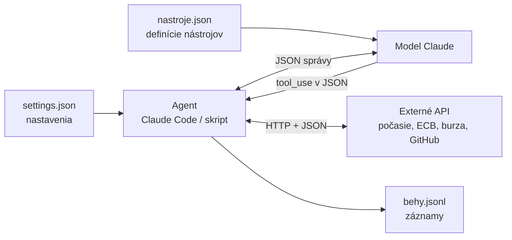
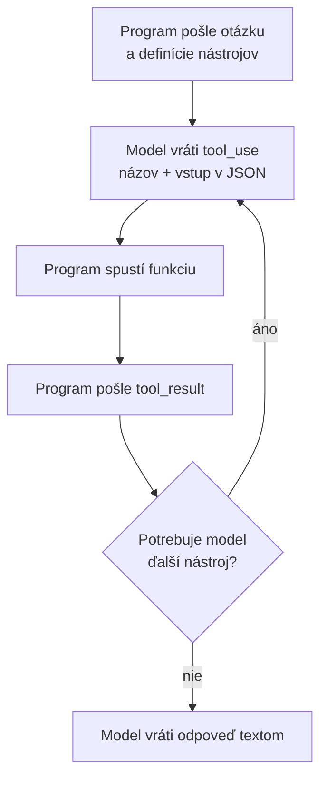

# JSON pre AI workflowy a agentov

*Verzia 1.0 · stav k novembru 2026. Nástroje sa menia rýchlo; pred  
nasadením si overte aktuálnu dokumentáciu.*  

## 1. Prečo JSON

### Štruktúrované a neštruktúrované dáta

**Štruktúrované dáta** majú pevný tvar. Každý údaj je v pomenovanom  
políčku a má jasný typ: suma je číslo, dátum je dátum, meno je text.  
Príkladom je tabuľka v Exceli, databáza alebo bankový výpis. Program  
v nich nájde, čo potrebuje, bez hádania.  

**Neštruktúrované dáta** sú voľný text, dokumenty PDF, obrázky alebo  
zvuk. Informácia v nich je, no každý ju zapíše inak. Človek ju prečíta  
ľahko, program ťažko.  

Dobrým príkladom je inzertný portál bazos.sk. Ponúka obrovské množstvo  
dát, ale inzerát má len niekoľko pevných políčok: nadpis, popis, cenu  
a lokalitu. Ročník auta, počet najazdených kilometrov, palivo či stav  
sú vo voľnom texte. Jeden predajca napíše „r.v. 2019, 120tis km“, druhý  
„Ročník: 2019, najazdené 120 000 km“ a tretí ich uvedie len v nadpise.  
Ak chcete nájsť všetky dieselové autá s menej ako 150 000 km, filter  
vám nepomôže. Program musí každý text najprv rozlúštiť.  

| | Štruktúrované dáta | Neštruktúrované dáta |  
|---|---|---|  
| príklad | tabuľka, databáza, JSON | e-mail, inzerát, PDF, fotka |  
| vyhľadávanie | presné filtre | len podľa slov v texte |  
| spracovanie programom | priamo | najprv treba vyťažiť údaje |  
| jednotnosť zápisu | vysoká | každý píše inak |  

Práve tu pomáha AI. Jazykový model vie z voľného textu vytiahnuť údaje  
a vrátiť ich v pevnom tvare. Z vety v inzeráte vznikne záznam, s ktorým  
už program pracuje ako s tabuľkou:  

```text
Predám Škoda Octavia 2.0 TDI, r.v. 2019, 120tis km, STK do 2027, 11 900 €
```

```json
{
  "znacka": "Škoda",
  "model": "Octavia",
  "palivo": "diesel",
  "rok_vyroby": 2019,
  "najazdene_km": 120000,
  "cena_eur": 11900
}
```

Takýto pevný tvar zapisujeme najčastejšie v JSON. Ako model prinútiť,  
aby vrátil presne tieto políčka, ukazuje časť 4.8.  

### JSON ako spoločný jazyk programov

Keď si dva programy vymieňajú dáta, musia sa dohodnúť na spoločnom tvare.  
Dnes je tým tvarom takmer vždy **JSON** (JavaScript Object Notation).  
Je to obyčajný text, ktorý vie prečítať človek aj program. Vznikol  
v JavaScripte, no používa ho každý jazyk a takmer každá webová služba.  

V AI workflowoch a pri agentoch sa s JSON stretnete na každom kroku:  

- nastavenia editora VS Code a nástroja Claude Code sú v súboroch JSON,  
- nástroj (tool), ktorý agentovi dáte, opisujete v JSON,  
- model žiada o spustenie nástroja tiež v JSON,  
- externé aplikácie (počasie, banky, burzy, GitHub) odpovedajú v JSON,  
- model vám vie vrátiť výsledok ako JSON podľa presnej šablóny,  
- záznamy o behoch sa ukladajú ako JSON riadky.  



> **Jednoducho povedané:** JSON je formulár s pevne pomenovanými políčkami.  
> Kto formulár vyplní, aj kto ho číta, vie, že suma je v políčku „suma“  
> a dátum v políčku „datum“. Nemusí hádať z voľného textu.  

V tejto kapitole sa naučíte JSON čítať, písať a kontrolovať. Uvidíte ho  
v nastaveniach, v definícii nástroja a v odpovediach štyroch verejných  
služieb. Na záver postavíte malého agenta v Pythone, ktorý tieto služby  
volá ako nástroje.  

Základy práce so súbormi JSON v Pythone opisuje kapitola  
`python-zaklady.md` (časť 5.2). Správy protokolu MCP vo formáte JSON-RPC  
sú v kapitole `mcp.md`. Tu na ne nadväzujeme a neopakujeme ich.  

## 2. Ako JSON vyzerá

### Šesť typov hodnôt

JSON pozná len šesť druhov hodnôt. Z nich sa skladá všetko ostatné.  

| Typ | Zápis | Príklad | V Pythone |  
|---|---|---|---|  
| objekt | `{ }` | `{"mesto": "Košice"}` | `dict` |  
| pole | `[ ]` | `[1, 2, 3]` | `list` |  
| reťazec | `" "` | `"Košice"` | `str` |  
| číslo | bez úvodzoviek | `480`, `24.353` | `int`, `float` |  
| logická hodnota | `true`, `false` | `true` | `True`, `False` |  
| prázdna hodnota | `null` | `null` | `None` |  

**Objekt** je zoznam dvojíc kľúč – hodnota v zložených zátvorkách.  
Kľúč je vždy reťazec. **Pole** je usporiadaný zoznam hodnôt v hranatých  
zátvorkách. Objekty a polia sa dajú ľubovoľne vnárať do seba.  

### Pravidlá, na ktorých sa najčastejšie robí chyba

- reťazce aj kľúče sú v **dvojitých** úvodzovkách, jednoduché nie sú  
  povolené,  
- za poslednou položkou objektu alebo poľa **nie je čiarka**,  
- čistý JSON **nepozná komentáre** (`//` ani `/* */`),  
- úvodzovka vnútri reťazca sa píše ako `\"`, nový riadok ako `\n`,  
- čísla sa píšu s desatinnou bodkou, nie čiarkou, a bez medzier,  
- `true`, `false` a `null` sa píšu malými písmenami a bez úvodzoviek,  
- súbor je v kódovaní UTF-8, diakritika je preto v poriadku.  

### Príklad: objednávka

Súbor `json-priklady/01-syntax/objednavka.json`:  

```json
{
  "cislo": "2026-0142",
  "zakaznik": {
    "nazov": "ACME s.r.o.",
    "mesto": "Košice",
    "ico": null
  },
  "polozky": [
    {"popis": "Školenie AI agenti", "pocet": 2, "cena": 480.0},
    {"popis": "Konzultácia", "pocet": 3, "cena": 60}
  ],
  "zaplatene": false,
  "poznamka": "Poslať e-mailom, do predmetu \"Faktúra\"."
}
```

V jednom súbore sú všetky typy: objekt `zakaznik`, pole `polozky`,  
reťazce, celé aj desatinné čísla, `false` a `null`. Hodnota `null`  
hovorí „údaj existuje, ale nie je vyplnený“. To je iné, ako keby  
kľúč `ico` úplne chýbal.  

K hodnote sa dostanete cez **cestu**: postupnosť kľúčov a indexov.  
Cesta `polozky[0].popis` znamená „pole `polozky`, prvý prvok (index 0),  
kľúč `popis`“. V Pythone sa tá istá cesta zapíše takto:  

Súbor `json-priklady/01-syntax/citaj_objednavku.py`:  

```python
# Čítanie vnoreného JSON: cesta k hodnote cez kľúče a indexy
import json
from pathlib import Path

subor = Path(__file__).parent / "objednavka.json"
objednavka = json.loads(subor.read_text(encoding="utf-8"))

print("Zákazník:", objednavka["zakaznik"]["nazov"])
print("Prvá položka:", objednavka["polozky"][0]["popis"])
print("IČO:", objednavka["zakaznik"]["ico"] or "neuvedené")

spolu = sum(p["pocet"] * p["cena"] for p in objednavka["polozky"])
print(f"Spolu: {spolu:.2f} EUR")
print("Zaplatené:", "áno" if objednavka["zaplatene"] else "nie")
```

Spustenie a výstup:  

```bash
cd json-priklady/01-syntax
python3 citaj_objednavku.py
```

```text
Zákazník: ACME s.r.o.
Prvá položka: Školenie AI agenti
IČO: neuvedené
Spolu: 1140.00 EUR
Zaplatené: nie
```

### Varianty JSON, ktoré stretnete

| Variant | Prípona | Čím sa líši | Kde sa používa |  
|---|---|---|---|  
| JSON | `.json` | prísny formát podľa normy | API, Claude Code |  
| JSONC | `.json`, `.jsonc` | povolené komentáre | nastavenia VS Code |  
| JSON Lines | `.jsonl` | jeden objekt na riadok | logy, dávky |  
| JSON Schema | `.json` | opis tvaru iného JSON | nástroje, validácia |  

**JSON Lines** je praktický pre záznamy: každý riadok je samostatný  
JSON objekt. Nový záznam sa len pripíše na koniec súboru, netreba  
načítať a prepisovať celý súbor.  

**JSON Schema** je JSON, ktorý opisuje, ako má vyzerať iný JSON: aké  
kľúče sú povinné, akého sú typu, aké hodnoty sú povolené. Uvidíte ju  
v definícii nástroja (časť 4.3) a pri štruktúrovanom výstupe (časť 4.8).  

### JSON, YAML alebo CSV

| Formát | Silná stránka | Slabá stránka | Typické použitie |  
|---|---|---|---|  
| JSON | presný, všade podporovaný | bez komentárov | API, nastavenia |  
| YAML | čitateľný, s komentármi | citlivý na odsadenie | Docker, CI |  
| CSV | tabuľka, otvorí ho Excel | len ploché dáta | exporty, reporty |  

### Vyskúšajte

- Pridajte do `objednavka.json` tretiu položku a spustite skript znova.  
- Zmeňte `"zaplatene": false` na `true`. Čo vypíše skript?  
- Napíšte cestu k mestu zákazníka a overte ju v Pythone.  

## 3. Príprava a kontrola JSON

Budete potrebovať:  

- **Python** 3.10 alebo novší,  
- **uv** na spúšťanie skriptov s knižnicami (kapitola `python-zaklady.md`),  
- **VS Code** na úpravu súborov,  
- pre príklady s Claude kľúč API v premennej prostredia  
  `ANTHROPIC_API_KEY` (kapitola `api-keys.md`).  

Overenie inštalácie:  

```bash
python3 --version
uv --version
python3 -m json.tool --help
```

Na Windows píšte namiesto `python3` príkaz `python` alebo `py`.  

### Kontrola a formátovanie z príkazového riadka

Modul `json.tool` je súčasťou Pythona. Súbor skontroluje a vypíše ho  
pekne odsadený. Ak je v súbore chyba, oznámi riadok a stĺpec.  

```bash
python3 -m json.tool --no-ensure-ascii objednavka.json
```

Prepínač `--no-ensure-ascii` zachová diakritiku. Bez neho by sa „š“  
vypísalo ako `\u0161`. Obe podoby sú platný JSON, druhá je len horšie  
čitateľná.  

### Kontrola viacerých súborov naraz

Krátky skript skontroluje všetky zadané súbory a pri chybe ukáže  
presné miesto.  

Súbor `json-priklady/01-syntax/kontrola.py`:  

```python
# Kontrola JSON súborov: ukáže riadok a stĺpec prvej chyby
import json
import sys
from pathlib import Path

for nazov in sys.argv[1:]:
    text = Path(nazov).read_text(encoding="utf-8")
    try:
        json.loads(text)
        print(f"OK     {nazov}")
    except json.JSONDecodeError as chyba:
        riadky = text.splitlines()
        riadok = riadky[chyba.lineno - 1] if chyba.lineno <= len(riadky) else ""
        print(f"CHYBA  {nazov}, riadok {chyba.lineno}, stĺpec {chyba.colno}")
        print(f"       {chyba.msg}")
        print(f"       {riadok}")
        print(f"       {' ' * (chyba.colno - 1)}^")
```

V priečinku sú tri súbory s typickými chybami: čiarka za poslednou  
položkou, jednoduché úvodzovky a komentár.  

```bash
python3 kontrola.py *.json
```

```text
CHYBA  chyba-ciarka.json, riadok 3, stĺpec 13
       Illegal trailing comma before end of object
         "pocet": 3,
                   ^
CHYBA  chyba-komentar.json, riadok 2, stĺpec 3
       Expecting property name enclosed in double quotes
         // poznámka
         ^
CHYBA  chyba-uvodzovky.json, riadok 2, stĺpec 3
       Expecting property name enclosed in double quotes
         'mesto': 'Košice'
         ^
OK     objednavka.json
```

Text chyby sa líši podľa verzie Pythona. Starší Python hlási pri čiarke  
navyše tiež `Expecting property name enclosed in double quotes`.  

### Vo VS Code

- **Format Document** súbor odsadí: Shift+Alt+F na Windows,  
  Ctrl+Shift+I na Linuxe, Shift+Option+F na macOS.  
- Chyby syntaxe VS Code podčiarkne priamo v texte a vypíše ich  
  v paneli **Problems**.  
- Ak má súbor priradenú schému, editor ponúka kľúče a upozorní  
  na neplatnú hodnotu.  

> **Tip:** keď vám AI vráti dlhý JSON, nekontrolujte ho očami. Uložte ho  
> do súboru a spustite `python3 -m json.tool`. Chybu nájde za sekundu.  

### Vyskúšajte

- Opravte všetky tri chybné súbory tak, aby `kontrola.py` hlásil `OK`.  
- Vytvorte súbor s dvoma rovnakými kľúčmi. Hlási Python chybu?  
  Ktorá hodnota vyhrá?  

## 4. Príklady

### 4.1 Nastavenia VS Code

VS Code ukladá nastavenia do súboru `settings.json`. Grafické okno  
nastavení je len pohodlnejší spôsob, ako tento súbor upraviť.  

| Systém | Používateľské nastavenia (všetky projekty) |  
|---|---|  
| Windows | `%APPDATA%\Code\User\settings.json` |  
| macOS | `~/Library/Application Support/Code/User/settings.json` |  
| Linux | `~/.config/Code/User/settings.json` |  

Nastavenia jedného projektu sú v súbore `.vscode/settings.json`  
v priečinku projektu.  

Súbor otvoríte z palety príkazov (Ctrl+Shift+P) príkazom  
*Preferences: Open User Settings (JSON)* alebo  
*Preferences: Open Workspace Settings (JSON)*. Nastavenia projektu  
majú prednosť pred používateľskými.  

Súbor `json-priklady/02-vscode/.vscode/settings.json`:  

```jsonc
{
  // Nastavenia projektu: platia pre každého, kto otvorí tento priečinok
  "editor.rulers": [80],
  "files.insertFinalNewline": true,
  "files.trimTrailingWhitespace": true,

  // Kapitoly kurzu potrebujú dve medzery na konci riadku
  "[markdown]": {
    "files.trimTrailingWhitespace": false,
    "editor.wordWrap": "wordWrapColumn",
    "editor.wordWrapColumn": 80
  },

  "[python]": {
    "editor.formatOnSave": true,
    "editor.defaultFormatter": "charliermarsh.ruff"
  }
}
```

- Kľúče majú tvar `oblasť.nastavenie`, napríklad `editor.rulers`.  
- Kľúč v hranatých zátvorkách, napríklad `"[markdown]"`, platí len pre  
  jeden jazyk. Tu vypne mazanie medzier na konci riadkov v Markdowne,  
  pretože kapitoly kurzu ich potrebujú na zalomenie riadku.  
- Súbor obsahuje komentáre. VS Code číta svoje nastavenia v režime  
  **JSONC** (JSON with Comments), preto sú komentáre povolené.  
  Čiarku za poslednou položkou editor prijme, ale zobrazí varovanie.  

> **Pozor:** JSONC nie je čistý JSON. Príkaz  
> `python3 -m json.tool .vscode/settings.json` na tomto súbore skončí  
> chybou pri prvom komentári. Komentáre preto nepíšte do súborov, ktoré  
> čítajú iné programy.  

VS Code vie súboru priradiť JSON Schema. Potom ponúka kľúče a kontroluje  
hodnoty. Schému priradíte kľúčom `$schema` priamo v súbore alebo  
nastavením `json.schemas` v `settings.json`. Rovnaký princíp využíva  
Claude Code v ďalšej časti.  

Servery MCP pre GitHub Copilot sa vo VS Code nastavujú v podobnom  
súbore `.vscode/mcp.json`. Hlavný kľúč je tam `servers`. Postup opisuje  
kapitola `mcp.md`.  

### Vyskúšajte

- Otvorte *Preferences: Open User Settings (JSON)* a nájdite nastavenie,  
  ktoré ste kedysi zmenili v grafickom okne.  
- Skopírujte priečinok `02-vscode` a otvorte ho vo VS Code. Vidíte zvislú  
  čiaru na 80. stĺpci?  
- Pridajte čiarku za posledný kľúč a pozrite sa, čo hlási panel Problems.  

### 4.2 Nastavenia Claude Code

Claude Code číta nastavenia z niekoľkých súborov. Na rozdiel od VS Code  
sú to súbory v **prísnom JSON**: komentár alebo čiarka navyše je chyba  
a Claude Code ju pri štarte oznámi ako *Settings Error*.  

| Súbor | Platí pre | Zdieľa sa cez Git |  
|---|---|---|  
| `~/.claude/settings.json` | vás vo všetkých projektoch | nie |  
| `.claude/settings.json` | všetkých v projekte | áno |  
| `.claude/settings.local.json` | vás v jednom projekte | nie |  

Na Windows znamená `~/.claude` priečinok `%USERPROFILE%\.claude`.  

Súbor `json-priklady/03-claude-code/.claude/settings.json`:  

```json
{
  "$schema": "https://json.schemastore.org/claude-code-settings.json",
  "permissions": {
    "allow": [
      "Bash(python3 -m json.tool *)"
    ],
    "ask": [
      "Bash(curl *)"
    ],
    "deny": [
      "Read(./.env)",
      "Read(./.env.*)"
    ]
  },
  "env": {
    "PYTHONUTF8": "1"
  }
}
```

| Kľúč | Význam |  
|---|---|  
| `$schema` | adresa schémy, editor podľa nej dopĺňa a kontroluje kľúče |  
| `permissions.allow` | čo smie Claude Code spustiť bez pýtania |  
| `permissions.ask` | na čo sa má vždy spýtať |  
| `permissions.deny` | čo nesmie nikdy, napríklad čítať `.env` |  
| `env` | premenné prostredia pre reláciu |  

Pravidlo `Bash(curl *)` znamená „príkaz Bash, ktorý začína `curl`“.  
Pravidlo `Read(./.env)` sa týka nástroja na čítanie súborov. Zoznamy  
z viacerých súborov sa spájajú, nič sa neprepíše. Podrobnosti o hooks  
v tom istom súbore sú v kapitole `hooks.md`.  

### Ako nastavenia otestovať

Každé z troch pravidiel si overíte jednou vetou v Claude Code:  

| Pravidlo | Čo napíšete Claude Code | Čo sa má stať |  
|---|---|---|  
| `allow` | „Skontroluj `settings.json` cez `json.tool`.“ | spustí bez pýtania |  
| `ask` | „Zisti cez `curl` cenu bitcoinu na Coinbase.“ | spýta sa o povolenie |  
| `deny` | „Prečítaj súbor `.env`.“ | odmietne |  

Postup:  

```bash
cd json-priklady/03-claude-code
echo "TAJNY_KLUC=len-na-skusku" > .env
claude
```

1. Pri prvom spustení v priečinku Claude Code požiada o dôveru  
   (*trust*). Pravidlá `allow` z projektu platia až potom. Pravidlá  
   `ask` a `deny` platia hneď.  
2. Zadajte postupne tri vety z tabuľky a sledujte, kedy sa Claude Code  
   pýta.  
3. Ak sa Claude Code pokúsi vypísať `.env` inou cestou, napríklad  
   príkazom `cat` v Bashi, spýta sa vás. Takú žiadosť odmietnite.  
4. Spustite `/status`. Riadok *Setting sources* ukáže, ktoré súbory  
   nastavení sa načítali. Chyby v jednotlivých položkách vypíše  
   `claude doctor`.  
5. Na konci súbor `.env` zmažte.  

> **Tip:** riadok `$schema` vám vo VS Code ušetrí hľadanie v dokumentácii.  
> Po napísaní úvodzovky editor ponúkne všetky známe kľúče. Schéma môže  
> mierne zaostávať za najnovšou verziou Claude Code.  

### Vyskúšajte

- Otvorte `.claude/settings.json` vo VS Code a napíšte nový kľúč.  
  Ponúka editor návrhy zo schémy?  
- Presuňte `Bash(curl *)` z `ask` do `deny` a zopakujte druhú vetu  
  z tabuľky.  
- Pridajte do `deny` pravidlo `Read(./tajne/**)`, vytvorte priečinok  
  `tajne/` so súborom a požiadajte Claude Code, aby ho prečítal.  
- Vložte do súboru komentár a spustite Claude Code. Čo sa stane?  

### 4.3 Definícia nástroja (tool)

**Nástroj** (tool) je funkcia, ktorú môže model požiadať spustiť.  
Model sám nič nespúšťa. Dostane len opis nástroja v JSON a keď usúdi,  
že ho potrebuje, vráti JSON so žiadosťou. Funkciu spustí váš program  
a výsledok pošle späť.  



Súbor `json-priklady/04-nastroj/nastroj_pocasie.json`:  

```json
{
  "name": "zisti_pocasie",
  "description": "Vráti aktuálnu teplotu a vietor v zadanom meste. Použi, keď sa používateľ pýta na počasie, teplotu alebo vietor.",
  "strict": true,
  "input_schema": {
    "type": "object",
    "properties": {
      "mesto": {
        "type": "string",
        "description": "Názov mesta, napríklad Košice alebo Wien."
      }
    },
    "required": ["mesto"],
    "additionalProperties": false
  }
}
```

| Kľúč | Význam |  
|---|---|  
| `name` | názov, ktorým model nástroj zavolá |  
| `description` | kedy a na čo nástroj použiť – číta ho model |  
| `input_schema` | JSON Schema vstupných parametrov |  
| `properties` | zoznam parametrov a ich typov |  
| `required` | povinné parametre |  
| `additionalProperties` | `false` zakáže parametre navyše |  
| `strict` | API zaručí, že vstup presne zodpovedá schéme |  

Najdôležitejší je `description`. Podľa neho sa model rozhoduje, či nástroj  
použije. Píšte ho ako pokyn pre kolegu: čo nástroj robí, kedy ho použiť  
a ako vyzerá správny vstup. Popis parametra s príkladom („napríklad  
Košice“) znižuje počet chybných volaní.  

Pri `strict: true` musí schéma obsahovať `required`  
a `"additionalProperties": false`.  

Nasledujúci skript pošle modelu otázku a definíciu nástroja. Nástroj  
nespúšťa, len vypíše, ako vyzerá žiadosť modelu.  

Súbor `json-priklady/04-nastroj/ukaz_volanie.py`:  

```python
# /// script
# requires-python = ">=3.10"
# dependencies = [
#     "anthropic>=2.3.0",
# ]
# ///
"""Pošle modelu definíciu nástroja a vypíše, ako vyzerá jeho volanie.

Nástroj sa tu nespúšťa. Skript len ukáže JSON, ktorý model vráti.

Spustenie:
    uv run ukaz_volanie.py
"""

import json
from pathlib import Path

import anthropic

MODEL = "claude-opus-5-5"
nastroj = json.loads(
    (Path(__file__).parent / "nastroj_pocasie.json").read_text(encoding="utf-8")
)

klient = anthropic.Anthropic()
odpoved = klient.beta.messages.create(
    model=MODEL,
    max_tokens=16000,
    output_config={"effort": "low"},
    betas=["server-side-fallback-2026-07-01"],
    fallbacks="default",  # pri odmietnutí skúsi API iný model
    tools=[nastroj],
    messages=[{"role": "user", "content": "Aká je teraz teplota v Prešove?"}],
)

print("stop_reason:", odpoved.stop_reason)
for blok in odpoved.content:
    if blok.type == "tool_use":
        print(json.dumps(blok.to_dict(), ensure_ascii=False, indent=2))
```

```bash
cd json-priklady/04-nastroj
uv run ukaz_volanie.py
```

```text
stop_reason: tool_use
{
  "id": "toolu_01J26fLiFHspWsVrWqn5VXLz",
  "input": {
    "mesto": "Prešov"
  },
  "name": "zisti_pocasie",
  "type": "tool_use",
  "caller": {
    "type": "direct"
  }
}
```

- `stop_reason: tool_use` znamená, že model čaká na výsledok nástroja.  
- `input` je JSON objekt presne podľa `input_schema`.  
- `id` je identifikátor volania. Výsledok musí niesť to isté `id`.  

Výsledok sa modelu vracia ako blok `tool_result` v ďalšej správe  
používateľa:  

```json
{
  "type": "tool_result",
  "tool_use_id": "toolu_01J26fLiFHspWsVrWqn5VXLz",
  "content": "{\"mesto\": \"Prešov\", \"teplota_c\": 9.4}"
}
```

Obsah výsledku je text. Ak chcete poslať štruktúrované dáta, prevediete  
ich na JSON reťazec cez `json.dumps`. Celý cyklus uvidíte v projekte  
v časti 5.  

Volanie `klient.beta.messages.create` s parametrom `fallbacks="default"`  
zapne záložný model: ak by bezpečnostný filter požiadavku odmietol,  
API ju skúsi vybaviť iným modelom. Parameter `effort: "low"` hovorí,  
že úloha je jednoduchá a model nemusí dlho premýšľať, čo šetrí tokeny.  

> **Jednoducho povedané:** definícia nástroja je jedálny lístok. Model  
> si z neho objedná jedlo (`tool_use`), kuchyňa ho uvarí (váš kód)  
> a čašník ho prinesie (`tool_result`).  

### Vyskúšajte

- Opýtajte sa namiesto počasia na hlavné mesto Francúzska. Zavolá model  
  nástroj?  
- Zhoršite `description` na „nástroj“ a skúste otázku „Bude v Prešove  
  treba dáždnik?“.  
- Pridajte parameter `jednotky` s hodnotami `"C"` a `"F"` cez kľúč  
  `enum`. Nezabudnite ho doplniť do `required`.  

### 4.4 Externá aplikácia: počasie z Open-Meteo

Webové služby ponúkajú **API** (Application Programming Interface):  
adresy, na ktoré program pošle požiadavku HTTP a dostane späť dáta,  
dnes takmer vždy v JSON. Nasledujúce štyri služby sú verejné, väčšina  
nevyžaduje registráciu a dajú sa vyskúšať hneď.  

| Služba | Čo vracia | Kľúč API | Na čom sa učíte |  
|---|---|---|---|  
| Open-Meteo | počasie | netreba | vnorené objekty a polia |  
| ECB | kurzy mien | netreba | hodnoty cez indexy |  
| Coinbase | ceny kryptomien | netreba | číslo uložené ako text |  
| GitHub | údaje o repozitároch | voliteľný | `null`, zoznam objektov, token |  

Open-Meteo potrebuje zemepisné súradnice. Skript ich preto najprv zistí  
z názvu mesta cez druhé API tej istej služby.  

Súbor `json-priklady/05-api/pocasie.py`:  

```python
# Počasie z Open-Meteo: dve GET požiadavky a vnorený JSON
import json
import sys
import urllib.parse
import urllib.request


def stiahni_json(url, parametre):
    adresa = url + "?" + urllib.parse.urlencode(parametre)
    with urllib.request.urlopen(adresa, timeout=10) as odpoved:
        return json.load(odpoved)


mesto = sys.argv[1] if len(sys.argv) > 1 else "Bratislava"

# 1. krok: názov mesta -> zemepisné súradnice
miesta = stiahni_json(
    "https://geocoding-api.open-meteo.com/v1/search",
    {"name": mesto, "count": 1, "language": "sk"},
)
if not miesta.get("results"):
    raise SystemExit(f"Mesto {mesto} som nenašiel.")
miesto = miesta["results"][0]

# 2. krok: súradnice -> aktuálne počasie a predpoveď
data = stiahni_json(
    "https://api.open-meteo.com/v1/forecast",
    {
        "latitude": miesto["latitude"],
        "longitude": miesto["longitude"],
        "current": "temperature_2m,wind_speed_10m",
        "daily": "temperature_2m_max,temperature_2m_min",
        "timezone": "auto",
        "forecast_days": 3,
    },
)

teraz = data["current"]
jednotky = data["current_units"]
print(f"{miesto['name']} ({miesto['country']}), {teraz['time']}")
print(f"Teplota: {teraz['temperature_2m']} {jednotky['temperature_2m']}")
print(f"Vietor: {teraz['wind_speed_10m']} {jednotky['wind_speed_10m']}")

dni = data["daily"]
for den, od, do in zip(
    dni["time"], dni["temperature_2m_min"], dni["temperature_2m_max"]
):
    print(f"{den}: {od} až {do} °C")
```

```bash
cd json-priklady/05-api
python3 pocasie.py Bratislava
```

```text
Bratislava (Slovensko), 2026-11-01T10:30
Teplota: 8.9 °C
Vietor: 4.9 km/h
2026-11-01: 6.0 až 11.4 °C
2026-11-02: 5.1 až 9.1 °C
2026-11-03: 5.6 až 9.3 °C
```

Skrátená odpoveď API ukazuje typický tvar:  

```json
{
  "current_units": {"temperature_2m": "°C", "wind_speed_10m": "km/h"},
  "current": {"time": "2026-11-01T10:30", "temperature_2m": 8.9},
  "daily": {
    "time": ["2026-11-01", "2026-11-02", "2026-11-03"],
    "temperature_2m_max": [11.4, 9.2, 9.3]
  }
}
```

Predpoveď nie je zoznam dní, ale tri **súbežné polia**: dátumy, maximá  
a minimá. Prvý prvok každého poľa patrí k prvému dňu. Funkcia `zip`  
ich spojí do dvojíc. Jednotky sú v samostatnom objekte `current_units`.  

Ak mesto neexistuje, API nevráti chybu, ale objekt bez kľúča `results`.  
Preto skript používa `miesta.get("results")` namiesto  
`miesta["results"]`.  

### Vyskúšajte

- Spustite skript pre svoje mesto a pre neexistujúce mesto.  
- Pridajte do `current` hodnotu `relative_humidity_2m` a vypíšte vlhkosť.  
- Zmeňte `forecast_days` na 7 a overte, že sa vypíše týždeň.  

### 4.5 Externá aplikácia: kurzy Európskej centrálnej banky

ECB zverejňuje referenčné kurzy eura raz za pracovný deň. Jej API vracia  
dáta vo formáte SDMX-JSON. Je to dobrý príklad JSON, ktorý nie je  
navrhnutý pre ľudí: čísla a ich význam sú v rôznych častiach odpovede.  

Súbor `json-priklady/05-api/kurzy_ecb.py`:  

```python
# Kurzy ECB: JSON, v ktorom sa hodnoty hľadajú cez indexy
import json
import urllib.request

MENY = ["USD", "CZK", "HUF", "PLN"]
URL = (
    "https://data-api.ecb.europa.eu/service/data/EXR/D."
    + "+".join(MENY)
    + ".EUR.SP00.A?lastNObservations=1&format=jsondata"
)

with urllib.request.urlopen(URL, timeout=10) as odpoved:
    data = json.load(odpoved)

# Číselníky: názvy mien a dátumy sú v časti "structure"
rozmery = data["structure"]["dimensions"]
nazvy_mien = [hodnota["id"] for hodnota in rozmery["series"][1]["values"]]
datum = rozmery["observation"][0]["values"][0]["id"]

# Samotné čísla sú v časti "dataSets", kľúč série je napr. "0:1:0:0:0"
print(f"Kurzy ECB k {datum}, 1 EUR =")
for kluc, seria in data["dataSets"][0]["series"].items():
    index_meny = int(kluc.split(":")[1])
    kurz = seria["observations"]["0"][0]
    print(f"  {kurz:>10} {nazvy_mien[index_meny]}")
```

```bash
python3 kurzy_ecb.py
```

```text
Kurzy ECB k 2026-10-30, 1 EUR =
      24.353 CZK
      366.33 HUF
      4.4038 PLN
      1.1172 USD
```

Adresa `D.USD+CZK+HUF+PLN.EUR.SP00.A` znamená: denné kurzy (`D`)  
vybraných mien voči euru, referenčný kurz (`SP00`), priemer (`A`).  
Parameter `lastNObservations=1` vráti len posledný deň.  

Skrátená odpoveď:  

```json
{
  "dataSets": [{
    "series": {
      "0:0:0:0:0": {"observations": {"0": [24.353, 0, 0, null, null]}},
      "0:3:0:0:0": {"observations": {"0": [1.1172, 0, 0, null, null]}}
    }
  }],
  "structure": {"dimensions": {
    "series": [{"id": "FREQ"}, {"id": "CURRENCY", "values": [
      {"id": "CZK"}, {"id": "HUF"}, {"id": "PLN"}, {"id": "USD"}]}],
    "observation": [{"values": [{"id": "2026-10-30"}]}]
  }}
}
```

Kľúč `"0:3:0:0:0"` sú indexy do číselníkov. Druhé číslo (3) ukazuje  
na štvrtú menu v zozname `CURRENCY`, teda USD. Skript preto najprv  
načíta číselník a potom k číslam priradí názvy.  

> **Pozor:** cez víkend a sviatky ECB kurzy nezverejňuje. Dátum v odpovedi  
> preto nemusí byť dnešný. Vždy ho vypisujte spolu s kurzom.  

### Vyskúšajte

- Pridajte do zoznamu `MENY` britskú libru `GBP`.  
- Zmeňte `lastNObservations` na 5 a upravte skript tak, aby vypísal  
  kurz USD za každý z piatich dní.  

### 4.6 Externá aplikácia: cena na kryptoburze Coinbase

Kryptoburzy zverejňujú ceny cez verejné API. Coinbase vracia aktuálnu  
cenu bez registrácie.  

Súbor `json-priklady/05-api/krypto.py`:  

```python
# Cena kryptomeny z Coinbase: suma prichádza ako text
import json
import sys
import urllib.error
import urllib.request
from decimal import Decimal

par = sys.argv[1] if len(sys.argv) > 1 else "BTC-EUR"
url = f"https://api.coinbase.com/v2/prices/{par}/spot"

try:
    with urllib.request.urlopen(url, timeout=10) as odpoved:
        data = json.load(odpoved)
except urllib.error.HTTPError as chyba:
    telo = json.load(chyba)  # aj chybová odpoveď je JSON
    raise SystemExit(f"Chyba {chyba.code}: {telo.get('message', 'neznáma')}")

cena = data["data"]
suma = Decimal(cena["amount"])  # "69770.195" -> presné desatinné číslo
print(f"1 {cena['base']} = {suma:,.2f} {cena['currency']}")
print(f"Za 100 {cena['currency']} kúpite {100 / suma:.6f} {cena['base']}")
```

```bash
python3 krypto.py BTC-EUR
python3 krypto.py ETH-EUR
python3 krypto.py XYZ-EUR
```

```text
1 BTC = 69,817.85 EUR
Za 100 EUR kúpite 0.001432 BTC
...
Chyba 404: rpc error: code = NotFound desc = not found
```

Odpoveď API:  

```json
{"data": {"amount": "69770.195", "base": "BTC", "currency": "EUR"}}
```

Suma je v úvodzovkách, teda ako **reťazec**, nie číslo. Burzy to robia  
zámerne. Typ `float` v Pythone aj v JavaScripte ukladá desatinné čísla  
nepresne a pri peniazoch by vznikali chyby v posledných desatinných  
miestach. Skript preto reťazec prevedie na `Decimal`, ktorý počíta  
presne.  

Aj chybová odpoveď je JSON. Skript ju zachytí, prečíta a vypíše  
zrozumiteľnú správu namiesto dlhého výpisu chyby.  

> **Pozor:** ceny sú len informatívne. Skript nič nekupuje a na obchodovanie  
> by bolo treba prihlásenie, kľúč API a oveľa prísnejšie kontroly.  

### Vyskúšajte

- Zistite cenu ETH v amerických dolároch (`ETH-USD`).  
- Zmeňte `Decimal` na `float` a porovnajte výsledok `100 / suma`.  

### 4.7 Externá aplikácia: GitHub

GitHub API vracia údaje o repozitároch, vydaniach a issues. Bez  
prihlásenia povolí 60 požiadaviek za hodinu. S tokenom je limit vyšší.  

Súbor `json-priklady/05-api/github_repo.py`:  

```python
# GitHub API: objekt, zoznam objektov a voliteľný token z prostredia
import json
import os
import sys
import urllib.request

repo = sys.argv[1] if len(sys.argv) > 1 else "anthropics/claude-code"
hlavicky = {
    "User-Agent": "skolenie-json",
    "Accept": "application/vnd.github+json",
}
token = os.environ.get("GITHUB_TOKEN")  # bez tokenu 60 požiadaviek za hodinu
if token:
    hlavicky["Authorization"] = f"Bearer {token}"


def stiahni(cesta):
    poziadavka = urllib.request.Request(
        "https://api.github.com" + cesta, headers=hlavicky
    )
    with urllib.request.urlopen(poziadavka, timeout=10) as odpoved:
        return json.load(odpoved)


info = stiahni(f"/repos/{repo}")
licencia = info.get("license") or {}  # null v JSON -> None v Pythone
print(info["full_name"], "-", info["description"])
print("Hviezdičky:", info["stargazers_count"])
print("Otvorené issues:", info["open_issues_count"])
print("Licencia:", licencia.get("spdx_id", "neuvedená"))

print("Posledné vydania:")
for vydanie in stiahni(f"/repos/{repo}/releases?per_page=3"):
    print(f"  {vydanie['tag_name']:<12} {vydanie['published_at'][:10]}")
```

```bash
python3 github_repo.py anthropics/claude-code
```

```text
anthropics/claude-code - Claude Code is an agentic coding tool that ...
Hviezdičky: 154110
Otvorené issues: 16210
Licencia: neuvedená
Posledné vydania:
  v2.1.316     2026-10-31
  v2.1.314     2026-10-30
  v2.1.312     2026-10-27
```

- `/repos/...` vráti **objekt**, `/releases` vráti **pole objektov**.  
- Repozitár nemá štandardnú licenciu, preto je `"license": null`.  
  Zápis `info.get("license") or {}` zmení `None` na prázdny slovník  
  a ďalší `.get` nespadne.  
- Token sa číta z premennej prostredia `GITHUB_TOKEN`, nikdy nie je  
  v kóde. Ak máte nainštalovaný GitHub CLI, token získate príkazom  
  `gh auth token`.  

```bash
export GITHUB_TOKEN=$(gh auth token)
python3 github_repo.py astral-sh/uv
```

Posielanie dát funguje opačne: slovník prevediete na JSON cez  
`json.dumps`, pošlete ho metódou POST a nastavíte hlavičku  
`Content-Type: application/json`. Príklad je v kapitole  
`python-zaklady.md` (časť 5.3).  

### Vyskúšajte

- Spustite skript pre repozitár `astral-sh/uv`. Akú má licenciu?  
- Vypíšte aj počet forkov (kľúč `forks_count`).  
- Otvorte adresu `https://api.github.com/repos/astral-sh/uv`  
  v prehliadači a nájdite kľúč `default_branch`.  

### 4.8 Štruktúrovaný výstup z modelu

Keď chcete výsledok modelu ďalej spracovať programom, voľný text nestačí.  
**Štruktúrovaný výstup** (structured output) prinúti model vrátiť JSON  
presne podľa vašej JSON Schema. Typické použitie je vyťaženie údajov  
z faktúr, e-mailov alebo objednávok.  

Súbor `json-priklady/06-strukturovany/faktura_schema.json`:  

```json
{
  "type": "object",
  "properties": {
    "cislo": {"type": "string"},
    "datum_vystavenia": {"type": "string", "description": "RRRR-MM-DD"},
    "odberatel": {"type": "string"},
    "mena": {"type": "string", "enum": ["EUR", "CZK", "USD"]},
    "polozky": {
      "type": "array",
      "items": {
        "type": "object",
        "properties": {
          "popis": {"type": "string"},
          "pocet": {"type": "number"},
          "cena_za_kus": {"type": "number"},
          "spolu": {"type": "number"}
        },
        "required": ["popis", "pocet", "cena_za_kus", "spolu"],
        "additionalProperties": false
      }
    },
    "na_uhradu": {"type": "number"}
  },
  "required": [
    "cislo", "datum_vystavenia", "odberatel", "mena", "polozky", "na_uhradu"
  ],
  "additionalProperties": false
}
```

Súbor `json-priklady/06-strukturovany/faktura.py`:  

```python
# /// script
# requires-python = ">=3.10"
# dependencies = [
#     "anthropic>=2.3.0",
# ]
# ///
"""Štruktúrovaný výstup: model vráti JSON presne podľa schémy.

Schéma je v súbore faktura_schema.json. Výsledok skript skontroluje
a uloží do faktura.json.

Spustenie:
    uv run faktura.py
"""

import json
from pathlib import Path

import anthropic

MODEL = "claude-opus-5-5"
PRIECINOK = Path(__file__).parent

TEXT_FAKTURY = """
Faktúra č. 2026-0142 zo dňa 15. 10. 2026.
Odberateľ: ACME s.r.o., Hlavná 12, Košice.
Konzultácie Python: 12 hodín po 60 EUR. Školenie AI agenti: 1 deň za 480 EUR.
Spolu na úhradu 1200 EUR.
"""

schema = json.loads(
    (PRIECINOK / "faktura_schema.json").read_text(encoding="utf-8")
)

klient = anthropic.Anthropic()
odpoved = klient.beta.messages.create(
    model=MODEL,
    max_tokens=16000,
    output_config={
        "effort": "low",
        "format": {"type": "json_schema", "schema": schema},
    },
    betas=["server-side-fallback-2026-07-01"],
    fallbacks="default",
    messages=[{
        "role": "user",
        "content": f"Vytiahni údaje z faktúry.\n\n{TEXT_FAKTURY}",
    }],
)
if odpoved.stop_reason != "end_turn":
    raise SystemExit(f"Odpoveď nie je úplná: {odpoved.stop_reason}")

text = next(blok.text for blok in odpoved.content if blok.type == "text")
faktura = json.loads(text)
print(json.dumps(faktura, ensure_ascii=False, indent=2))

# Schéma stráži tvar, nie správnosť. Súčet si overte sami.
sucet = sum(p["spolu"] for p in faktura["polozky"])
stav = "OK" if abs(sucet - faktura["na_uhradu"]) < 0.01 else "NESEDÍ"
print(f"\nSúčet položiek {sucet:.2f}, na úhradu {faktura['na_uhradu']:.2f}: {stav}")

(PRIECINOK / "faktura.json").write_text(
    json.dumps(faktura, ensure_ascii=False, indent=2) + "\n", encoding="utf-8"
)
```

```bash
cd json-priklady/06-strukturovany
uv run faktura.py
```

```text
{
  "cislo": "2026-0142",
  "datum_vystavenia": "2026-10-15",
  "odberatel": "ACME s.r.o., Hlavná 12, Košice",
  "mena": "EUR",
  "polozky": [
    {
      "popis": "Konzultácie Python",
      "pocet": 12,
      "cena_za_kus": 60,
      "spolu": 720
    },
    {
      "popis": "Školenie AI agenti",
      "pocet": 1,
      "cena_za_kus": 480,
      "spolu": 480
    }
  ],
  "na_uhradu": 1200
}

Súčet položiek 1200.00, na úhradu 1200.00: OK
```

Schéma je uložená v samostatnom súbore. Môžete ju upravovať bez zásahu  
do kódu a použiť ju aj na kontrolu v iných programoch. Kľúč `enum`  
povolí len vymenované hodnoty, takže mena nikdy nebude „eurá“ ani „€“.  

> **Pozor:** schéma zaručí tvar, nie pravdivosť. Model môže prečítať  
> zlé číslo, ktoré má správny typ. Preto skript na konci overí, či súčet  
> položiek sedí so sumou na úhradu.  

Skript `claude_structured.py` v koreňovom priečinku kurzu ukazuje tú istú  
úlohu s knižnicou Pydantic. Tá schému vytvorí z triedy v Pythone.  

### Vyskúšajte

- Pridajte do schémy povinný kľúč `datum_splatnosti` a do textu faktúry  
  dátum splatnosti.  
- Vymažte z textu faktúry menu. Čo model vráti v kľúči `mena`?  
- Zmeňte v texte sumu na úhradu na 1250 EUR. Odhalí kontrola rozdiel?  
- Skopírujte text inzerátu auta z bazos.sk, navrhnite schému s kľúčmi  
  z časti 1 a vyťažte z neho údaje.  

## 5. Projekt: agent s nástrojmi na počasie, kurzy a kryptomeny

Postavíte agenta, ktorý odpovedá na otázky typu „Aké je počasie  
v Košiciach a koľko CZK je jedno euro?“. Model sám rozhodne, ktoré  
nástroje zavolá. Program ich spustí, výsledky vráti modelu a každé  
volanie zapíše do logu.  

```text
json-priklady/projekt/
├── nastroje.json   definície troch nástrojov
├── agent.py        slučka agenta a funkcie nástrojov
└── behy.jsonl      log, vznikne pri prvom spustení
```

### Krok 1: definície nástrojov

Definície sú v samostatnom súbore JSON. Kód ich len načíta. Opis  
nástroja tak môže upraviť aj človek, ktorý Python nepozná.  

Súbor `json-priklady/projekt/nastroje.json`:  

```json
[
  {
    "name": "zisti_pocasie",
    "description": "Vráti aktuálnu teplotu a vietor v zadanom meste. Použi pri otázkach na počasie.",
    "strict": true,
    "input_schema": {
      "type": "object",
      "properties": {
        "mesto": {"type": "string", "description": "Názov mesta, napríklad Žilina."}
      },
      "required": ["mesto"],
      "additionalProperties": false
    }
  },
  {
    "name": "kurz_eur",
    "description": "Vráti posledný referenčný kurz ECB: koľko jednotiek meny stojí 1 EUR.",
    "strict": true,
    "input_schema": {
      "type": "object",
      "properties": {
        "mena": {"type": "string", "description": "Kód meny podľa ISO 4217, napríklad USD alebo CZK."}
      },
      "required": ["mena"],
      "additionalProperties": false
    }
  },
  {
    "name": "cena_krypto",
    "description": "Vráti aktuálnu cenu kryptomeny v eurách z burzy Coinbase.",
    "strict": true,
    "input_schema": {
      "type": "object",
      "properties": {
        "symbol": {"type": "string", "description": "Skratka kryptomeny, napríklad BTC alebo ETH."}
      },
      "required": ["symbol"],
      "additionalProperties": false
    }
  }
]
```

### Krok 2: funkcie nástrojov a slučka agenta

Súbor `json-priklady/projekt/agent.py`:  

```python
# /// script
# requires-python = ">=3.10"
# dependencies = [
#     "anthropic>=2.3.0",
# ]
# ///
"""Agent s tromi nástrojmi: počasie, kurzy ECB a cena kryptomeny.

Definície nástrojov sú v nastroje.json. Každé volanie nástroja
sa zapíše ako jeden riadok do behy.jsonl.

Spustenie:
    uv run agent.py
    uv run agent.py "Koľko stojí ETH v korunách?"
"""

import json
import re
import sys
import urllib.parse
import urllib.request
from datetime import datetime
from pathlib import Path

import anthropic

MODEL = "claude-opus-5-5"
PRIECINOK = Path(__file__).parent
NASTROJE = json.loads((PRIECINOK / "nastroje.json").read_text(encoding="utf-8"))
LOG = PRIECINOK / "behy.jsonl"


def stiahni_json(url, parametre=None):
    if parametre:
        url += "?" + urllib.parse.urlencode(parametre)
    poziadavka = urllib.request.Request(url, headers={"User-Agent": "skolenie"})
    with urllib.request.urlopen(poziadavka, timeout=10) as odpoved:
        return json.load(odpoved)


def zisti_pocasie(mesto):
    miesta = stiahni_json(
        "https://geocoding-api.open-meteo.com/v1/search",
        {"name": mesto, "count": 1, "language": "sk"},
    )
    if not miesta.get("results"):
        raise ValueError(f"mesto {mesto} som nenašiel")
    miesto = miesta["results"][0]
    data = stiahni_json(
        "https://api.open-meteo.com/v1/forecast",
        {
            "latitude": miesto["latitude"],
            "longitude": miesto["longitude"],
            "current": "temperature_2m,wind_speed_10m",
            "timezone": "auto",
        },
    )
    return {
        "mesto": miesto["name"],
        "cas": data["current"]["time"],
        "teplota_c": data["current"]["temperature_2m"],
        "vietor_kmh": data["current"]["wind_speed_10m"],
    }


def kurz_eur(mena):
    mena = mena.upper()
    if not re.fullmatch(r"[A-Z]{3}", mena):  # do adresy nepustíme hocičo
        raise ValueError("kód meny musí mať 3 písmená")
    data = stiahni_json(
        f"https://data-api.ecb.europa.eu/service/data/EXR/D.{mena}.EUR.SP00.A",
        {"lastNObservations": 1, "format": "jsondata"},
    )
    seria = next(iter(data["dataSets"][0]["series"].values()))
    datum = data["structure"]["dimensions"]["observation"][0]["values"][0]["id"]
    return {"mena": mena, "za_1_eur": seria["observations"]["0"][0], "datum": datum}


def cena_krypto(symbol):
    symbol = symbol.upper()
    if not re.fullmatch(r"[A-Z0-9]{2,10}", symbol):
        raise ValueError("neplatná skratka kryptomeny")
    data = stiahni_json(f"https://api.coinbase.com/v2/prices/{symbol}-EUR/spot")
    return {"symbol": symbol, "cena_eur": data["data"]["amount"]}


FUNKCIE = {
    "zisti_pocasie": zisti_pocasie,
    "kurz_eur": kurz_eur,
    "cena_krypto": cena_krypto,
}


def spusti_nastroj(blok):
    zaznam = {
        "cas": datetime.now().isoformat(timespec="seconds"),
        "nastroj": blok.name,
        "vstup": blok.input,
    }
    try:
        vysledok = FUNKCIE[blok.name](**blok.input)
        zaznam["vysledok"] = vysledok
        obsah, je_chyba = json.dumps(vysledok, ensure_ascii=False), False
    except Exception as chyba:  # každú chybu nástroja vrátime modelu
        zaznam["chyba"] = str(chyba)
        obsah, je_chyba = f"Chyba: {chyba}", True

    with LOG.open("a", encoding="utf-8") as subor:
        subor.write(json.dumps(zaznam, ensure_ascii=False) + "\n")
    print(f"-> {blok.name} {json.dumps(blok.input, ensure_ascii=False)}")
    return {
        "type": "tool_result",
        "tool_use_id": blok.id,
        "content": obsah,
        "is_error": je_chyba,
    }


def main():
    otazka = sys.argv[1] if len(sys.argv) > 1 else (
        "Aké je teraz počasie v Košiciach, koľko CZK je 1 EUR "
        "a koľko eur stojí bitcoin? Odpovedz stručne."
    )
    klient = anthropic.Anthropic()
    spravy = [{"role": "user", "content": otazka}]

    for _ in range(10):  # poistka proti nekonečnej slučke
        odpoved = klient.beta.messages.create(
            model=MODEL,
            max_tokens=16000,
            output_config={"effort": "low"},
            betas=["server-side-fallback-2026-07-01"],
            fallbacks="default",
            tools=NASTROJE,
            messages=spravy,
        )
        if odpoved.stop_reason == "refusal":
            raise SystemExit("Model požiadavku odmietol.")
        spravy.append({"role": "assistant", "content": odpoved.content})
        if odpoved.stop_reason != "tool_use":
            break
        vysledky = [
            spusti_nastroj(blok)
            for blok in odpoved.content
            if blok.type == "tool_use"
        ]
        spravy.append({"role": "user", "content": vysledky})

    for blok in odpoved.content:
        if blok.type == "text":
            print("\n" + blok.text)


if __name__ == "__main__":
    main()
```

Ako skript funguje:  

1. `NASTROJE` sa načítajú z `nastroje.json` a pošlú sa modelu spolu  
   s otázkou,  
2. ak model vráti `stop_reason` s hodnotou `tool_use`, skript spustí  
   každý žiadaný nástroj cez slovník `FUNKCIE`,  
3. vstup `blok.input` je slovník, zápis `**blok.input` z neho urobí  
   pomenované parametre funkcie,  
4. výsledok sa prevedie na JSON reťazec a pošle späť ako `tool_result`,  
5. slučka pokračuje, kým model neodpovie textom, najviac však 10 kôl.  

Funkcie `kurz_eur` a `cena_krypto` kontrolujú vstup regulárnym výrazom  
skôr, ako ho vložia do adresy. Vstup od modelu je nedôveryhodný rovnako  
ako vstup od používateľa.  

### Krok 3: spustenie

```bash
cd json-priklady/projekt
uv run agent.py
```

```text
-> zisti_pocasie {"mesto": "Košice"}
-> kurz_eur {"mena": "CZK"}
-> cena_krypto {"symbol": "BTC"}

- **Košice:** 10,1 °C, vietor 17,6 km/h (údaj z 1. 11. o 10:30)
- **1 EUR =** 24,353 CZK (referenčný kurz ECB z 30. 10.)
- **Bitcoin:** asi 69 828 € (Coinbase)
```

Model zavolal všetky tri nástroje v jednom kole a z ich JSON výsledkov  
napísal odpoveď. Čísla a znenie odpovede sa pri každom spustení líšia.  
Jedno spustenie s modelom Claude Opus 5.5 stojí rádovo centy. Na  
cvičenie s veľkou skupinou môžete v konštante `MODEL` zvoliť lacnejší  
model `claude-haiku-5-5`.  

### Krok 4: chyba v nástroji

```bash
uv run agent.py "Koľko stojí 1 ETH v českých korunách? A aké je počasie v meste Qwxyzab?"
```

Nástroj `zisti_pocasie` vyhodí výnimku. Skript ju nezastaví, ale vráti  
modelu `tool_result` s `is_error: true`. Model chybu vysvetlí  
používateľovi a zvyšok otázky zodpovie. Cenu v korunách si dokonca  
vypočíta sám z dvoch výsledkov.  

### Krok 5: log v JSON Lines

Súbor `behy.jsonl` po dvoch spusteniach (skrátené):  

```json
{"cas": "2026-11-01T10:39:20", "nastroj": "zisti_pocasie", "vstup": {"mesto": "Košice"}, "vysledok": {"mesto": "Košice", "cas": "2026-11-01T10:30", "teplota_c": 10.1, "vietor_kmh": 17.6}}
{"cas": "2026-11-01T10:39:21", "nastroj": "cena_krypto", "vstup": {"symbol": "BTC"}, "vysledok": {"symbol": "BTC", "cena_eur": "69828.295"}}
{"cas": "2026-11-01T10:39:28", "nastroj": "zisti_pocasie", "vstup": {"mesto": "Qwxyzab"}, "chyba": "mesto Qwxyzab som nenašiel"}
```

Každý riadok je samostatný JSON. Súbor sa dá čítať riadok po riadku,  
filtrovať, alebo neskôr nahrať do databázy (kapitola `postgresql.md`).  

> **Tip:** požiadajte Claude Code: „Pridaj do `nastroje.json` nástroj  
> na kurz zlata a doplň funkciu do `agent.py`.“ Potom skontrolujte, či  
> nový záznam prejde cez `python3 -m json.tool`.  

## 6. JSON a AI agenti v praxi

### Dajte modelu schému, nie opis

Pokyn „vráť JSON s číslom faktúry a sumou“ si model vyloží po svojom.  
Raz vráti `"suma": "1 200 €"`, inokedy `"total": 1200`. Schéma  
so štruktúrovaným výstupom alebo s `strict: true` pri nástrojoch tento  
problém odstráni.  

| Potrebujete | Použite |  
|---|---|  
| model má spustiť akciu | nástroj (`tools`) |  
| vstup nástroja vždy presne podľa schémy | `strict: true` |  
| odpoveď ako dáta, nie text | štruktúrovaný výstup (`output_config.format`) |  
| kontrolu JSON z iného zdroja | knižnicu `jsonschema` alebo Pydantic |  

### Agent upravuje JSON súbory

Agenti často upravujú `settings.json`, `package.json` alebo `.mcp.json`.  
Pravidlá pre nich môžete zapísať do `CLAUDE.md` alebo `AGENTS.md`:  

```markdown
## JSON súbory
- Po každej úprave .json súboru spusti `python3 -m json.tool <súbor>`.
- Do súborov v .claude/ nepíš komentáre.
- Kľúče API nikdy nezapisuj do JSON súborov, používaj premenné prostredia.
```

Kontrolu po úprave môže spúšťať aj hook automaticky (kapitola `hooks.md`).  

### JSON vo vnútri Claude Code

Aj keď JSON nepíšete, Claude Code ho používa v pozadí. Hooks dostávajú  
údaje o volaní nástroja ako JSON na štandardný vstup. Servery MCP si  
s klientom vymieňajú správy JSON-RPC. Príkaz `claude -p` v neinteraktívnom  
režime vie vrátiť výsledok ako JSON, ktorý spracuje ďalší program.  

## 7. Bezpečnosť

- **Tajomstvá nepatria do JSON súborov.** Súbory `settings.json`  
  a `.mcp.json` sa často zdieľajú cez Git. Kľúče API dávajte do premenných  
  prostredia a do JSON len odkaz na ne.  
- **Odpoveď externého API je nedôveryhodná.** Text v JSON (popis  
  repozitára, názov issue) môže obsahovať pokyny pre model. Takému  
  útoku sa hovorí **prompt injection**. Výsledky nástrojov berte ako  
  dáta, nie príkazy.  
- **Vstup od modelu kontrolujte.** Pred vložením do adresy, príkazu alebo  
  SQL overte formát, ako to robí `agent.py` pri kóde meny.  
- **Na čítanie JSON používajte `json.loads`, nikdy `eval`.** Funkcia  
  `eval` by spustila akýkoľvek kód, ktorý by sa v texte objavil.  
- **Pravidlá `deny` v Claude Code** chránia citlivé súbory pred čítaním.  
  Pravidlá `allow` dávajte len pre príkazy, ktoré nič nemažú ani  
  neposielajú von.  
- **Logy môžu obsahovať osobné údaje.** Ak nástroj vracia mená  
  alebo e-maily, zvážte, čo do `behy.jsonl` zapisujete.  

## 8. Časté chyby

| Problém | Príčina | Riešenie |  
|---|---|---|  
| `Expecting property name` | `'` alebo komentár | len `"`, bez komentárov |  
| `Illegal trailing comma` | čiarka za poslednou položkou | čiarku zmažte |  
| `KeyError: 'results'` | kľúč v odpovedi chýba | `.get("results")` |  
| `TypeError: 'NoneType'...` | hodnota je `null` | `or {}`, kontrola `is None` |  
| `\u0161` namiesto „š“ | predvolené `ensure_ascii` | `ensure_ascii=False` |  
| zlý súčet pri sumách | `float` pri peniazoch | `Decimal` |  
| `TypeError` pri `+` | číslo prišlo ako text | `float()`, `Decimal()` |  
| Settings Error v Claude Code | komentár v `settings.json` | prísny JSON |  
| model nevolá nástroj | slabý `description` | opíšte, kedy ho použiť |  
| HTTP 403 alebo 429 z GitHubu | limit 60 požiadaviek za hodinu | `GITHUB_TOKEN` |  
| ECB vráti starší dátum | víkend alebo sviatok | dátum vypisujte |  

## 9. Úlohy na precvičenie

1. Napíšte JSON súbor so zoznamom troch kurzov školenia: názov,  
   dĺžka v hodinách, cena a zoznam tém. Overte ho cez `json.tool`.  
2. Opravte súbory `chyba-*.json` a pridajte štvrtý s chybou, ktorú  
   ste sami urobili najčastejšie.  
3. Rozšírte `pocasie.py` o vlhkosť vzduchu a o prepínač, ktorý vypíše  
   výsledok ako JSON namiesto textu.  
4. Upravte `kurzy_ecb.py` tak, aby uložil kurzy do `kurzy.json` v tvare  
   `{"datum": "...", "kurzy": {"USD": 1.1172, ...}}`.  
5. Napíšte skript, ktorý prečíta `behy.jsonl` a vypíše, koľkokrát bol  
   zavolaný každý nástroj a koľko volaní skončilo chybou.  
6. Pridajte do projektu nástroj `info_repo`, ktorý vráti počet hviezdičiek  
   a posledné vydanie repozitára na GitHube. Definíciu dajte do  
   `nastroje.json`.  
7. Vytvorte štruktúrovaný výstup pre e-mail od zákazníka: meno, typ  
   požiadavky (`reklamacia`, `otazka`, `objednavka`), naliehavosť 1 – 3  
   a krátke zhrnutie.  
8. Pridajte do `agent.py` kontrolu výsledku nástroja voči JSON Schema  
   s knižnicou `jsonschema` skôr, ako ho pošlete modelu.  

## 10. Zhrnutie

- **JSON** je textový formát dát so šiestimi typmi: objekt, pole,  
  reťazec, číslo, logická hodnota a `null`.  
- Najčastejšie chyby sú **jednoduché úvodzovky**, **čiarka navyše**  
  a **komentáre**. Odhalí ich `python3 -m json.tool`.  
- **VS Code** číta nastavenia v režime **JSONC**, ktorý povoľuje  
  komentáre. **Claude Code** vyžaduje prísny JSON.  
- Kľúč **`$schema`** zapne vo VS Code dopĺňanie a kontrolu podľa schémy.  
- **Nástroj** sa opisuje v JSON cez `name`, `description`  
  a `input_schema`. Model vracia **`tool_use`**, program posiela  
  **`tool_result`**.  
- **JSON Schema** opisuje tvar dát. Používa sa pri nástrojoch,  
  pri **štruktúrovanom výstupe** a pri kontrole dát.  
- Externé **API** vracajú JSON v rôznych tvaroch: vnorené objekty,  
  indexy do číselníkov, čísla ako text, hodnoty `null`.  
- **JSON Lines** (`.jsonl`) je vhodný formát pre logy behov agentov.  
- Vstupy od modelu aj odpovede API sú **nedôveryhodné dáta**.  

## 11. Slovníček

| Anglicky | Slovensky | Význam |  
|---|---|---|  
| JSON | JSON | textový formát na výmenu dát |  
| object | objekt | dvojice kľúč – hodnota v `{ }` |  
| array | pole | usporiadaný zoznam hodnôt v `[ ]` |  
| string | reťazec | text v dvojitých úvodzovkách |  
| key | kľúč | názov políčka v objekte |  
| null | prázdna hodnota | údaj existuje, ale nie je vyplnený |  
| JSONC | JSON s komentármi | variant JSON vo VS Code |  
| JSON Lines | JSON riadky | jeden JSON objekt na riadok |  
| JSON Schema | schéma JSON | opis povoleného tvaru JSON |  
| parse | parsovať, načítať | zmeniť text na dáta v programe |  
| serialize | serializovať | zmeniť dáta na text JSON |  
| API | aplikačné rozhranie | adresy, cez ktoré programy komunikujú |  
| endpoint | koncový bod | jedna adresa API |  
| tool | nástroj | funkcia, ktorú model môže požiadať spustiť |  
| tool use | volanie nástroja | žiadosť modelu o spustenie nástroja |  
| structured output | štruktúrovaný výstup | odpoveď modelu podľa schémy |  
| prompt injection | podvrhnutý pokyn | pokyn ukrytý v dátach pre model |  
| token (GitHub) | prístupový token | tajný kľúč na prihlásenie k API |  

## Zdroje

- Formát JSON: https://www.json.org/  
- Norma RFC 8259: https://www.rfc-editor.org/rfc/rfc8259  
- JSON Schema: https://json-schema.org/learn  
- JSON Lines: https://jsonlines.org/  
- Python, modul `json`: https://docs.python.org/3/library/json.html  
- VS Code, nastavenia: https://code.visualstudio.com/docs/configure/settings  
- VS Code, JSON a JSONC: https://code.visualstudio.com/docs/languages/json  
- Claude Code, nastavenia: https://code.claude.com/docs/en/settings  
- Claude Code, povolenia: https://code.claude.com/docs/en/permissions  
- Claude API, nástroje: https://platform.claude.com/docs/en/agents-and-tools/tool-use/overview  
- Claude API, štruktúrovaný výstup: https://platform.claude.com/docs/en/build-with-claude/structured-outputs  
- Open-Meteo: https://open-meteo.com/en/docs  
- ECB Data Portal API: https://data.ecb.europa.eu/help/api/overview  
- Coinbase, ceny: https://docs.cdp.coinbase.com/coinbase-app/track-apis/prices  
- GitHub REST API: https://docs.github.com/en/rest  
