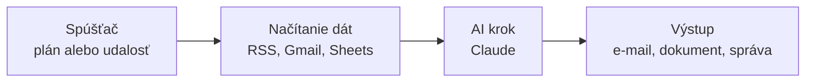
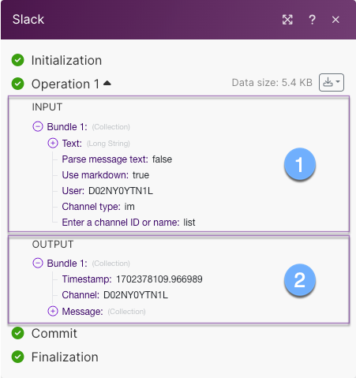
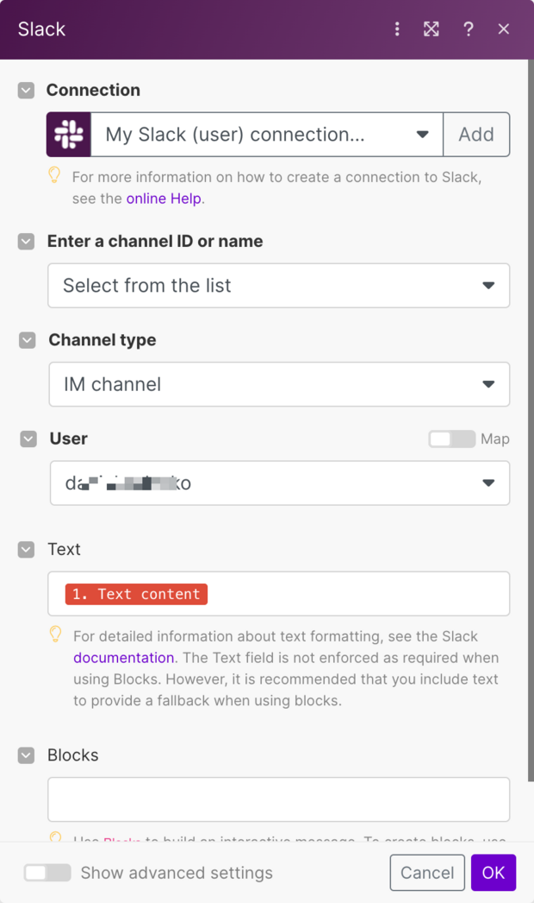
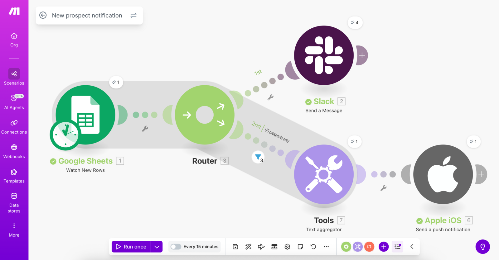
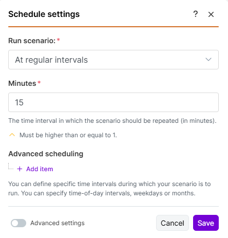
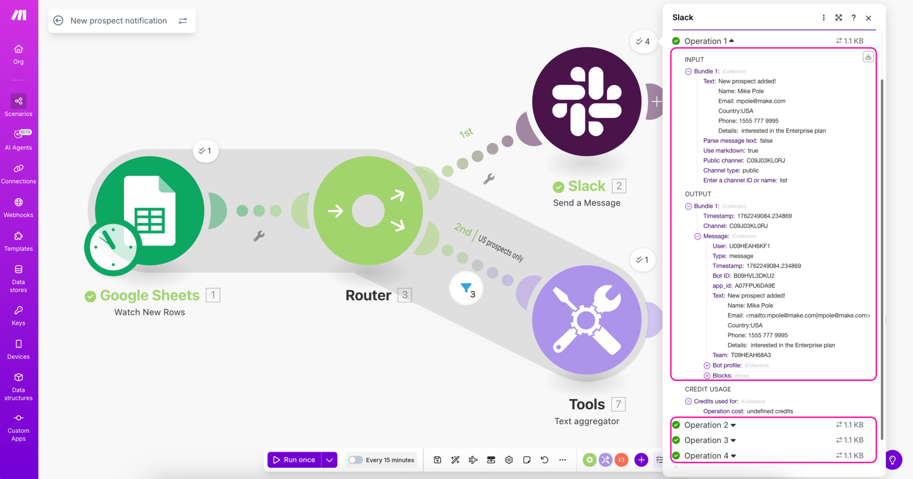
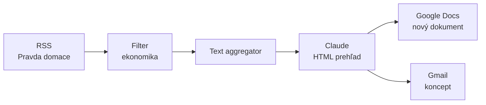
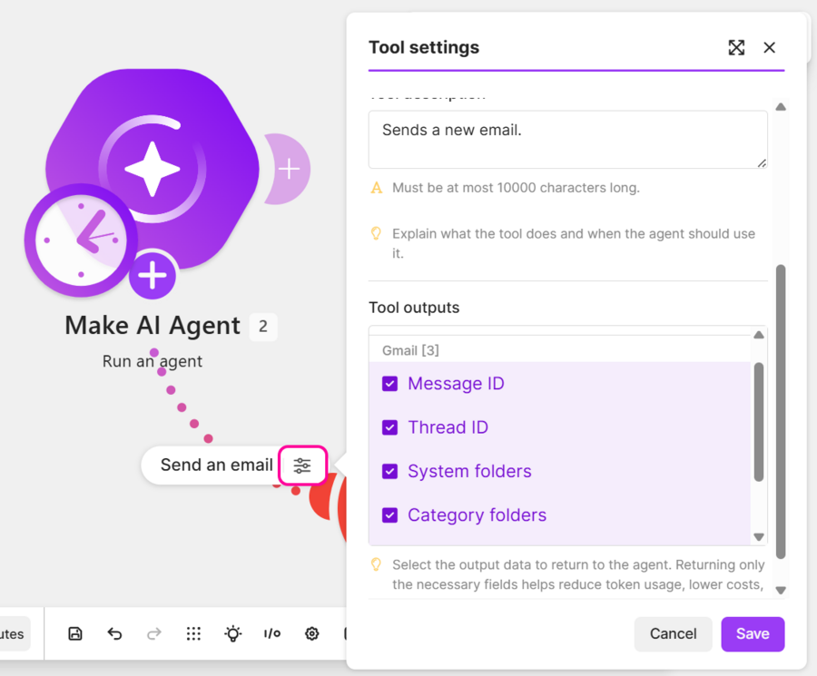

# Make: AI workflowy a agenti v praxi

*Verzia 1.0 · stav k novembru 2026. Nástroje sa menia rýchlo; pred  
nasadením si overte aktuálnu dokumentáciu Make a Anthropicu.*  

## 1. Prečo Make v AI školení

Make (make.com) je nástroj, v ktorom spájate aplikácie do automatizácií  
bez programovania. Kroky poskladáte na plátne z krabičiek a Make ich  
potom spúšťa sám, napríklad každé ráno o 7:00.  

Pre toto školenie je Make dôležitý preto, lebo do automatizácií vie  
zapojiť AI modely ako Claude. AI tak nie je iba okno na chatovanie, ale  
krok v procese: prečíta dáta, zhrnie ich, rozhodne alebo napíše text  
a výsledok ide ďalej do e-mailu, dokumentu či tabuľky.  



> **Jednoducho povedané:** Make je kuchynský robot. Vy určíte recept  
> a Make ho zopakuje presne rovnako, aj keď práve spíte.  

Make je vhodný aj pre ľudí bez technického vzdelania. Stačí vedieť, čo  
chcete automatizovať, a mať účty v aplikáciách, ktoré chcete prepojiť.  
Bezplatný plán stačí na vyskúšanie všetkých príkladov v tomto dokumente,  
len nemôžete mať aktívne viac ako dva scenáre naraz.  

## 2. Základné pojmy

Na prácu s Make stačí poznať sedem pojmov. Najdôležitejšie sú bundle,  
mapovanie a kredity, lebo pri nich vzniká väčšina chýb aj prekvapení  
na konci mesiaca.  

| Pojem | Význam | Príklad |  
| --- | --- | --- |  
| Scenár | celá automatizácia, čiže workflow | denný prehľad správ |  
| Modul | jeden krok scenára, krabička | Gmail → Send an email |  
| Spúšťač | rozhoduje, kedy scenár beží | plán alebo webhook |  
| Bundle | jeden balík dát z modulu | jeden článok z RSS |  
| Mapovanie | vloženie dát do poľa | nadpis do predmetu e-mailu |  
| Kredit | jednotka spotreby | 10 článkov × 1 modul = 10 |  
| Spojenie | uložené prihlásenie | váš Google účet |  

Make donedávna účtoval **operácie**. Dnes je účtovnou jednotkou  
**kredit** a jedna operácia sa rovná jednému kreditu. V starších  
návodoch preto ešte uvidíte slovo operácia; znamená to isté.  

> **Pozor:** AI moduly nie sú výnimkou z pravidla „jeden krok, jeden  
> kredit“. Modul Simple Text Prompt spotrebuje kredity podľa počtu  
> vstupných a výstupných tokenov, takže dlhý prompt alebo dlhá odpoveď  
> stoja viac než krátka otázka.  

Dôležité pravidlo o bundloch: ak modul vráti 10 bundlov, každý ďalší  
modul sa spustí 10-krát. Ak chcete jeden výsledok, bundly treba spojiť  
agregátorom (pozri príklad 2).  

  
*Obrázok 1: Jeden bundle v okne modulu. Input je to, čo Make poslal  
do aplikácie, Output to, čo sa vrátilo.  
Zdroj: help.make.com/mapping.*  

Namapované dáta vyzerajú v poli ako farebný štítok. Nikdy ich nepíšte  
ručne, vždy ich vkladajte kliknutím v mapovacom paneli.  

  
*Obrázok 2: Namapovaná hodnota má podobu farebného štítku s číslom  
modulu. Prepínač Map vpravo pole prepne do mapovacieho režimu.  
Zdroj: help.make.com/mapping.*  

### Bundly, iterátor a agregátor

| Modul | Čo robí | Kedy sa hodí |  
| --- | --- | --- |  
| Iterator | pole na samostatné bundly | každá položka sama ďalej |  
| Text aggregator | bundly do jedného textu | prompt alebo správa |  
| Array aggregator | bundly do jedného poľa | JSON, tabuľka, prílohy |  

Príklad: Claude vráti zoznam úloh ako JSON pole, modul Parse JSON ho  
sprístupní a Iterator z neho urobí samostatné bundly. Za iterátorom  
potom môže stáť Add a Row a zapíše každú úlohu do nového riadku.  

Opačný smer: Search Rows vráti 10 riadkov, Array aggregator z nich  
urobí jedno pole a JSON ho odošle ako jeden objekt.  

> **Tip:** Kým modul s poľom nebežal, ponúka mapovací panel za  
> iterátorom iba `Total number of bundles` a `Bundle order position`.  
> Po behu sa objavia polia jednotlivých položiek.  

Iterator aj agregátor stoja kredit za každý bundle.  

## 3. Prvé kroky a rozhranie

Rozhranie Make je v angličtine, preto pri tlačidkách a poliach uvádzame  
pôvodné anglické názvy. Obrázky v tejto kapitole pochádzajú z oficiálnej  
dokumentácie Make a zachytávajú aktuálne rozhranie.  

### Účet a bezplatný plán

1. Otvorte make.com a kliknite na **Sign up**. Stačí e-mail alebo účet  
   Google.  
2. Po prihlásení vznikne organizácia s bezplatným plánom. Ten nie je  
   časovo obmedzený, platí sa až za vyšší objem kreditov.  
3. V ľavom menu otvorte **Scenarios** a kliknite na **Create a new  
   scenario**. Otvorí sa prázdne plátno.  

| Parameter | Bezplatný plán |  
| --- | --- |  
| Kredity za mesiac | 1 000 |  
| Aktívne scenáre súčasne | 2 |  
| Najkratší interval plánu | 15 minút |  

Kredity sa na konci obdobia neprehadzujú do ďalšieho mesiaca. Keď sa  
minú, scenáre sa zastavia, kým kredity nedoplníte alebo neprejdete na  
vyšší plán.  

### Ľavé menu

Na začiatok potrebujete iba sekcie Scenarios a Connections, ostatné sú  
pre pokročilé použitie.  

| Položka | Na čo slúži |  
| --- | --- |  
| Org | Prehľad organizácie: spotreba kreditov, plán, členovia tímu |  
| Scenarios | Vaše automatizácie, tu trávite najviac času |  
| AI Agents | Agenti, ktorí sami rozhodujú, aké kroky a nástroje použijú |  
| Connections | Všetky uložené spojenia do aplikácií |  
| Webhooks | URL adresy, ktoré spustia scenár okamžite, keď na ne prídu dáta |  
| MCP Toolboxes | Scenáre ako nástroje pre AI asistentov |  
| Templates | Hotové scenáre na skopírovanie a úpravu |  
| Data stores | Malé tabuľky pre dáta medzi behmi |  
| Keys | Prístupové kľúče k Make API |  
| Devices | Prepojenie s mobilnou aplikáciou Make |  
| Data structures | Definície formátu dát, napr. aké polia má JSON |  
| Custom Apps | Vlastné konektory pre služby, ktoré Make nepodporuje |  

  
*Obrázok 3: Ľavé menu, plátno s modulmi a spodná lišta s Run once  
a plánom. Čísla v bublinách ukazujú počet spracovaných bundlov.  
Zdroj: help.make.com/step-7-test-the-final-scenario.*  

### Spodná lišta editora

- **Run once** spustí scenár raz na skúšku, bez ohľadu na plán,  
- **Save** uloží celý scenár; oranžová bodka znamená neuložené zmeny,  
- **Save** v nastaveniach modulu potvrdí iba nastavenia jedného modulu,  
- **prepínač ON/OFF** zapne scenár, aby bežal podľa plánu.  

> **Pozor:** Make neukladá automaticky. Ak zatvoríte kartu s neuloženými  
> zmenami, práca sa stratí.  

Plán nastavíte kliknutím na hodiny pri prvom module alebo na chip  
s časom v spodnej lište. Predvolená hodnota je **Every 15 minutes**  
a na bezplatnom pláne je to zároveň najkratší možný interval.  

  
*Obrázok 4: Nastavenie plánu. Vľavo dole je prepínač  
Advanced settings, vpravo tlačidlo Save.  
Zdroj: help.make.com/schedule-a-scenario.*  

### Bubliny po behu

Po každom behu sa nad modulmi objavia bubliny s číslom. Kliknutím na  
bublinu uvidíte vstup (Input) a výstup (Output) modulu. To je hlavný  
nástroj na hľadanie chýb.  

  
*Obrázok 5: Panel modulu po behu. Vpravo je zoznam operácií, dole  
spotreba kreditov (Credit usage).  
Zdroj: help.make.com/step-7-test-the-final-scenario.*  

## 4. Workflow verzus AI agent

Scenár ide vždy rovnakou cestou, ktorú ste nakreslili. Agent dostane  
cieľ a nástroje a cestu si volí sám.  

|  | Workflow (scenár) | AI agent |  
| --- | --- | --- |  
| Postup určuje | vy, pri návrhu | AI, pri každom behu |  
| Predvídateľnosť | vysoká, beh je rovnaký | nižšia, beh sa mení |  
| Flexibilita | nízka, treba dokresliť | vysoká, zvládne nové |  
| Cena | pevný počet kreditov | podľa rozhodnutí agenta |  
| Vhodné na | jasný opakovaný postup | postup podľa obsahu |  

AI v scenári ešte neznamená agenta. V príkladoch 1 až 3 Claude píše  
text, ale poradie krokov je pevné, takže ide stále o workflow.  

Obe veci sa dajú kombinovať: agent môže používať vaše scenáre ako svoje  
nástroje. Odporúčanie pre začiatočníkov je začať scenárom a agenta  
použiť až vtedy, keď pevný postup nestačí.  

## 5. Ako zapojiť Claude do Make

Na začiatok použite modul Simple Text Prompt. Ten nepotrebuje účet  
u Anthropicu ani API kľúč. Vlastný kľúč sa oplatí až pri pravidelnom  
používaní alebo keď potrebujete iný model než Haiku.  

| Spôsob | Čo treba | Kedy použiť |  
| --- | --- | --- |  
| Simple Text Prompt | nič | prvé pokusy a školenie |  
| Run an agent | nič | agent bez vlastného kľúča |  
| Anthropic Claude + API kľúč | účet a kredit | pravidelné používanie |  

Simple Text Prompt aj Make AI Provider sa platia kreditmi z plánu Make.  
Pri vlastnom API kľúči platíte tokeny priamo Anthropicu a Make vám  
strhne kredit iba za samotný modul.  

Predplatné claude.ai (Pro, Max) API nezahŕňa. API má vlastný účet  
a kredit v Claude Console.  

Na bezplatnom pláne Make je Simple Text Prompt obmedzený na modely  
Haiku. Prémiové modely (Sonnet, Opus) vyžadujú platený plán alebo  
vlastný API kľúč.  

### Postup s vlastným API kľúčom

1. Prihláste sa na console.anthropic.com a dobite kredit.  
2. Kliknite na ikonu kľúča v ľavom dolnom rohu, potom na **Create Key**,  
   zadajte názov a kľúč skopírujte. Znova ho už neuvidíte.  
3. V Make pridajte modul **Anthropic Claude → Create a Prompt**  
   a kliknite na **Create a connection**.  
4. Vložte kľúč do poľa **API Key** a uložte.  

Opačný smer, keď Claude spúšťa scenáre v Make, zabezpečujú MCP  
Toolboxes. Tomu sa venuje kapitola 12.  

## 6. Príklad 1: Claude napíše dokument do Google Docs

Claude každý deň napíše krátky tip na programovanie v Pythone a Make ho  
uloží ako nový Google dokument. Ide o najjednoduchší scenár s AI: dva  
moduly a žiadne kľúče.  

**Scenár:** Claude (Simple Text Prompt) → Google Docs (Create a Document)  

1. Vytvorte nový scenár a kliknite na veľké **+**.  
2. Vyberte **Anthropic Claude → Simple Text Prompt** a do promptu  
   napíšte: „Napíš krátky tip na Python pre začiatočníkov. Formátuj ho  
   ako HTML: jeden nadpis h2, jeden odsek p a jeden príklad kódu v pre.  
   Vráť iba HTML.“  
3. Uložte modul a kliknite na **Run once**. V bubline nad modulom  
   skontrolujte, či odpoveď vyzerá ako HTML.  
4. Kliknite na malé **+** vpravo od modulu a vyberte  
   **Google Docs → Create a Document**.  
5. Vyplňte polia:  
   - **Connection:** prihlásenie do vášho Google účtu,  
   - **Name:** napríklad Tip na Python,  
   - **Content:** kliknite do poľa a v mapovacom paneli vyberte odpoveď  
     Clauda,  
   - **Choose a Drive** a **Location:** ponechajte My Drive a „/“, alebo  
     vyberte priečinok.  
6. Uložte modul aj scenár (**Save** v spodnej lište) a spustite  
   **Run once**.  
7. Na Google Drive by sa mal objaviť nový dokument s naformátovaným  
   tipom.  

> **Tip:** Pole Content prijíma HTML, preto je výhodné žiadať od Clauda  
> odpoveď priamo v HTML. Nadpisy a kód sa v dokumente zobrazia správne  
> naformátované.  

> **Pozor na plán:** nový scenár beží predvolene každých 15 minút. Pred  
> zapnutím kliknite na hodiny pri prvom module a nastavte napríklad  
> Every day o 8:00, inak vznikne dokument každú štvrťhodinu.  

### Vyskúšajte

1. Pridajte do názvu dokumentu dátum funkciou  
   `formatDate(now; "YYYY-MM-DD")`.  
2. Zmeňte prompt tak, aby Claude odpovedal v angličtine, a porovnajte  
   výsledok v dokumente.  
3. Vypočítajte, koľko kreditov spotrebuje jeden beh a koľko ich minie  
   za mesiac pri dennom pláne.  

## 7. Príklad 2: Denný prehľad správ z Pravdy e-mailom

Make každé ráno načíta zahraničné správy z Pravdy, Claude vyberie päť  
najdôležitejších a zhrnutie príde e-mailom. Príklad učí nový pojem:  
agregáciu mnohých bundlov do jedného.  

**Scenár:** RSS → Text aggregator → Claude → Gmail  

### Krok 1: RSS

1. Pridajte modul **RSS → Retrieve RSS feed items**.  
2. **URL:** `https://spravy.pravda.sk/svet/rss/xml`  
   (pre domáce správy zmeňte `svet` na `domace`).  
3. **Maximum number of returned items:** 10 až 15.  
4. Spustite **Run once**, aby mapovací panel poznal polia feedu.  

Make premenuje polia z XML: `<title>` sa zobrazí ako **Title**  
a `<link>` ako **URL**. Hoci je `<description>` v XML prázdny, Make  
perex nájde a ponúkne ho ako **Description**.  

### Krok 2: Text aggregator

RSS vráti 10 článkov ako 10 bundlov. Bez agregátora by sa Claude aj  
Gmail spustili 10-krát a prišlo by 10 e-mailov.  

1. Pridajte modul **Tools → Text aggregator**.  
2. **Source module:** RSS.  
3. **Text:** namapujte tri polia s oddeľovačmi:  
   **Title** | **Description** | **URL**.  
4. V **Show advanced settings** nastavte **Row separator: New row**.  

Výstupom je jeden bundle s položkou **text**, ktorá obsahuje všetky  
články pod sebou.  

### Krok 3: Claude

1. Pridajte modul **Anthropic Claude → Simple Text Prompt**.  
2. Kliknite do prázdneho poľa a ako prvé namapujte **text** z Text  
   aggregatora. V poli musí byť farebný štítok.  
3. Pred štítok dopíšte: „Tu sú dnešné zahraničné správy z Pravdy  
   (nadpis | perex | odkaz):“.  
4. Za štítok dopíšte: „Vyber 5 najdôležitejších správ a napíš krátky  
   prehľad v slovenčine. Pri každej uveď nadpis, jednu až dve vety  
   o tom, o čom správa je, a odkaz. Formátuj ako jednoduché HTML  
   (h3, p, a href). Vráť iba HTML.“  

### Krok 4: Gmail

1. Pridajte modul **Gmail → Send an email** a prihláste Google účet.  
2. **To:** vaša e-mailová adresa.  
3. **Subject:** Prehľad zo sveta a dátum vložený funkciou  
   `formatDate(now; "D. M. YYYY")` z mapovacieho panela (záložka Date  
   and time).  
4. **Content:** namapujte odpoveď Clauda.  

> **Tip:** Ak si nie ste istí výstupom AI, použite  
> **Gmail → Create a Draft** namiesto odoslania. E-mail vznikne, ale  
> odíde až po vašej kontrole.  

### Krok 5: Test a plán

1. Kliknite na **Save** v spodnej lište, potom na **Run once**  
   a skontrolujte schránku.  
2. Na hodinách RSS modulu nastavte **Every day** o 7:00 a zapnite  
   scenár prepínačom **ON**.  

### Vyskúšajte

1. Zmeňte prompt na „Vyber správy o ekonomike“ a porovnajte výsledky.  
2. Vymeňte Gmail za Google Docs, takže prehľad sa uloží do dokumentu.  
3. Spočítajte bundly v Outpute RSS modulu a vysvetlite, prečo by bez  
   agregátora prišlo viac e-mailov.  

## 8. Príklad 3: Dokončenie porekadiel z tabuľky

Scenár načíta z Google Sheets začiatky porekadiel, Claude ich dokončí,  
výsledok sa zapíše späť do toho istého riadku a na konci príde jedna  
súhrnná správa na Telegram. Príklad učí tri nové veci: čítanie a zápis  
do tabuľky, filter na čiare medzi modulmi a posielanie správ cez  
Telegram bota.  

**Scenár:** Google Sheets (Search Rows) → filter → Claude →  
Google Sheets (Update a Row) → Text aggregator → Telegram  

### Krok 1: Príprava hárka

V prvom riadku sú hlavičky bez diakritiky a medzier:  

| zaciatok | dokoncenie |  
| --- | --- |  
| Bez práce |  |  
| Lepší vrabec v hrsti |  |  
| Kto druhému jamu kope |  |  
| Pán Boh dal, pán Boh vzal | Pán Boh dal, pán Boh vzal... |  

Posledný riadok je už hotový, takže ho filter nemá pustiť ďalej. Stĺpec  
dokoncenie musí byť pri nedokončených úplne prázdny, bez medzier.  

> **Tip:** V module zapnite **Use column headers as IDs**. Mapovanie  
> potom zostane platné, aj keď stĺpce premenujete, pridáte alebo  
> presuniete.  

### Krok 2: Moduly

**Google Sheets → Search Rows**  

- Vyberte súbor a hárok s porekadlami.  
- **Table contains headers:** Yes.  
- **Column range:** A-AZZ.  
- **Limit:** 10 pri testovaní.  
- Po každej zmene hárka spustite pravým klikom  
  **Run this module only**, inak Make nepozná polia.  

**Filter na čiare medzi Search Rows a Claudom**  

Kliknite na čiaru medzi modulmi a nastavte filter:  

- **Label:** Only unfinished.  
- **Condition:** pole dokoncenie zo Search Rows, operátor  
  **Basic operators → Does not exist**.  

**Anthropic Claude → Simple Text Prompt**  

- **Model:** Claude Haiku, ktorý je na krátke úlohy rýchly a lacný.  
- **Prompt:** namiesto `{{1.zaciatok}}` vložte kliknutím pole zaciatok  
  zo Search Rows.  

```text
Dokonči slovenské porekadlo, ktoré začína takto: "{{1.zaciatok}}"

Pravidlá:
- Vráť iba dokončenie, ktoré nadväzuje na začiatok. Začiatok neopakuj.
- Jedna veta, obyčajný text bez úvodzoviek a markdownu.
- Ak porekadlo poznáš, použi jeho správne znenie.
- Žiadny komentár ani vysvetlenie.
```

**Google Sheets → Update a Row**  

- Rovnaký súbor a hárok ako pri Search Rows.  
- **Row number:** pole Row number zo Search Rows.  
- **dokoncenie:** pole Result z Clauda.  

**Tools → Text aggregator**  

- **Source module:** Google Sheets – Search Rows.  
- **Text:** pole zaciatok, medzera a pole Result z Clauda, aby bolo  
  vidieť celé porekadlo.  
- **Row separator:** New row.  

**Telegram Bot → Send a Text Message or Reply**  

- **Connection:** token od BotFathera (postup nižšie).  
- **Chat ID:** vaše číselné ID.  
- **Text:** „Dokončené porekadlá:“, prázdny riadok a pole text  
  z agregátora.  

### Krok 3: Test

1. Spustite **Run this module only** na Search Rows. V bubline majú byť  
   riadky hárka a pri nedokončených je dokoncenie prázdne.  
2. Spustite **Run once**. Bubliny majú ukázať: Search Rows 1, Claude 3,  
   Update a Row 3, Text aggregator 3, Telegram 1. V hárku sa doplnia tri  
   dokončenia a na Telegram príde jedna správa.  
3. Spustite scenár znova. Všetky riadky už majú dokončenie, filter  
   nepustí nič a správa nepríde. To je správny výsledok.  
4. Pridajte nový riadok s prázdnym dokoncenie. Pri ďalšom behu sa  
   spracuje len on.  

Ak filter nič nepustí ani pri prázdnych bunkách, zmeňte operátor na  
**Equal to** s prázdnou pravou stranou a skontrolujte, či v bunke nie je  
medzera.  

### Krok 4: Rozbehanie Telegram bota

1. V Telegrame otvorte **@BotFather**, pošlite `/newbot` a zadajte meno  
   a username končiace na `bot`.  
2. BotFather vráti **token** v tvare `123456789:AAH...`. Skopírujte ho  
   celý a nikomu ho neukazujte. Ak ho stratíte, pošlite `/mybots`,  
   vyberte bota a API Token.  
3. Otvorte chat so svojím botom a stlačte **Start**. Bez tohto kroku vám  
   bot nemôže písať.  
4. Zistite svoje **Chat ID**: otvorte **@userinfobot**, stlačte Start  
   a skopírujte číslo pri Id.  
5. V Make pri module Telegram kliknite pri Connection na **Add**  
   a vložte token (nie ID).  
6. Do **Chat ID** vložte číslo (nie @username) a modul otestujte cez  
   **Run this module only**.  

Pri posielaní do kanála pridajte bota do kanála ako administrátora a ako  
Chat ID použite `@nazov_kanala` pri verejnom kanáli alebo číslo  
v tvare `-100...` pri súkromnom.  

### Spotreba a obmedzenia

Pri troch nedokončených riadkoch beh spotrebuje najmenej 11 kreditov:  
Search Rows 1, Claude 3, Update a Row 3, agregátor 3 a Telegram 1.  
K tomu sa pripočítajú kredity za tokeny v AI module. Beh bez nových  
riadkov stojí jediný kredit za Search Rows.  

| Modul | Kredity za beh |  
| --- | --- |  
| Search Rows (1 beh) | 1 |  
| Claude (3 bundly) | 3 + tokeny |  
| Update a Row (3 riadky) | 3 |  
| Text aggregator (3 riadky) | 3 |  
| Telegram (1 správa) | 1 |  

Správa na Telegrame môže mať najviac 4 096 znakov, preto pri väčšom  
počte riadkov nastavte **Limit** v Search Rows. Ak nie je čo spracovať,  
správa nepríde. Ak chcete vedieť aj o prázdnom behu, treba pridať  
vetvu cez Router.  

### Vyskúšajte

1. Znížte **Limit** na 3 a overte, že na Telegram prídu tri dokončenia.  
2. Vymeňte Telegram za Gmail a pošlite si súhrn e-mailom.  
3. Pridajte do tabuľky riadok s už vyplneným dokončením a overte, že ho  
   filter preskočí.  

## 9. Projekt: osobný denný prehľad

V tomto projekte spojíte naučené postupy do scenára, ktorý každý  
pracovný deň pripraví krátky prehľad ekonomických správ, uloží ho ako  
dokument a pošle vám koncept e-mailu na kontrolu.  



**Scenár:** RSS → filter → Text aggregator → Claude → Google Docs  
a Gmail  

1. Vytvorte scenár s názvom **Denný prehľad ekonomiky**.  
2. Pridajte **RSS → Retrieve RSS feed items**, URL  
   `https://spravy.pravda.sk/domace/rss/xml`, počet položiek 15 a raz  
   spustite **Run once**.  
3. Na čiaru za RSS pridajte filter: pole **Title**, operátor  
   **Text operators → Contains**, hodnota `ekonom`.  
4. Pridajte **Tools → Text aggregator** so zdrojom RSS a textom  
   **Title** | **Description** | **URL**.  
5. Pridajte **Anthropic Claude → Simple Text Prompt**. Namapujte  
   **text** z agregátora a dopíšte: „Vyber najdôležitejšie ekonomické  
   správy a napíš prehľad v slovenčine. Formátuj ako HTML s h3, p a a  
   href. Vráť iba HTML.“  
6. Pridajte **Google Docs → Create a Document**. Do poľa **Name**  
   vložte text `Prehľad ` a zaň funkciu  
   `formatDate(now; "D. M. YYYY")`. Do poľa **Content** namapujte  
   odpoveď Clauda.  
7. Pridajte **Gmail → Create a Draft**. Predmet doplňte dátumom  
   a do obsahu namapujte odpoveď Clauda.  
8. Kliknite na **Save**, spustite **Run once** a skontrolujte dokument  
   aj koncept v Gmaile.  
9. Na hodinách RSS nastavte **Weekdays** o 7:30 a zapnite scenár  
   prepínačom **ON**.  

**Kontrolný zoznam pred zapnutím:**  

- [ ] každý modul má v poli farebný štítok, nie ručne písaný text,  
- [ ] filter prepustí aspoň jeden článok,  
- [ ] agregátor má Source module nastavený na RSS,  
- [ ] plán nie je predvolených 15 minút,  
- [ ] e-mail odchádza ako koncept, nie priamo.  

Pri šiestich článkoch, ktoré prejdú filtrom, stojí jeden beh približne  
10 kreditov plus tokeny: RSS 1, agregátor 6, Claude 1, dokument 1  
a koncept 1. Za mesiac pri 21 pracovných dňoch je to okolo  
210 kreditov, čo sa do bezplatného plánu zmestí.  

## 10. Spúšťanie scenára webhookom

Plán nie je jediný spôsob štartu. Druhou možnosťou je **webhook**:  
adresa, na ktorú iná aplikácia pošle dáta, a Make scenár spustí  
okamžite.  

> **Jednoducho povedané:** webhook je zvonček pri dverách. Niekto naň  
> zazvoní a vy hneď viete, že máte niečo robiť. Pri pláne by ste museli  
> každých 15 minút otvárať dvere a pozerať, či niekto neprišiel.  

| Plán (polling) | Webhook (push) |  
| --- | --- |  
| Make sa pýta každých 15 minút | aplikácia zavolá Make |  
| oneskorenie až 15 minút | odpoveď za sekundy |  
| kredity minie aj naprázdno | kredity minie až pri dátach |  

### Vytvorenie webhooku

1. V novom scenári pridajte modul **Webhooks → Custom webhook**.  
2. Pri poli **Webhook** kliknite na **Add**, zadajte názov a uložte.  
3. Skopírujte vygenerovanú URL. Make na ňu počúva a každá požiadavka  
   spustí scenár.  
4. Voliteľne pridajte **API key authentication**: kľúč sa posiela  
   v hlavičke `x-make-apikey`.  
5. Kliknite na **Detect new values** a pošlite testovaciu požiadavku,  
   aby Make poznal polia, ktoré môžete namapovať.  
6. Doplňte zvyšok scenára, otestujte a nastavte plán  
   **Immediately as data arrives**.  

Webhook prijme parametre v adrese (query string), údaje z formulára  
aj JSON. Ak požiadavka obsahuje viac formátov naraz, Make ich spojí  
do jedného bundlu.  

### Odpoveď pre volajúceho

Bez modulu **Webhooks → Webhook response** vráti Make automaticky  
`200 Accepted`. Ak je fronta plná, vráti `400`, pri prekročení limitu  
`429`.  

Modul Webhook response nastaví **Status**, **Body** a voliteľné  
hlavičky. Odpoveď musí prísť do 180 sekúnd, inak Make vráti  
`200 Accepted`.  

> **Pozor:** Webhook response patrí na koniec scenára. Ak ho vložíte  
> doprostred a ďalší modul zlyhá, scenár sa nevypne a chybu nemusíte  
> zaznamenať.  

### Bezpečnosť webhooku

- URL webhooku je tajomstvo. Kto ju pozná, môže posielať dáta.  
- **API kľúč** overí volajúceho, **IP restrictions** obmedzia adresy.  
- **Data structure** zvaliduje vstup; neplatné dáta Make odmietne  
  s kódom 400.  
- Pri okamžitých spúšťačoch nastavte **Maximum runs to start per  
  minute**, predvolene 100, aby vás príval požiadaviek neprekvapil.  
- Bezplatný plán nemá pri webhooku 15-minútové obmedzenie; to platí  
  iba pre plánované behy.  

### Príklad: žiadosť z vlastnej stránky

**Scenár:** Custom webhook → filter → Claude → Telegram  

1. Formulár na vašej stránke pošle na webhook polia `meno`, `text`  
   a `email` metódou POST ako JSON.  
2. V scenári namapujte `text` do promptu Clauda s pokynom, aby  
   odpovedal jednou vetou v slovenčine.  
3. Výsledok pošlite na Telegram a do Webhook response vložte JSON  
   `{"stav": "prijate"}`.  
4. Otestujte z reálnej stránky, nie z editora, a až potom webhook  
   použite v produkčnom formulári.  

### Vyskúšajte

1. Vytvorte webhook a spustite ho zadaním URL do prehliadača.  
2. Pošlite JSON s dvoma poľami a overte, že sa objavili  
   v mapovacom paneli.  
3. Pridajte API kľúč a vyskúšajte požiadavku bez hlavičky; všimnite  
   si, ako Make zareaguje.  

## 11. Ďalšie scenáre na rozšírenie

Každý z nasledujúcich scenárov pridáva jeden nový koncept. Sú zoradené  
od najjednoduchšieho po agenta.  

### Príklad 4: Odpoveď na formulár ako koncept e-mailu

**Scenár:** Google Forms (Watch Responses) → Claude →  
Gmail (Create a Draft)  

Keď niekto vyplní formulár, napríklad prihlášku na školenie, Claude  
pripraví osobnú odpoveď a uloží ju ako koncept v Gmaile. E-mail  
neodchádza sám, človek ho pred odoslaním skontroluje.  

**Nový koncept:** človek v procese (human in the loop). Pri výstupoch  
AI, ktoré idú von k ľuďom, je koncept bezpečnejší než priame  
odoslanie.  

### Príklad 5: Triedenie prichádzajúcich e-mailov

**Scenár:** Gmail (Watch Emails) → Claude → Router → tri vetvy  

Claude každý nový e-mail zaradí do jednej kategórie: faktúra, otázka od  
zákazníka alebo ostatné. Router potom pošle e-mail správnou vetvou,  
napríklad faktúry dostanú štítok a otázky sa zapíšu do tabuľky.  

**Nový koncept:** router a filtre. Na každej vetve nastavíte filter,  
napríklad „odpoveď Clauda sa rovná faktúra“. Požiadajte Clauda, aby  
odpovedal iba jedným slovom z presného zoznamu, inak filtre odpoveď  
nezachytia.  

### Príklad 6: Údaje z faktúr do tabuľky

**Scénár:** Gmail (Watch Emails) → Claude → JSON (Parse JSON) →  
Google Sheets (Add a Row)  

Claude z textu e-mailu s faktúrou vytiahne dodávateľa, číslo faktúry,  
sumu a splatnosť. Výsledok vráti ako JSON a Make ho rozdelí do stĺpcov  
tabuľky.  

**Nový koncept:** štruktúrovaný výstup. Prompt končí vetou typu „Vráť  
iba JSON s kľúčmi dodavatel, cislo, suma, splatnost, bez ďalšieho  
textu“. Modul Parse JSON potom sprístupní každý kľúč na mapovanie.  

### Príklad 7: Zhrnutie nových dokumentov v priečinku

**Scenár:** Google Drive (Watch Files in a Folder) →  
Google Docs (Get Content) → Claude → Gmail  

Keď kolega vloží do zdieľaného priečinka nový dokument, Claude ho  
zhrnie do piatich bodov a zhrnutie príde e-mailom.  

**Nový koncept:** spúšťač na udalosť namiesto plánu. Scenár reaguje na  
nový súbor, nie na čas.  

## 12. Agenti a MCP Toolboxes

### Ako funguje agent v Make

Agent v Make je modul, ktorý dostane cieľ, inštrukcie a zoznam  
nástrojov. Nástrojom môže byť jeden modul, celý scenár alebo server  
MCP. Make pri každom behu pošle modelu názov a popis každého nástroja  
a model sa podľa nich rozhoduje.  

| Krok | Čo nastaviť |  
| --- | --- |  
| 1 | Pridajte modul **Make AI Agent (New) → Run an agent** |  
| 2 | Vyberte AI provider a model; na bezplatnom pláne Make AI Provider |  
| 3 | Napíšte **Instructions** – rolu, cieľ a pravidlá agenta |  
| 4 | Pridajte nástroje cez **Add tool** |  
| 5 | Otestujte agenta v module a až potom ho zapnite |  

Scenár, ktorý má agentovi vracať dáta, musí mať plán **On demand**, byť  
aktívny a končiť modulom **Scenarios → Return output**. Bez toho agent  
dostane prázdnu odpoveď.  

  
*Obrázok 6: Agent a jeho nástroj. V paneli Tool settings sa nastavuje  
popis nástroja a polia, ktoré agentovi vráti.  
Zdroj: help.make.com/create-your-first-ai-agent.*  

### Príklad 8: Jednoduchý AI agent

**Agent:** modul Run an agent s nástrojmi: scenár z príkladu 1 (vytvor  
dokument) a scenár z príkladu 2 (prehľad správ).  

Agent dostane požiadavku v bežnej reči, napríklad „Urob mi prehľad  
správ o ekonomike a ulož ho do dokumentu“. Sám rozhodne, ktoré nástroje  
použije a v akom poradí.  

**Nový koncept:** scenáre ako nástroje. Každý nástroj potrebuje jasný  
popis, čo robí a aké vstupy potrebuje, lebo agent sa rozhoduje podľa  
neho.  

> **Pozor:** agent míňa kredity aj na rozhodovanie. Jeden beh môže  
> znamenať niekoľko volaní modelu a niekoľko spustených scenárov, preto  
> mu nastavte limity a testujte ho na malých dátach.  

### MCP Toolboxes

MCP Toolbox je samostatný server, ktorý sprístupní vybrané scenáre  
AI asistentom, napríklad Claude alebo ChatGPT. Namiesto celého účtu  
Make dostane asistent iba zoznam nástrojov, ktoré do toolboxu pridáte.  

1. V ľavom menu kliknite na **MCP Toolboxes** a potom na  
   **Create toolbox**.  
2. Pomenujte toolbox a v časti **Tools** vyberte scenáre. Ponúknu sa  
   iba aktívne scenáre s plánom On demand.  
3. Doplňte popis každého nástroja a určite, či je len na čítanie, alebo  
   aj na zápis.  
4. Vygenerujte kľúč a URL toolboxu a vložte ich do svojho AI  
   asistenta.  

> **Tip:** Vďaka toolboxu nemusí model vidieť medzikroky. Make spustí  
> celý scenár a asistentovi vráti iba výsledok. To šetrí tokeny aj  
> znižuje riziko nesprávneho rozhodnutia.  

## 13. Chybové vetvy a opakovanie

Keď modul vráti chybu, scenár sa zastaví a Make sa pokúsi vrátiť zmeny,  
ktoré stihol urobiť. **Error handler** je posledný modul chybovej vetvy:  
chybu zachytí a rozhodne, čo bude ďalej.  

> **Jednoducho povedané:** error handler je istič v elektrike. Pri  
> skrate nevypadne celý dom, len jeden okruh, a vy viete, kam sa  
> pozrieť.  

### Päť error handlerov

| Handler | Čo urobí | Stav behu |  
| --- | --- | --- |  
| Skip | zahodí bundle a ide ďalej | Success |  
| Retry | odloží bundle a skúsi znova | Warning |  
| Resume | nahradí výstup pripravenou hodnotou | Success |  
| Commit | zastaví beh, zmeny potvrdí | Warning |  
| Rollback | zastaví beh, zmeny vráti | Error |  

Bez error handlera a s vypnutými nedokončenými behmi Make použije  
Rollback. Pri viacerých chybách za sebou scenár vypne plán, aby  
nemíňal kredity naprázdno.  

### Nedokončené behy

V **Scenario settings** zapnite **Store incomplete executions**. Make  
potom pri chybe uloží stav behu do záložky **Incomplete executions**,  
odkiaľ ho môžete opraviť a dokončiť.  

| Stav | Význam |  
| --- | --- |  
| Unresolved | čaká na vaše rozhodnutie |  
| Pending | je naplánovaný ďalší pokus |  
| In progress | Make práve skúša beh dokončiť |  

Modul Retry vyžaduje zapnuté ukladanie nedokončených behov. Make sám  
opakuje chyby `RateLimitError`, `ConnectionError` a  
`ModuleTimeoutError` s odstupom 1 minúta, 10 minút, neskôr až  
3 hodiny. Z jedného scenára bežia najviac tri pokusy súčasne.  

### Kedy ktorý handler

| Situácia | Voľba |  
| --- | --- |  
| dočasný výpadok API alebo limit | Retry |  
| jeden pokazený riadok v dávke | Skip |  
| chýbajúca hodnota, ktorú viete nahradiť | Resume |  
| zápis do databázy, ktorý sa nesmie rozpadnúť | Rollback alebo Commit |  
| tichá chyba, o ktorej sa chcete dozvedieť | Retry a upozornenie |  

### Praktické pravidlá

- Error handler pridávajte na rizikové moduly, nie na každý.  
- Opakujte iba prechodné chyby. Zlý vstup sa opakovaním neopraví.  
- Retry bez upozornenia je tichá chyba: pošlite si e-mail alebo  
  zápis do Data store.  
- Error handlery a Router sa nepočítajú do kreditov.  
- Po oprave chyby skontrolujte históriu a dokončite nedokončené behy.  

### Vyskúšajte

1. Pridajte Retry na Google Sheets v príklade 3, v Search Rows uveďte  
   neexistujúci hárok a sledujte stav Warning v histórii.  
2. Nastavte Resume na Claude s náhradnou vetou a overte, že scenár  
   dobehne aj bez odpovede modelu.  
3. Vysvetlite, prečo sa Skip nehodí na zápis sumy do tabuľky.  

## 14. História behov a verzie scenára

### História behov

Záložka **History** v scenári ukazuje zoznam behov aj zmien. Pri každom  
behu vidíte čas, stav (Success, Warning, Error), trvanie, počet  
operácií, spotrebu kreditov a veľkosť prenesených dát.  

1. Otvorte scenár a prepnite sa na záložku **History**.  
2. Kliknite na **Details** pri behu, ktorý chcete preskúmať.  
3. V detaile prepínajte jednoduchý a rozšírený záznam a otvárajte  
   bundly jednotlivých modulov.  
4. Ikona filtra skryje stĺpce, ktoré nepotrebujete.  
5. V menu s tromi bodkami zapnete **Hide check runs** (behy bez dát)  
   alebo **Export to CSV**.  

Pri chybe ponúkne Make aj **Explain error** (vysvetlenie od AI)  
a **Get help** s odkazmi na dokumentáciu. Nástroj Maia vie chybu aj  
opraviť, jeho použitie však míňa kredity.  

### Verzie scenára

Pred väčšou úpravou si uložte verziu: v lište kliknite na šípku pri  
**Save** a vyberte **Save a version**. Ku verzii napíšte popis,  
napríklad „pred pridaním Telegramu“.  

**Version history** ukáže verzie s popismi a dátumom a umožní vrátiť sa  
k nim. Make ich drží 60 dní, poslednú až do uloženia novšej. Ak sa  
relácia preruší, pomôže **Scenario recovery** s neuloženými zmenami.  

### Blueprint

Blueprint je scenár uložený ako JSON: moduly, nastavenia aj mapovanie.  
Hodí sa na zálohu, na odovzdanie študentom a na presun medzi účtami.  

1. V pravom hornom rohu kliknite na tri bodky a vyberte  
   **Export blueprint**. Súbor sa uloží ako `.json`.  
2. Na inom účte otvorte nový scenár, zvoľte **Import blueprint**  
   a vyberte súbor.  
3. Spojenia sa neprenášajú. Každý modul s červenou známkou treba  
   znova pripojiť.  
4. Uložte scenár a pred zapnutím ho raz spustite.  

> **Pozor:** blueprint obsahuje aj natvrdo zapísané hodnoty, napríklad  
> e-mailové adresy alebo ID tabuliek. Pred zdieľaním ho otvorte  
> a skontrolujte. Súbor môže mať najviac 2 MB.  

### Vyskúšajte

1. Vyexportujte blueprint príkladu 2 a naimportujte ho do nového  
   scenára. Čo musíte doplniť, aby bežal?  
2. Nájdite beh so stavom Warning a vysvetlite, ktorý modul ho spôsobil.  
3. Uložte verziu pred úpravou promptu a potom sa k nej vráťte.  

## 15. Bezpečnosť

- **Kľúče a tokeny** patria do spojení v Make, nikdy do promptu ani do  
  textu dokumentu. Token Telegram bota je heslo: ktokoľvek s ním môže  
  posielať správy vašim menom.  
- **Prístup k dátam** obmedzte na minimum. Ak scenár potrebuje iba  
  čítanie z hárka, nedávajte mu právo zápisu do celého disku.  
- **Osobné údaje** z formulárov a e-mailov posielate modelu. Zvážte, čo  
  je naozaj potrebné, a nepúšťajte do promptu rodné čísla ani zdravotné  
  údaje.  
- **Vloženie pokynu** je reálne riziko pri RSS a e-mailoch: cudzí text  
  môže obsahovať vetu „ignoruj predošlé pokyny“. Preto AI krok nesmie  
  sám odosielať peniaze, mazať dáta ani meniť oprávnenia.  
- **Odchádzajúce správy** nechajte ako koncept alebo ich posielajte len  
  na vlastnú adresu, kým scenár nevyladíte.  
- **Nekonečné slučky a plán** sú najčastejšia príčina vyčerpaných  
  kreditov. Pred zapnutím nastavte interval a sledujte históriu behov.  
- **Webhook URL** je verejný vstup do vášho scenára. Ak ho niekto  
  získa, môže scenár spúšťať. Použite tajný token v URL alebo overenie  
  hlavičky.  

## 16. Časté chyby a ich hľadanie

Väčšina chýb v Make vzniká pri mapovaní dát medzi modulmi, nie  
v samotných aplikáciách. Nájdete ich tak, že prejdete bubliny modul po  
module.  

### Reálny prípad z príkladu 2

**Príznak:** e-mail prišiel, ale Claude v ňom písal, že mu chýba  
zoznam správ.  

**Hľadanie:**  

1. Output RSS modulu obsahoval 10 článkov, takže RSS fungovalo.  
2. Output Text aggregatora obsahoval jeden bundle so všetkými článkami,  
   takže agregátor fungoval.  
3. Input Claude modulu nemal v prompte žiadne správy. Chyba bola teda  
   tu.  

**Príčina:** v prompte bol ručne napísaný text v zátvorkách `{{...}}`.  
Make ho rozbil na niekoľko prázdnych premenných a Claudovi poslal  
prázdne miesto.  

**Oprava:** prompt sa vymazal, najprv sa kliknutím v mapovacom paneli  
vložil štítok **text** z agregátora a až potom sa okolo neho dopísal  
text.  

### Prehľad častých chýb

| Problém | Príčina | Riešenie |  
| --- | --- | --- |  
| AI nemá dáta | v poli je text, nie štítok | namapujte cez panel |  
| Príde 10 e-mailov | chýba agregátor | pridajte agregátor pred AI |  
| Panel neukazuje polia | modul ešte nebežal | spustite Run once |  
| Zmeny zmizli | uložil sa iba modul | Save v spodnej lište |  
| Kredity rýchlo miznú | plán každých 15 minút | nastavte plán prvého modulu |  
| Zlý formát výstupu | prompt nehovorí formát | „Vráť iba HTML“ alebo JSON |  
| Telegram: Unauthorized | neplatný token | vytvorte nové spojenie |  
| Telegram: chat not found | chýba Start, zlé Chat ID | stlačte Start, overte ID |  
| Telegram: prázdna správa | text nie je namapovaný | namapujte pole text |  
| Agent nič nerobí | nástroj nie je On demand | plán On demand, Return output |  

### Postup pri každej chybe

1. Spustite **Run once**.  
2. Otvorte bublinu prvého modulu a pozrite **Output**.  
3. Pokračujte ďalším modulom: najprv jeho **Input**, potom **Output**.  
4. Kde sa dáta stratia alebo zmenia, tam je chyba.  

## 17. Úlohy na precvičenie

1. Postavte príklad 1 a do názvu dokumentu pridajte dátum pomocou  
   funkcie `formatDate(now; "YYYY-MM-DD")`.  
2. Upravte prompt z príkladu 1 tak, aby Claude písal tip na tému  
   z vašej práce, napríklad Excel alebo e-mailová komunikácia.  
3. Postavte príklad 2 a najprv spustite iba RSS modul. Spočítajte  
   bundly v Outpute a vysvetlite, prečo treba agregátor.  
4. V príklade 2 vymeňte Gmail za Google Docs, takže prehľad sa uloží  
   do dokumentu.  
5. Pridajte do príkladu 2 druhý zdroj, sekciu `domace`, a nechajte  
   Clauda napísať prehľad z oboch.  
6. Zapíšte si, koľko kreditov spotreboval jeden beh príkladu 2,  
   a vypočítajte spotrebu za mesiac pri dennom behu.  
7. Postavte príklad 3 s vlastnou tabuľkou, napríklad s otázkami do  
   testu namiesto porekadiel.  
8. Pridajte do príkladu 3 druhý filter, ktorý spracuje iba riadky  
   začínajúce na písmeno K, a otestujte ho na troch riadkoch.  
9. Navrhnite na papieri scenár z vašej práce: spúšťač, kroky, úlohu AI  
   a kam ide výsledok. Ku každému kroku napíšte, či ho má robiť Make  
   alebo človek.  
10. Premeňte svoj scenár na agenta: pomenujte nástroje, napíšte ich  
    popisy a vysvetlite, prečo ste zvolili agenta a nie workflow.  
11. Vytvorte webhook a pošlite naň dáta z inej aplikácie alebo  
    z príkazového riadka. Do scenára pridajte Webhook response  
    s vlastným telom odpovede.  
12. Nechajte Clauda vrátiť tri úlohy ako JSON pole, rozdeľte ich  
    iterátorom a zapíšte každú do nového riadku tabuľky.  
13. Pridajte na rizikový modul Retry a zapnite Store incomplete  
    executions. Overte, čo sa objaví v záložke Incomplete executions.  
14. Vyexportujte blueprint svojho scenára a naimportujte ho do nového  
    scenára. Zoznamte, čo sa neprenieslo a prečo.  

## 18. Zhrnutie a ťahák

### Kľúčové body

- **Scenár** je pevná postupnosť modulov, **agent** si cestu volí sám.  
- Každý modul stojí aspoň jeden **kredit**; AI moduly podľa tokenov.  
- Veľa **bundlov** a jeden výsledok znamená **agregátor**.  
- Dáta sa do polí vkladajú **kliknutím v mapovacom paneli**, nikdy  
  ručne cez zátvorky.  
- Predvolený plán je každých 15 minút; pred zapnutím ho vždy zmeňte.  
- Od AI žiadajte **presný formát** výstupu: HTML, JSON alebo jedno  
  slovo.  
- Výstupy, ktoré idú k ľuďom, nechajte najprv ako **koncept**.  
- Scenáre sa dajú sprístupniť agentom cez **MCP Toolboxes**.  
- **Webhook** spustí scenár okamžite, bez čakania na plán.  
- **Error handler** zabráni tomu, aby jedna chyba zastavila celý beh.  
- **História** a **verzie** ukážu, čo sa stalo a kedy sa to pokazilo.  
- **Blueprint** je záloha scenára, ale bez spojení a s citlivými  
  hodnotami, preto sa pred zdieľaním kontroluje.  

### Ťahák

**Postup pri každom scenári:** pridaj modul → Save modulu → Run once →  
skontroluj bublinu → ďalší modul → Save scenára → nastav plán → ON.  

**Päť pravidiel:**  

1. Zátvorky `{{ }}` nikdy nepíšte ručne, dáta vkladajte kliknutím  
   v mapovacom paneli.  
2. Správne namapované dáta vyzerajú ako farebný štítok.  
3. Veľa bundlov a jeden výsledok znamená agregátor.  
4. Pred zapnutím vždy nastavte plán, predvolený je každých 15 minút.  
5. Od AI žiadajte presný formát: „Vráť iba HTML“, „Vráť iba JSON“,  
   „Odpovedz jedným slovom“.  

### Užitočné moduly

| Modul | Na čo |  
| --- | --- |  
| Anthropic Claude → Simple Text Prompt | AI krok bez API kľúča |  
| Make AI Agent (New) → Run an agent | Agent s nástrojmi |  
| RSS → Retrieve RSS feed items | Načítanie článkov z webu |  
| Tools → Text aggregator | Spojenie bundlov do jedného textu |  
| Flow Control → Router | Rozdelenie scenára do vetiev |  
| JSON → Parse JSON | Rozdelenie odpovede AI na polia |  
| Tools → Iterator | Rozdelenie poľa na samostatné bundly |  
| Tools → Array aggregator | Spojenie bundlov do jedného poľa |  
| Webhooks → Custom webhook | Spustenie scenára okamžite |  
| Webhooks → Webhook response | Vlastná odpoveď volajúcemu |  
| Gmail → Send an email / Create a Draft | Odoslanie alebo koncept e-mailu |  
| Google Docs → Create a Document | Uloženie výsledku do dokumentu |  
| Google Sheets → Add a Row | Zápis do tabuľky |  
| Google Sheets → Search Rows / Update a Row | Čítanie a zápis späť do riadku |  
| Telegram Bot → Send a Text Message or Reply | Správa cez vlastného bota |  

**Užitočné funkcie:** `now` (aktuálny čas),  
`formatDate(now; "D. M. YYYY")` (dátum v slovenskom tvare).  

## 19. Slovníček

| Anglicky | Slovensky | Význam |  
| --- | --- | --- |  
| scenario | scenár | celá automatizácia na plátne |  
| module | modul | jeden krok scenára |  
| trigger | spúšťač | modul, ktorý rozhoduje o štarte |  
| bundle | balíček dát | jeden záznam, ktorý modul spracuje |  
| mapping | mapovanie | vkladanie výstupov do polí ďalšieho modulu |  
| connection | spojenie | uložené prihlásenie do aplikácie |  
| credit | kredit | jednotka spotreby v pláne Make |  
| operation | operácia | starší názov pre kredit |  
| aggregator | agregátor | spojí viac bundlov do jedného |  
| router | smerovač | rozdelí tok do viacerých vetiev |  
| filter | filter | podmienka, ktorá pustí alebo zastaví bundle |  
| webhook | webhook | URL, ktorá spustí scenár udalosťou |  
| error handler | chybová vetva | modul, ktorý zachytí chybu a rozhodne |  
| retry | opakovanie | nový pokus po prechodnej chybe |  
| incomplete execution | nedokončený beh | uložený beh, ktorý čaká na opravu |  
| history | história | zoznam behov a zmien scenára |  
| version | verzia | uložený stav scenára s popisom |  
| blueprint | blueprint | scenár uložený ako súbor JSON |  
| iterator | iterátor | rozdelí pole na samostatné bundly |  
| array aggregator | agregátor poľa | spojí bundly do jedného poľa |  
| agent | agent | AI, ktorá si sama volí nástroje a postup |  
| tool | nástroj | modul alebo scenár, ktorý agent použije |  
| MCP | protokol pre nástroje | spôsob, akým AI asistent volá nástroje |  
| human in the loop | človek v procese | človek schvaľuje výstup AI |  
| prompt | pokyn | zadanie pre model |  
| token | token | najmenšia jednotka textu pre model |  

## Zdroje

- Make – ako fungujú kredity: help.make.com/credits  
- Make – plánovanie scenára: help.make.com/schedule-a-scenario  
- Make – cenník a limity plánov: make.com/pricing  
- Make – aplikácia Anthropic Claude a moduly:  
  apps.make.com/anthropic-claude  
- Make – prvý AI agent a nástroje: help.make.com/create-your-first-ai-agent  
- Make – MCP Toolboxes: make.com/how-to-guides/mcp-toolboxes  
- Make – moduly Google Sheets: apps.make.com/google-sheets-modules  
- Make – moduly Telegram Bot: apps.make.com/telegram  
- Make – error handlery a chyby: help.make.com/Overview-of-error-handling  
- Make – nedokončené behy: help.make.com/incomplete-executions  
- Make – história scenára: help.make.com/scenario-history  
- Make – verzie a blueprinty: help.make.com/blueprints  
- Make – iterátor a agregátory: help.make.com/flow-control  
- Make – webhooky: help.make.com/webhooks  
- Make – Custom webhook a odpovede: apps.make.com/gateway  
- Anthropic – API kľúče a Console: console.anthropic.com  
- Obrázky 1 až 6: Make Help Center (help.make.com), prevzaté ako  
  ilustrácia rozhrania.  
- Pravda – RSS kanály: spravy.pravda.sk  
