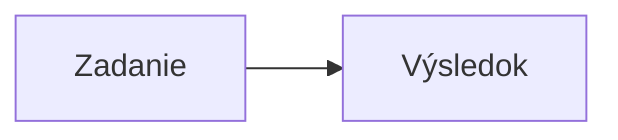
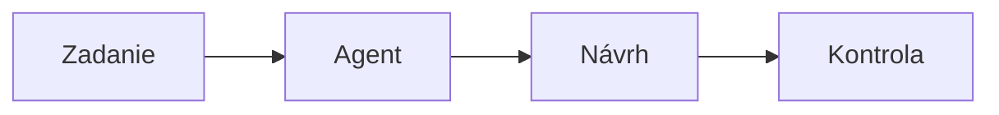
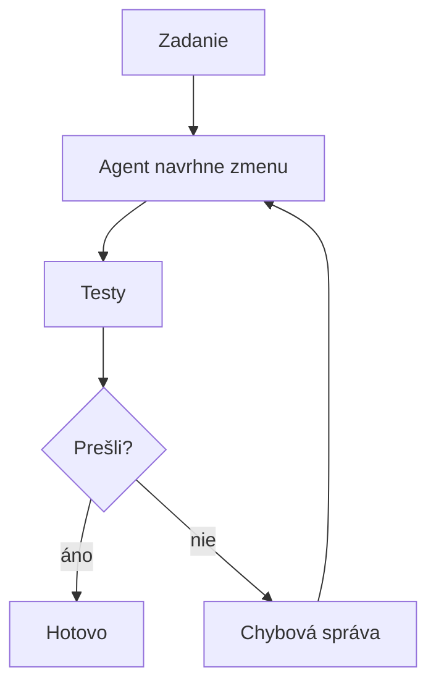
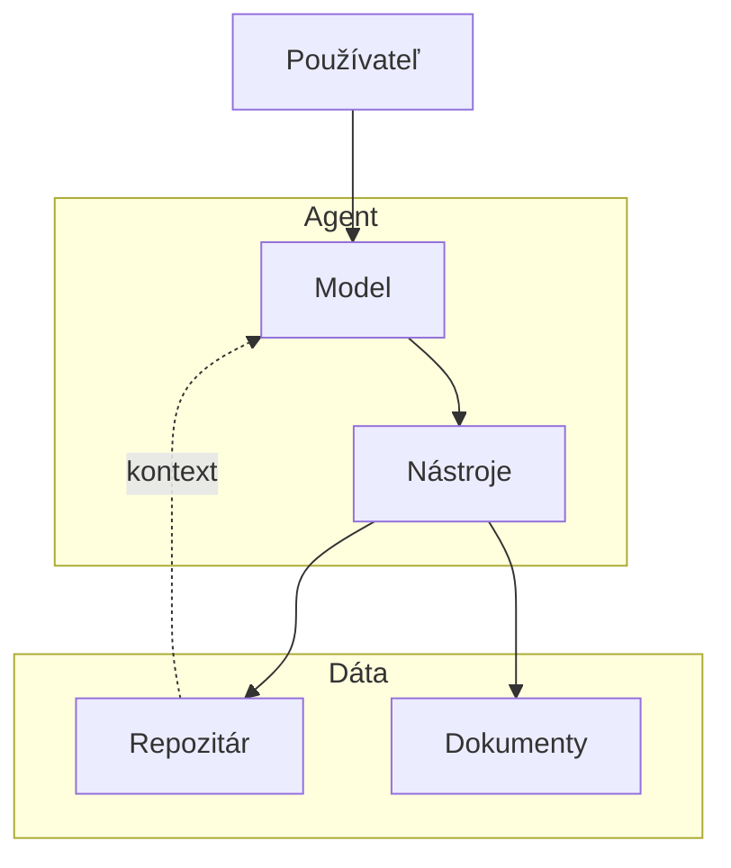
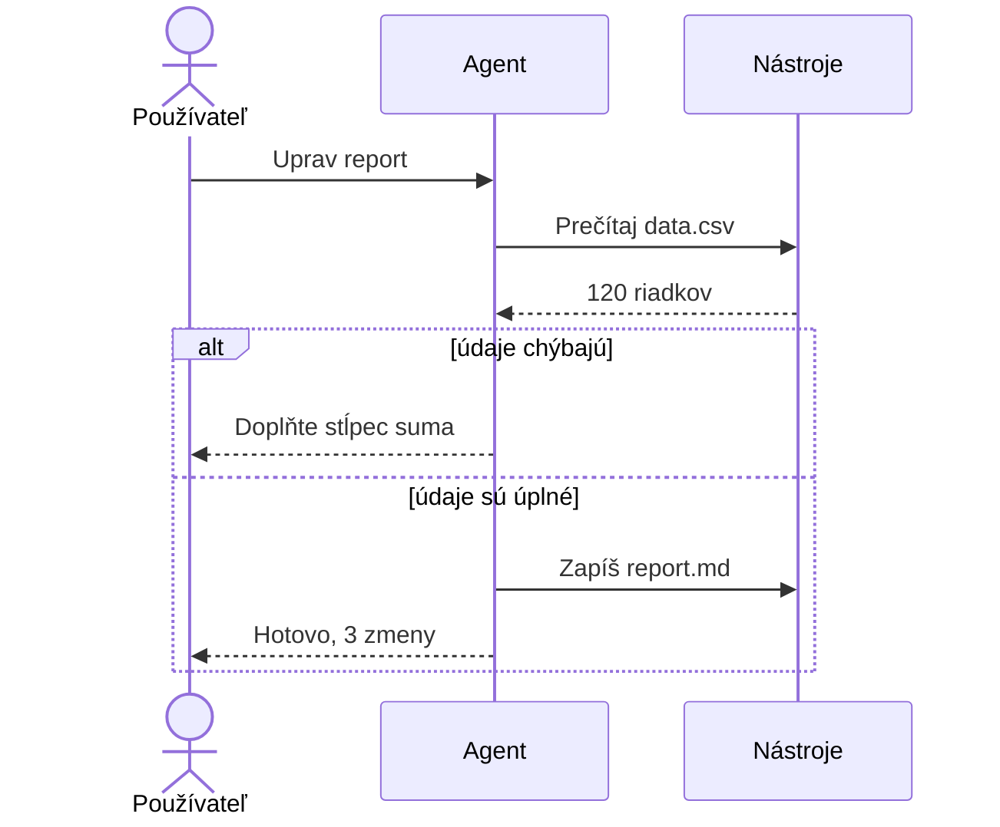
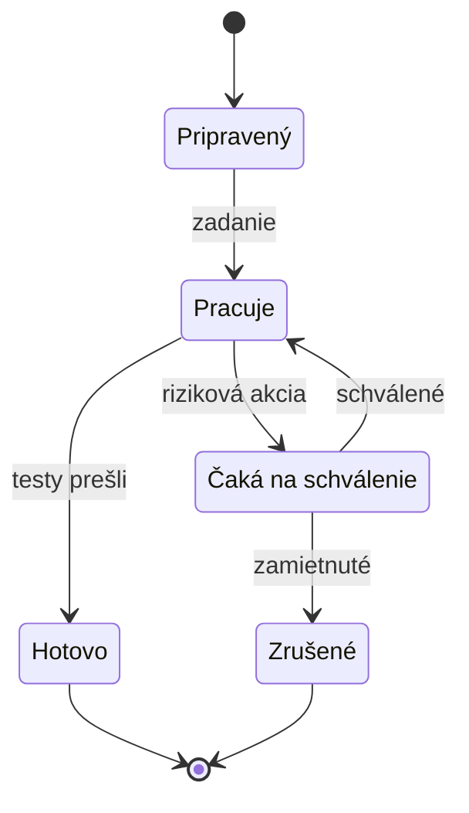
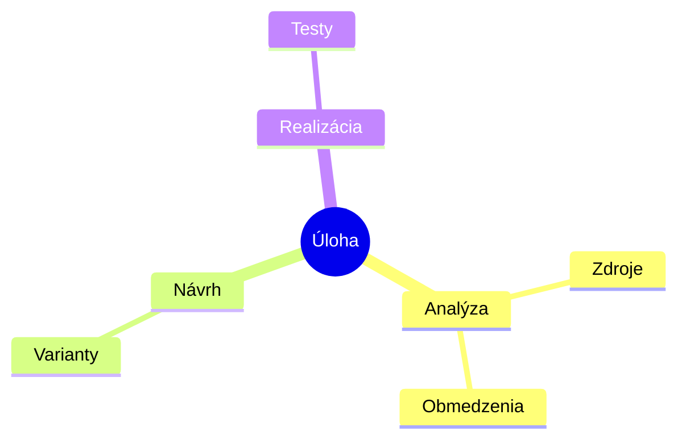
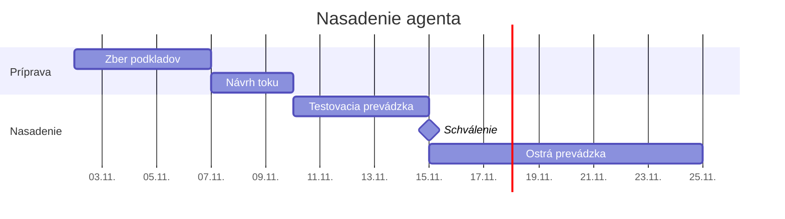
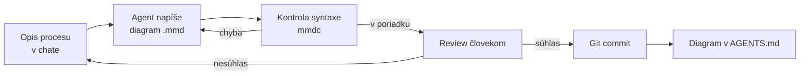

# Mermaid pri práci s agentmi: diagramy ako zadanie

*Verzia 1.0 · stav k októbru 2026. Nástroje sa menia rýchlo; pred  
nasadením si overte aktuálnu dokumentáciu Mermaid a VS Code.*  

## 1. Prečo diagramy pri agentoch

Agent pracuje s textom. Obrázok dnes síce prečíta, ale nedá sa v ňom  
spoľahlivo hľadať, upraviť ho a v gite porovnať. Mermaid tento problém  
odstraňuje: diagram je text, ktorý agent napíše, vy aj kolega prečítate  
a git zobrazí ako rozdiel.  

Keď proces opíšete odstavcom, čitateľ si hranice domýšľa. Diagram ho  
donúti rozhodnúť: kto koná, čo nasleduje, kde sa vetví a čo do procesu  
nepatrí. Agentovi tak zadanie nehovorí len „čo“, ale aj „v akom poradí“  
a „kedy sa zastaviť“.  

Diagram má pri agentoch tri úlohy:  

- **zadanie** – tok schválite skôr, než agent napíše kód,  
- **dokumentácia** – architektúra v `AGENTS.md` zostane aktuálna,  
- **kontrola** – rozdiel medzi diagramom a realitou je vidieť.  

> **Jednoducho povedané:** slovný opis je rozprávanie o ceste, diagram  
> je mapa. Agent sa podľa mapy zastaví na správnom mieste.  

## 2. Ako Mermaid funguje

Mermaid je knižnica, ktorá premení text na obrázok vo formáte SVG  
(vektorový obrázok, ktorý sa dá ľubovoľne zväčšiť). Parser najprv text  
skontroluje a až potom ho renderer vykreslí. Diagram sa preto správa  
ako kód: buď je syntakticky správny, alebo vráti chybu s číslom riadku.  

Prvý riadok určuje typ (pred ním môže byť len voliteľná hlavička  
s nastavením). `flowchart` kreslí tok, `sequenceDiagram`  
poradie správ, `stateDiagram-v2` stavy, `mindmap` rozklad a `gantt`  
plán v čase. Typ určuje, akú otázku diagram odpovie; nemiešajte ich  
len preto, že jeden vyzerá krajšie.  

V Markdown súbore je diagram obyčajný blok kódu s jazykom `mermaid`:  

````markdown

````

Kde sa diagram vykreslí:  

| Kde | Čo treba | Poznámka |  
| --- | --- | --- |  
| GitHub | nič | Issues, PR, wiki aj `.md` |  
| VS Code 1.121+ | nič | náhľad Markdownu a notebooky |  
| mermaid.live | prehliadač | rýchly pokus a zdieľanie |  
| CLI `mmdc` | Node 22.12+ | SVG, PNG, PDF aj kontrola |  
| dokumentačné nástroje | doplnok | Docusaurus, MkDocs a ďalšie |  

V čase písania bola aktuálna verzia Mermaid 12.2. GitHub a VS Code  
používajú vlastnú verziu, ktorá býva o niečo staršia. Preto pri nových  
a beta typoch vždy overte náhľad. Verziu na GitHube zistíte dočasným  
blokom, ktorý obsahuje jediné slovo `info`.  

> **Tip:** chybové hlásenie obsahuje číslo riadku a ukazovateľ na znak.  
> Presne túto správu pošlite agentovi, keď má diagram opraviť.  

## 3. Príprava a prvé overenie

Na GitHub nič neinštalujete a vo VS Code 1.121 a novšom stačí náhľad.  
Na kontrolu mimo editora potrebujete Node.js 22.12 alebo novší a nástroj  
`mmdc` z balíka `@mermaid-js/mermaid-cli`.  

Súbor `mermaid-priklady/01-tok/diagram.mmd` overíte takto:  

```bash
node -v
npm install -g @mermaid-js/mermaid-cli
mmdc --version
cd mermaid-priklady/01-tok
mmdc -i diagram.mmd -o /tmp/tok.svg
```

Príkaz `mmdc --version` vypíše verziu nástroja. Ak nechcete globálnu  
inštaláciu, použite `npx -p @mermaid-js/mermaid-cli mmdc` s rovnakými  
parametrami. Otvorenie `/tmp/tok.svg` v prehliadači je prvá vizuálna  
kontrola.  

Vo VS Code otvorte Markdown a stlačte Ctrl+Shift+V. Náhľad kreslí  
diagram, umožňuje priblíženie a po kliknutí pravým tlačidlom skopíruje  
zdroj. V prehliadači stačí otvoriť mermaid.live a vložiť ten istý text.  

### Vyskúšajte

1. overte, že `mmdc --version` vypíše verziu,  
2. otvorte diagram v náhľade VS Code a priblížte ho,  
3. ten istý text vložte do mermaid.live a porovnajte výsledok.  

## 4. Príklady od jednoduchých po zložité

Každý príklad je v samostatnom priečinku v `mermaid-priklady`. Spoločný  
postup je vždy rovnaký: prepíšte `diagram.mmd`, spustite `mmdc` a otvorte  
výsledné SVG. Keď príkaz prejde bez chyby, syntax je v poriadku; obsah  
ešte kontrolujte očami.  

### 4.1 Prvý diagram: tok úlohy

Súbor `mermaid-priklady/01-tok/diagram.mmd`:  



Prvý riadok určuje typ a smer. `LR` znamená zľava doprava, `TD` zhora  
nadol. Zápis `A["Zadanie"]` je identifikátor `A` s popisom „Zadanie“;  
identifikátor slúži na prepojenie, popis vidí čitateľ.  

Identifikátory píšte bez diakritiky a medzier. Popis, ktorý obsahuje  
zátvorku, úvodzovku alebo zvislú čiaru, dajte do úvodzoviek, inak ho  
parser môže rozdeliť na viac častí.  

### Vyskúšajte

1. zmeňte smer na `TD`,  
2. pridajte uzol „Schválenie“ medzi návrh a kontrolu,  
3. zmeňte popis na `Návrh (verzia 2)` bez úvodzoviek a prečítajte  
   chybu.  

### 4.2 Rozhodnutie a slučka

Súbor `mermaid-priklady/02-rozhodnutie/diagram.mmd`:  



`{ }` je rozhodovací uzol a `|"áno"|` je popis hrany. Cyklus `F --> A`  
znamená, že agent po chybe skúsi krok znova. Takýto obrázok je užitočný  
pri návrhu automatizácie, lebo ukáže, kde môže úloha uviaznuť.  

Každá slučka potrebuje zastavenie. Doplňte ho pravidlom v zadaní  
(najviac tri pokusy) alebo druhým rozhodnutím, ktoré pošle úlohu  
človeku. Diagram bez výstupu z cyklu je návod na nekonečné opakovanie.  

### Vyskúšajte

1. pridajte vetvu „neviem“ s uzlom „Otázka používateľovi“,  
2. otočte diagram na `LR` a všimnite si prekreslenie,  
3. doplňte do popisu hrany počet pokusov.  

### 4.3 Hranice systému

Súbor `mermaid-priklady/03-architektura/diagram.mmd`:  



`subgraph` zoskupí uzly do rámu a pomenuje ich. Hrany môžu viesť medzi  
rámami; práve tie ukazujú, kde systém prekračuje vlastnú hranicu.  
Prerušovaná hrana `-.->` znamená voliteľný alebo oneskorený tok, v ukážke  
kontext, ktorý agent načíta podľa potreby.  

Takýto diagram patrí skôr do `AGENTS.md` než do prezentácie. Agent z neho  
zistí, kde sú hranice; oprávnenia však nastavuje konfigurácia, nie  
obrázok. Keď sa hranica zmení, zmena je vidieť v diffu ako jeden riadok.  

### Vyskúšajte

1. pridajte rám „Externé API“ s jedným uzlom,  
2. presuňte „Dokumenty“ do tohto rámca,  
3. zmeňte `TB` na `LR` a porovnajte čitateľnosť.  

### 4.4 Postupnosť: kto s kým hovorí

Súbor `mermaid-priklady/04-postupnost/diagram.mmd`:  



`sequenceDiagram` ukazuje poradie správ v čase. `->>` je požiadavka  
a `-->>` odpoveď. `alt` a `else` sú vetvy, `end` ich uzatvára. Na rozdiel  
od vývojového diagramu tu vidíte aj to, kto čaká na koho.  

Tento typ je vhodný na rozhovor agenta s nástrojmi a na schvaľovanie.  
Keď do diagramu zakreslíte človeka, hneď vidíte, v ktorom kroku môže  
zasiahnuť a kde naopak chýba.  

### Vyskúšajte

1. pridajte `Note over Agent: kontrola pravidiel`,  
2. obaľte volanie nástroja do `loop` s tromi pokusmi,  
3. premenujte `Nástroje` na `Súbory a API`.  

### 4.5 Stavy agenta

Súbor `mermaid-priklady/05-stavy/diagram.mmd`:  



Stavový diagram odpovedá na otázku „v akom stave sa úloha nachádza“.  
`[*]` je začiatok alebo koniec. Zápis `state "..." as X` dá uzlu čitateľný  
popis a krátky identifikátor, ktorý sa používa v prechodoch.  

Prechod píšte v tvare `odkiaľ --> kam: udalosť`. Udalosť je to, čo zmenu  
vyvolá, nie to, čo sa potom stane. Dobrý stavový diagram obyčajne nemá  
dva prechody s rovnakou udalosťou z toho istého stavu.  

### Vyskúšajte

1. pridajte stav „Chyba“ a prechod doň z „Pracuje“,  
2. doplňte, ako sa z chyby vráti späť,  
3. overte, že každý stav má aspoň jeden východ.  

### 4.6 Rozklad úlohy

Súbor `mermaid-priklady/06-rozklad/diagram.mmd`:  



Mindmap nemá hrany; vzťah je daný odsadením. Prvý riadok `root` je  
koreň a každá ďalšia úroveň je viac odsadená, v ukážke o dve medzery.  
Mermaid kreslí uzly automaticky, preto sa hodí na prvý návrh rozkladu.  

Úvodzovky v mindmape netreba; vypísali by sa do popisu uzla. Použite  
ich len vtedy, keď to vyžaduje syntax konkrétneho tvaru uzla.  

Agent ju použije na to, aby úlohu rozdelil na časti, ktoré sa dajú  
overiť. Vy potom vetvy škrtáte alebo presúvate. Mindmap nie je plán;  
neobsahuje poradie ani zodpovednosť, na to slúži vývojový diagram.  

### Vyskúšajte

1. pridajte vetvu „Riziká“ s dvoma poduzlami,  
2. presuňte „Testy“ pod „Realizácia“ a sledujte zmenu,  
3. posuňte riadok o úroveň a všimnite si, kam sa uzol pripne.  

### 4.7 Plán v čase

Súbor `mermaid-priklady/07-plan/diagram.mmd`:  



Gantt je typ, v ktorom sa počítajú trvania. `dateFormat` určuje, ako  
sa píšu dátumy, a `after a1` nadviaže krok na úlohu s identifikátorom  
`a1`. Keď sa prvý krok posunie, ostatné idú s ním; ručné dátumy by  
zostali na mieste.  

`milestone` je bod bez trvania, vhodný na schválenie alebo odovzdanie.  
Plán v diagrame nie je záväzok, ale dohoda o poradí. Pri agentoch sa  
hodí najmä na fázy, v ktorých sa strieda práca agenta a kontrola.  

### Vyskúšajte

1. posuňte začiatok o týždeň dopredu,  
2. pridajte úlohu „Školenie tímu“ pred ostrú prevádzku,  
3. zmeňte trvanie testovacej prevádzky a všimnite si následky.  

## 5. Diagram ako zadanie pre agenta

Diagram nie je len výstup pre ľudí. Je to najkratšie zadanie, ktoré  
agent dokáže overiť parserom. Namiesto odseku o tom, ako sa spracuje  
žiadosť, pošlete diagram s desiatimi uzlami a jednou vetvou.  

Diagram je aj úspornejší vstup: desať uzlov zaberie menej tokenov než  
tri odseky, a napriek tomu nesie viac informácií o poradí a vetvách.  

| Vlastnosť | Odsek | Diagram |  
| --- | --- | --- |  
| dĺžka | 300 slov | 10 uzlov |  
| vetvy | ľahko prehliadnuteľné | vidno ich |  
| kontrola | čítanie | parser |  
| zmena | prepíšte text | upravte uzol |  
| diff | nejasný | presný |  

Pravidlá pre diagram, ktorý má agent vytvoriť:  

- jeden diagram odpovedá na jednu otázku,  
- 5 až 12 uzlov, inak ho rozdeľte,  
- na hranách sú slovesá alebo podmienky,  
- popisy po slovensky, identifikátory bez diakritiky,  
- žiadne farby a štýly, tie neskrývajú štruktúru,  
- súbor pomenujte podľa otázky, napríklad `tok-ziadosti.mmd`.  

Agent si pri nejasnom zadaní doplní účastníkov aj vetvy. Preto v zadaní  
vymenujte, kto v procese vystupuje a čo je mimo rozsahu; diagram potom  
nekreslí fiktívnych účastníkov.  

Takéto zadanie funguje v Claude Code, opencode aj v chate:  

```text
Vytvor diagram toku žiadosti o dovolenku.
Ulož ho do súboru diagrams/tok-prace.mmd.
Použi flowchart LR, najviac 10 uzlov a popisy po slovensky.
Identifikátory uzlov píš bez diakritiky.
Nepridávaj farby ani štýly.
Potom over syntax: mmdc -i diagrams/tok-prace.mmd -o /tmp/tok.svg
Ak príkaz zlyhá, prečítaj chybu, oprav diagram a spusti ho znova.
```

Posledné dve vety sú dôležité. Agent dostane nielen cieľ, ale aj spôsob  
kontroly a pravidlo, čo robiť s chybou. Bez nich často vráti diagram,  
ktorý vyzerá dobre, no parser ho odmietne.  

Súbor `mermaid-priklady/projekt/diagrams/tok-prace.mmd` ukazuje celý  
postup ako diagram:  



Cyklus `K -->|"chyba"| D` je automatický, cyklus `R -->|"nesúhlas"| Z`  
je ľudský. Oba sú v diagrame viditeľné, preto sa pri kontrole nezabudne  
ani jeden. Keď agent opraví syntax, ešte to neznamená, že proces opísal  
správne; to rozhoduje človek.  

> **Pozor:** agent môže diagram „opraviť“ tak, že ho prispôsobí svojmu  
> riešeniu. Diagram je zadanie, nie dôkaz. Zhodu s realitou overte v  
> kóde, logoch alebo rozhovorom s ľuďmi, ktorí proces robia.  

## 6. Praktický projekt: runbook, ktorý zostane aktuálny

Cieľ: priečinok, v ktorom tím aj agent nájdu postup spracovania žiadosti.  
Diagram je zdroj, SVG je vygenerovaný výstup a kontrola je jeden príkaz.  

Pripravený projekt skopírujte a spustite:  

```bash
cp -r mermaid-priklady/projekt ~/runbook
cd ~/runbook
chmod +x kontrola.sh
./kontrola.sh
```

Štruktúra projektu:  

```text
runbook/
├── AGENTS.md
├── README.md
├── kontrola.sh
└── diagrams/
    ├── tok-prace.mmd
    └── tok-prace.svg
```

Súbor `AGENTS.md` drží pravidlá, ktoré agent potrebuje pri každej zmene:  

```markdown
# Runbook

## Diagramy

- Zdroj je v `diagrams/*.mmd`, SVG sa generuje, needitujte ho.
- Pred commitom spusti `./kontrola.sh`.
- Jeden diagram = jedna otázka, najviac 12 uzlov.
- Popisy po slovensky, identifikátory bez diakritiky.
- Farby a štýly nepoužívaj, rozhoduje štruktúra.
- Po zmene procesu uprav diagram v tom istom commite.
```

Súbor `README.md` ukáže diagram ľuďom, ktorí Mermaid nečítajú:  

```markdown
# Runbook

Postup, ktorým agent spracuje žiadosť o dovolenku.


```

Súbor `kontrola.sh` je jediné miesto, kde sa overuje syntax:  

```bash
#!/usr/bin/env bash
set -euo pipefail

# Overí a vygeneruje všetky diagramy.
for subor in diagrams/*.mmd; do
  echo "Kontrolujem $subor"
  mmdc -i "$subor" -o "${subor%.mmd}.svg" --quiet
done
echo "Hotovo."
```

Postup pri zmene:  

1. opíšte agentovi zmenu a nechajte ho upraviť `.mmd`,  
2. spustite `./kontrola.sh` a otvorte vygenerované SVG,  
3. prečítajte diff; zmena v diagrame má byť malá a zámerná,  
4. commitnite diagram aj s kódom alebo textom, ktorý ho zmenil.  

Keď sa proces zmení, požiadajte agenta o úpravu diagramu a commitnite  
ju spolu so zmenou, ktorá ju vyvolala. Diagram, ktorý zostane o krok  
pozadu, je horší než žiadny: tvári sa ako dokumentácia a ľudia podľa  
neho konajú.  

## 7. Automatizácia: kontrola pri každom commite

Ručné spúšťanie stačí na učenie, nie na tím. Najjednoduchšia poistka je  
git hook (skript, ktorý sa spustí pred commitom), ktorý pustí  
`kontrola.sh`.  

Súbor `.git/hooks/pre-commit`:  

```bash
#!/usr/bin/env bash
set -euo pipefail
./kontrola.sh
```

Nezabudnite na `chmod +x .git/hooks/pre-commit`. Hook beží lokálne, preto  
ho môže obísť `git commit --no-verify`; v tíme preto patrí kontrola aj  
do CI (continuous integration, automatická kontrola pri každej zmene).  

Krok v GitHub Actions môže vyzerať takto:  

```yaml
name: Diagramy
on: [pull_request]
jobs:
  kontrola:
    runs-on: ubuntu-latest
    steps:
      - uses: actions/checkout@v4
      - uses: actions/setup-node@v4
        with:
          node-version: 22
      - run: npm install -g @mermaid-js/mermaid-cli
      - run: ./kontrola.sh
```

Tento postup je overený lokálne. V CI závisí od dostupného Chromia, ktoré  
`mmdc` potrebuje; ak krok zlyhá na sandboxe, použite Docker obraz  
`minlag/mermaid-cli` alebo konfiguráciu Puppeteera.  

Agentovi môžete kontrolu vynútiť aj hookom po zápise súboru. V Claude  
Code nastavte `PostToolUse` hook na `Write`, ktorý pre `.mmd` spustí  
`mmdc`. Predloha je v [hooks.md](hooks.md).  

> **Tip:** do textu chyby nedávajte celý výpis. Agentovi stačí prvých  
> päť riadkov s číslom riadku a znakom pod chybou.  

## 8. Bezpečnosť

- **Cudzí diagram je kód.** Mermaid sa vykonáva v prehliadači; renderer  
  má ochrany, ale otvárať neznáme diagramy na svojom počítači je riziko.  
- **Nechajte `securityLevel` na `strict`.** Predvolená úroveň kóduje  
  HTML a vypína kliknutia; `loose` povoľuje oboje.  
- **SVG je aktívny formát.** Vygenerovaný obrázok môže obsahovať odkazy  
  alebo skript, ak ho vyrobil niekto iný. Pred zverejnením ho otvorte  
  v sandboxe alebo vygenerujte znova z vlastného zdroja.  
- **Tajomstvá nepatria do popisov.** Kľúče, interné adresy a mená  
  klientov sa dostanú do gitu aj do obrázka.  
- **Text z webu je vstup.** Popis skopírovaný z cudzej stránky môže  
  obsahovať skrytý pokyn. Agent ho prečíta spolu s diagramom.  
- **Diagram nie je dôkaz.** Zhoda s realitou sa overuje v kóde a v  
  rozhovore s ľuďmi, ktorí proces robia.  

> **Pozor:** `securityLevel: loose` povoľuje HTML aj kliknutia. Do  
> verejnej dokumentácie ho nedávajte; výnimku zdôvodnite a ohraničte.  

## 9. Časté chyby

| Problém | Príčina | Riešenie |  
| --- | --- | --- |  
| `Parse error` | chýba `end` alebo úvodzovka | pozrite riadok pod chybou |  
| diagram chýba na GitHube | novší alebo beta typ | overte verziu cez `info` |  
| popis sa oreže | interpunkcia bez úvodzoviek | dajte popis do úvodzoviek |  
| diakritika v id | závisí od verzie nástroja | id píšte bez diakritiky |  
| diagram je nečitateľný | viac ako 15 uzlov | rozdeľte ho na dva |  
| `mmdc: command not found` | chýba inštalácia | `npm install -g ...` |  
| `mmdc` zlyhá na serveri | chýba Chromium | Docker alebo config Puppeteera |  
| agent diagram prepisuje | chýbajú pravidlá | doplňte ich do `AGENTS.md` |  

## 10. Úlohy na precvičenie

1. Nakreslite tok, ktorým sa u vás schvaľuje faktúra,  
2. pridajte doň rozhodnutie a jednu slučku s maximom pokusov,  
3. zakreslite architektúru svojho agenta do `AGENTS.md`,  
4. napíšte postupnosť volania dvoch nástrojov vrátane chybovej vetvy,  
5. nechajte agenta vygenerovať diagram z odseku a nájdite v ňom chybu,  
6. nastavte `kontrola.sh` a overte, že chybný diagram naozaj zlyhá.  

## 11. Zhrnutie

- **Mermaid** je textový formát; diagram sa dá upraviť, porovnať a  
  skontrolovať ako kód.  
- **Typ diagramu** určuje otázku: tok, postupnosť, stavy, rozklad alebo  
  plán.  
- **Identifikátory** píšte bez diakritiky, popisy do úvozoviek, keď  
  obsahujú interpunkciu.  
- **Agentovi** dávajte diagram ako zadanie aj príkaz na kontrolu  
  (`mmdc`), inak nemá spätnú väzbu.  
- **Kontrola** patrí do hooku a do CI; vygenerované SVG sa needituje.  
- **Bezpečnosť** znamená `securityLevel: strict` a opatrnosť pri cudzích  
  diagramoch.  

## 12. Slovníček

| Anglicky | Slovensky | Význam |  
| --- | --- | --- |  
| diagram as code | diagram ako kód | text, z ktorého vznikne obrázok |  
| flowchart | vývojový diagram | tok krokov a rozhodnutí |  
| sequence diagram | diagram postupnosti | poradie správ medzi aktérmi |  
| state diagram | stavový diagram | prechody medzi stavmi |  
| mindmap | myšlienková mapa | rozklad témy na vetvy |  
| gantt | ganttov diagram | plán v čase s nadväznosťami |  
| node | uzol | jeden bod v diagrame |  
| edge | hrana | spojenie alebo prechod |  
| renderer | vykresľovač | knižnica, ktorá text zobrazí |  
| parser | syntaktický analyzátor | kontroluje správnosť zápisu |  
| review | kontrola zmeny | čítanie a schválenie človekom |  
| runbook | prevádzkový postup | návod na opakovanú činnosť |  
| `mmdc` | Mermaid CLI | nástroj na kontrolu a export |  

## Zdroje

- Mermaid – About a syntaxe: mermaid.js.org/intro/  
- Mermaid – vývojové diagramy: mermaid.js.org/syntax/flowchart.html  
- Mermaid Live Editor: mermaid.live  
- Mermaid – CLI: github.com/mermaid-js/mermaid-cli  
- Mermaid – konfigurácia a `securityLevel`:  
  mermaid.js.org/config/usage.html  
- GitHub – Creating diagrams:  
  docs.github.com/en/get-started/writing-on-github/working-with-advanced-formatting/creating-diagrams  
- VS Code 1.121 – Mermaid v Markdown náhľade:  
  code.visualstudio.com/updates/v1_121  
