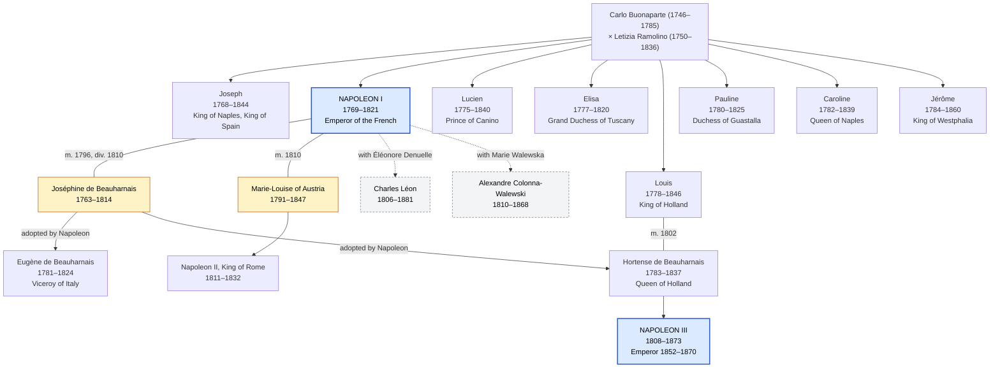
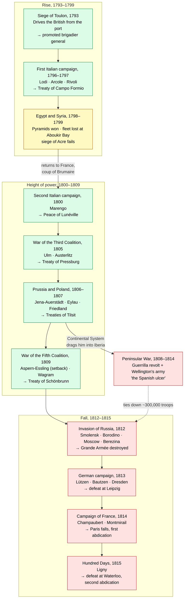

# Napoleon Bonaparte: A Biography

## Introduction

Napoleon Bonaparte (1769–1821) rose from minor Corsican nobility to Emperor of  
the French and, for a decade, master of most of continental Europe. He was a  
general of rare talent, a lawgiver whose Civil Code still shapes legal systems  
on four continents, and a dynast who placed his brothers and sisters on  
European thrones.  

His career runs in a single arc. He became a general at 24, First Consul at 30  
and Emperor at 35. He then lost everything in the snows of Russia and the  
fields of Belgium, and died in exile on a remote Atlantic island at 51. This  
biography follows that arc and gives particular attention to the large,  
ambitious and often quarrelsome Bonaparte family that travelled it with him.  

## Corsican origins and education

Napoleone di Buonaparte was born on 15 August 1769 in Ajaccio, Corsica, only  
fifteen months after the Republic of Genoa ceded the island to France. His  
family descended from Tuscan petty nobility who had settled in Corsica in the  
16th century. They were respected locally but far from rich.  

### His parents

His father, **Carlo Buonaparte** (1746–1785), was a lawyer who had fought  
alongside the Corsican patriot Pasquale Paoli against the French. After  
Paoli's defeat in 1769, Carlo switched sides and courted the new French  
governor, the Comte de Marbeuf. That patronage won the family recognition as  
French nobility and secured royal scholarships for the children. Carlo was  
charming and ambitious but spent beyond his means, and he died of stomach  
cancer at 38, leaving the family in debt.  

His mother, **Maria Letizia Ramolino** (1750–1836), married Carlo at about 14  
and bore him thirteen children, eight of whom survived infancy. Stern, frugal  
and devout, she held the family together after Carlo's death. Napoleon later  
said that he owed everything to her. As Emperor he gave her the title *Madame  
Mère*, yet she saved much of her allowance, famously remarking, "Pourvu que ça  
dure" ("Let's hope it lasts"). She outlived her son by fifteen years and died  
in Rome in 1836.  

### School in France

In 1779, aged nine, Napoleon was sent to the military school at  
Brienne-le-Château in Champagne. He spoke French with a heavy Italian accent,  
was mocked for his poverty and his Corsican origins, and grew into a solitary,  
proud boy who read voraciously, especially history and mathematics.  

In 1784 he entered the École Militaire in Paris, where he trained as an  
artillery officer. He finished the course in a single year instead of the  
usual two or three. His father died in February 1785, and at 15 Napoleon  
became, in practice, the head of the family alongside his elder brother  
Joseph. He was commissioned a second lieutenant of artillery in September  
1785.  

## Rise during the Revolution

The French Revolution of 1789 opened careers to talent, and Napoleon seized  
the opening. At first he hoped to make his name in Corsica, but he quarrelled  
with Paoli, who had turned toward Britain. In 1793 the Bonapartes were driven  
off the island and fled to the French mainland as penniless refugees.  

### Toulon and Vendémiaire

Later in 1793, Captain Bonaparte took command of the artillery at the siege of  
Toulon, a port held by royalists and the British fleet. His plan to seize the  
heights commanding the harbour forced the British out in December. At 24 he  
was promoted to brigadier general.  

The fall of Robespierre in 1794 briefly landed him in prison because of his  
Jacobin connections. His break came on 5 October 1795 (13 Vendémiaire), when  
royalist crowds marched on the National Convention in Paris. Bonaparte placed  
cannon in the streets and broke the attack with what he called "a whiff of  
grapeshot". The grateful new government, the Directory, gave him command of  
the Army of the Interior.  

### The Italian campaign, 1796–1797

In March 1796 he married Joséphine de Beauharnais and, two days later, left to  
command the ragged Army of Italy. In a year of rapid marches he defeated the  
Piedmontese and then the Austrians at Lodi, Arcole and Rivoli. He forced  
Austria to sign the Treaty of Campo Formio in October 1797. He also ran  
conquered northern Italy almost as his own state, founding sister republics  
and sending art and money back to Paris.  

### Egypt and Brumaire

In 1798 he led an expedition to Egypt to threaten Britain's route to India. He  
won the Battle of the Pyramids, but Admiral Nelson destroyed his fleet at  
Aboukir Bay, stranding the army. The expedition's scholars made lasting  
discoveries, among them the Rosetta Stone.  

Learning that France was faring badly at home, Napoleon slipped back in  
October 1799. On 9–10 November (18–19 Brumaire) he joined a coup against the  
Directory. His brother **Lucien**, then president of the Council of Five  
Hundred, rallied the troops at the decisive moment. A new constitution made  
Napoleon First Consul, the effective ruler of France, at the age of 30.  

## Consul and Emperor

As First Consul (1799–1804), Napoleon gave France the stable institutions the  
Revolution had failed to build. Many of them survive today.  

- **Peace abroad.** He beat the Austrians at Marengo in June 1800. Treaties  
  with Austria at Lunéville (1801) and with Britain at Amiens (1802) brought  
  Europe its first general peace in ten years.  
- **The Concordat (1801).** This agreement with Pope Pius VII ended the  
  Revolution's war with the Catholic Church while keeping the state in control  
  of the clergy.  
- **The Civil Code (1804).** Later called the Napoleonic Code, it guaranteed  
  equality before the law, secure property and secular civil marriage. It also  
  strengthened the authority of husbands and fathers over wives and children.  
- **Administration and money.** He created centrally appointed prefects for  
  each department, founded the Bank of France (1800) and the gold-backed franc  
  (1803), and opened the *lycées* to train an educated elite. In 1802 he  
  created the Légion d'honneur.  

There was a darker side. The press was censored, police surveillance expanded,  
and in 1802 Napoleon restored slavery in the French Caribbean colonies. In  
1804 he had the Bourbon prince the Duc d'Enghien abducted and shot after a  
royalist plot.  

### The coronation

In 1802 a plebiscite made him Consul for life. On 2 December 1804, in  
Notre-Dame de Paris, he crowned himself Emperor of the French in the presence  
of the Pope, then crowned Joséphine as Empress. A hereditary empire, he  
argued, would put the regime beyond the reach of assassins and plots.  

### Master of Europe

Britain had resumed war in 1803, and Napoleon soon faced a coalition with  
Austria and Russia. Nelson's victory at Trafalgar in October 1805 ended his  
hopes of invading Britain. On land, though, he was supreme:  

- **Austerlitz** (2 December 1805), his masterpiece, crushed Austria and  
  Russia and led to the end of the Holy Roman Empire.  
- **Jena-Auerstädt** (1806) shattered Prussia in a single day.  
- **Friedland** (1807) led to the Treaties of Tilsit with Tsar Alexander I.  
- **Wagram** (1809) defeated Austria again.  

By 1810 his empire stretched from Hamburg to Rome. Around it lay a ring of  
satellite states, many ruled by members of his own family.  

## The Bonaparte family

Napoleon ran his empire as a family business. He made his brothers kings and  
his sisters princesses, and he married into Europe's oldest dynasty to found  
one of his own. His relatives repaid him with loyalty, but also with rivalry,  
extravagance and open defiance.  

*Solid arrows: legitimate descent. Dotted arrows: sons born outside marriage.  
Blue: emperors. Yellow: Napoleon's wives.*  

Napoleon's direct line ended when his only legitimate son died in 1832; the  
imperial claim passed through his brother Louis and stepdaughter Hortense to  
their son, Napoleon III.  

### Brothers and sisters

Eight of Carlo and Letizia's children survived to adulthood. Napoleon was the  
second son.  

| Sibling | Life | Title under Napoleon | Notes |
| --- | --- | --- | --- |
| Joseph | 1768–1844 | King of Naples (1806), King of Spain (1808–1813) | The eldest; a mild man, overwhelmed by the Spanish revolt. Later lived in exile in New Jersey. |
| Napoleon | 1769–1821 | Emperor of the French (1804–1814, 1815) | |
| Lucien | 1775–1840 | Prince of Canino (a papal title) | Saved the Brumaire coup, then broke with Napoleon over his marriage to Alexandrine Jouberthon. Rallied to him only in 1815. |
| Elisa | 1777–1820 | Princess of Lucca and Piombino, Grand Duchess of Tuscany (1809) | The most capable administrator of the siblings. |
| Louis | 1778–1846 | King of Holland (1806–1810) | Sided with his Dutch subjects against the blockade; Napoleon removed him and annexed Holland. Unhappily married to Hortense de Beauharnais. |
| Pauline | 1780–1825 | Duchess of Guastalla | Famous beauty; married General Leclerc, then Prince Camillo Borghese. The only sibling to visit Napoleon on Elba. |
| Caroline | 1782–1839 | Queen of Naples (1808–1815) | Married Marshal Joachim Murat. Both deserted Napoleon in 1814 to try to keep their throne. |
| Jérôme | 1784–1860 | King of Westphalia (1807–1813) | Napoleon annulled his first marriage, to Elizabeth Patterson of Baltimore, and wed him to Princess Catharina of Württemberg. His line still heads the House of Bonaparte. |

### Joséphine

Napoleon's first wife was born Marie-Josèphe-Rose Tascher de La Pagerie in  
Martinique in 1763. Her first husband, Vicomte Alexandre de Beauharnais, was  
guillotined in 1794, and she survived the Terror in prison. Napoleon, six  
years younger, met her in Paris society in 1795. He renamed her "Joséphine"  
and married her in a civil ceremony on 9 March 1796.  

The marriage began with his passionate letters from Italy and her open affair  
with a young officer, Hippolyte Charles. It later settled into real affection  
on both sides. But Joséphine bore Napoleon no children, and an empire needed  
an heir. They divorced in January 1810. She kept the title of Empress and her  
house at Malmaison, where she died in May 1814. Napoleon's reported last words  
included her name.  

Napoleon adopted her two children:  

- **Eugène de Beauharnais** (1781–1824) became Viceroy of Italy and one of his  
  most loyal commanders.  
- **Hortense de Beauharnais** (1783–1837) married Louis Bonaparte and became  
  Queen of Holland. Her third son, Louis-Napoléon, later became Emperor  
  Napoleon III.  

### Marie-Louise and the King of Rome

In April 1810 Napoleon married **Archduchess Marie-Louise of Austria**  
(1791–1847), the 18-year-old daughter of Emperor Francis I and a great-niece  
of Marie-Antoinette. On 20 March 1811 she bore him a son,  
**Napoléon-François-Joseph-Charles**, proclaimed King of Rome at birth.  

After Napoleon's fall, Marie-Louise returned to Austria with the boy and never  
saw her husband again. She became Duchess of Parma and married her  
chamberlain, Count Adam von Neipperg. Napoleon's son, known to Bonapartists as  
**Napoleon II**, was raised in Vienna as the Duke of Reichstadt and died of  
tuberculosis at Schönbrunn in 1832, aged 21.  

### Children outside marriage

Napoleon also fathered at least two acknowledged sons:  

- **Charles Léon** (1806–1881), son of Éléonore Denuelle de La Plaigne, a  
  reader to Caroline Murat. His birth proved to Napoleon that he could father  
  children, which hastened the divorce.  
- **Alexandre Colonna-Walewski** (1810–1868), son of the Polish countess  
  **Marie Walewska**, who visited Napoleon on Elba with the boy. Alexandre  
  became French foreign minister under Napoleon III.  

### The dynasty after Napoleon

The Bonaparte claim passed through Hortense's son, **Napoleon III**  
(1808–1873). He was elected President of France in 1848 and proclaimed himself  
Emperor in 1852, reigning until his defeat by Prussia in 1870. His only son,  
the Prince Imperial, was killed fighting for the British in the Zulu War in  
1879. Since then the headship of the family has passed to the descendants of  
Jérôme.  

## Decline and fall

Napoleon's empire rested on victory, and from 1808 the victories grew costlier  
while his enemies learned from their defeats.  

### The Continental System and Spain

Unable to beat Britain at sea, Napoleon tried to ruin it economically. The  
Berlin Decree of 1806 closed continental ports to British goods. The blockade  
hurt Europe's own merchants, bred smuggling, and drew Napoleon into ever more  
interventions to enforce it.  

To close Portugal's ports he invaded the Iberian Peninsula. In 1808 he deposed  
the Spanish Bourbons and gave the crown to Joseph. The Spanish rose in revolt,  
and a brutal guerrilla war, backed by a British army under Wellington, tied  
down some 300,000 French troops for six years. Napoleon called it "the Spanish  
ulcer".  

### Russia, 1812

When Tsar Alexander I left the Continental System, Napoleon invaded Russia in  
June 1812 with a Grande Armée of over 600,000 men. The Russians retreated,  
burning the land behind them. After the bloody Battle of Borodino in  
September, Napoleon entered Moscow, only to find it abandoned and soon in  
flames.  

The Tsar refused to negotiate, and in October the French began to retreat.  
Hunger, Cossack raids and a savage winter destroyed the army; the crossing of  
the Berezina in November became a byword for catastrophe. Fewer than 100,000  
men made it out.  

### Leipzig and abdication

Prussia, then Austria, joined Russia, Britain and Sweden in a new coalition.  
At Leipzig in October 1813, the "Battle of the Nations" and the largest battle  
in Europe before the 20th century, Napoleon was decisively beaten. In early  
1814 he fought a brilliant defensive campaign in France, but the allies took  
Paris on 31 March. His marshals refused to fight on, and on 6 April 1814 he  
abdicated at Fontainebleau.  

### Elba and the Hundred Days

The allies gave him sovereignty over Elba, a small island off the Tuscan  
coast, with an annual income and a guard of about 1,000 men. Letizia and  
Pauline joined him there; Marie-Louise and his son did not. Louis XVIII,  
brother of the executed Louis XVI, took the French throne.  

On 1 March 1815 Napoleon landed in southern France with about 1,000 soldiers.  
The troops sent to arrest him went over to him instead, and he entered Paris  
on 20 March without firing a shot. The allies declared him an outlaw. On 18  
June 1815, at **Waterloo** in Belgium, he was defeated by Wellington's  
Anglo-allied army and Blücher's Prussians. He abdicated a second time on 22  
June and surrendered to the British.  

## Saint Helena, death and legacy

The British sent Napoleon to Saint Helena, a volcanic island in the South  
Atlantic some 1,900 km from the nearest coast. He arrived in October 1815 and  
lived at Longwood House, a damp, rat-infested farmhouse, under constant guard.  
His relations with the island's governor, Sir Hudson Lowe, were bitter.  

A small household of loyal followers shared his exile, including Generals  
Bertrand, Montholon and Gourgaud and the courtier Las Cases. To them he  
dictated his memoirs and reflections. Las Cases published them as the  
*Mémorial de Sainte-Hélène* (1823), which cast Napoleon as a liberal champion  
of the Revolution and became one of the best-selling books of the century.  

Napoleon's health declined from 1817. He died on 5 May 1821, aged 51, most  
likely of stomach cancer, the disease that had killed his father. Rumours of  
arsenic poisoning have never been proven. His will asked that his ashes rest  
"on the banks of the Seine, among the French people I have loved so well". In  
1840 his remains were brought back to Paris and, in 1861, placed under the  
dome of Les Invalides, where they lie today.  

### Legacy

Napoleon's legacy is among the most contested in history.  

- **Law and the state.** The Civil Code spread across Europe and Latin America  
  and still underlies the law of France, Belgium, Italy, Spain and many other  
  countries. The prefects, the Bank of France, the *lycées* and the Légion  
  d'honneur all survive.  
- **The map of Europe.** By abolishing the Holy Roman Empire and consolidating  
  hundreds of German and Italian states, he helped pave the way for the  
  unification of Germany and Italy. His invasions also awakened the  
  nationalism that eventually defeated him.  
- **War.** His campaigns are still studied in military academies. They also  
  cost an estimated three to six million lives, soldiers and civilians  
  together.  
- **Authoritarianism.** He censored the press, rigged plebiscites, restored  
  slavery and set a model for later rulers who claimed to embody the will of  
  the nation.  

To admirers he remains the man who consolidated the gains of the Revolution  
and modernised Europe. To critics he is a warmonger and a despot. Both images  
were present in his own lifetime, and both have shaped the way the world has  
remembered him.  

## Major military campaigns

Napoleon won almost every campaign he led until 1809. From 1812 onward his  
campaigns ended in defeat, and the war in Spain drained his armies the whole  
time.  

*Green: decisive victory. Yellow: mixed result. Red: defeat.*  

## Key dates

| Date | Event |
| --- | --- |
| 15 Aug 1769 | Born in Ajaccio, Corsica |
| 1779 | Enters the military school at Brienne |
| Feb 1785 | Father, Carlo Buonaparte, dies |
| Sep 1785 | Commissioned lieutenant of artillery |
| Dec 1793 | Siege of Toulon; promoted brigadier general |
| 5 Oct 1795 | Crushes the royalist rising of 13 Vendémiaire |
| 9 Mar 1796 | Marries Joséphine de Beauharnais |
| 1796–1797 | Italian campaign; Treaty of Campo Formio |
| 1798–1799 | Egyptian expedition |
| 9–10 Nov 1799 | Coup of 18 Brumaire; becomes First Consul |
| Jun 1800 | Victory at Marengo |
| 1801 | Concordat with the Pope |
| Mar 1804 | Civil Code promulgated |
| 2 Dec 1804 | Crowned Emperor at Notre-Dame |
| 2 Dec 1805 | Victory at Austerlitz |
| 1806–1808 | Joseph, Louis and Jérôme made kings |
| Jan 1810 | Divorces Joséphine |
| Apr 1810 | Marries Marie-Louise of Austria |
| 20 Mar 1811 | Son, the King of Rome, born |
| Jun–Dec 1812 | Invasion of and retreat from Russia |
| Oct 1813 | Defeat at Leipzig |
| 6 Apr 1814 | First abdication; exile to Elba |
| May 1814 | Joséphine dies at Malmaison |
| 1 Mar 1815 | Lands in France; the Hundred Days begin |
| 18 Jun 1815 | Defeat at Waterloo |
| Oct 1815 | Arrives on Saint Helena |
| 5 May 1821 | Dies on Saint Helena, aged 51 |
| 1840 | Remains returned to Paris |

*Written from the standard historical record; no sources were consulted while  
drafting, and army and casualty figures are approximate.*  
