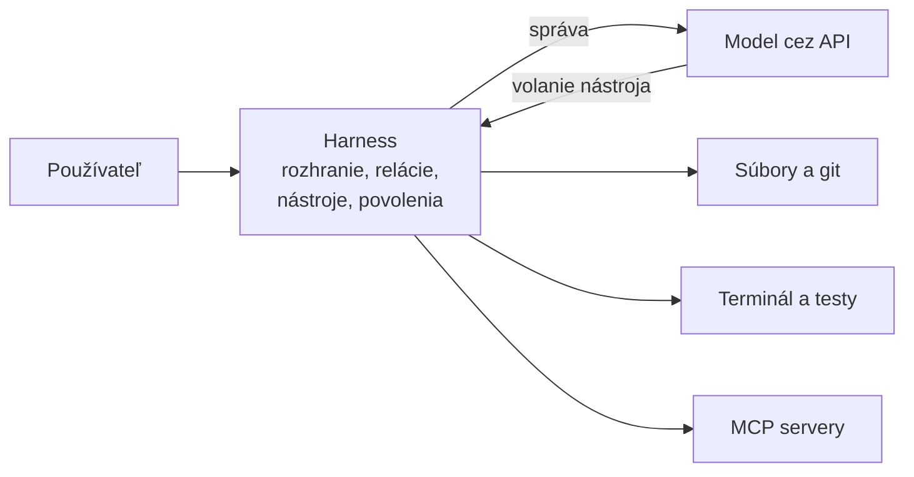

# OpenCode: harness, relácie a príkazy

*Verzia 1.0 · stav k novembru 2026. Nástroje sa menia rýchlo; pred  
nasadením si overte aktuálnu dokumentáciu.*  

## 1. Prečo OpenCode v kurze

V chate ste modeli vkladali text a dostávali text späť. Neskôr ste  
model volali z kódu a stavali workflow. V oboch prípadoch ste museli  
dáta priniesť vy: skopírovať súbor, pripraviť JSON, spustiť skript.  

Agentický nástroj v termináli robí opak. Model dostane prístup  
k priečinku, v ktorom pracujete. Sám si prečíta súbory, spustí testy,  
navrhne zmenu a pýta si povolenie, keď ide o rizikový krok.  

OpenCode je takýto nástroj. Je open source, beží v termináli a model  
si vyberáte sami – od lokálneho modelu až po komerčného  
poskytovateľa. Rovnakú prácu dnes robia aj Claude Code a GitHub  
Copilot. Tu si ukážeme OpenCode, pretože jeho správanie je viditeľné,  
dá sa skriptovať a neviaže vás na jedného výrobcu modelov.  

Čo z kapitoly využijete v praxi:  

- nainštalujete nástroj a pripojíte model,  
- budete viesť oddelené relácie pre skúmanie a pre úpravy,  
- napíšete vlastný príkaz, ktorý používate celý tím,  
- spustíte agenta bez rozhrania zo skriptu alebo z CI.  

> **Tip:** Ak už poznáte Claude Code, polovica kapitoly vám bude  
> povedomá. Menia sa názvy súborov a tvar konfigurácie, princíp  
> zostáva rovnaký.  

Kapitola pracuje s OpenCode 2. Staršie ukážky v kapitole `hooks.md`  
používajú rozhranie OpenCode 1; nemiešajte ich v jednom projekte.  

## 2. Čo je harness

Harness (čítaj „hárnes“, doslova postroj) je vrstva softvéru medzi  
jazykovým modelom a vaším počítačom. Model sám o sebe nevidí disk,  
nevie spustiť príkaz a nepamätá si predchádzajúci deň. Vidí len text,  
ktorý mu harness pošle.  

Harness preto robí tri veci. Poskladá správu pre model – vašu  
požiadavku, obsah súborov a pravidlá projektu. Po odpovedi vykoná  
požadované volanie nástroja, napríklad prečítanie súboru alebo  
spustenie testu. Výsledok vráti modelu a celý cyklus opakuje, kým  
úloha nie je hotová.  



> **Jednoducho povedané:** model je jazdec, ktorý vidí len to, čo mu  
> ukážete. Harness je postroj, ktorý ho spojí s vozom – so súbormi,  
> terminálom a nástrojmi.  

### Čo harness obsahuje

| Časť | Čo robí | Príklad v OpenCode |  
|---|---|---|  
| Rozhranie | prijíma požiadavky a zobrazuje kroky | TUI v termináli |  
| Slučka | posiela správy a spracúva volania | odpoveď, nástroj, výsledok |  
| Nástroje | čítanie, zápis, príkazy, web | `read`, `edit`, `shell` |  
| Povolenia | rozhoduje, čo sa smie | `allow`, `ask`, `deny` |  
| Kontext | pamäť relácie a pravidlá | `AGENTS.md`, história |  
| Pripojenia | dopĺňa schopnosti | MCP servery, pluginy |  

### Jeden model, tri postroje

**Claude Code** je harness od Anthropic. Beží v termináli a v editore,  
používa modely Claude a pravidlá projektu číta z súboru `CLAUDE.md`.  

**GitHub Copilot** je harness zabudovaný do VS Code a ďalších  
editorov. Ponúka chat, agentický režim a vlastné CLI; pravidlá  
projektu číta z `.github/copilot-instructions.md`.  

**OpenCode** je open source harness pre terminál, desktop a web.  
Model si vyberáte z ľubovoľného pripojeného poskytovateľa a pravidlá  
projektu číta z `AGENTS.md`.  

| Otázka | OpenCode | Claude Code | GitHub Copilot |  
|---|---|---|---|  
| Kde beží | terminál, desktop, web | terminál, IDE | VS Code, CLI |  
| Modely | ľubovoľný poskytovateľ | modely Anthropic | modely GitHubu |  
| Open source | áno | nie | nie |  
| Pravidlá projektu | `AGENTS.md` | `CLAUDE.md` | `copilot-instructions.md` |  
| Skriptovanie | `opencode run` | `claude -p` | `copilot` v CLI |  

> **Pozor:** OpenCode 2 načíta iba `AGENTS.md`. Súbor `CLAUDE.md`  
> zámerne nečíta, takže projekt prenesený z Claude Code potrebuje  
> premenovať alebo doplniť inštrukcie.  

### Rovnaký model nestačí

Dva nástroje s rovnakým modelom nedopadnú rovnako. Líši sa výber  
nástrojov, znenie systémovej inštrukcie, spôsob skracovania histórie  
a to, čo nástroj smie urobiť bez opýtania. Preto sa pri hodnotení  
nerozhodujte len podľa názvu modelu, ale aj podľa toho, aký harness  
ho vedie.  

### Vyskúšajte

1. Napíšte vlastnými slovami, čo robí harness a čo robí model.  
2. Nájdite v tabuľke dva rozdiely medzi OpenCode a Copilotom, ktoré  
   sú pre vašu firmu dôležité.  
3. Odhadnite, prečo môže rovnaký model v dvoch nástrojoch minúť  
   rozdielne množstvo tokenov.  

## 3. JavaScript, Node.js a npm

OpenCode je napísaný v TypeScripte, čo je nadstavba JavaScriptu.  
Inštaluje sa cez npm a jeho pluginy sa píšu v JavaScripte.  
Programovať nemusíte, ale tri pojmy potrebujete poznať, aby ste  
rozumeli chybovým hláseniam a návodom na internete.  

### Jazyk, runtime a správca balíkov

| Pojem | Čo to je | Kde ho stretnete |  
|---|---|---|  
| JavaScript | programovací jazyk | `.js` súbory, pluginy |  
| Node.js | runtime, ktorý spúšťa JavaScript | príkaz `node` |  
| npm | správca balíkov a registr | príkaz `npm`, `package.json` |  

**JavaScript** vznikol v roku 1995 pre prehliadače. Dnes je to  
univerzálny jazyk: beží v prehliadači, na serveri aj v nástrojoch  
príkazového riadka. Je dynamický, takže typy premenných sa určujú  
až pri behu.  

Súbor `pozdrav.js`:  

```js
const meno = "Jana";
const pocet = 3;

for (let i = 0; i < pocet; i++) {
  console.log(`Ahoj, ${meno}!`);
}
```

**Node.js** je runtime. Je to program, ktorý spustí JavaScript mimo  
prehliadača, nad motorom V8 z Chrome. Používa sa na servery, skripty  
a nástroje príkazového riadka – vrátane OpenCode.  

Podporované verzie nájdete na nodejs.org. V novembri 2026 je  
najnovší LTS rad Node 26 (Lithium), predchádzajúci LTS je Node 24.  
Pre kurz stačí Node 24 alebo novší.  

**npm** (Node Package Manager) je zároveň:  

- registr balíkov na adrese npmjs.com,  
- príkaz `npm`, ktorý balíky inštaluje,  
- formát projektu opísaný v súbore `package.json`.  

`node_modules` je priečinok, kam npm ukladá stiahnutý kód. Do gitu  
nepatrí, pridajte ho do `.gitignore`.  

Príkaz `npx` spustí balík bez trvalej inštalácie. Často ho uvidíte  
v návodoch na MCP servery:  

```bash
npx -y @modelcontextprotocol/server-everything
```

### Prečo to OpenCode potrebuje

- **Inštalácia.** Balík `@opencode/cli` sa distribuuje cez npm;  
  po inštalácii si stiahne natívny binárny súbor pre váš systém.  
- **Pluginy.** Rozšírenia a hooky sú súbory v JavaScripte  
  (podrobne v kapitole `hooks.md`).  
- **MCP servery.** Mnohé lokálne servery sa spúšťajú cez `npx`.  
- **Konfigurácia.** Súbory `opencode.json(c)` sú JSON alebo JSONC  
  (kapitola `json.md`).  

> **Tip:** Ak OpenCode nainštalujete skriptom `curl` alebo cez  
> Homebrew, Node.js pre samotný nástroj nepotrebujete. Zostáva však  
> užitočný na pluginy a MCP servery.  

### Overenie a prvý skript

```bash
node --version
npm --version
```

Očakávaný výstup je aspoň `v24.0.0` a `11.0.0`. Ak príkaz neexistuje,  
Node.js nie je nainštalovaný alebo nie je v `PATH`.  

Súbor `ahoj.js` v ľubovoľnom priečinku:  

```js
console.log("OpenCode používa Node.js");
```

Spustenie:  

```bash
node ahoj.js
```

### Čo je `package.json`

Súbor `package.json` opisuje projekt: názov, verziu, skripty  
a závislosti. Minimálna podoba:  

```json
{
  "name": "rozpocet",
  "version": "1.0.0",
  "private": true,
  "scripts": {
    "start": "node rozpocet.js"
  }
}
```

Potom stačí `npm start`. Balíky sa pridávajú cez `npm install`,  
napríklad `npm install --save-dev prettier`.  

> **Pozor:** Neinštalujte globálne balíky cez `sudo npm install -g`.  
> Zmení vlastníka systémových priečinkov a neskôr spôsobí chyby  
> `EACCES`. Ak potrebujete viac verzií Node.js, použite správcu  
> verzií, napríklad `nvm` alebo `fnm`.  

### Vyskúšajte

1. Overte `node --version` a `npm --version`.  
2. Spustite ukážku `ahoj.js` a zmeňte počet pozdravov na päť.  
3. Vytvorte `package.json` so skriptom `start` a spustite ho.  
4. Vysvetlite rozdiel medzi `npm install` a `npx`.  

## 4. Inštalácia a prvé spustenie

### Čo potrebujete

| Položka | Poznámka |  
|---|---|  
| macOS, Linux alebo Windows | Windows: npm cez Node.js, binárka alebo WSL |  
| terminál | Ghostty, WezTerm, Alacritty, Kitty |  
| Node.js 24+ | len pri inštalácii cez npm |  
| účet poskytovateľa | API kľúč alebo prihlásenie OAuth |  

### Inštalácia na macOS a Linux

```bash
# 1. inštalačný skript, nepotrebuje Node.js
curl -fsSL https://opencode.ai/v2/install | bash

# 2. Homebrew na macOS
brew install anomalyco/tap/opencode-v2

# 3. npm, ak už Node.js máte
npm install -g @opencode/cli
```

Všetky tri cesty nainštalujú rovnaký nástroj. Skript a Homebrew  
stiahnu hotovú binárku, npm balík si ju vyberie podľa platformy.  
Windows má vlastnú podsekciu nižšie, pretože najprv potrebuje  
Node.js.  

> **Pozor:** winget, Chocolatey ani Scoop nie sú pre OpenCode  
> podporované. Na Windows použite npm podľa nasledujúcej podsekcie  
> alebo samostatnú binárku.  

### Windows: Node.js a npm

OpenCode sa na Windows inštaluje cez npm. Balík `@opencode/cli`  
obsahuje aj binárku `opencode.exe` pre Windows, takže postup je  
rovnaký ako inde – najprv Node.js, potom OpenCode.  

#### Krok 1: Node.js

Najrýchlejšie je winget. Je súčasťou Windows 11 a Windows 10 od  
verzie 1809. V PowerShelli:  

```powershell
winget install OpenJS.NodeJS.LTS
```

Druhá možnosť je inštalátor: na nodejs.org stiahnite **Windows  
Installer (.msi)** pre LTS a spustite ho. Predvolené nastavenia sú  
v poriadku, `PATH` doplní sám.  

> **Tip:** Ak winget nie je k dispozícii, stiahnite inštalátor  
> priamo z nodejs.org.  

#### Krok 2: Overenie Node.js

Zatvorte PowerShell a otvorte nový, aby sa načítala nová `PATH`.  

```powershell
node --version
npm --version
```

Očakávate aspoň `v24.0.0` a `11.0.0`. Ak sa príkazy nenájdu,  
inštalácia sa nedokončila alebo terminál nebol otvorený nanovo.  

#### Krok 3: Inštalácia OpenCode

```powershell
npm install -g @opencode/cli
```

Globálne balíky končia v `%APPDATA%\npm`, teda napríklad  
v `C:\Users\jano\AppData\Roaming\npm`. Inštalátor Node.js tento  
priečinok zvyčajne pridá do `PATH` za vás.  

#### Krok 4: Overenie OpenCode

```powershell
opencode --version
```

Má sa vypísať verzia, v čase písania `2.2.5`.  

Ak PowerShell príkaz nepozná, pomôže jedna z dvoch opráv nižšie.  

##### Ak `opencode` chýba v `PATH`

```powershell
npm config get prefix
Get-ChildItem "$(npm config get prefix)" -Filter "opencode*"
```

Prvý príkaz vypíše priečinok, typicky  
`C:\Users\<meno>\AppData\Roaming\npm`. Druhý overí, že v ňom  
je spúšťací súbor `opencode.cmd` (prípadne `opencode.ps1`).  
Priečinok potom doplňte do premennej `PATH` pre svojho  
používateľa: **Settings > System > About > Advanced system  
settings > Environment Variables**. Po zmene otvorte nový  
terminál.  

##### Ak PowerShell blokuje `npm.ps1`

Pri prvom globálnom balíku sa môže objaviť hláška, že `npm.ps1`  
nemožno načítať, pretože beh skriptov je zakázaný. Máte dve  
možnosti:  

```powershell
# 1. povoliť podpísané skripty pre svojho používateľa
Set-ExecutionPolicy -Scope CurrentUser -ExecutionPolicy RemoteSigned

# 2. obísť skript a zavolať npm.cmd priamo
npm.cmd install -g @opencode/cli
```

Prvý príkaz mení bezpečnostné nastavenie PowerShellu, preto ho  
použite len vtedy, ak rozumiete dôsledkom. Druhý je jednorazový  
a nastavenie nemení.  

#### Krok 5: Prvé spustenie

```powershell
cd $HOME\projekty\rozpocet
opencode
```

V PowerShelli funguje `$HOME`; v `cmd` použite `%USERPROFILE%`.  
Konfigurácia je v `%USERPROFILE%\.config\opencode\`, presnú cestu  
vypíše `opencode debug paths config`.  

> **Tip:** Používajte Windows Terminal. OpenCode je textové  
> rozhranie a v starom okne `conhost` sa farby a klávesy správajú  
> horšie.  

#### Ak npm cesta nefunguje

Stiahnite samostatnú binárku pre Windows x64 alebo ARM64 zo  
stránky <https://opencode.ai/v2/docs/>, rozbaľte ju a priečinok  
pridajte do `PATH`. Alternatíva je WSL, kde platí linuxový postup  
s `curl`; OpenCode v ňom beží oddelene od Windows.  

### Overenie

```bash
opencode --version
opencode --help
```

Prvý z nich vypíše verziu, v čase písania `2.2.5`. Druhý zobrazí  
prehľad podpríkazov: `run`, `session`, `auth`, `models`, `mcp`,  
`plugin`, `stats`, `service`, `api`, `debug`, `upgrade`.  

### Pripojenie modelu

Bez modelu OpenCode nespraví nič. V rozhraní použite príkaz  
s lomítkom:  

```text
/connect
```

Vyberte poskytovateľa a spôsob prihlásenia. Ponuka obsahuje API kľúč,  
OAuth prihlásenie v prehliadači, príkaz poskytovateľa alebo premennú  
prostredia. Potom overte zoznam modelov:  

```bash
opencode models
```

Bez rozhrania to isté urobí:  

```bash
opencode auth login
opencode auth login anthropic --method key
opencode auth list
```

> **Tip:** Kľúč môžete držať aj v premennej prostredia. Pri  
> samostatnom serveri stačí `ANTHROPIC_API_KEY=... opencode  
> --standalone`. Pre zdieľanú službu použite  
> `opencode service set env ANTHROPIC_API_KEY ...`.  

### Prvé spustenie v projekte

```bash
cd ~/projekty/rozpocet
opencode
```

Do vstupného riadka napíšte požiadavku a stlačte Enter:  

```text
Vysvetli, čo robí súbor @rozpocet.js.
```

Značka `@` otvorí hľadanie súborov. Za cestu môžete pridať rozsah  
riadkov, napríklad `@src/auth.ts#20-45`. Znak `!` na začiatku  
prázdneho vstupu prepne do shell režimu: `!git status`.  

Kým OpenCode pracuje, môžete vstup doplniť. Enter počas behu  
usmerní bežiacu reláciu; `Ctrl+X` a potom Enter požiadavku zaradí  
do fronty.  

### Klávesy, ktoré sa vyplatí vedieť

| Klávesa | Účinok |  
|---|---|  
| `Ctrl+P` | paleta všetkých akcií |  
| `Ctrl+X`, `N` | nová relácia |  
| `Ctrl+X`, `L` | zoznam relácií |  
| `Ctrl+X`, `M` | výber modelu |  
| `Ctrl+X`, `A` | výber agenta |  
| `Ctrl+X`, `U` | vrátiť poslednú požiadavku (`/undo`) |  
| `Ctrl+Tab` | prepnutie karty |  
| `Shift+Tab` | cyklovanie agentov |  
| `F2` | cyklovanie naposledy použitých modelov |  
| `Ctrl+O` | nedávne relácie a projekty |  

Predvolená hlavná klávesa (`leader`) je `Ctrl+X`. Zmeniť sa dá  
v nastaveniach terminálového rozhrania; projektová konfigurácia  
ju neovplyvní.  

### Kde je konfigurácia

| Súbor | Platnosť |  
|---|---|  
| `opencode.json(c)` v projekte | jeden projekt |  
| `.opencode/opencode.json(c)` | jeden projekt, vyššia priorita |  
| `~/.config/opencode/opencode.json(c)` | všetky projekty |  
| `/etc/opencode/opencode.json` | celý počítač |  

Projektové nastavenia vždy prepíšu globálne. Do súboru pridajte odkaz  
na schému, editor potom ponúka dopĺňanie a kontrolu:  

```jsonc
{
  "$schema": "https://opencode.ai/config.json",
  "model": "anthropic/claude-sonnet-5-5",
}
```

Zmeny v konfigurácii sa načítajú samé. Ak sa niečo nezobrazí,  
pomôže `/reload`; reštart zvyčajne nie je potrebný.  

### Služba na pozadí

OpenCode sa skladá z rozhrania a servera. Server beží na pozadí,  
vlastní relácie, povolenia a vykonávanie nástrojov, a všetky vaše  
rozhrania sa pripájajú k nemu. Stav overíte takto:  

```bash
opencode service status
```

Reštartujte ho len vtedy, keď je zaseknutý – nie po každej zmene  
konfigurácie.  

> **Tip:** Desktop aplikáciu a webové rozhranie otvoríte príkazom  
> `opencode pair`. Odkaz je jednorazový a platí päť minút.  

### Vyskúšajte

1. Nainštalujte OpenCode a overte verziu.  
2. Pripojte model cez `/connect` a vypíšte modely.  
3. Spustite OpenCode v priečinku s ľubovoľným textovým súborom  
   a nechajte ho zhrnúť obsah.  
4. Otvorte paletu `Ctrl+P` a nájdite v nej akciu na zmenu modelu.  
5. Na Windows vypíšte `npm config get prefix` a nájdite v ňom  
   `opencode.cmd`.  

## 5. Relácie

Relácia je jedna konverzácia s modelom. Obsahuje históriu správ,  
pracovný priečinok, zvolený model a agenta, udelené povolenia  
a prípadné zhrnutie staršej časti rozhovoru.  

Relácie sa ukladajú do databázy, takže prežijú zatvorenie terminála  
aj reštart počítača. Sú viazané na projekt – v inom priečinku  
uvidíte iný zoznam.  

### Prečo sú relácie dôležité

Každá nová požiadavka posiela modelu celú históriu relácie. Čím dlhšia  
história, tým viac tokenov a tým vyššia cena. Zároveň sa v dlhej  
relácii stráca presnosť: model miesi staré rozhodnutia s novými.  

Preto sa vyplatí držať jednu tému v jednej relácii a po jej  
uzavretí začať novú.  

### Nová relácia a prepínanie

| Akcia | Rozhranie | Terminál |  
|---|---|---|  
| nová relácia | `/new` alebo `Ctrl+X`, `N` | `opencode run` bez `--session` |  
| zoznam relácií | `/sessions` alebo `Ctrl+X`, `L` | `opencode session list` |  
| nedávne relácie a projekty | `Ctrl+O` | – |  
| pokračovať v poslednej | – | `opencode -c` |  

Karty sú zapnuté predvolene. Medzi nimi prepínate `Ctrl+Tab`,  
zavriete ich `Ctrl+X` a `W`, poslednú zavretú vrátite  
`Ctrl+Shift+T`.  

### Relácie z terminálu

```bash
opencode session list
opencode session list --max-count 20 --format json
opencode session export ses_4f2a1c
opencode session export ses_4f2a1c --sanitize
opencode session delete ses_9c1b08
```

Export vytvorí JSON s celým priebehom. Prepínač `--sanitize`  
prekryje citlivé údaje v konverzácii a súboroch – použite ho vždy,  
keď export posielate ďalej. Import slúži na prenos relácie do iného  
priečinka alebo na iný počítač.  

### Pokračovanie bez rozhrania

```bash
opencode run --continue "Teraz ošetri prázdny súbor."
opencode run --session ses_4f2a1c "Skontroluj okrajové prípady."
opencode run --session ses_4f2a1c --fork "Skús iný prístup."
opencode run --title "Kontrola rozpočtu" "Prejdi projekt."
```

`--fork` vytvorí kópiu relácie, takže pôvodná zostane nedotknutá.  
Hodí sa na experiment, ktorý môže zlyhať.  

### Vrátenie a obnovenie

`/undo` vráti poslednú používateľskú požiadavku a všetku prácu, ktorá  
po nej nasledovala. Požiadavka sa vráti do vstupného riadka, takže ju  
môžete upraviť a poslať znova. `/redo` vrátené zmeny obnoví.  

Nová požiadavka namiesto `/redo` znamená, že s vrátením súhlasíte  
a pokračujete z tohto bodu.  

### Keď je relácia príliš dlhá

OpenCode pred prekročením kontextového okna zhrnie staršiu časť  
konverzácie a ponechá posledných približne 15 000 tokenov. Tomu sa  
hovorí kompakcia (compaction). Je stratová: detaily zo staršej časti  
zmiznú a zostane zhrnutie.  

```jsonc
{
  "$schema": "https://opencode.ai/config.json",
  "compaction": {
    "auto": true,
    "keep": { "tokens": 15000 },
    "buffer": "15%"
  }
}
```

Parameter `keep.tokens` určuje, koľko presnej histórie zostane pri  
zhrnutí. `buffer` je podiel okna, ktorý zostane voľný; pri 15 % sa  
kompakcia spustí, keď je konverzácia na 85 % kapacity.  

> **Pozor:** Kompakcia nezachráni reláciu, v ktorej väčšinu okna  
> zaberajú inštrukcie a definície nástrojov. Vtedy pomôže len nová  
> relácia.  

### Kedy začať novú reláciu

| Situácia | Dôvod |  
|---|---|  
| nová téma alebo iný súbor | starý kontext len mýli |  
| skúmanie a úpravy oddelene | plán sa nemá miešať s vykonávaním |  
| agent sa zacyklil | nový štart je lacnejší než opravy |  
| pred rizikovou zmenou | čistý bod pre `/undo` |  
| po dokončení úlohy | zhrnutie pre ďalšiu prácu |  

### Vyskúšajte

1. Spustite dve relácie: v prvej sa pýtajte na projekt, v druhej  
   nechajte agenta upraviť súbor.  
2. Vypíšte relácie cez `opencode session list` a jednu exportujte.  
3. Vytvorte reláciu, požiadajte o zmenu a potom ju vráťte cez  
   `/undo`.  
4. Zistite, koľko tokenov má vaša najdlhšia relácia, a odhadnite  
   cenu ďalšej požiadavky.  

## 6. Príkazy s lomítkom

Príkaz s lomítkom je skratka pre vopred pripravenú akciu alebo  
požiadavku. Napíšte `/`, pokračujte v písaní a stlačte Enter.  
Zoznam sa filtruje podľa toho, čo píšete.  

### Vstavané príkazy

| Príkaz | Účinok |  
|---|---|  
| `/new` | nová relácia |  
| `/sessions` | zoznam a prepnutie relácií |  
| `/models` | výber modelu |  
| `/agents` | výber agenta |  
| `/undo` | vrátiť poslednú požiadavku a prácu |  
| `/redo` | obnoviť vrátené |  
| `/editor` | upraviť požiadavku v editore |  
| `/btw` | rýchla otázka mimo histórie relácie |  
| `/connect` | pripojiť poskytovateľa alebo účet |  
| `/mcps` | správa MCP serverov |  
| `/reload` | znovu načítať konfiguráciu |  
| `/highlights` | čo je nové v tejto verzii |  

`/btw` je užitočný pri práci: odpovie na doplňujúcu otázku, ale  
odpoveď sa nepridá do relácie, takže nezaťaží ďalšie požiadavky.  

Ak príkaz v zozname chýba, otvorte `Ctrl+P`. Paleta obsahuje všetky  
akcie dostupné v aktuálnom zobrazení, nielen tie s lomítkom.  

### `@`, `!` a rozsahy

- `@subor.js` pripojí súbor k požiadavke,  
- `@subor.js#20-45` pripojí len uvedené riadky,  
- `!git status` spustí príkaz v shelli a výstup nechá v relácii.  

### Vlastné príkazy

Vlastný príkaz je súbor v Markdowne s požiadavkou. Názov súboru sa  
stane názvom príkazu. Projektové príkazy patria do  
`.opencode/commands/`, globálne do `~/.config/opencode/commands/`.  

Súbor `.opencode/commands/kontrola.md`:  

```md
---
description: Skontroluje zmeny bez úprav
agent: plan
---

Skontroluj zmeny v tomto projekte so zameraním na $ARGUMENTS.
Vypíš nálezy v poradí podľa závažnosti, každý s cestou k súboru
a číslom riadku. Nič neupravuj.
```

Použitie v rozhraní:  

```text
/kontrola ošetrenie prázdneho CSV
```

OpenCode nahradí `$ARGUMENTS` textom za príkazom a pošle výsledok  
ako bežnú požiadavku. Okrem `$ARGUMENTS` fungujú aj pozície `$1`,  
`$2` a ďalšie. Najvyššia použitá pozícia pohltí zvyšok vstupu;  
chýbajúca pozícia sa nahradí prázdnym textom.  

Ak šablóna neobsahuje žiadnu značku, OpenCode pripojí argumenty na  
koniec po prázdnom riadku.  

### Hlavička príkazu

| Pole | Význam |  
|---|---|  
| `description` | text v zozname príkazov |  
| `agent` | agent, ktorý príkaz vykoná |  
| `model` | model v tvare `poskytovateľ/model` |  
| `subagent` | `true` spustí príkaz na pozadí |  

Podpriečinok sa stane súčasťou názvu:  
`.opencode/commands/tim/review.md` sa volá `/tim/review`.  

Projektový príkaz prepíše globálny s rovnakým názvom. Bližší  
priečinok prepíše vzdialenejší. Uložený súbor sa načíta okamžite,  
bez reštartu.  

### Shell blok v príkaze

Do šablóny môžete vložiť výstup príkazu. Uzavrite ho do `!`  
a spätných úvodzoviek:  

```md
---
description: Zhrnie zmeny pre kolegu
---

Zhrň tieto zmeny do troch odrážok pre kolegu, ktorý projekt nepozná.

!`git diff --stat`
```

> **Pozor:** Shell blok sa vykoná pri zostavení príkazu, mimo  
> povoľovacieho dialógu agenta. Používajte len príkazy, ktorých  
> zdroj dôverujete, a nikdy doň nevkladajte cudzí vstup.  

Príkazy sa dajú zapísať aj do konfigurácie, do poľa `commands`.  
Výhodnejšie sú súbory: dajú sa verzovať a v JSON netreba escapovať  
úvodzovky.  

### Príkaz, agent a skill

| Pojem | Čo to je | Kedy ho použiť |  
|---|---|---|  
| príkaz | uložená požiadavka | opakovaná úloha s rovnakým postupom |  
| agent | rola s vlastnými pravidlami | rozdielne práva a tón odpovede |  
| skill | balík znalostí | postupy, ktoré sa načítajú podľa potreby |  

### Vyskúšajte

1. Vypíšte vstavané príkazy a nájdite v palete `Ctrl+P` ekvivalent  
   k `/undo`.  
2. Vytvorte príkaz `/zhrn`, ktorý zhrnie zmeny pre kolegu.  
3. Pridajte do príkazu parameter `$1` a vyskúšajte ho s cestou  
   k súboru.  
4. Skopírujte príkaz do globálneho priečinka a overte, že funguje  
   aj v inom projekte.  

## 7. Projekt: rozpočet krok za krokom

Cieľ: malý nástroj v Node.js, ktorý spočíta výdavky z CSV. Na ňom si  
vyskúšate relácie, agenta `plan`, pravidlá projektu a vlastný príkaz.  

### Štruktúra projektu

```
opencode-priklady/
└── 01-projekt/
    ├── AGENTS.md
    ├── opencode.jsonc
    ├── rozpocet.js
    ├── vydavky.csv
    └── .opencode/
        └── commands/
            ├── kontrola.md
            └── zhrn.md
```

### Krok 1: Spustite nástroj bez agenta

Súbor `vydavky.csv`:  

```csv
datum;kategoria;suma
2026-10-01;softvér;49.00
2026-10-03;cestovné;12.50
2026-10-05;softvér;99.00
2026-10-11;kancelária;23.40
```

Súbor `rozpocet.js`:  

```js
// Spočíta výdavky z CSV a vypíše súčet podľa kategórií.
const { readFileSync } = require("node:fs");

const subor = process.argv[2] ?? "vydavky.csv";
const riadky = readFileSync(subor, "utf8").trim().split("\n").slice(1);
const sumy = new Map();

for (const riadok of riadky) {
  const [datum, kategoria, suma] = riadok.split(";");
  const hodnota = Number(suma);
  if (Number.isNaN(hodnota)) {
    console.error(`Chybná suma v riadku: ${riadok}`);
    process.exitCode = 1;
    continue;
  }
  sumy.set(kategoria, (sumy.get(kategoria) ?? 0) + hodnota);
}

const celkom = [...sumy.values()].reduce((sucet, suma) => sucet + suma, 0);

console.log(`${"Kategória".padEnd(20)}${"Suma".padStart(8)} €`);
for (const [kategoria, suma] of sumy) {
  console.log(`${kategoria.padEnd(20)}${suma.toFixed(2).padStart(8)} €`);
}
console.log(`${"Celkom".padEnd(20)}${celkom.toFixed(2).padStart(8)} €`);
```

```bash
node rozpocet.js
```

Očakávaný výstup:  

```text
Kategória               Suma €
softvér               148.00 €
cestovné               12.50 €
kancelária             23.40 €
Celkom                183.90 €
```

### Krok 2: Pravidlá projektu

Bez pravidiel musí agent hádať. Súbor `AGENTS.md` v koreňu projektu  
mu povie, ako sa projekt spúšťa a čo sa nesmie meniť.  

Súbor `AGENTS.md`:  

```md
# Projekt: rozpočet

Malý nástroj v Node.js, ktorý spočíta výdavky z CSV.

## Príkazy

- Spustenie: `node rozpocet.js`
- Iný vstup: `node rozpocet.js iny.csv`
- Kontrola syntaxe: `node --check rozpocet.js`

## Pravidlá

- Bez externých balíkov, stačí vstavaný modul `node:fs`.
- Komentáre a výstup po slovensky, názvy funkcií po anglicky.
- Súbor `vydavky.csv` neupravuj bez výslovnej požiadavky.
- Po zmene `rozpocet.js` spusti `node rozpocet.js` a over výstup.
```

> **Tip:** Dobré `AGENTS.md` má tri časti: ako projekt spustiť, aké  
> sú konvencie a čo sa nesmie. Nemá opisovať celý kód.  

### Krok 3: Povolenia

Súbor `opencode.jsonc` obmedzí, čo agent smie bez opýtania:  

```jsonc
{
  "$schema": "https://opencode.ai/config.json",
  "permissions": [
    { "action": "shell", "resource": "*", "effect": "ask" },
    { "action": "shell", "resource": "node *", "effect": "allow" },
    { "action": "shell", "resource": "git status *", "effect": "allow" },
    { "action": "shell", "resource": "git push *", "effect": "deny" }
  ]
}
```

Pravidlá sa vyhodnocujú zhora nadol a platí posledné, ktoré sedí.  
Preto všeobecné `ask` stojí prvé a výnimky za ním.  

### Krok 4: Skúmanie v relácii `plan`

```bash
cd opencode-priklady/01-projekt
opencode
```

```text
Prejdi @rozpocet.js a vysvetli, ako sa počítajú sumy.
```

Potom prepnite agenta (`/agents`) na `plan` a nechajte ho navrhnúť  
zmenu:  

```text
Navrhni, ako zoradiť kategórie podľa sumy zostupne a ako ošetriť
prázdny CSV. Nič neupravuj.
```

Agent `plan` nemá právo meniť súbory. Výstup si prečítajte a ak  
sedí, prejdite k úpravám.  

### Krok 5: Úprava v novej relácii

```text
/new
```

```text
Podľa predchádzajúceho návrhu uprav rozpocet.js: zoraď kategórie
podľa sumy zostupne a pri prázdnom súbore vypíš „Žiadne výdavky.“
```

Agent prečíta súbor, navrhne zmenu a požiada o povolenie na zápis.  
Po schválení overte výsledok:  

```bash
node rozpocet.js
```

Kategórie majú byť zoradené 148.00, 23.40, 12.50 a celková suma  
183.90 €.  

### Krok 6: Vrátenie zmeny

Ak sa výstup nepozdáva, vráťte poslednú požiadavku:  

```text
/undo
```

Požiadavka sa objaví vo vstupnom riadku. Upravte ju a pošlite znova.  
Ak chcete vrátenie zrušiť, použite `/redo`.  

### Krok 7: Vlastný príkaz

Súbor `.opencode/commands/kontrola.md`:  

```md
---
description: Skontroluje zmeny bez úprav
agent: plan
---

Skontroluj zmeny v tomto projekte so zameraním na $ARGUMENTS.
Vypíš nálezy v poradí podľa závažnosti, každý s cestou k súboru
a číslom riadku. Nič neupravuj.
```

```text
/kontrola ošetrenie prázdneho CSV
```

Následne skúste druhý príkaz, ktorý si sám zistí rozsah zmien:  

Súbor `.opencode/commands/zhrn.md`:  

```md
---
description: Zhrnie zmeny pre kolegu
---

Zhrň tieto zmeny do troch odrážok pre kolegu, ktorý projekt nepozná.

!`git diff --stat`
```

### Krok 8: Uzavretie práce

```bash
opencode session list
opencode session export ses_... --sanitize > rozpocet-relacia.json
```

### Kontrolný zoznam

- `node rozpocet.js` beží bez chyby,  
- `AGENTS.md` obsahuje príkazy a pravidlá,  
- `opencode.jsonc` povoľuje len to, čo naozaj potrebujete,  
- `/kontrola` funguje a nič nemení,  
- relácia je exportovaná alebo uzavretá.  

## 8. Automatizácia: `opencode run`

Rozhranie je dobré na prácu pod dohľadom. Skript potrebuje odpoveď  
bez klávesnice. Na to slúži podpríkaz `run`, ktorý pošle požiadavku,  
vypíše odpoveď a skončí.  

| Prepínač | Význam |  
|---|---|  
| `--model` | model v tvare `poskytovateľ/model` |  
| `--agent` | agent, napríklad `plan` |  
| `--continue` | pokračovať v poslednej relácii |  
| `--session` | konkrétna relácia alebo nová s týmto ID |  
| `--fork` | pred pokračovaním reláciu skopíruje |  
| `--format json` | výstup po riadkoch ako JSON |  
| `--file` | priložiť súbor |  
| `--auto` | schváliť všetko, čo nie je zakázané |  
| `--title` | názov novej relácie |  

### Skript

Súbor `opencode-priklady/02-automatizacia/kontrola.sh`:  

```bash
#!/usr/bin/env bash
# Spustí OpenCode bez rozhrania a uloží kontrolu do súboru.
set -euo pipefail

dnes=$(date +%Y-%m-%d)
vystup="kontrola-${dnes}.md"

opencode run --agent plan \
  "Prejdi zmeny od posledného commitu a vypíš riziká." \
  > "$vystup"

echo "Kontrola uložená do $vystup"
```

Spustenie:  

```bash
chmod +x kontrola.sh
./kontrola.sh
```

### Výstup pre ďalšie spracovanie

`--format json` vypisuje udalosti po riadkoch, takže sa dajú čítať  
v shelli aj v Pythone. Použite ho tam, kde chcete ukladať výsledky  
do tabuľky alebo počítať náklady.  

### Agent v GitHub Actions

Súbor `.github/workflows/opencode-kontrola.yml` v koreňu  
repozitára:  

```yaml
name: OpenCode kontrola

on: [pull_request]

jobs:
  kontrola:
    runs-on: ubuntu-latest
    steps:
      - uses: actions/checkout@v4
      - run: npm install --global @opencode/cli
      - run: |
          opencode run --standalone \
            --model anthropic/claude-sonnet-5-5 \
            "Prejdi zmeny v tomto pull requeste a vymenuj riziká."
        env:
          ANTHROPIC_API_KEY: ${{ secrets.ANTHROPIC_API_KEY }}
```

V CI je `--standalone` dôležitý: spustí vlastný server, ktorý dostane  
kľúč z premennej prostredia. Bez neho by sa použila zdieľaná služba  
bez vášho kľúča.  

> **Pozor:** `--auto` v CI znamená, že agent mení súbory bez  
> potvrdenia. V tomto príklade sa nič nemení, ale pri automatických  
> opravách obmedzte povolenia a nechajte zmeny prejsť cez pull  
> request.  

### Kedy sa to hodí

- nočná kontrola repozitára a zhrnutie rizík,  
- generovanie dokumentácie z kódu,  
- triedenie issues podľa pravidiel,  
- kontrola, či nový súbor neporušuje konvencie.  

### Vyskúšajte

1. Spustite `opencode run "Vypíš tri najväčšie súbory v projekte."`  
2. Uložte výstup do súboru a porovnajte dva behy.  
3. Pridajte `--format json` a spočítajte riadky výstupu.  
4. Vysvetlite, prečo sa v CI používa `--standalone`.  

## 9. Bezpečnosť

Harness vykonáva to, čo mu model povie. Bez pravidiel vykoná aj to,  
čo nechcete. Preto patria povolenia do konfigurácie, nie do  
diskusie s modelom.  

### Povolenia

Každé pravidlo má tri polia: `action` (čo), `resource` (na čom)  
a `effect` (`allow`, `ask`, `deny`). Platí posledné zodpovedajúce  
pravidlo.  

```jsonc
{
  "$schema": "https://opencode.ai/config.json",
  "permissions": [
    { "action": "shell", "resource": "*", "effect": "ask" },
    { "action": "shell", "resource": "node *", "effect": "allow" },
    { "action": "shell", "resource": "git push *", "effect": "deny" },
    { "action": "read", "resource": "*.env", "effect": "deny" },
    { "action": "external_directory", "resource": "*", "effect": "ask" }
  ]
}
```

> **Pozor:** Predvolená politika povoľuje prístup mimo projektu. Ak  
> chcete, aby sa OpenCode pred každým takým prístupom opýtal,  
> nastavte `external_directory` na `ask`.  

### `--auto` a schvaľovanie

Voľba „Allow always“ uloží trvalé pravidlo pre projekt. Nikdy  
neprepíše nakonfigurované `deny`, takže zákazy sú pevné.  

`--auto` schváli všetko, čo nie je zakázané. Hodí sa do izolovaného  
kontajnera alebo CI, nie na váš počítač s prístupom k produkcii.  

### Shell a zložené príkazy

Pred spustením OpenCode analyzuje príkaz. Pri zložených príkazoch  
kontroluje každú časť. Napriek tomu je odporúčanie jednoduché:  
povoľte konkrétne príkazy, ktoré poznáte, nie vzory, ktoré majú  
„uhádnuť“ všetko nebezpečné.  

### Tajomstvá

- Kľúče držte v premennej prostredia alebo v súbore mimo repozitára.  
- V konfigurácii používajte `{env:NAZOV}` alebo `{file:cesta}`.  
- Export relácie obsahuje celý priebeh; posielajte ho len  
  s `--sanitize`.  
- Pred pridaním MCP servera zvážte, aké údaje uvidí.  

### Cudzí obsah

Súbory z repozitára, webové stránky a výstupy MCP serverov môžu  
obsahovať pokyn, ktorý model poslúchne. Tomu sa hovorí prompt  
injection. Praktické opatrenia:  

- nespúšťajte agenta s `--auto` nad nedôveryhodným repozitárom,  
- držte `git push` a prístup k produkcii na `deny`,  
- kontrolujte, ktoré MCP servery sú pripojené,  
- čítajte, čo agent robí, kým ide o cudzí kód.  

### Minimálna bezpečná konfigurácia

Pre tímový projekt stačí tento základ:  

```jsonc
{
  "$schema": "https://opencode.ai/config.json",
  "permissions": [
    { "action": "shell", "resource": "*", "effect": "ask" },
    { "action": "read", "resource": "*.env", "effect": "deny" },
    { "action": "external_directory", "resource": "*", "effect": "ask" }
  ]
}
```

## 10. Časté chyby

| Problém | Príčina | Riešenie |  
|---|---|---|  
| chýba príkaz `opencode` | nie je v `PATH` | nový terminál, `PATH` |  
| `EACCES` pri npm | priečinok patrí rootovi | `nvm`, nie `sudo` |  
| `npm.ps1` je zakázaný | politika PowerShellu | `npm.cmd`, `RemoteSigned` |  
| po npm chýba `opencode` | `%APPDATA%\npm` nie je v `PATH` | doplňte `PATH` |  
| chýba príkaz `node` | Node.js nie je nainštalovaný | LTS z nodejs.org |  
| model sa nenačíta | chýba kľúč | `/connect`, `auth list` |  
| chyba 401 alebo 403 | neplatný kľúč | obnovte kľúč |  
| chyba 429 | vyčerpaná kvóta | menej požiadaviek |  
| konfigurácia neplatí | zlý súbor alebo priorita | cesta, `/reload` |  
| agent žiada to isté | pravidlo je `ask` | „Allow always“, `allow` |  
| relácia je pomalá | dlhá história | `/new`, kompakcia |  
| príkaz sa nezobrazí | zlý priečinok | `.opencode/commands/*.md` |  
| `AGENTS.md` sa ignoruje | je mimo projektu | koreň projektu |  
| MCP server mlčí | chýba prihlásenie | `/mcps`, `mcp list` |  
| Windows inštalácia zlyhá | package manager | binárka alebo WSL |  

## 11. Úlohy na precvičenie

1. Nainštalujte OpenCode a pripojte dva modely. Overte, že `/models`  
   ponúka oba.  
2. Vytvorte priečinok s jedným textovým súborom a nechajte agenta  
   zhrnúť obsah bez toho, aby ste súbor otvorili.  
3. Vysvetlite rozdiel medzi relačnou históriou a súborom  
   `AGENTS.md`.  
4. Vytvorte `AGENTS.md` pre svoj projekt: príkazy, konvencie,  
   zákazy.  
5. Navrhnite pravidlá povolení tak, aby agent smel spúšťať testy, ale  
   nie `git push`.  
6. Napíšte príkaz `/kontrola`, ktorý pracuje s `$ARGUMENTS` a beží  
   v agentovi `plan`.  
7. Vytvorte príkaz, ktorý do požiadavky vloží výstup  
   `git diff --stat`.  
8. Vráťte zmenu cez `/undo`, potom ju obnovte cez `/redo`.  
9. Spustite `opencode run` v skripte a uložte výstup do súboru.  
10. Pridajte krok do GitHub Actions, ktorý na pull request spustí  
    kontrolu a vypíše riziká do logu.  
11. Na Windows nainštalujte Node.js cez `winget` a OpenCode cez npm  
    podľa časti 4.  

## 12. Zhrnutie

- **Harness** je vrstva medzi modelom a počítačom; dáva modelu  
  nástroje, kontext a povolenia.  
- **OpenCode**, Claude Code a GitHub Copilot sú tri rôzne postroje;  
  líšia sa nástrojmi, pravidlami a spôsobom nasadenia,  
  nie princípom.  
- **JavaScript** je jazyk, **Node.js** ho spúšťa mimo prehliadača  
  a **npm** dodáva balíky. OpenCode sa inštaluje cez npm, pluginy sa  
  píšu v JavaScripte.  
- **Relácia** nesie históriu, priečinok, model a povolenia. Dlhá  
  relácia stojí viac a mýli model; nová téma si zaslúži novú  
  reláciu.  
- **Kompakcia** zhrnie staršiu časť konverzácie, keď sa blíži limit  
  kontextového okna.  
- **Príkazy s lomítkom** sú uložené požiadavky; vlastné patria do  
  `.opencode/commands/` a pracujú s `$ARGUMENTS`.  
- **`AGENTS.md`** dáva projektu trvalé pravidlá; OpenCode 2 nečíta  
  `CLAUDE.md`.  
- **`opencode run`** sprístupní agenta skriptom a CI; v CI použite  
  `--standalone`.  
- **Povolenia** patria do konfigurácie: všeobecné `ask`, výnimky  
  `allow`, nebezpečné kroky `deny`.  

## 13. Slovníček

| Anglicky | Slovensky | Význam |  
|---|---|---|  
| harness | postroj | vrstva spájajúca model s nástrojmi a súbormi |  
| agent | agent | model s nástrojmi, pravidlami a cieľom |  
| session | relácia | jedna konverzácia s históriou a kontextom |  
| prompt | požiadavka | text, ktorý dostane model |  
| token | token | základná jednotka textu pre model |  
| context window | kontextové okno | najdlhší text, ktorý model prečíta |  
| compaction | kompakcia | zhrnutie staršej časti relácie |  
| tool | nástroj | akcia, ktorú agent smie vykonať |  
| permission | povolenie | pravidlo allow, ask alebo deny |  
| slash command | príkaz s lomítkom | skratka pre uloženú akciu |  
| runtime | behové prostredie | prostredie, ktoré spúšťa kód |  
| package | balík | znovupoužiteľný kus kódu z npm |  
| CLI | rozhranie príkazového riadka | ovládanie nástroja textom |  
| TUI | textové rozhranie | celoobrazovkové rozhranie v termináli |  
| MCP | Model Context Protocol | štandard na pripájanie nástrojov |  
| provider | poskytovateľ | firma alebo server, ktorý ponúka modely |  

## Zdroje

- OpenCode 2 – úvod: <https://opencode.ai/v2/docs/>  
- OpenCode 2 – inštalácia a CLI: <https://opencode.ai/v2/docs/cli/>  
- OpenCode 2 – terminálové rozhranie:  
  <https://opencode.ai/v2/docs/cli/tui/>  
- OpenCode 2 – príkazy: <https://opencode.ai/v2/docs/cli/commands/>  
- OpenCode 2 – vlastné príkazy:  
  <https://opencode.ai/v2/docs/commands/>  
- OpenCode 2 – konfigurácia: <https://opencode.ai/v2/docs/config/>  
- OpenCode 2 – povolenia:  
  <https://opencode.ai/v2/docs/permissions/>  
- OpenCode 2 – inštrukcie a `AGENTS.md`:  
  <https://opencode.ai/v2/docs/instructions/>  
- OpenCode 2 – agenti: <https://opencode.ai/v2/docs/agents/>  
- OpenCode 2 – kompakcia:  
  <https://opencode.ai/v2/docs/compaction/>  
- Node.js – vydania: <https://nodejs.org/en/about/previous-releases>  
- npm – dokumentácia: <https://docs.npmjs.com/>  
