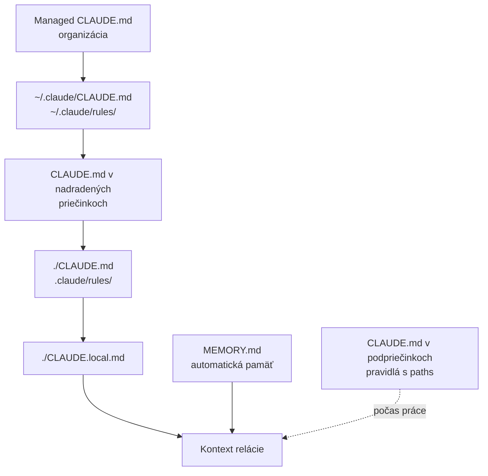

# Súbory pamäte v Claude Code: čo sa načíta a v akom poradí

*Verzia 1.0 · stav k októbru 2026. Nástroje sa menia rýchlo; pred  
nasadením si overte aktuálnu dokumentáciu.*  

## 1. Prečo poznať súbory pamäte

Kapitola [pamat.md](pamat.md) vysvetľuje, čo je pamäť agenta a prečo ju  
potrebujete. Táto kapitola ide o krok ďalej. Ukáže všetky súbory, z ktorých  
Claude Code skladá pamäť, kde ležia, kedy sa načítajú a akú má ktorý váhu.  

Bez tejto znalosti sa ľahko stane, že pokyn napíšete, ale do nesprávneho  
súboru. Agent ho potom nevidí, alebo ho vidí spolu s iným pokynom, ktorý  
mu odporuje. Väčšina záhad typu „prečo to ignoruje“ má príčinu práve tu.  

Claude Code pozná tri skupiny súborov pamäte:  

- **pokyny**, ktoré píšete vy – súbory `CLAUDE.md`, `AGENTS.md` a pravidlá,  
- **automatickú pamäť** – poznámky, ktoré si agent píše sám,  
- **pamäť subagentov** – samostatné poznámky pomocných agentov.  

> **Jednoducho povedané:** pamäť nie je jeden zošit, ale kôpka zošitov  
> na stole. Claude ich prečíta za sebou, od najvšeobecnejšieho po  
> najkonkrétnejší, a všetky naraz drží v hlave.  

Rozšírenie Claude Code pre VS Code zdieľa s príkazovým riadkom (CLI,  
command-line interface) nastavenia aj históriu konverzácií. Súbory pamäte  
v tejto kapitole teda platia v termináli aj vo VS Code.  

## 2. Ako Claude Code skladá pamäť

### 2.1 Spájanie, nie prepisovanie

Pri štarte relácie Claude Code nájde všetky súbory pamäte, ktoré sa majú  
načítať, a spojí ich za sebou do kontextu. Žiadny súbor iný neprepisuje.  
Ak si dva pokyny odporujú, Claude si podľa dokumentácie môže vybrať  
ktorýkoľvek z nich.  

Obsah súborov dostane model ako správu používateľa hneď za systémovým  
promptom. Prompt je text zadania pre model, systémový prompt sú úvodné  
pokyny aplikácie. Súbory pamäte sú preto kontext, nie vynútené pravidlá.  

> **Pozor:** veta „nikdy nemaž súbory“ v `CLAUDE.md` nič nezakáže. Ak niečo  
> nesmie nastať, nastavte to v oprávneniach (`permissions.deny`) alebo  
> v hooku `PreToolUse` – skripte, ktorý beží pred akciou nástroja. Hooky  
> opisuje [hooks.md](hooks.md).  

### 2.2 Poradie: od všeobecného ku konkrétnemu

Súbory sa načítajú od najširšej platnosti po najužšiu. V strome priečinkov  
ide poradie od koreňa disku smerom k priečinku, v ktorom ste Claude Code  
spustili. V rámci jedného priečinka ide `CLAUDE.local.md` za `CLAUDE.md`.  



Neskôr načítaný text je v kontexte bližšie ku koncu, teda bližšie k vašej  
práci. To však nie je pravidlo priority. Ak má platiť jeden z dvoch  
odporujúcich si pokynov, druhý odstráňte.  

### 2.3 Pri štarte a počas práce

| Kedy | Čo sa načíta |  
| --- | --- |  
| pri štarte | managed, používateľské, projektové a lokálne súbory |  
| pri štarte | pravidlá bez `paths`, začiatok `MEMORY.md` |  
| počas práce | `CLAUDE.md` v podpriečinkoch |  
| počas práce | pravidlá s `paths`, tematické poznámky |  

„Počas práce“ znamená vo chvíli, keď Claude číta, zapisuje alebo upravuje  
súbor v danom podpriečinku alebo súbor, ktorý zodpovedá vzoru. Za čítanie  
sa ráta aj príkaz `cat` alebo `head` na jeden súbor. Tematické poznámky  
automatickej pamäte si Claude otvorí sám, keď ich potrebuje.  

## 3. Súbory pamäte jeden po druhom

Prehľad všetkých miest. Skratka `<p>` znamená názov projektu, `<meno>`  
názov subagenta.  

| Súbor | Platnosť | Píše | V gite |  
| --- | --- | --- | --- |  
| `/etc/claude-code/CLAUDE.md` | organizácia | správca | nie |  
| `~/.claude/CLAUDE.md` | vy, všade | vy | nie |  
| `~/.claude/rules/*.md` | vy, všade | vy | nie |  
| `./CLAUDE.md` | projekt | tím | áno |  
| `./.claude/CLAUDE.md` | projekt | tím | áno |  
| `./AGENTS.md` | projekt | tím | áno |  
| `./.claude/rules/*.md` | projekt | tím | áno |  
| `./CLAUDE.local.md` | projekt, len vy | vy | nie |  
| `podpriecinok/CLAUDE.md` | časť projektu | tím | áno |  
| `~/.claude/projects/<p>/memory/` | projekt, len vy | agent | nie |  
| `.claude/agent-memory/<meno>/` | subagent | subagent | áno |  

### 3.1 Managed CLAUDE.md – pokyny organizácie

Súbor spravuje IT oddelenie a platí pre všetkých používateľov počítača  
v každom projekte. Na disk ho rozdá nástroj na správu zariadení, napríklad  
MDM alebo Ansible. Bežný používateľ ho nemá a ani nepotrebuje.  

| Systém | Umiestnenie |  
| --- | --- |  
| Linux a WSL | `/etc/claude-code/CLAUDE.md` |  
| macOS | `/Library/Application Support/ClaudeCode/CLAUDE.md` |  
| Windows | `C:\Program Files\ClaudeCode\CLAUDE.md` |  

Je to jediný súbor, ktorý sa nedá vylúčiť nastavením `claudeMdExcludes`.  
Nenačíta sa len vtedy, keď niekto spustí reláciu s úplne vypnutým  
načítaním `CLAUDE.md`. Rovnaký obsah sa dá zapísať aj do kľúča `claudeMd`  
v súbore `managed-settings.json`.  

Patria sem firemné zásady: štýl kódu, práca s údajmi, pripomienky  
k súladu s predpismi. Technické zákazy však patria do managed nastavení,  
napríklad `permissions.deny`.  

### 3.2 Používateľský súbor ~/.claude/CLAUDE.md

Vaše osobné pokyny pre všetky projekty na tomto počítači. Patria sem  
preferencie, ktoré nechcete opakovať: jazyk odpovedí, odsadenie kódu,  
obľúbené nástroje. Nezdieľa sa s nikým a nepatrí do žiadneho repozitára.  

### 3.3 Používateľské pravidlá ~/.claude/rules/

Ten istý účel ako `~/.claude/CLAUDE.md`, ale rozdelený do súborov podľa  
tém, napríklad `preferencie.md` a `postupy.md`. Načítajú sa pred  
projektovými pravidlami. Ani jedny neprebíjajú druhé, preto si nesmú  
odporovať.  

### 3.4 Projektový CLAUDE.md

Hlavný súbor pamäte, ktorý zdieľa celý tím cez git. Môže ležať v koreni  
projektu ako `./CLAUDE.md` alebo v priečinku `.claude/` ako  
`./.claude/CLAUDE.md`. Patria sem príkazy na build a testy, štruktúra  
projektu, konvencie a rozhodnutia, ktoré agent z kódu neodvodí.  

Dokumentácia odporúča menej ako 200 riadkov na súbor. Dlhší súbor zaberá  
viac kontextu a agent ho dodržiava horšie. Príkaz `/init` vytvorí prvú  
verziu súboru z analýzy projektu; existujúci súbor neprepíše, len navrhne  
úpravy.  

Blokové HTML komentáre `<!-- ... -->` Claude Code pred vložením do kontextu  
odstráni. Môžete do nich písať poznámky pre ľudí bez toho, aby zaberali  
miesto v kontexte.  

### 3.5 AGENTS.md

`AGENTS.md` je otvorený štandard pokynov pre viacero AI nástrojov, opísaný  
v kapitole [subor-agents.md](subor-agents.md). Claude Code ho číta od  
verzie 2.1.277 – predvolene však len vtedy, keď v projekte nie je  
`CLAUDE.md`.  

| V projekte máte | Claude prečíta |  
| --- | --- |  
| len `AGENTS.md` | `AGENTS.md` |  
| `AGENTS.md` a `CLAUDE.md` | len `CLAUDE.md` |  
| `AGENTS.md` a `CLAUDE.local.md` | len `CLAUDE.local.md` |  
| `CLAUDE.md` s importom `@AGENTS.md` | oba cez import |  

Do kontroly sa rátajú súbory `CLAUDE.md`, `.claude/CLAUDE.md` a  
`CLAUDE.local.md` v pracovnom priečinku a nad ním. Nerátajú sa  
`~/.claude/CLAUDE.md`, managed súbor ani pravidlá – tie sa načítajú vedľa  
`AGENTS.md`. Súbory `AGENTS.local.md`, `AGENTS.override.md` a obsah  
priečinka `.agents/` Claude Code nečíta.  

Správanie zmeníte v `/config` nastavením **Project instructions**:  

| Hodnota | Čo sa načíta |  
| --- | --- |  
| `claude-md-or-agents-md` | `CLAUDE.md`, inak `AGENTS.md` (predvolené) |  
| `claude-md-and-agents-md` | oba, `CLAUDE.md` ako prvý |  
| `claude-md` | len `CLAUDE.md` |  
| `managed-only` | len managed súbor a automatická pamäť |  

> **Pozor:** ak projekt stojí na `AGENTS.md` a pridáte si `CLAUDE.local.md`,  
> Claude prestane `AGENTS.md` čítať. Riešením je hodnota  
> `claude-md-and-agents-md`.  

### 3.6 Projektové pravidlá .claude/rules/

Pravidlá (rules) sú pokyny rozdelené do menších súborov, každý na jednu  
tému: `testy.md`, `styl.md`, `bezpecnost.md`. Claude Code prehľadá  
priečinok `.claude/rules/` rekurzívne, takže môžete mať aj podpriečinky  
`frontend/` a `backend/`.  

Pravidlo bez hlavičky sa načíta pri štarte s rovnakou váhou ako  
`.claude/CLAUDE.md`. Pravidlo s hlavičkou `paths` sa načíta až vtedy, keď  
Claude pracuje so súborom, ktorý zodpovedá niektorému vzoru. Hlavička  
(frontmatter) je blok YAML medzi riadkami `---` na začiatku súboru.  

Súbor `.claude/rules/api.md` (ukážka):  

```markdown
---
paths:
  - "src/api/**/*.ts"
---

- Každý endpoint overuje vstupy.
```

Vzory sú glob – zápis s hviezdičkami, kde `*` znamená ľubovoľné meno  
a `**` ľubovoľnú hĺbku priečinkov. Platia relatívne k priečinku, ktorý  
obsahuje `.claude`. Pole `paths` je jediné, ktoré Claude Code v hlavičke  
číta. Ak sa YAML nedá prečítať, pravidlo sa načíta, ako keby `paths`  
nemalo – teda vždy.  

> **Tip:** postup na jednu konkrétnu úlohu, napríklad deploy, nepatrí do  
> pravidiel, ale do skillu. Skill sa načíta až pri použití; opisuje ho  
> [prikazy.md](prikazy.md).  

### 3.7 CLAUDE.local.md

Osobné pokyny len pre jeden projekt: vaša testovacia adresa, vlastné dáta,  
skratky. Načíta sa hneď po `CLAUDE.md` v tom istom priečinku, takže ho  
Claude na danej úrovni číta posledný. Pridajte ho do `.gitignore`, aby sa  
nedostal ku kolegom.  

Pri práci vo viacerých git worktree – samostatných pracovných kópiách  
jedného repozitára – existuje ignorovaný súbor len v tej kópii, kde ste ho  
vytvorili. Ak chcete osobné pokyny vo všetkých kópiách, importujte súbor  
z domovského priečinka (pozri 3.9).  

### 3.8 CLAUDE.md v nadradených a podriadených priečinkoch

Claude Code načíta `CLAUDE.md` a `CLAUDE.local.md` z pracovného priečinka  
a zo všetkých priečinkov nad ním. Spustíte ho v `firma/projekt/` a načíta  
sa `firma/CLAUDE.md` aj `firma/projekt/CLAUDE.md`, v tomto poradí.  

Súbory v podpriečinkoch sa pri štarte nenačítajú. Claude Code ich pridá až  
vtedy, keď agent číta, zapisuje alebo upravuje súbor v danom podpriečinku.  
V termináli sa vtedy objaví riadok `Loaded` s cestou k súboru.  

Takéto súbory majú obmedzenú veľkosť. Ak je súbor väčší, Claude dostane len  
jeho začiatok s poznámkou, že zvyšok si má dočítať. Kým to neurobí, koniec  
súboru nevidí. To isté platí pre pravidlá, ktoré sa načítajú počas práce.  

### 3.9 Importy @cesta

Zápis `@cesta/k/suboru.md` v ktoromkoľvek súbore pamäte vloží obsah  
ďalšieho súboru. Relatívna cesta sa počíta od súboru, ktorý import  
obsahuje. Importovaný súbor môže importovať ďalší, najviac do hĺbky štyroch  
krokov.  

Import pomáha s poriadkom, ale kontext nešetrí: importovaný súbor sa  
načíta spolu so súborom, ktorý ho importuje. Cesta v spätných apostrofoch,  
napríklad `` `@README` ``, sa neimportuje. Import mimo projektu, napríklad  
`@~/.claude/moje-pokyny.md`, si pri prvom použití vyžiada vaše schválenie.  

### 3.10 Automatická pamäť

Automatická pamäť (auto memory) sú poznámky, ktoré si Claude píše sám.  
Ležia v `~/.claude/projects/<p>/memory/`. Názov `<p>` sa odvodí  
z git repozitára, takže všetky podpriečinky a worktree jedného repozitára  
zdieľajú jednu pamäť. Mimo gitu sa použije koreň projektu.  

```text
~/.claude/projects/<p>/memory/
├── MEMORY.md          index, jeden riadok na poznámku
├── user_role.md       tematické poznámky
└── feedback_testy.md
```

Claude zapisuje štyri druhy poznámok a druh uvádza v poli `type`:  

| Druh | Obsah |  
| --- | --- |  
| `user` | vaša rola, skúsenosti a preferencie |  
| `feedback` | opravy a postupy, ktoré ste potvrdili |  
| `project` | rozbehnutá práca, termíny, rozhodnutia |  
| `reference` | kde hľadať informácie mimo projektu |  

Pri štarte sa načíta prvých 200 riadkov alebo 25 kB súboru `MEMORY.md`,  
podľa toho, čo nastane skôr. Zvyšok sa nenačíta vôbec. Tematické súbory  
si Claude číta sám, keď ich potrebuje.  

Automatická pamäť je predvolene zapnutá a ostáva len na tomto počítači.  
Vypnete ju v `/memory` alebo premennou prostredia  
`CLAUDE_CODE_DISABLE_AUTO_MEMORY=1`. Iné umiestnenie nastavíte kľúčom  
`autoMemoryDirectory` v `settings.json`.  

### 3.11 Pamäť subagentov

Subagent je pomocný agent s vlastným kontextom, ktorému hlavná relácia  
odovzdá časť práce (pozri [subagenti.md](subagenti.md)). Pri štarte  
dostane rovnaké súbory pokynov ako hlavná relácia. Výnimkou sú vstavané  
agenty Explore a Plan a subagent s nastavením `omitClaudeMd`. Automatickú  
pamäť hlavnej relácie subagent nedostane.  

Subagent si však môže viesť vlastnú pamäť. Zapne ju pole `memory`  
v definícii subagenta:  

| Hodnota | Priečinok | Kedy |  
| --- | --- | --- |  
| `user` | `~/.claude/agent-memory/<meno>/` | vo všetkých projektoch |  
| `project` | `.claude/agent-memory/<meno>/` | projekt, zdieľa sa v gite |  
| `local` | `.claude/agent-memory-local/<meno>/` | projekt, mimo gitu |  

Aj tu sa načíta prvých 200 riadkov alebo 25 kB súboru `MEMORY.md`. Ak je  
automatická pamäť vypnutá, pole `memory` nemá žiadny účinok.  

## 4. Hierarchia a váha

Váhu súboru neurčuje pevné poradie priority. Určuje ju to, kedy a či sa  
súbor načíta, či sa dá vypnúť a koľko z neho sa do kontextu zmestí.  

| # | Súbor | Kedy | Váha |  
| --- | --- | --- | --- |  
| 1 | managed `CLAUDE.md` | štart | nedá sa vylúčiť |  
| 2 | `~/.claude/CLAUDE.md` | štart | vaše pravidlá všade |  
| 3 | `~/.claude/rules/` | štart | pred projektovými |  
| 4 | nadradené `CLAUDE.md` | štart | od koreňa disku nadol |  
| 5 | `./CLAUDE.md`, rules | štart | hlavný projektový súbor |  
| 5 | `./AGENTS.md` | štart | len bez `CLAUDE.md` |  
| 6 | `./CLAUDE.local.md` | štart | posledný na úrovni |  
| 7 | podpriečinky, `paths` | práca | blízko kódu, orezané |  
| 8 | `MEMORY.md` | štart | len 200 riadkov/25 kB |  
| 9 | tematické poznámky | práca | len keď ich otvorí |  

### 4.1 Limity

| Súbor | Limit |  
| --- | --- |  
| `CLAUDE.md` pri štarte | celý do 4 MiB, väčší sa preskočí |  
| `CLAUDE.md` odporúčanie | menej ako 200 riadkov |  
| podpriečinky, `paths` | po limite len začiatok s poznámkou |  
| `MEMORY.md` | 200 riadkov alebo 25 kB |  

### 4.2 Čo sa dá vypnúť

| Nástroj | Čo robí |  
| --- | --- |  
| `claudeMdExcludes` | preskočí vybrané súbory, okrem managed |  
| **Project instructions** | volí medzi `CLAUDE.md` a `AGENTS.md` |  
| `--setting-sources` | bez `project` alebo `local` vynechá skupinu |  
| `/memory` | zapne alebo vypne automatickú pamäť |  

V obrovskom repozitári sa môžu načítať `CLAUDE.md` súbory iných tímov.  
Vylúčite ich v `.claude/settings.local.json`, aby výnimka platila len  
u vás. Vzory sa porovnávajú s absolútnou cestou k súboru.  

Súbor `.claude/settings.local.json` (ukážka):  

```json
{
  "claudeMdExcludes": [
    "**/ine-timy/CLAUDE.md"
  ]
}
```

## 5. Príprava a overenie

Overte verziu. Čítanie `AGENTS.md` vyžaduje verziu 2.1.277 a novšiu,  
sekcia **Customize** vo VS Code verziu 2.1.274 a novšiu.  

```bash
claude --version
```

Pozrite sa, ktoré súbory pamäte máte:  

```bash
ls -l CLAUDE.md .claude/CLAUDE.md CLAUDE.local.md AGENTS.md 2>/dev/null
ls -R .claude/rules 2>/dev/null
ls -l ~/.claude/CLAUDE.md 2>/dev/null
ls -R ~/.claude/rules 2>/dev/null
ls ~/.claude/projects/
```

V relácii máte dva príkazy:  

| Príkaz | Čo ukáže |  
| --- | --- |  
| `/context` | časť **Memory files** so súbormi načítanými pri štarte |  
| `/memory` | zoznam súborov pamäte, otvorenie, vypínač auto memory |  

Vo VS Code nájdete v sekcii **Customize** položky **Instructions** na  
úpravu `CLAUDE.md` a **Memory** na prezeranie automatickej pamäte.  
Rozšírenie nemusí ponúkať všetky príkazy z terminálu. Napíšte `/` a pozrite  
sa do zoznamu; ak `/context` chýba, spustite `claude` v integrovanom  
termináli v tom istom priečinku.  

> **Tip:** hook `InstructionsLoaded` vie zapisovať, ktorý súbor pamäte  
> sa načítal, kedy a prečo. Hodí sa pri ladení pravidiel s `paths`.  

Príklady skopírujte mimo tohto priečinka kurzu. Priečinok obsahuje vlastný  
`AGENTS.md` a ten by sa v niektorých príkladoch načítal ako nadradený  
súbor:  

```bash
cp -r pamat-priklady ~/pokusy-pamat
cd ~/pokusy-pamat
```

## 6. Príklady

Každý súbor v príkladoch obsahuje riadok `Značka:` s jedinečným slovom.  
Podľa značiek zistíte, ktoré súbory má agent v kontexte. Po spustení  
relácie v priečinku príkladu položte túto otázku:  

```text
Nečítaj žiadne súbory. Vypíš všetky riadky „Značka:“ zo svojich pokynov
v poradí, v akom ich vidíš, a ku každej súbor, z ktorého pochádza.
```

Prvá veta je dôležitá. Bez nej si agent súbory môže prečítať nástrojom  
a značky „nájde“, aj keď v kontexte neboli. Výsledok si vždy porovnajte  
s výpisom `/context`.  

### 6.1 Projektový CLAUDE.md

Najjednoduchší prípad: jeden súbor v koreni projektu.  

Súbor `pamat-priklady/01-projekt/CLAUDE.md`:  

```markdown
# Projekt: pokus s pamäťou

- Značka: PROJEKT
- Odpovedaj po slovensky a stručne.
- Sumy píš v eurách s dvoma desatinnými miestami.
```

### Vyskúšajte

1. Otvorte priečinok `01-projekt` a spustite novú reláciu,  
2. spustite `/context` a nájdite `CLAUDE.md` v časti **Memory files**,  
3. položte otázku o značkách – odpoveď má byť len `PROJEKT`,  
4. spýtajte sa „Koľko je 12,5 plus 7?“ a overte formát `19,50 €`,  
5. zmeňte pravidlo o sumách, otvorte novú reláciu a otázku zopakujte.  

### 6.2 Lokálny súbor

Pridáme osobný súbor, ktorý nepatrí do gitu.  

Súbor `pamat-priklady/02-lokalny/CLAUDE.md`:  

```markdown
# Projekt: lokálne pokyny

- Značka: PROJEKT
- Testovacie dáta sú v priečinku `data/`.
```

Súbor `pamat-priklady/02-lokalny/CLAUDE.local.md`:  

```markdown
- Značka: LOKALNY
- Moje testovacie dáta sú v `~/pokusy-data/`, nie v `data/`.
```

Súbor `pamat-priklady/02-lokalny/.gitignore`:  

```text
CLAUDE.local.md
```

### Vyskúšajte

1. Položte otázku o značkách – poradie má byť `PROJEKT`, `LOKALNY`,  
2. spýtajte sa, kde sú testovacie dáta, a všimnite si, ktorý pokyn vyhral,  
3. spustite `git init` a `git status` a overte, že `CLAUDE.local.md`  
   v zozname chýba,  
4. premenujte `CLAUDE.local.md` a overte, že značka `LOKALNY` zmizne.  

Druhý bod ukazuje dôležitú vec. Oba súbory hovoria o dátach niečo iné  
a odpoveď môže byť raz taká, raz iná. Lokálny súbor projektový neprebíja,  
len je v kontexte neskôr.  

### 6.3 Import a skrytý komentár

Projektový súbor vloží iný súbor importom a obsahuje komentár pre ľudí.  

Súbor `pamat-priklady/03-import/CLAUDE.md`:  

```markdown
# Projekt s importom

<!-- Poznámka pre ľudí: tento komentár Claude neuvidí. Značka: KOMENTAR -->

- Značka: PROJEKT
- Štýl textov: @docs/styl.md
- Cestu `@docs/neimportuj.md` v spätných apostrofoch Claude nenačíta.
```

Súbor `pamat-priklady/03-import/docs/styl.md`:  

```markdown
- Značka: IMPORT
- Nadpisy začínaj veľkým písmenom, ďalšie slová píš malými.
```

Súbor `pamat-priklady/03-import/docs/neimportuj.md`:  

```markdown
- Značka: NEIMPORTOVANE
```

### Vyskúšajte

1. Položte otázku o značkách – čakajte `PROJEKT` a `IMPORT`,  
2. overte, že chýba `KOMENTAR` aj `NEIMPORTOVANE`,  
3. odstráňte spätné apostrofy okolo `@docs/neimportuj.md`, otvorte novú  
   reláciu a overte, že sa značka objaví.  

### 6.4 Podpriečinky

Súbor v podpriečinku sa načíta až vtedy, keď agent pracuje so súborom  
v ňom.  

```text
04-podpriecinky/
├── CLAUDE.md
└── reporty/
    ├── CLAUDE.md
    └── januar.csv
```

Súbor `pamat-priklady/04-podpriecinky/CLAUDE.md`:  

```markdown
# Projekt: reporty

- Značka: KOREN
- Reporty sú v priečinku `reporty/`.
```

Súbor `pamat-priklady/04-podpriecinky/reporty/CLAUDE.md`:  

```markdown
- Značka: REPORTY
- Report má vždy stĺpce `datum` a `suma`.
```

Súbor `pamat-priklady/04-podpriecinky/reporty/januar.csv`:  

```text
datum,suma
2026-01-05,120.50
2026-01-19,89.90
```

### Vyskúšajte

1. Spustite reláciu v `04-podpriecinky` a spýtajte sa na značky – len  
   `KOREN`,  
2. napíšte „Prečítaj reporty/januar.csv a spočítaj sumy.“,  
3. v termináli hľadajte riadok `Loaded` s cestou `reporty/CLAUDE.md`,  
4. otázku o značkách zopakujte – pribudne `REPORTY`,  
5. spustite novú reláciu priamo v `reporty/` – obe značky budú hneď,  
   lebo `KOREN` je teraz v nadradenom priečinku.  

### 6.5 Pravidlá s paths a bez nich

Jedno pravidlo platí vždy, druhé len pre CSV súbory v `data/`.  

```text
05-rules/
├── CLAUDE.md
├── .claude/
│   └── rules/
│       ├── texty.md
│       └── data.md
└── data/
    └── predaj.csv
```

Súbor `pamat-priklady/05-rules/CLAUDE.md`:  

```markdown
# Projekt: pravidlá

- Značka: PROJEKT
```

Súbor `pamat-priklady/05-rules/.claude/rules/texty.md`:  

```markdown
- Značka: RULE-TEXTY
- V textoch používaj slovenské úvodzovky „takto“.
```

Súbor `pamat-priklady/05-rules/.claude/rules/data.md`:  

```markdown
---
paths:
  - "data/*.csv"
---

- Značka: RULE-DATA
- V CSV súboroch nemeň desatinnú čiarku na bodku.
```

Súbor `pamat-priklady/05-rules/data/predaj.csv`:  

```text
datum;suma
2026-02-01;45,20
2026-02-03;12,80
```

### Vyskúšajte

1. Položte otázku o značkách – čakajte `PROJEKT` a `RULE-TEXTY`,  
2. napíšte „Pridaj do data/predaj.csv riadok s dnešným dátumom a sumou  
   7,50.“,  
3. otázku o značkách zopakujte – pribudne `RULE-DATA`,  
4. overte, že nový riadok má desatinnú čiarku,  
5. pokazte hlavičku v `data.md` (napríklad zmažte jeden `---`) a overte  
   v novej relácii, že `RULE-DATA` je tam hneď od štartu.  

### 6.6 AGENTS.md a pasca s lokálnym súborom

Projekt používa len `AGENTS.md`, aby fungoval aj v iných nástrojoch.  

Súbor `pamat-priklady/06-agents-md/AGENTS.md`:  

```markdown
# Projekt pre viac nástrojov

- Značka: AGENTS
- Odpovedaj po slovensky.
```

### Vyskúšajte

1. Spustite reláciu a v termináli hľadajte riadok  
   `no CLAUDE.md found; AGENTS.md loaded`,  
2. overte značku `AGENTS`,  
3. vytvorte lokálny súbor príkazom nižšie a spustite novú reláciu,  
4. overte, že `AGENTS` zmizla a ostala len `LOKALNY`,  
5. v `/config` nastavte **Project instructions** na  
   `claude-md-and-agents-md` a overte obe značky.  

```bash
echo "- Značka: LOKALNY" > CLAUDE.local.md
```

Po skúške vráťte nastavenie na `claude-md-or-agents-md` a súbor zmažte  
príkazom `rm CLAUDE.local.md`.  

### 6.7 Automatická pamäť

Tento príklad nepotrebuje vlastný priečinok; použite `01-projekt`.  
Agentovi napíšte:  

```text
Zapamätaj si: v tomto projekte chcem dátumy vo formáte DD.MM.RRRR.
```

Agent si vytvorí poznámku. Nájdete ju takto:  

```bash
ls ~/.claude/projects/
cat ~/.claude/projects/*pokusy-pamat-01-projekt*/memory/MEMORY.md
```

### Vyskúšajte

1. Otvorte `/memory` alebo vo VS Code **Customize** → **Memory**  
   a nájdite novú poznámku,  
2. spustite novú reláciu a spýtajte sa „Aký formát dátumu chcem?“,  
3. všimnite si, že `CLAUDE.md` sa nezmenil – poznámka je len vo vašej  
   pamäti, kolega ju neuvidí,  
4. poznámku zmažte a overte, že agent formát nepozná,  
5. napíšte „Pridaj do CLAUDE.md, že dátumy píšeme ako DD.MM.RRRR.“  
   a porovnajte, kam sa pokyn uložil teraz.  

### 6.8 Celá hierarchia naraz

Tento projekt spája všetko predchádzajúce. K nemu dočasne pridáte aj  
používateľský súbor.  

```text
08-hierarchia/
├── CLAUDE.md
├── CLAUDE.local.md
├── .gitignore
├── .claude/
│   └── rules/
│       ├── styl.md
│       └── testy.md
├── docs/
│   └── postup.md
├── modul/
│   ├── CLAUDE.md
│   └── vypocet.py
└── tests/
    └── test_vypocet.py
```

Súbor `pamat-priklady/08-hierarchia/CLAUDE.md`:  

```markdown
# Projekt: výpočty

- Značka: PROJEKT
- Testy: `python -m pytest -q`
- Postup pri zmene: @docs/postup.md
```

Súbor `pamat-priklady/08-hierarchia/docs/postup.md`:  

```markdown
- Značka: IMPORT
- Po každej zmene spusti testy.
```

Súbor `pamat-priklady/08-hierarchia/.claude/rules/styl.md`:  

```markdown
- Značka: RULE-STYL
- Komentáre v kóde píš po slovensky.
```

Súbor `pamat-priklady/08-hierarchia/.claude/rules/testy.md`:  

```markdown
---
paths:
  - "tests/*.py"
---

- Značka: RULE-TESTY
- Každý test má práve jeden `assert`.
```

Súbor `pamat-priklady/08-hierarchia/CLAUDE.local.md`:  

```markdown
- Značka: LOKALNY
- Sumy píš s dvoma desatinnými miestami.
```

Súbor `pamat-priklady/08-hierarchia/.gitignore`:  

```text
CLAUDE.local.md
__pycache__/
```

Súbor `pamat-priklady/08-hierarchia/modul/CLAUDE.md`:  

```markdown
- Značka: MODUL
- Funkcie v tomto priečinku nič nevypisujú, len vracajú hodnotu.
```

Súbor `pamat-priklady/08-hierarchia/modul/vypocet.py`:  

```python
def suma(polozky):
    """Vráti súčet položiek zaokrúhlený na centy."""
    return round(sum(polozky), 2)
```

Súbor `pamat-priklady/08-hierarchia/tests/test_vypocet.py`:  

```python
from modul.vypocet import suma


def test_suma():
    assert suma([1.10, 2.20]) == 3.30
```

Do používateľského súboru dočasne pridajte jeden riadok. Ak súbor ešte  
nemáte, príkaz ho vytvorí:  

```bash
echo "- Značka: POUZIVATEL" >> ~/.claude/CLAUDE.md
```

### Vyskúšajte

1. Položte otázku o značkách a zapíšte si poradie; pri štarte čakajte  
   `POUZIVATEL`, `PROJEKT`, `IMPORT`, `RULE-STYL` a `LOKALNY`,  
2. napíšte „Spusti testy.“ a overte, že agent použil `python -m pytest -q`,  
3. napíšte „Pridaj do modul/vypocet.py funkciu priemer a test k nej.“,  
4. otázku o značkách zopakujte – pribudnú `MODUL` a `RULE-TESTY`,  
5. dopíšte do `CLAUDE.local.md` riadok „Sumy píš bez desatinných miest.“  
   a niekoľkokrát sa spýtajte na súčet 1,10 a 2,20,  
6. všimnite si, že odpoveď nie je istá, a rozpor odstráňte,  
7. riadok `POUZIVATEL` z `~/.claude/CLAUDE.md` zmažte.  

Presné poradie pravidiel voči `CLAUDE.local.md` dokumentácia neuvádza.  
Ak vám vyjde inak, nie je to chyba; dôležité je, ktoré značky sú pri  
štarte a ktoré pribudnú až počas práce.  

### 6.9 Pamäť subagenta

Najzložitejší prípad: subagent, ktorý si sám vedie poznámky v projekte.  
Definícia subagenta je Markdown súbor v `.claude/agents/`.  

Súbor `pamat-priklady/09-subagent/.claude/agents/kontrolor.md`:  

```markdown
---
name: kontrolor
description: Skontroluje slovenský text a zapamätá si opakované chyby.
memory: project
---

Si kontrolór slovenských textov. Nájdi preklepy, anglické úvodzovky
a chýbajúce diakritické znamienka. Výsledok vráť ako zoznam.

Pred kontrolou si prečítaj svoju pamäť. Po kontrole si do nej zapíš,
ktoré chyby sa opakovali, aby si ich nabudúce hľadal ako prvé.
```

Súbor `pamat-priklady/09-subagent/texty/clanok.md`:  

```markdown
# Novinky v kancelarii

Od pondelka mame novu tlačiaren. Heslo je na nastenke pri "kuchynke".
Prosim, netlačte celé knihy.
```

### Vyskúšajte

1. Napíšte „Použi subagenta kontrolor na texty/clanok.md.“,  
2. pozrite sa, čo si subagent zapísal:  
   `cat .claude/agent-memory/kontrolor/MEMORY.md`,  
3. vytvorte druhý text s podobnými chybami a kontrolu zopakujte,  
4. porovnajte, či subagent využil svoje poznámky,  
5. zmeňte `memory: project` na `memory: local` a zistite, kam sa poznámky  
   ukladajú teraz.  

> **Tip:** pamäť s hodnotou `project` sa dá commitnúť a zdieľať s tímom.  
> Pred commitom si ju prečítajte – zapisuje ju stroj, nie človek.  

## 7. Copilot Chat a opencode stručne

Iné nástroje majú podobné súbory s inými názvami. Princíp je rovnaký:  
projektový súbor, používateľský súbor a pravidlá pre vybrané súbory.  
Ekvivalenty v Claude Code sú v časti 3.  

| Úroveň | Copilot Chat | opencode |  
| --- | --- | --- |  
| projekt | `.github/copilot-instructions.md` | `AGENTS.md` |  
| používateľ | `~/.copilot/instructions/` | `~/.config/opencode/AGENTS.md` |  
| pravidlá | `.github/instructions/` | pole `instructions` |  
| na súbory | `applyTo` | nie je |  

### 7.1 Copilot Chat vo VS Code

Okrem `.github/copilot-instructions.md` číta Copilot aj súbory  
`*.instructions.md`. Hlavička môže mať polia `applyTo` (glob, pre ktoré  
súbory pokyn platí), `description` (popis úlohy, podľa ktorého si ho agent  
vyberie) a `name`. Súbor bez `applyTo` aj `description` treba do chatu  
pripojiť ručne.  

VS Code vie čítať aj `AGENTS.md`, `CLAUDE.md` a priečinky `.claude/rules/`  
a `~/.claude/rules/`. Zapínajú to nastavenia `chat.useAgentsMdFile`  
a `chat.useClaudeMdFile`. Či sa pokyn použil, zistíte v odpovedi po  
rozbalení **References**. Podrobnosti sú v kapitole [copilot.md](copilot.md).  

### 7.2 opencode

opencode hľadá `AGENTS.md` od pracovného priečinka nahor. Ak ho nenájde,  
použije `CLAUDE.md`. Globálny súbor je `~/.config/opencode/AGENTS.md`,  
záložný `~/.claude/CLAUDE.md`. V každej skupine vyhrá prvý nájdený súbor;  
podporu súborov Claude Code vypne `OPENCODE_DISABLE_CLAUDE_CODE=1`.  

Ďalšie súbory pridáte poľom `instructions` v `opencode.json`. Prijíma  
cesty, glob vzory aj URL adresy a všetko sa spojí s `AGENTS.md`.  
Podmienené načítanie podľa upravovaného súboru opencode nemá.  

Súbor `opencode.json` (ukážka):  

```json
{
  "instructions": ["CONTRIBUTING.md", "docs/*.md"]
}
```

## 8. Bezpečnosť

- **Žiadne tajomstvá.** Kľúče a heslá nepatria do žiadneho súboru pamäte,  
  ani do `CLAUDE.local.md`. Patria do premenných prostredia.  
- **Cudzí repozitár číta aj agent.** Po naklonovaní cudzieho projektu si  
  najprv prečítajte jeho `CLAUDE.md`, `AGENTS.md` a `.claude/rules/`.  
- **Importy mimo projektu schvaľujte vedome.** Dialóg pri prvom spustení  
  existuje práve preto, aby cudzí súbor nenačítal vaše súbory z disku.  
- **Automatickú pamäť čítajte.** Ak si agent zapamätá text z webu, môže  
  si uložiť aj skrytý pokyn (prompt injection).  
- **Pamäť subagenta v gite kontrolujte** ako kód – pred každým commitom.  
- **Zákazy patria do nastavení.** Súbor pamäte je rada, nie zámka.  

> **Pozor:** kto zmení súbor pamäte, ovplyvní každú budúcu reláciu.  
> Zmeny v `CLAUDE.md` a `.claude/` posudzujte v code review rovnako  
> prísne ako zmeny kódu.  

## 9. Časté chyby

| Problém | Príčina | Riešenie |  
| --- | --- | --- |  
| `AGENTS.md` sa nenačíta | je tu `CLAUDE.local.md` | zmeňte v `/config` |  
| pokyn platí raz áno, raz nie | dva súbory si odporujú | jeden pokyn zmažte |  
| súbor v podpriečinku chýba | načíta sa až pri práci | prečítajte súbor tam |  
| pravidlo s `paths` platí vždy | chybná hlavička YAML | opravte `---` |  
| koniec súboru sa ignoruje | limit veľkosti | skráťte, rozdeľte |  
| agent zabúda poznámky | `MEMORY.md` nad 200 riadkov | zlúčte a zmažte staré |  
| kolega pokyn nevidí | je v auto memory | presuňte do `CLAUDE.md` |  
| import sa nenačíta | cesta v apostrofoch | odstráňte apostrofy |  
| cudzie pokyny v monorepe | nadradené `CLAUDE.md` | `claudeMdExcludes` |  
| „zákaz“ nefunguje | pamäť nie je oprávnenie | `permissions.deny`, hook |  

## 10. Úlohy na precvičenie

1. Vypíšte všetky súbory pamäte, ktoré máte na počítači, podľa časti 5,  
2. pre jeden svoj projekt spustite `/context` a zapíšte poradie súborov,  
3. presuňte osobné pokyny z projektového súboru do `CLAUDE.local.md`,  
4. rozdeľte dlhý `CLAUDE.md` na tri pravidlá v `.claude/rules/`,  
5. jednému pravidlu pridajte `paths` a overte, kedy sa načíta,  
6. v projekte s `AGENTS.md` nastavte, aby Claude čítal aj `CLAUDE.md`,  
7. nájdite v automatickej pamäti poznámku, ktorá patrí do `CLAUDE.md`,  
   a presuňte ju,  
8. navrhnite subagenta s pamäťou `project` pre úlohu, ktorú často  
   opakujete, a po troch použitiach zhodnoťte jeho poznámky.  

## 11. Zhrnutie

- Claude Code súbory pamäte **spája**, neprepisuje. Rozpory treba  
  odstrániť, poradie ich nerieši.  
- Poradie ide od **managed** cez **používateľské** a **projektové** súbory  
  po **CLAUDE.local.md**, v strome od koreňa disku nadol.  
- **Pravidlá** v `.claude/rules/` delia pokyny podľa tém; s **paths** sa  
  načítajú až pri práci s vybranými súbormi.  
- **AGENTS.md** sa predvolene číta len vtedy, keď v projekte nie je  
  `CLAUDE.md` ani `CLAUDE.local.md`.  
- **Podpriečinky** a **importy** pridávajú kontext bližšie ku kódu;  
  importy však kontext nešetria.  
- **Automatická pamäť** je lokálna a načíta sa z nej len 200 riadkov  
  alebo 25 kB indexu `MEMORY.md`.  
- **Subagenti** môžu mať vlastnú pamäť cez pole `memory`.  
- Overujte cez `/context` a `/memory`; zákazy nastavte v **oprávneniach**.  

## 12. Slovníček

| Anglicky | Slovensky | Význam |  
| --- | --- | --- |  
| memory file | súbor pamäte | Markdown s pokynmi pre agenta |  
| managed policy | firemná politika | súbor spravovaný IT |  
| user instructions | používateľské pokyny | `~/.claude/CLAUDE.md` |  
| project instructions | projektové pokyny | `CLAUDE.md` v projekte |  
| local instructions | lokálne pokyny | `CLAUDE.local.md` mimo gitu |  
| rules | pravidlá | pokyny v `.claude/rules/` |  
| path-scoped rule | pravidlo pre cesty | platí len pre vybrané súbory |  
| frontmatter | hlavička | YAML medzi `---` na začiatku |  
| glob | vzor cesty | zápis s `*` a `**` |  
| import | import | vloženie súboru cez `@cesta` |  
| auto memory | automatická pamäť | poznámky, ktoré píše agent |  
| subagent | subagent | pomocný agent s vlastným kontextom |  
| worktree | pracovná kópia | ďalší priečinok toho istého repa |  
| system prompt | systémový prompt | úvodné pokyny aplikácie |  

## Zdroje

- Claude Code – How Claude remembers your project:  
  code.claude.com/docs/en/memory  
- Claude Code – Subagents: code.claude.com/docs/en/sub-agents  
- Claude Code – VS Code: code.claude.com/docs/en/vs-code  
- VS Code – Custom instructions:  
  code.visualstudio.com/docs/copilot/customization/custom-instructions  
- opencode – Rules: opencode.ai/docs/rules  
- AGENTS.md – otvorený štandard: agents.md  
