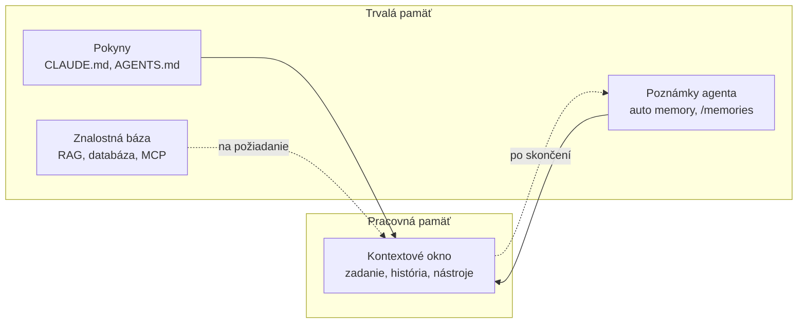

# Pamäť agenta: čo si má pamätať medzi reláciami

*Verzia 1.0 · stav k októbru 2026. Nástroje sa menia rýchlo; pred  
nasadením si overte aktuálnu dokumentáciu.*  

## 1. Prečo pamäť

Každá relácia — jedno spustenie agenta a jeho konverzácia — začína  
s prázdnym kontextom. Agent nevie, že ste minulý týždeň riešili rovnakú  
chybu, že testy sa púšťajú cez `pytest -q` ani že sumy v reportoch majú  
byť v eurách. Ak mu to nepoviete, znova háda alebo sa znova opýta.  

Predstavte si kolegu, ktorý si každý deň založí nový notes. Prvý deň mu  
vysvetlíte, kde sú podklady a aký formát chcete. Druhý deň to isté. Po  
týždni máte dosť. Rovnako sa správa agent bez pamäte: je šikovný, ale  
začína od nuly.  

Pamäť je preto tretia vrstva práce s agentom:  

- **zadanie** hovorí, čo chcete teraz,  
- **nástroje** dávajú agentovi schopnosť konať,  
- **pamäť** uchová to, čo platí aj nabudúce.  

> **Jednoducho povedané:** zadanie je poznámka na lístoček, pamäť je  
> zošit, ktorý zostane na stole.  

## 2. Ako pamäť funguje

Model má dve miesta, kde môže niečo „vedieť“. Prvé je **kontextové  
okno**: všetko, čo vidí v tejto chvíli — zadanie, história konverzácie,  
výsledky nástrojov a načítané pokyny. Je veľké, ale konečné a každý token  
(najmenšia jednotka textu) v ňom stojí peniaze aj pozornosť.  

Druhé je **trvalá pamäť**: súbory a databázy mimo modelu. Do kontextu sa  
dostanú len vtedy, keď ich aplikácia načíta alebo keď si ich agent  
vyžiada. To je celý princíp: držať pri sebe málo a zvyšok mať po ruke.  



Keď kontext presýti história a výstupy nástrojov, kvalita odpovedí  
klesá. Tomu sa hovorí **degradácia kontextu** (context rot): model má  
pred sebou priveľa textu a prestáva rozlišovať podstatné. Prvým liekom  
je pamäť mimo kontextu, druhým kompakcia — o oboch píše  
[context.md](context.md).  

## 3. Druhy pamäte

Pamäť nie je jedna vec. Líši sa podľa toho, kto ju píše, ako dlho platí  
a či sa načíta vždy alebo len na požiadanie.  

| Druh | Kto píše | Príklad |  
| --- | --- | --- |  
| Pokyny | vy a tím | `CLAUDE.md` |  
| Poznámky | agent | `MEMORY.md` |  
| Znalosti | vy alebo systém | firemné PDF |  
| História | aplikácia | konverzácia |  

**Pokyny** sú fakty a pravidlá, ktoré majú platiť pri každej úlohe:  
príkazy na testy, štruktúra projektu, štýl textov, hranice. Píšete ich  
vy, zvyčajne do Markdown súboru, ktorý agent načíta na začiatku relácie.  
Podrobne ich opisuje [subor-agents.md](subor-agents.md).  

**Poznámky** sú to, čo si agent zapíše sám: vaše opravy, preferencie,  
rozhodnutia, na ktoré prišiel. Nemusíte ich písať, ale mali by ste ich  
čítať — nesprávna poznámka sa inak šíri ďalej.  

**Znalosti** sú dokumenty, tabuľky a databázy, z ktorých agent hľadá  
odpoveď. Nezmestia sa do pokynov, preto sa načítavajú až vtedy, keď ich  
úloha potrebuje — často cez MCP (protokol pre externé nástroje a dáta).  
Tomuto postupu sa hovorí **RAG** (retrieval-augmented generation,  
doplnenie odpovede vyhľadaním).  

Je tu ešte **história** relácie: celá konverzácia, ktorú aplikácia drží  
a posiela modelu. Po zatvorení okna zmizne alebo sa uloží len na  
pokračovanie, preto sa na ňu nepozerajte ako na pamäť.  

## 4. Čo kam patrí

Najčastejšia chyba nie je chýbajúca pamäť, ale pamäť na nesprávnom  
mieste. Rozhodujte sa podľa dvoch otázok: platí to pri každej úlohe,  
alebo len pri niektorej? A potrebuje to vidieť tím, alebo len vy?  

| Čo | Kde | Prečo |  
| --- | --- | --- |  
| príkazy, konvencie | projektový súbor | platí pre celý tím |  
| moje preferencie | používateľský súbor | len pre mňa, všade |  
| osobné nastavenie | lokálny súbor | nepatrí do gitu |  
| postup na jednu úlohu | príkaz alebo skill | načíta sa až pri použití |  
| veľký manuál | znalostná báza | nezmestí sa do pokynov |  
| jednorazová požiadavka | zadanie v chate | netreba si ju pamätať |  

> **Tip:** ak tú istú vetu píšete do chatu tretí raz, patrí do pamäte.  
> Ak ju použijete raz za mesiac, patrí do príkazu alebo skillu.  

Rozdiel je v tom, kedy sa text načíta: pokyn pri každej relácii, postup  
až pri použití. Skill je postup so svojimi pomocnými súbormi. Ukladanie  
postupov opisuje [prikazy.md](prikazy.md).  

## 5. Nastavenie a prvé overenie

Každý nástroj má vlastné názvy súborov, ale princíp je rovnaký: projektový  
súbor pre tím, používateľský pre vás, lokálny pre výnimky.  

| Nástroj | Súbor | Platnosť |  
| --- | --- | --- |  
| Claude Code | `CLAUDE.md` alebo `.claude/CLAUDE.md` | projekt |  
| Claude Code | `~/.claude/CLAUDE.md` | všetky projekty |  
| Claude Code | `CLAUDE.local.md` | projekt, len vy |  
| opencode | `AGENTS.md` | projekt |  
| opencode | `~/.config/opencode/AGENTS.md` | všetky projekty |  
| Copilot Chat | `.github/copilot-instructions.md` | projekt |  
| Copilot Chat | `~/.copilot/instructions/` | všetky projekty |  

Claude Code číta aj `AGENTS.md`, ak ho v projekte máte namiesto  
`CLAUDE.md`. opencode naopak preferuje `AGENTS.md` a `CLAUDE.md` použije  
ako záložný súbor. VS Code prijíma oba názvy a k tomu vlastné súbory  
`*.instructions.md` s hlavičkou `applyTo`.  

Skontrolujte, čo máte:  

```bash
ls -l CLAUDE.md AGENTS.md CLAUDE.local.md 2>/dev/null
wc -l CLAUDE.md 2>/dev/null
ls -l ~/.claude/CLAUDE.md ~/.config/opencode/AGENTS.md 2>/dev/null
```

V Claude Code overíte načítané súbory príkazom `/context` a pamäť otvoríte  
príkazom `/memory`. V opencode stačí, keď súbor leží v koreni projektu  
alebo v globálnom priečinku. Vo VS Code nájdete zoznam v nastaveniach  
inštrukcií; typ `#` v chate ponúka aj kontextové položky.  

> **Pozor:** samotné načítanie súboru ešte nič nevykoná. Pokyny sú  
> kontext, nie pravidlo vynútené systémom. Ak niečo nesmie nastať,  
> nastavte to v oprávneniach alebo v hooku (skript pred alebo po akcii),  
> nie len v texte.  

## 6. Príklady

### 6.1 Projektová pamäť

Súbor `CLAUDE.md` v koreni projektu. Je krátky, konkrétny a obsahuje len  
to, čo agent z kódu sám neodvodí.  

```markdown
# Projekt: mesačné reporty

## Príkazy
- Testy: `pytest -q`
- Kontrola štýlu: `ruff check .`

## Štruktúra
- `src/` – výpočty a reporty
- `tests/` – testy
- `data/` – vstupy, needituj ich

## Pravidlá
- Texty a komentáre píš po slovensky.
- Sumy zaokrúhľuj na centy, nie na celé eurá.
- Pred zmenou schémy CSV sa najprv opýtaj.
```

### Vyskúšajte

1. Vytvorte súbor s týmto obsahom v novom priečinku,  
2. spustite agenta a spýtajte sa, ako sa púšťajú testy,  
3. zmeňte pravidlo o zaokrúhľovaní a overte, že ho agent použije.  

### 6.2 Osobná pamäť a výnimky

Používateľský súbor `~/.claude/CLAUDE.md` platí vo všetkých projektoch.  
Patria doň preferencie, ktoré nechcete opakovať:  

```markdown
- Odpovedaj po slovensky a stručne.
- Pri kóde používaj 4 medzery, nie tabulátory.
- Pred commitom mi ukáž `git diff --stat`.
```

Súbor `CLAUDE.local.md` je naopak osobný len pre jeden projekt. Dajte ho  
do `.gitignore`, aby sa nedostal kolegom. Súbor `.gitignore`:  

```text
CLAUDE.local.md
```

Do lokálneho súboru patria veci ako testovacia adresa, vlastný používateľ  
alebo priečinok s ukážkovými dátami.  

### Vyskúšajte

1. Pridajte do používateľského súboru jednu vetu o jazyku odpovedí,  
2. overte ju v dvoch rôznych projektoch,  
3. pridajte do lokálneho súboru riadok a skontrolujte, že ho git ignoruje.  

### 6.3 Poznámky, ktoré si agent píše sám

Claude Code má automatickú pamäť: počas práce si zapisuje poznámky do  
vlastného priečinka priradeného projektu. Prvých 200 riadkov indexu  
`MEMORY.md` alebo 25 kB sa načíta na začiatku každej relácie; zvyšok si  
agent dočíta podľa potreby.  

```text
~/.claude/projects/<projekt>/memory/
├── MEMORY.md
├── user_role.md
└── feedback_testy.md
```

Index drží jeden riadok na poznámku, detail je v samostatnom súbore.  
Súbor `MEMORY.md` (ukážka):  

```markdown
- [user] Účtovník, chce sumy v eurách. (user_role.md)
- [feedback] Testy púšťať po každej zmene. (feedback_testy.md)
```

Automatická pamäť je uložená len na tomto počítači a v rámci jedného  
repozitára. Do nového počítača ani do cloudu sa neprenesie.  

### Vyskúšajte

1. Otvorte `/memory` a pozrite si, čo agent zapísal,  
2. jednu poznámku upravte a overte, že ju agent použije,  
3. poznámku, ktorá už neplatí, zmažte a vysvetlite prečo.  

## 7. Praktický projekt: pamäť pre tím

Cieľ: nová relácia alebo nový kolega má po prečítaní súborov dosť  
kontextu na to, aby mohol pracovať bez vypytovania.  

1. **Zozbierajte opakovania.** Prejdite posledné relácie a vypíšte vety,  
   ktoré ste písali viackrát. Zvyčajne ide o príkazy, štýl a hranice.  
2. **Napíšte projektový súbor.** Začnite pod 60 riadkami: prehľad,  
   príkazy, štruktúra, tri až päť pravidiel.  
3. **Oddelte osobné.** Preferencie a lokálne adresy presuňte do  
   používateľského alebo lokálneho súboru.  
4. **Overte v novej relácii.** Otvorte novú reláciu, spustite `/context`  
   a položte otázku, na ktorú poznáte odpoveď.  
5. **Uložte do verziovania.** Projektový súbor commitnite spolu so zmenou,  
   ktorá ho vyvolala, aby bola vidieť história.  
6. **Naplánujte kontrolu.** Raz za mesiac prejdite pravidlá a zmažte tie,  
   ktoré už neplatia. V Claude Code pomôže `/doctor prompt-audit`  
   (verzia 2.1.283 a novšia).  

Výsledná štruktúra môže vyzerať takto:  

```text
projekt/
├── CLAUDE.md
├── CLAUDE.local.md        (v .gitignore)
├── .claude/
│   ├── rules/
│   │   └── testy.md
│   └── settings.json
└── src/
```

Podpriečinky môžu mať vlastné `CLAUDE.md`. Priečinok `.claude/rules/`  
drží pravidlá, ktoré sa načítajú len pre vybrané súbory, napríklad pre  
testy. Agent tak dostane kontext bližšie k miestu, kde pracuje.  

## 8. Automatizácia: keď pamäť riadi aplikácia

Pamäť sa nedá udržať ručne pri dlhých úlohách. Aplikácie preto používajú  
niekoľko techník, ktoré dopĺňajú trvalé súbory:  

| Technika | Čo rieši |  
| --- | --- |  
| kompakcia | skráti históriu tej istej relácie |  
| sumarizácia | zhrnie staré správy do odstavca |  
| odkladanie | veľký výstup uloží mimo kontextu |  
| subagent | prácu presunie do vlastného okna |  
| nástroj pamäte | zápis a čítanie `/memories` |  

**Kompakcia** je príkaz `/compact`: aplikácia zhrnie konverzáciu a nechá  
pokyny. **Odkladanie** (offloading) uloží veľký výsledok nástroja do  
súboru a modelu dá len ukážku; keď ju potrebuje, prečíta si zvyšok.  
**Subagent** dostane vlastný kontext a rodičovi vráti len záver, takže  
hlavná relácia zostane čistá.  

**Nástroj pamäte** je rozhranie pre API (programové volanie modelu):  
model žiada operácie ako `view` alebo `create` a aplikácia ich vykoná  
v priečinku `/memories`. Všetko sa deje na strane klienta — vy rozhodujete,  
kde súbory ležia a kto k nim má prístup. Do požiadavky na API stačí  
pridať:  

```json
{
  "tools": [
    {"type": "memory_20250818", "name": "memory"}
  ]
}
```

Takáto pamäť je vhodná na rozhodnutia a preferencie, ktoré sa majú  
preniesť medzi reláciami. Nie je to náhrada databázy ani dokumentácie.  

> **Tip:** pamäť má byť malá a presná. Každý riadok sa načíta pri  
> každej relácii, preto sa dlhý zoznam nevypláca.  

## 9. Bezpečnosť

Pamäť je súbor, ktorý agent číta a niekedy aj píše. Z toho vyplývajú  
riziká, ktoré sa netýkajú modelu, ale procesu okolo neho.  

- **Žiadne tajomstvá.** Kľúče, heslá a tokeny patria do premenných  
  prostredia, nie do `CLAUDE.md` ani do poznámok.  
- **Osobné údaje zvážte.** Mená klientov, adresy a zdravotné údaje  
  nepatria do súboru, ktorý sa commitne alebo zdieľa.  
- **Cudzí text je podozrivý.** Ak agent uloží do pamäte text z webu, môže  
  si zapamätať aj skrytý pokyn. Preto pamäť čítajte a čistite.  
- **Pamäť nie je oprávnenie.** Zápis „smieš mazať“ v Markdown súbore  
  neznamená, že to aplikácia dovolí. Hranice nastavte v konfigurácii.  
- **Zdieľajte vedome.** Projektový súbor je súčasť repozitára. Pred  
  commitom si prečítajte diff tak ako pri kóde.  
- **Majte záložnú kopiu.** Zmazaná pamäť sa nedá vrátiť; pri dôležitých  
  poznámkach ju držte v gite alebo v inom úložisku.  

> **Pozor:** útočník, ktorý ovplyvní obsah pamäte, ovplyvní všetky  
> budúce relácie. Podozrivý záznam vymažte, nie len obíďte.  

## 10. Časté chyby

| Problém | Príčina | Riešenie |  
| --- | --- | --- |  
| pravidlo sa ignoruje | konflikt alebo dlhý súbor | skráťte a zjednoťte |  
| pamäť sa nenačíta | zlý názov alebo priečinok | overte `/context` |  
| agent používa staré údaje | nikto pamäť neaktualizuje | mesačná kontrola |  
| tajomstvo uniklo | zápis priamo do pamäte | presuňte do prostredia |  
| osobný súbor v gite | chýba `.gitignore` | použite `CLAUDE.local.md` |  
| pamäť nafúkne | zapisuje sa každá maličkosť | len to, čo sa opakuje |  
| cudzí text v pamäti | skrytý pokyn z webu | čítajte a mažte záznamy |  
| nová relácia nič nevie | pamäť je len lokálna | zdieľajte súbor v gite |  

## 11. Úlohy na precvičenie

1. Vypíšte tri vety, ktoré ste agentovi povedali viackrát,  
2. z nich napíšte projektový súbor do 40 riadkov,  
3. overte ho v novej relácii otázkou, ktorej odpoveď poznáte,  
4. rozdeľte pravidlá na tímové a osobné,  
5. nájdite jednu poznámku, ktorá už neplatí, a odstráňte ju,  
6. navrhnite, čo z vašej pamäte by mal vidieť subagent a čo nie.  

## 12. Zhrnutie

- **Kontextové okno** je pracovná pamäť; **trvalá pamäť** žije v súboroch  
  a databázach mimo modelu.  
- **Pokyny** píše človek, **poznámky** agent, **znalosti** vznikajú  
  z dokumentov.  
- Projektový súbor patrí do gitu, osobný mimo neho.  
- **Automatická pamäť** je pohodlná, ale strojová a lokálna; treba ju  
  čítať a čistiť.  
- **Kompakcia**, **odkladanie** a **subagenti** chránia kontext pri  
  dlhých úlohách.  
- V pamäti nikdy nie sú tajomstvá a cudzí text sa kontroluje.  

## 13. Slovníček

| Anglicky | Slovensky | Význam |  
| --- | --- | --- |  
| memory | pamäť | informácie mimo kontextu |  
| context window | kontextové okno | časť, ktorú model vidí |  
| context rot | degradácia kontextu | presýtenie zhorší odpovede |  
| compaction | kompakcia | zhrnutie histórie relácie |  
| offloading | odkladanie | veľký vstup sa uloží mimo |  
| retrieval | vyhľadanie | načítanie relevantných častí |  
| RAG | doplnenie vyhľadaním | hľadanie v dokumentoch |  
| auto memory | automatická pamäť | poznámky agenta o projekte |  
| memory tool | nástroj pamäte | súbory `/memories` cez API |  
| prompt injection | vložený pokyn | cudzí text ovláda agenta |  

## Zdroje

- Claude Code – How Claude remembers your project:  
  code.claude.com/docs/en/memory  
- Anthropic – Memory tool:  
  platform.claude.com/docs/en/agents-and-tools/tool-use/memory-tool  
- opencode – Rules: opencode.ai/docs/rules  
- VS Code – Custom instructions:  
  code.visualstudio.com/docs/copilot/customization/custom-instructions  
- AGENTS.md – otvorený štandard: agents.md  
