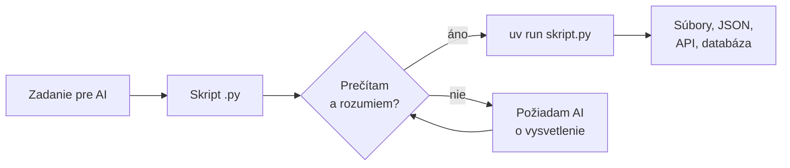

# Python pre praktikov

*Verzia 1.0 · stav k októbru 2026. Nástroje sa menia rýchlo; pred  
nasadením si overte aktuálnu dokumentáciu Pythonu a uv.*  

## 1. Prečo Python v AI školení

Keď požiadate AI asistenta o automatizáciu, veľmi často dostanete  
skript v jazyku **Python**. Spracuje súbory, zavolá API alebo zapíše  
výsledok do databázy. Skripty `claude_*.py` v tomto priečinku sú presne  
takéto. Programátorom sa stať nemusíte, no mali by ste vedieť skript  
prečítať, spustiť, upraviť jednu hodnotu a rozpoznať, kedy robí niečo  
podozrivé.  

**Python** je bezplatný programovací jazyk s jednoduchou, čitateľnou  
syntaxou. Má rozsiahlu **štandardnú knižnicu**, teda moduly, ktoré  
dostanete s Pythonom bez inštalácie (súbory, JSON, HTTP, CSV). Ďalšie  
knižnice, napríklad oficiálnu knižnicu `anthropic` pre Claude API,  
doinštalujete z katalógu **PyPI**.  

V tejto kapitole prejdete minimum, ktoré na prácu so skriptmi od AI  
potrebujete:  

1. prečítate a pochopíte stavbu bežného skriptu,  
2. nainštalujete Python a nástroj **uv**,  
3. naučíte sa, čo je virtuálne prostredie a ako sa inštalujú balíky,  
4. vyskúšate si prácu so súbormi, JSON a HTTP,  
5. postavíte malý nástroj na prehľad behov AI workflowov,  
6. naučíte sa skripty od AI bezpečne kontrolovať.  



> **Jednoducho povedané:** Skript od AI je ako recept od kuchára, ktorého  
> nepoznáte. Nemusíte vedieť variť ako on, ale pred varením si recept  
> prečítate a skontrolujete, či v ňom nie je niečo, čo nechcete jesť.  

## 2. Ako čítať skript v Pythone

Väčšina skriptov má rovnakú stavbu. Keď ju poznáte, rýchlo nájdete  
miesto, kde sa nastavuje model, cesta k súboru alebo adresa API.  

| Časť | Ako vyzerá | Na čo slúži |  
|---|---|---|  
| hlavička PEP 723 | `# /// script` | Python a balíky pre skript |  
| docstring | `"""Popis..."""` | čo skript robí a ako ho spustiť |  
| importy | `import json` | moduly, ktoré skript používa |  
| konštanty | `MODEL = "..."` | nastavenia, ktoré meníte najčastejšie |  
| funkcie | `def nacitaj(subor):` | pomenované kroky programu |  
| hlavná funkcia | `def main():` | poradie krokov |  
| spúšťač | `if __name__ == "__main__":` | spustí `main()` pri spustení súboru |  

Hlavičku PEP 723 vysvetľuje časť 4. Konštanty sa podľa zvyku píšu  
veľkými písmenami. Ak má skript iba zmeniť model alebo priečinok,  
hľadajte zmenu práve tam.  

### Syntax, ktorú stretnete najčastejšie

Python nepoužíva zložené zátvorky. Čo patrí do funkcie, podmienky alebo  
cyklu, určuje **odsadenie**, zvyčajne štyri medzery. Riadok, ktorý  
otvára blok, končí dvojbodkou.  

| Zápis | Význam |  
|---|---|  
| `pocet = 3` | priradenie hodnoty do premennej |  
| `"text"`, `'text'` | reťazec (text), obe úvodzovky sú rovnocenné |  
| `f"Spolu: {pocet}"` | f-reťazec, do `{}` sa vloží hodnota |  
| `[1, 2, 3]` | zoznam (list), poradie sa zachováva |  
| `{"meno": "Ján"}` | slovník (dict), dvojice kľúč – hodnota |  
| `None`, `True`, `False` | nič, pravda, nepravda |  
| `# poznámka` | komentár, Python ho ignoruje |  
| `def f(x):` | definícia funkcie |  
| `if`, `elif`, `else` | podmienka |  
| `for x in zoznam:` | cyklus cez prvky |  
| `try:` / `except` | zachytenie chyby |  
| `with open(...) as f:` | blok, ktorý po sebe zatvorí súbor |  

Súbor `python-priklady/01-zaklady/zaklady.py`:  

```python
# Základy Pythonu: hodnoty, zoznamy, slovníky, podmienky, cykly, funkcie

kurz = "Úvod do AI agentov"     # text (str)
cena = 290.0                    # desatinné číslo (float)
kapacita = 12                   # celé číslo (int)
otvoreny = True                 # pravda alebo nepravda (bool)

ucastnici = ["Mária", "Peter", "Jana"]          # zoznam (list)
ucastnici.append("Tomáš")

lektor = {"meno": "Ján", "mesto": "Bratislava"}  # slovník (dict)


def volne_miesta(kapacita, prihlasenych):
    """Vráti počet voľných miest, nikdy nie záporný."""
    return max(kapacita - len(prihlasenych), 0)


volnych = volne_miesta(kapacita, ucastnici)
print(f"Kurz: {kurz}, cena {cena:.2f} €")
print(f"Lektor: {lektor['meno']} ({lektor['mesto']})")

if otvoreny and volnych > 0:
    print(f"Voľných miest: {volnych}")
else:
    print("Kurz je plný alebo uzavretý.")

for poradie, meno in enumerate(ucastnici, start=1):
    print(f"{poradie}. {meno}")
```

Spustenie a výstup:  

```bash
python zaklady.py
```

```
Kurz: Úvod do AI agentov, cena 290.00 €
Lektor: Ján (Bratislava)
Voľných miest: 8
1. Mária
2. Peter
3. Jana
4. Tomáš
```

Zápis `{cena:.2f}` vypíše číslo s dvoma desatinnými miestami. Funkcia  
`len` vráti počet prvkov zoznamu a `enumerate` dáva k prvkom aj ich  
poradie.  

> **Pozor:** Odsadenie nie je len vzhľad. Ak riadok pod `if` posuniete  
> doľava, už do podmienky nepatrí a vykoná sa vždy. Nemiešajte medzery  
> a tabulátory; VS Code ich pri súboroch `.py` nastaví správne sám.  

### Vyskúšajte

- Zmeňte `kapacita` na 4 a spustite skript znova. Čo vypíše?  
- Pridajte do slovníka `lektor` kľúč `"email"` a vypíšte ho.  
- Odstráňte odsadenie riadku `print(f"Voľných miest: ...")` a prečítajte  
  si chybové hlásenie.  

## 3. Inštalácia a príprava

Aktuálna verzia je **Python 3.15** (opravná verzia 3.15.2 z októbra  
2026). Nová hlavná verzia vychádza každý rok v októbri a má päť rokov  
podpory. Podrobnosti o verziách a prechode zo systémového Pythonu  
nájdete v kapitole `python-versions.md`.  

Okrem Pythonu budete potrebovať **uv**. Je to rýchly nástroj od firmy  
Astral, ktorý v jednom programe spravuje verzie Pythonu, virtuálne  
prostredia aj balíky. Nahrádza `pip`, `venv` a ďalšie pomocné nástroje.  

### Windows

Na Windows sa Python od verzie 3.14 inštaluje cez **Python install  
manager**. Klasický inštalátor `.exe` je zastaraný a pre Python 3.16 už  
nevyjde. Install manager pridá príkazy `python`, `py` a `pymanager`.  

```powershell
winget install 9NQ7512CXL7T -e --accept-package-agreements --disable-interactivity
py install --configure -y
py list
```

Ten istý install manager nájdete aj v Microsoft Store alebo ako súbor  
MSIX na python.org/downloads. Ďalšie verzie pridáte príkazom  
`py install 3.14`, konkrétnu spustíte cez `py -V:3.14`.  

Inštalácia uv:  

```powershell
winget install --id=astral-sh.uv -e
```

Alternatíva bez winget je oficiálny inštalačný skript:  

```powershell
powershell -ExecutionPolicy ByPass -c "irm https://astral.sh/uv/install.ps1 | iex"
```

### Linux a macOS

Na Linuxe a macOS je Python často predinštalovaný, no býva starší.  
Nainštalujte uv a cez neho aktuálny Python:  

```bash
curl -LsSf https://astral.sh/uv/install.sh | sh
uv python install 3.15
```

> **Pozor:** Systémový Python na Linuxe používa operačný systém. Balíky  
> do neho neinštalujte cez `sudo pip install`. Na vlastné skripty  
> používajte virtuálne prostredie alebo `uv run`.  

### Overenie inštalácie

Otvorte nový terminál, aby sa načítala nová premenná `Path`:  

```bash
python --version
uv --version
uv python list --only-installed
```

Mali by ste vidieť `Python 3.15.2` (alebo novšiu) a `uv 0.13.6` (alebo  
novšiu). Ak príkaz `python` na Linuxe neexistuje, použite `python3`.  

## 4. Virtuálne prostredia a balíky

**Balík** (package) je knižnica, ktorú si stiahnete z PyPI, napríklad  
`httpx` na HTTP alebo `anthropic` na Claude API. Ak by ste všetky balíky  
inštalovali do jedného spoločného Pythonu, projekty by si skôr či neskôr  
prekážali: jeden potrebuje verziu 1, druhý verziu 2.  

Preto sa používa **virtuálne prostredie** (virtual environment, venv).  
Je to priečinok, zvyčajne `.venv`, s vlastnou kópiou odkazov na Python  
a vlastnými balíkmi. Každý projekt má svoje prostredie a zmazaním  
priečinka ho celé odstránite.  

> **Jednoducho povedané:** Virtuálne prostredie je samostatná dielňa  
> pre každý projekt. Náradie z jednej dielne sa nepomieša s druhou.  

### Klasický spôsob: venv a pip

Tento postup stretnete v starších návodoch a v mnohých odpovediach AI.  
Modul `venv` a nástroj `pip` sú súčasťou Pythonu.  

```powershell
python -m venv .venv
.venv\Scripts\Activate.ps1
python -m pip install httpx
python -m pip freeze > requirements.txt
deactivate
```

Na Linuxe a macOS sa prostredie aktivuje inak:  

```bash
python3 -m venv .venv
source .venv/bin/activate
```

**Aktivácia** prepne terminál tak, aby príkazy `python` a `pip` patrili  
prostrediu. Na začiatku riadku uvidíte `(.venv)`. Súbor  
`requirements.txt` je zoznam balíkov s verziami. Na inom počítači ich  
nainštalujete príkazom `python -m pip install -r requirements.txt`.  

> **Tip:** Píšte `python -m pip`, nie samotné `pip`. Tak máte istotu,  
> že balík ide do toho Pythonu, ktorý potom skript spustí.  

### Moderný spôsob: uv

uv robí to isté, len rýchlejšie a bez ručnej aktivácie. Príkaz  
`uv run` si prostredie nájde, vytvorí alebo aktualizuje sám.  

| Úloha | venv a pip | uv |  
|---|---|---|  
| vytvoriť prostredie | `python -m venv .venv` | `uv venv` |  
| inštalovať balík | `python -m pip install httpx` | `uv pip install httpx` |  
| zo zoznamu | `pip install -r requirements.txt` | `uv pip install -r ...` |  
| nový projekt | – | `uv init --no-package` |  
| pridať balík do projektu | – | `uv add httpx` |  
| spustiť skript | aktivovať a `python s.py` | `uv run s.py` |  
| obnoviť prostredie | – | `uv sync` |  

uv rozlišuje dva hlavné spôsoby práce. Pri **projekte** sú balíky  
zapísané v súbore `pyproject.toml`. Pri **samostatnom skripte** sú  
priamo v jeho hlavičke.  

#### Projekt: pyproject.toml

```bash
uv init --no-package prehlad
cd prehlad
uv add httpx
uv run main.py
```

Prepínač `--no-package` vytvorí jednoduchý projekt so súborom `main.py`.  
Bez neho vytvorí uv 0.13 balík s priečinkom `src`, čo pre bežné skripty  
nepotrebujete. Po `uv add` pribudnú tieto súbory:  

```
prehlad/
├── .venv/            virtuálne prostredie (necommitovať)
├── .python-version   verzia Pythonu pre projekt
├── main.py
├── pyproject.toml    popis projektu a zoznam balíkov
└── uv.lock           presné verzie všetkých balíkov
```

Súbor `pyproject.toml` po príkaze `uv add httpx`:  

```toml
[project]
name = "prehlad"
version = "0.1.0"
description = "Add your description here"
readme = "README.md"
requires-python = ">=3.15"
dependencies = [
    "httpx>=0.28.1",
]
```

Súbory `pyproject.toml` aj `uv.lock` patria do Gitu. Priečinok `.venv`  
nie; kolega si ho vytvorí príkazom `uv sync`. Starší projekt so súborom  
`requirements.txt` prevediete príkazom `uv add -r requirements.txt`.  

#### Samostatný skript: hlavička PEP 723

**PEP 723** je štandard, podľa ktorého si skript nesie zoznam balíkov  
v komentári na začiatku súboru. Takto sú napísané aj skripty  
`claude_*.py`. Príkaz `uv run` hlavičku prečíta, pripraví dočasné  
prostredie a skript spustí.  

```python
# /// script
# requires-python = ">=3.10"
# dependencies = [
#     "anthropic>=2.3.0",
# ]
# ///
```

Hlavičku nemusíte písať ručne. Vytvorí ju príkaz  
`uv init --script skript.py` a balík do nej pridá  
`uv add --script skript.py httpx`. Na jednorazový pokus bez úpravy súboru  
stačí `uv run --with httpx skript.py`.  

| Situácia | Odporúčaný spôsob |  
|---|---|  
| jeden skript, ktorý niekomu pošlete | hlavička PEP 723 a `uv run` |  
| viac súborov, dlhodobý projekt | `uv init --no-package` a `uv add` |  
| návod alebo server bez uv | `venv`, `pip` a `requirements.txt` |  

### Vyskúšajte

- Vytvorte projekt `uv init --no-package skuska` a spustite `uv run main.py`.  
- Pridajte balík `httpx` a pozrite sa, čo pribudlo v `pyproject.toml`.  
- Zmažte priečinok `.venv` a spustite `uv sync`. Čo sa stalo?  

## 5. Príklady: súbory, JSON a HTTP

Všetky príklady sú pripravené v priečinku `python-priklady`:  

```
python-priklady/
├── 01-zaklady/zaklady.py
├── 02-subory/subory.py, ucastnici.csv
├── 03-json/json_priklad.py, nastavenia.json
├── 04-http/http_zakladne.py, http_httpx.py
└── projekt/suhrn_behov.py, behy.json
```

Príklady 01 až 03 a `http_zakladne.py` používajú len štandardnú  
knižnicu. Spustíte ich príkazom `python subor.py` alebo `uv run subor.py`  
z priečinka, kde ležia.  

### 5.1 Textové súbory a CSV

Na cesty k súborom slúži modul `pathlib`. Objekt `Path` pozná operátor  
`/`, ktorým spájate časti cesty rovnako na Windows aj Linuxe. Formát  
**CSV** (hodnoty oddelené čiarkou) je bežný export z Excelu a databáz.  

Súbor `python-priklady/02-subory/ucastnici.csv`:  

```
meno,firma
Mária,Alfa s.r.o.
Peter,Beta a.s.
Tomáš,
Zuzana,Gama s.r.o.
```

Súbor `python-priklady/02-subory/subory.py`:  

```python
# Práca so súbormi: textový súbor a CSV
import csv
from pathlib import Path

priecinok = Path(__file__).parent        # priečinok, v ktorom leží skript
poznamky = priecinok / "poznamky.txt"

# Zápis a čítanie textu (vždy s kódovaním UTF-8)
poznamky.write_text("Prvý riadok\nDruhý riadok\n", encoding="utf-8")
for riadok in poznamky.read_text(encoding="utf-8").splitlines():
    print("Text:", riadok)

# Čítanie CSV: každý riadok ako slovník podľa hlavičky
subor_csv = priecinok / "ucastnici.csv"
with subor_csv.open(encoding="utf-8", newline="") as f:
    riadky = list(csv.DictReader(f))

for r in riadky:
    print(f"{r['meno']:<8} {r['firma'] or '(bez firmy)'}")

# Zápis CSV: len účastníci s firmou
vystup = priecinok / "s-firmou.csv"
with vystup.open("w", encoding="utf-8", newline="") as f:
    zapisovac = csv.DictWriter(f, fieldnames=["meno", "firma"])
    zapisovac.writeheader()
    for r in riadky:
        if r["firma"]:
            zapisovac.writerow(r)

print("Uložené:", vystup.name)
```

Výstup:  

```
Text: Prvý riadok
Text: Druhý riadok
Mária    Alfa s.r.o.
Peter    Beta a.s.
Tomáš    (bez firmy)
Zuzana   Gama s.r.o.
Uložené: s-firmou.csv
```

| Zápis | Význam |  
|---|---|  
| `Path(__file__).parent` | priečinok skriptu, nezávisle od terminálu |  
| `encoding="utf-8"` | správna diakritika pri čítaní aj zápise |  
| `newline=""` | odporúčanie modulu `csv`, inak pribudnú prázdne riadky |  
| `csv.DictReader` | riadok CSV ako slovník podľa hlavičky |  
| `r['firma'] or '...'` | prázdny text nahradí náhradnou hodnotou |  
| `"w"` | otvorenie na zápis, **prepíše** existujúci súbor |  

Od Pythonu 3.15 je kódovanie UTF-8 predvolené (PEP 686). Staršie verzie  
na Windows používajú kódovú stránku systému a diakritika sa môže  
pokaziť. Parameter `encoding="utf-8"` preto píšte vždy.  

> **Pozor:** Režim `"w"` súbor bez varovania prepíše. Ak chcete  
> pridávať na koniec, použite `"a"`. Skripty od AI s režimom `"w"`  
> skontrolujte, či nezapisujú do vášho pôvodného súboru.  

### Vyskúšajte

- Pridajte do `ucastnici.csv` stĺpec `email` a vypíšte ho.  
- Otvorte `ucastnici.csv` v Exceli, uložte ho ako CSV a spustite skript.  
  Funguje diakritika aj oddeľovač?  
- Zmeňte skript tak, aby do `s-firmou.csv` zapisoval len firmu Beta a.s.  

### 5.2 JSON

**JSON** je textový formát, v ktorom si programy vymieňajú dáta. Vracajú  
ho API, používajú ho konfiguračné súbory a v ňom posiela Claude  
štruktúrované odpovede. JSON objekt sa v Pythone zmení na slovník,  
JSON pole na zoznam.  

| JSON | Python |  
|---|---|  
| `{"a": 1}` | `dict` – slovník |  
| `[1, 2]` | `list` – zoznam |  
| `"text"` | `str` |  
| `1`, `1.5` | `int`, `float` |  
| `true`, `false`, `null` | `True`, `False`, `None` |  

Súbor `python-priklady/03-json/nastavenia.json`:  

```json
{
  "model": "claude-haiku-5-5",
  "max_tokens": 1000,
  "popis": "Triedenie e-mailov"
}
```

Súbor `python-priklady/03-json/json_priklad.py`:  

```python
# JSON: načítanie nastavení, úprava a uloženie
import json
from pathlib import Path

priecinok = Path(__file__).parent
subor = priecinok / "nastavenia.json"

try:
    nastavenia = json.loads(subor.read_text(encoding="utf-8"))
except FileNotFoundError:
    print("Súbor chýba, použijem predvolené nastavenia.")
    nastavenia = {"model": "claude-haiku-5-5", "max_tokens": 1000}
except json.JSONDecodeError as chyba:
    raise SystemExit(f"Neplatný JSON v {subor.name}: {chyba}")

print("Model:", nastavenia["model"])
print("Teplota:", nastavenia.get("temperature", "nenastavená"))

nastavenia["max_tokens"] = 2000
vystup = priecinok / "nastavenia-nove.json"
vystup.write_text(
    json.dumps(nastavenia, ensure_ascii=False, indent=2), encoding="utf-8"
)
print("Uložené:", vystup.name)
```

Výstup:  

```
Model: claude-haiku-5-5
Teplota: nenastavená
Uložené: nastavenia-nove.json
```

Zápis `nastavenia["model"]` skončí chybou `KeyError`, ak kľúč chýba.  
Metóda `get` vráti v takom prípade náhradnú hodnotu. `ensure_ascii=False`  
zachová diakritiku čitateľnú a `indent=2` súbor pekne odsadí.  

Blok `try` a `except` zachytí očakávané chyby a vypíše zrozumiteľnú  
správu namiesto dlhého výpisu. `raise SystemExit(...)` skript ukončí  
s chybovým kódom.  

### Vyskúšajte

- Vymažte v `nastavenia.json` jednu čiarku a spustite skript.  
- Premenujte `nastavenia.json` a spustite skript. Ktorá vetva `except`  
  sa vykonala?  
- Pridajte do súboru `"temperature": 0.2` a overte výstup.  

### 5.3 HTTP a API

**HTTP** je protokol, ktorým sa programy rozprávajú s webovými  
službami. **GET** požiadavka dáta číta, **POST** ich posiela. Server  
odpovedá **stavovým kódom**: 200 znamená úspech, 4xx chybu na vašej  
strane (napríklad 404 – nenájdené, 401 – chýba prihlásenie) a 5xx chybu  
servera.  

Prvý príklad používa len štandardnú knižnicu a zistí najnovšiu verziu  
uv cez verejné API GitHubu.  

Súbor `python-priklady/04-http/http_zakladne.py`:  

```python
# HTTP bez knižníc: GET požiadavka na API GitHubu a čítanie JSON
import json
import urllib.request

URL = "https://api.github.com/repos/astral-sh/uv/releases/latest"

poziadavka = urllib.request.Request(URL, headers={"User-Agent": "skolenie"})
with urllib.request.urlopen(poziadavka, timeout=10) as odpoved:
    print("Stav:", odpoved.status)
    data = json.load(odpoved)

print("Najnovšie uv:", data["tag_name"])
print("Vydané:", data["published_at"][:10])
```

Výstup (k 31. 10. 2026):  

```
Stav: 200
Najnovšie uv: 0.13.6
Vydané: 2026-10-27
```

Väčšina skriptov od AI používa pohodlnejšiu knižnicu **httpx** alebo  
staršiu **requests**. Druhý príklad má hlavičku PEP 723, preto ho  
spustite cez uv. Služba httpbin.org vracia späť to, čo ste jej poslali.  

Súbor `python-priklady/04-http/http_httpx.py`:  

```python
# /// script
# requires-python = ">=3.12"
# dependencies = ["httpx>=0.28"]
# ///
# HTTP s knižnicou httpx: GET s parametrami, POST s JSON, kontrola chýb
import httpx

with httpx.Client(timeout=10) as klient:
    odpoved = klient.get("https://httpbin.org/get", params={"kurz": "python"})
    odpoved.raise_for_status()            # chyba 4xx/5xx vyvolá výnimku
    print("GET parametre:", odpoved.json()["args"])

    odpoved = klient.post("https://httpbin.org/post", json={"pocet": 3})
    odpoved.raise_for_status()
    print("POST telo:", odpoved.json()["json"])

    odpoved = klient.get("https://httpbin.org/status/404")
    if odpoved.is_error:
        print("Chyba servera:", odpoved.status_code)
```

```bash
uv run http_httpx.py
```

```
GET parametre: {'kurz': 'python'}
POST telo: {'pocet': 3}
Chyba servera: 404
```

| Zápis | Význam |  
|---|---|  
| `timeout=10` | po 10 sekundách to vzdá, skript nevisí donekonečna |  
| `params={...}` | parametre do adresy, `?kurz=python` |  
| `json={...}` | telo požiadavky ako JSON |  
| `raise_for_status()` | pri kóde 4xx alebo 5xx vyvolá výnimku |  
| `odpoved.json()` | prevedie telo odpovede na slovník |  

> **Tip:** Knižnice ako `anthropic` volajú HTTP za vás. Keď však skript  
> zlyhá s kódom 401 alebo 429, pomôže vedieť, že ide o chýbajúci API  
> kľúč, respektíve o prekročený limit požiadaviek.  

### Vyskúšajte

- V `http_zakladne.py` zmeňte adresu na repozitár `python/cpython`  
  a zistite jeho najnovšie vydanie.  
- Nastavte `timeout=0.001` a pozrite si chybu.  
- V `http_httpx.py` zmeňte stav 404 na 500.  

## 6. Projekt: prehľad behov AI workflowov

V kapitole `postgresql.md` ukladáte behy workflowov do tabuľky `behy`.  
Rovnaké údaje sa dajú exportovať do JSON. Teraz napíšete nástroj, ktorý  
z exportu spraví prehľad v Markdowne a uloží ho do súboru.  

### Krok 1: dáta

Súbor `python-priklady/projekt/behy.json`:  

```json
[
  {"workflow": "triedenie-emailov", "stav": "ok", "trvanie_ms": 1840, "tokeny": 2300},
  {"workflow": "triedenie-emailov", "stav": "ok", "trvanie_ms": 2110, "tokeny": 2650},
  {"workflow": "triedenie-emailov", "stav": "chyba", "trvanie_ms": 30000, "tokeny": 0},
  {"workflow": "suhrn-faktur", "stav": "ok", "trvanie_ms": 5200, "tokeny": 8100},
  {"workflow": "suhrn-faktur", "stav": "ok", "trvanie_ms": 4800, "tokeny": 7600},
  {"workflow": "denny-report", "stav": "ok", "trvanie_ms": 9400, "tokeny": 15200},
  {"workflow": "denny-report", "stav": "chyba", "trvanie_ms": 1200, "tokeny": 400}
]
```

### Krok 2: skript

Skript je rozdelený do funkcií: načítanie s kontrolou, výpočet, tvorba  
reportu a hlavná funkcia. Modul `argparse` spracuje parametre z príkazového  
riadku a sám vytvorí nápovedu `--help`.  

Súbor `python-priklady/projekt/suhrn_behov.py`:  

```python
"""Prehľad behov AI workflowov zo súboru JSON do reportu v Markdowne.

Použitie:
    uv run suhrn_behov.py
    uv run suhrn_behov.py behy.json --vystup report.md --workflow suhrn-faktur
"""

import argparse
import json
import sys
from pathlib import Path


def nacitaj_behy(subor):
    """Načíta zoznam behov a skontroluje povinné polia."""
    behy = json.loads(Path(subor).read_text(encoding="utf-8"))
    for i, beh in enumerate(behy, start=1):
        for pole in ("workflow", "stav", "trvanie_ms", "tokeny"):
            if pole not in beh:
                raise ValueError(f"Beh č. {i} nemá pole '{pole}'")
    return behy


def spocitaj(behy):
    """Zoskupí behy podľa workflowu a spočíta štatistiky."""
    vysledok = {}
    for beh in behy:
        s = vysledok.setdefault(
            beh["workflow"], {"behov": 0, "ok": 0, "tokeny": 0, "trvanie": 0}
        )
        s["behov"] += 1
        s["ok"] += beh["stav"] == "ok"
        s["tokeny"] += beh["tokeny"]
        s["trvanie"] += beh["trvanie_ms"]
    return vysledok


def vytvor_report(statistiky):
    """Vráti text reportu ako tabuľku v Markdowne."""
    riadky = [
        "# Prehľad behov",
        "",
        "| Workflow | Behov | Úspešnosť | Tokeny | Priemer ms |",
        "|---|---|---|---|---|",
    ]
    for nazov, s in sorted(statistiky.items(), key=lambda p: -p[1]["tokeny"]):
        uspesnost = round(100 * s["ok"] / s["behov"])
        priemer = round(s["trvanie"] / s["behov"])
        riadky.append(
            f"| {nazov} | {s['behov']} | {uspesnost} % "
            f"| {s['tokeny']} | {priemer} |"
        )
    return "\n".join(riadky) + "\n"


def main():
    parser = argparse.ArgumentParser(description="Prehľad behov workflowov")
    parser.add_argument("subor", nargs="?", default="behy.json")
    parser.add_argument("--vystup", default="report.md")
    parser.add_argument("--workflow", help="len jeden workflow")
    args = parser.parse_args()

    try:
        behy = nacitaj_behy(args.subor)
    except (FileNotFoundError, json.JSONDecodeError, ValueError) as chyba:
        print(f"Chyba: {chyba}", file=sys.stderr)
        sys.exit(1)

    if args.workflow:
        behy = [b for b in behy if b["workflow"] == args.workflow]

    report = vytvor_report(spocitaj(behy))
    Path(args.vystup).write_text(report, encoding="utf-8")
    print(report)
    print(f"Uložené do {args.vystup} ({len(behy)} behov)")


if __name__ == "__main__":
    main()
```

| Zápis | Význam |  
|---|---|  
| `nargs="?"` | parameter je nepovinný, inak platí `default` |  
| `setdefault(kľúč, {...})` | vráti záznam, chýbajúci najprv vytvorí |  
| `s["ok"] += beh["stav"] == "ok"` | `True` sa pripočíta ako 1 |  
| `[b for b in behy if ...]` | nový zoznam len s vybranými prvkami |  
| `sorted(..., key=...)` | zoradenie, tu podľa tokenov zostupne |  
| `file=sys.stderr` | chybová správa ide do chybového výstupu |  
| `sys.exit(1)` | ukončenie s kódom 1 = neúspech |  

### Krok 3: spustenie

```bash
cd python-priklady/projekt
uv run suhrn_behov.py
uv run suhrn_behov.py --help
uv run suhrn_behov.py --workflow suhrn-faktur --vystup faktury.md
```

Výstup prvého príkazu:  

```
# Prehľad behov

| Workflow | Behov | Úspešnosť | Tokeny | Priemer ms |
|---|---|---|---|---|
| suhrn-faktur | 2 | 100 % | 15700 | 5000 |
| denny-report | 2 | 50 % | 15600 | 5300 |
| triedenie-emailov | 3 | 67 % | 4950 | 11317 |

Uložené do report.md (7 behov)
```

Čísla sú rovnaké ako pri dotaze SQL v kapitole `postgresql.md`. Ten istý  
výpočet teraz beží bez databázy.  

### Krok 4: chybový stav

```bash
uv run suhrn_behov.py neexistuje.json
echo $?
```

Skript vypíše `Chyba: [Errno 2] No such file or directory` a skončí  
s kódom 1. V PowerShelli zistíte kód cez `$LASTEXITCODE`. Na tento kód  
reagujú plánovače úloh a workflowy: nenulový kód znamená, že beh zlyhal.  

### Krok 5: rozšírenie s pomocou AI

Otvorte priečinok `projekt` v Claude Code a zadajte napríklad:  

```
Rozšír suhrn_behov.py o stĺpec "Chyby" s počtom behov so stavom chyba.
Nemeň formát vstupu. Po úprave skript spusti a ukáž mi výstup.
```

Potom si zmenu prečítajte podľa kontrolného zoznamu v časti 7.  

## 7. Python a AI agenti

### Ako čítať skript, ktorý napísala AI

Pred prvým spustením si prejdite skript zhora nadol. Netreba rozumieť  
každému riadku; stačí zodpovedať tieto otázky:  

| Otázka | Kde hľadať |  
|---|---|  
| Aké balíky skript inštaluje? | hlavička PEP 723, `pyproject.toml` |  
| Aké súbory číta a zapisuje? | `open`, `Path`, `write_text`, `"w"` |  
| Kam posiela dáta? | adresy `https://`, `httpx`, `requests` |  
| Čo maže? | `unlink`, `rmtree`, `os.remove`, `DELETE` |  
| Spúšťa iné programy? | `subprocess`, `os.system` |  
| Kde berie heslá a kľúče? | `os.environ`, `getenv`, súbor `.env` |  
| Je v kóde napísaný kľúč alebo heslo? | reťazce ako `sk-...` |  

Ak niečomu nerozumiete, požiadajte AI o vysvetlenie konkrétneho riadku:  
„Vysvetli riadok 42 a povedz, aké súbory tento skript mení.“ Pri  
skriptoch, ktoré niečo mažú alebo posielajú, si vyžiadajte režim  
skúšky nanečisto, napríklad prepínač `--nanecisto`, ktorý len vypíše,  
čo by sa stalo.  

### Pravidlá pre agenta v CLAUDE.md

Claude Code a iní agenti si pravidlá prečítajú zo súboru `CLAUDE.md`  
alebo `AGENTS.md` (pozri kapitolu `pamat-subory.md`). Odporúčaný úryvok  
pre projekty v Pythone:  

```markdown
## Python
- Na spúšťanie a balíky používaj uv (uv run, uv add), nie pip.
- Samostatné skripty majú hlavičku PEP 723.
- Súbory otváraj s encoding="utf-8".
- Kľúče čítaj z premenných prostredia, nikdy ich nepíš do kódu.
- Po zmene spusti python -m py_compile na upravené súbory.
```

### Skripty claude_*.py

Skripty `claude_*.py` v hlavnom priečinku kurzu volajú Claude API.  
Majú hlavičku PEP 723, takže ich spustíte bez inštalácie:  

```bash
uv run claude_basic.py "Čo je virtuálne prostredie?"
```

Knižnica `anthropic` číta kľúč z premennej prostredia  
`ANTHROPIC_API_KEY` (pozri `api-keys.md`). Model je v konštante `MODEL`  
na začiatku súboru; to je zvyčajne jediné miesto, ktoré budete meniť.  

## 8. Bezpečnosť

- **Spúšťate kód s vašimi právami.** Skript smie všetko, čo smiete vy:  
  čítať dokumenty, mazať súbory, posielať dáta. Pred spustením ho  
  prečítajte podľa časti 7.  
- **Kľúče a heslá nepatria do kódu.** Čítajte ich z premenných  
  prostredia (`os.environ["ANTHROPIC_API_KEY"]`) alebo zo súboru `.env`,  
  ktorý pridáte do `.gitignore`.  
- **Overujte názvy balíkov.** Útočníci zverejňujú na PyPI balíky  
  s podobnými názvami (typosquatting). AI si navyše niekedy vymyslí  
  balík, ktorý neexistuje, a niekto ho potom zaregistruje. Pred  
  `uv add` si balík vyhľadajte na pypi.org.  
- **Používajte virtuálne prostredia.** Neinštalujte balíky do  
  systémového Pythonu a nepoužívajte `sudo pip`.  
- **Nastavujte `timeout`.** Požiadavka bez časového limitu môže  
  zablokovať celý workflow.  
- **Vstupy od používateľov nevkladajte do príkazov.** Text zvonku  
  nedávajte do `eval`, `exec`, `os.system` ani priamo do reťazca SQL.  
- **Testujte na kópii.** Skript, ktorý mení alebo maže súbory, skúšajte  
  najprv na kópii priečinka.  

## 9. Časté chyby

| Problém | Príčina | Riešenie |  
|---|---|---|  
| `python` sa nenašiel | chýba Python alebo `Path` | nový terminál, `py list` |  
| otvorí sa Microsoft Store | alias Windows | install manager |  
| `ModuleNotFoundError` | balík nie je v prostredí | `uv add`, `uv run` |  
| `Activate.ps1` zakázaný | politika PowerShellu | pozri poznámku nižšie |  
| `IndentationError` | zlé odsadenie | 4 medzery, bez tabulátorov |  
| `SyntaxError` | chýba `:`, `)` alebo `"` | pozrieť riadok nad chybou |  
| `KeyError: 'model'` | kľúč v slovníku chýba | `get("model")` |  
| `FileNotFoundError` | relatívna cesta | `Path(__file__).parent` |  
| zlá diakritika | chýba `encoding` | `encoding="utf-8"` |  
| `JSONDecodeError` | neplatný JSON | čiarky, úvodzovky `"` |  
| `externally-managed-environment` | systémový Python | venv alebo `uv` |  
| `401 Unauthorized` | chýba API kľúč | nastaviť premennú |  
| skript visí | požiadavka bez limitu | `timeout=10` |  

Ak PowerShell odmietne spustiť `Activate.ps1`, povoľte lokálne skripty  
pre svojho používateľa príkazom  
`Set-ExecutionPolicy -Scope CurrentUser RemoteSigned`, alebo aktiváciu  
obíďte cez `uv run`.  

## 10. Úlohy na precvičenie

1. **Inštalácia.** Nainštalujte Python 3.15 a uv. Overte  
   `python --version` a `uv --version`.  
2. **Čítanie.** Otvorte `claude_basic.py` a nájdite hlavičku PEP 723,  
   konštantu s modelom a funkciu `main`. Popíšte vlastnými slovami, čo  
   skript robí.  
3. **Prostredie.** Vytvorte klasické prostredie cez `python -m venv`,  
   nainštalujte `httpx` a uložte `requirements.txt`. Potom ten istý  
   projekt preveďte na uv cez `uv add -r requirements.txt`.  
4. **CSV na JSON.** Napíšte skript, ktorý `ucastnici.csv` uloží ako  
   `ucastnici.json`.  
5. **API.** Upravte `http_zakladne.py` tak, aby adresu repozitára  
   dostal ako parameter cez `argparse`.  
6. **Projekt.** Doplňte do `suhrn_behov.py` parameter `--min-uspesnost`.  
   Ak má niektorý workflow nižšiu úspešnosť, skript skončí s kódom 2.  
7. **S AI.** Nechajte Claude Code rozšíriť projekt o načítanie behov  
   z PostgreSQL namiesto JSON. Skontrolujte zmenu podľa časti 7  
   a overte, že sa pripája rolou len na čítanie.  

## 11. Zhrnutie

- **Python** je jazyk, v ktorom AI najčastejšie píše automatizačné  
  skripty. Aktuálna verzia je **3.15**.  
- Bežný skript má **hlavičku PEP 723**, **importy**, **konštanty**,  
  **funkcie** a hlavnú funkciu **`main`**. Bloky určuje **odsadenie**.  
- Na Windows sa Python inštaluje cez **Python install manager**  
  (`py install`, `py list`).  
- **Virtuálne prostredie** oddeľuje balíky jednotlivých projektov.  
  Klasicky ho tvoríte cez **`venv`** a **`pip`**.  
- **uv** spravuje Python, prostredia aj balíky; **`uv run`** spustí  
  skript bez ručnej aktivácie, **`uv add`** pridá balík.  
- So súbormi pracujte cez **`pathlib`** a vždy s **`encoding="utf-8"`**.  
- **JSON** sa načíta na slovníky a zoznamy cez modul **`json`**.  
- HTTP požiadavky robí **`urllib`** zo štandardnej knižnice alebo  
  **httpx**; vždy s **`timeout`**.  
- Skript od AI pred spustením **prečítajte**: súbory, adresy, mazanie,  
  kľúče.  

## 12. Slovníček

| Anglicky | Slovensky | Význam |  
|---|---|---|  
| script | skript | program v jednom súbore `.py` |  
| standard library | štandardná knižnica | moduly dodávané s Pythonom |  
| package | balík | knižnica na inštaláciu z PyPI |  
| PyPI | PyPI | verejný katalóg balíkov Pythonu |  
| module, import | modul, import | súbor s kódom a jeho načítanie |  
| virtual environment | virtuálne prostredie | oddelené balíky pre projekt |  
| pip | pip | klasický inštalátor balíkov |  
| uv | uv | nástroj na Python, prostredia a balíky |  
| lock file | zamknutý zoznam | presné verzie balíkov, `uv.lock` |  
| PEP 723 | PEP 723 | zoznam balíkov v hlavičke skriptu |  
| variable | premenná | pomenovaná hodnota |  
| string | reťazec | text v úvodzovkách |  
| list, dict | zoznam, slovník | kolekcie hodnôt |  
| function | funkcia | pomenovaný blok kódu |  
| indentation | odsadenie | medzery, ktoré určujú bloky |  
| exception | výnimka | chyba počas behu programu |  
| traceback | výpis chyby | kde a prečo program zlyhal |  
| JSON | JSON | textový formát dát |  
| CSV | CSV | tabuľka ako text oddelený čiarkami |  
| HTTP, API | HTTP, API | protokol a rozhranie webovej služby |  
| status code | stavový kód | výsledok požiadavky, napr. 200 |  
| timeout | časový limit | ako dlho čakať na odpoveď |  
| exit code | návratový kód | 0 = úspech, iné = chyba |  

## Zdroje

- Python – dokumentácia: docs.python.org/3  
- Python – tutoriál: docs.python.org/3/tutorial  
- Python na Windows (install manager): docs.python.org/3/using/windows.html  
- Python – stiahnutie a stav verzií: python.org/downloads  
- venv – virtuálne prostredia: docs.python.org/3/library/venv.html  
- PEP 723 – metadáta skriptov: peps.python.org/pep-0723  
- PEP 686 – UTF-8 ako predvolené kódovanie: peps.python.org/pep-0686  
- uv – dokumentácia: docs.astral.sh/uv  
- httpx – dokumentácia: python-httpx.org  
- PyPI – katalóg balíkov: pypi.org  
