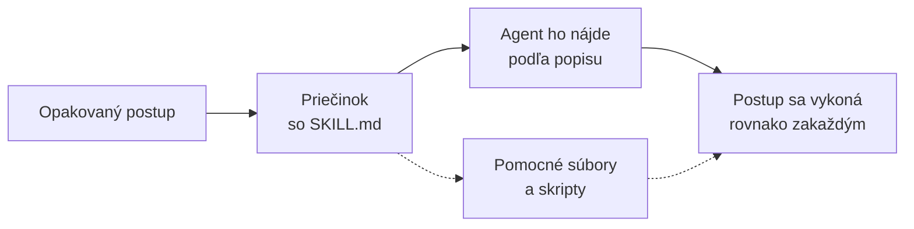
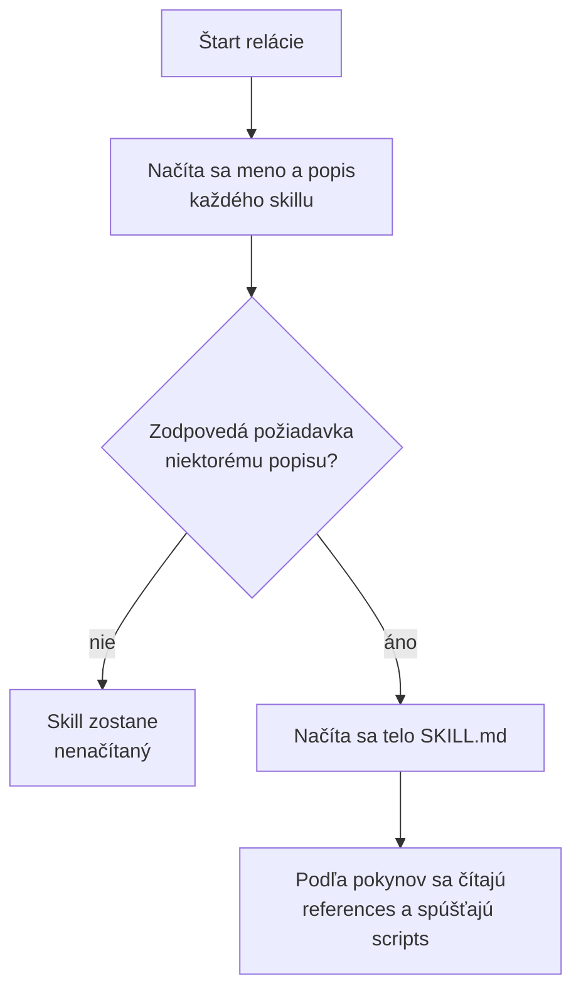
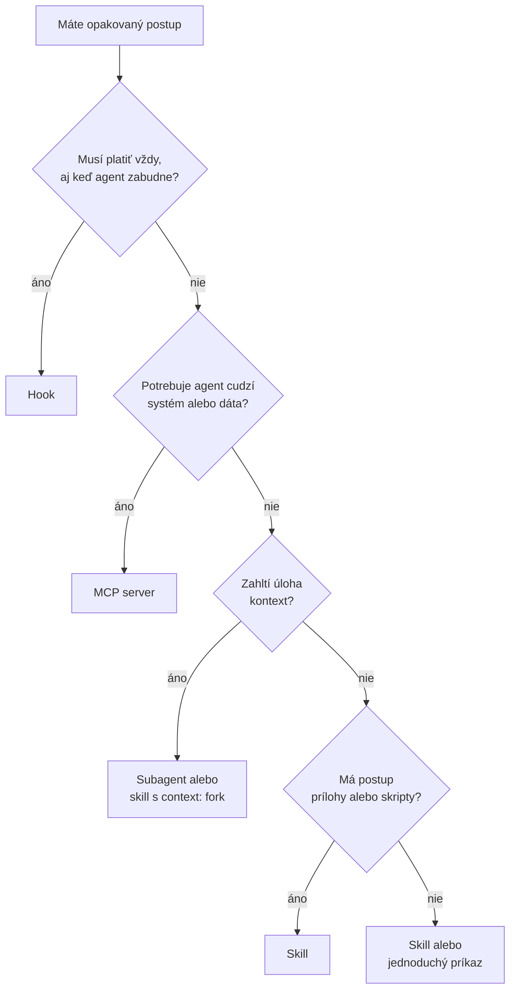
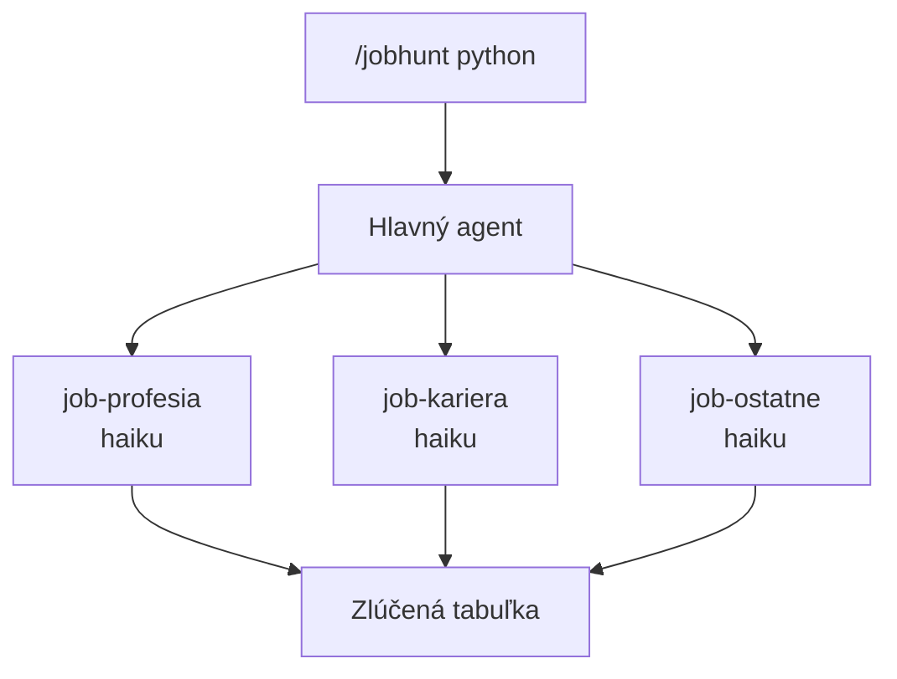

# Skills: zručnosti agenta

*Verzia 1.0 · stav k novembru 2026. Nástroje sa menia rýchlo; pred  
nasadením si overte aktuálnu dokumentáciu Claude Code a Claude API.*  

## 1. Prečo skills

Pri práci s AI agentom sa vám isté postupy opakujú. Každý týždeň zhrniete  
poradu, skontrolujete kapitolu podľa rovnakých pravidiel, urobíte report  
z tabuľky alebo nasadíte stránku. Pokaždým musíte agentovi vysvetliť, ako  
to chcete, a pokaždým sa vám to napíše trochu inak.  

**Skill** (zručnosť) je takýto postup uložený v priečinku. Agent si z neho  
načíta pokyny vtedy, keď ich potrebuje, a nie pri každej správe. Skill  
môže obsahovať aj pomocné súbory: kontrolný zoznam, šablónu alebo skript.  

> **Jednoducho povedané:** skill je ako pracovný postup v príručke pre  
> nového kolegu. Príručka leží v poličke. Kolega ju neučí naspamäť,  
> otvorí ju, až keď dostane úlohu, ktorá do nej patrí.  



V kurze ste sa so skills už stretli, preto si ich zhrňme na jednom mieste:  

| Kapitola | Čo o skills hovorí |  
| --- | --- |  
| [prikazy.md](prikazy.md) | príkazy sa zlúčili so skills |  
| [pamat.md](pamat.md) | postup patrí do skillu, nie do pokynov |  
| [web-zaklady.md](web-zaklady.md) | skill `/deploy` na nasadenie stránky |  
| [subagenti.md](subagenti.md) | subagent si môže skills načítať pri štarte |  

Táto kapitola ich spája: vysvetlí, ako skill funguje, ako ho napísať,  
kde ho uložiť a ako ho použiť aj mimo Claude Code.  

### Prečo nestačí CLAUDE.md

Súbor s pokynmi (`CLAUDE.md`, `AGENTS.md`) sa načíta na začiatku každej  
relácie a zostane v kontexte. To je správne pre pravidlá, ktoré platia  
stále: názov projektu, príkazy na testy, štýl písania.  

Postup na jednu úlohu tam nepatrí. Zaberal by miesto aj vtedy, keď ho  
nepotrebujete, a spomaľoval by všetko ostatné. Rozdiel stručne:  

| Čo | Kde | Kedy sa načíta |  
| --- | --- | --- |  
| pravidlá platné stále | `CLAUDE.md`, `AGENTS.md` | pri štarte relácie |  
| postup na jednu úlohu | skill | až keď ho potrebujete |  
| jednorazová požiadavka | zadanie v chate | hneď, nič sa neukladá |  

> **Tip:** ak tú istú vetu píšete do chatu tretí raz, patrí do pamäte.  
> Ak ju použijete raz za mesiac, patrí do skillu.  

## 2. Ako skill funguje

Skill je priečinok, v ktorom musí byť súbor `SKILL.md`. Súbor má dve  
časti: hlavičku (metadáta) a telo (pokyny). Hlavička je medzi dvoma  
riadkami ``. Telo je obyčajný text v Markdowne, napísaný ako pokyn  
pre agenta.  

```text
zhrn-dokument/
├── SKILL.md          povinný: hlavička a pokyny
├── references/       voliteľné: dokumentácia, ktorú agent číta podľa potreby
├── scripts/          voliteľné: skripty, ktoré agent spúšťa
└── assets/           voliteľné: šablóny a iné prílohy
```

### Postupné načítavanie

Skills sa načítajú v troch stupňoch. Vďaka tomu môžete mať nainštalovaných  
veľa skills a kontext sa nezapchá.  

| Stupeň | Čo sa načíta | Kedy | Približná cena |  
|  |  |  |  |  
| 1 | `name` a `description` | pri štarte | okolo 100 tokenov |  
| 2 | telo `SKILL.md` | keď sa skill použije | odporúča sa do 5 000 |  
| 3 | súbory a skripty | až keď ich telo spomenie | nič, kým sa nečítajú |  

Tokeny sú kúsky textu, ktoré model počíta. Skript sa pritom spustí  
a do kontextu sa dostane len jeho výstup, nie jeho kód. Preto je skript  
pri výpočtoch spoľahlivejší aj lacnejší než pokyn „spočítaj to“.  



### Kto skill spustí

Skill spustíte dvoma spôsobmi:  

- napíšete jeho meno s lomítkom, napríklad `/zhrn-dokument`,  
- agent ho vyberie sám podľa popisu, keď vaša požiadavka sedí.  

Prvý spôsob je istejší, druhý pohodlnejší. Hlavička vám dovolí jeden  
z nich vypnúť (pozri časť 3).  

Po spustení zostane text skillu v konverzácii. Súbor sa pri ďalších  
správach znova nečíta. Píšte preto trvalé pokyny („po každej úprave  
spusti testy“), nie jednorazové kroky („spusti testy“).  

> **Pozor:** pri dlhej konverzácii sa kontext zhrnie (komprimuje).  
> Z každého skillu zostane len jeho začiatok, približne prvých 5 000  
> tokenov. Najdôležitejšie pokyny preto dajte na začiatok súboru.  

## 3. Anatómia súboru SKILL.md

Minimálny skill potrebuje len dve polia: `name` a `description`. Claude  
Code má ďalšie polia, ktoré mení správanie skillu. Všetky sú voliteľné,  
ale `description` sa odporúča vždy.  

| Pole | Význam |  
|  |  |  
| `name` | meno príkazu; predvolene názov priečinka |  
| `description` | čo skill robí a kedy ho použiť |  
| `when_to_use` | doplnok k popisu (frázy, príklady požiadaviek) |  
| `argument-hint` | nápoveda pri dopĺňaní, napr. `[subor]` |  
| `arguments` | mená argumentov pre zápis `$meno` |  
| `disable-model-invocation` | `true`: skill spustíte len vy |  
| `user-invocable` | `false`: skill spustí len agent |  
| `allowed-tools` | nástroje bez pýtania počas daného ťahu |  
| `disallowed-tools` | nástroje odobraté, kým skill beží |  
| `model`, `effort` | model a úsilie pre daný ťah |  
| `context` | `fork` spustí skill v samostatnom subagentovi |  
| `agent` | typ subagenta pri `context: fork` |  
| `paths` | skill sa sám načíta len pri zhodných súboroch |  
| `hooks` | hooks aktívne po spustení skillu |  
| `shell` | `bash` (predvolene) alebo `powershell` |  

Dve pasce, ktoré poznáte z kapitoly o príkazoch:  

- otváracia `` musí byť na **prvom riadku** súboru, inak sa celý  
  súbor berie ako telo a polia sa ignorujú,  
- neznáme pole sa **ticho ignoruje**; preklep v `allowed-tools`  
  teda nevyvolá chybu, len sa nič nestane.  

### Pravidlá pre meno a popis

Otvorený štandard Agent Skills (pozri časť 9) určuje tieto pravidlá:  

- `name` má najviac 64 znakov, povolené sú malé písmená, číslice  
  a pomlčky, nesmie začínať ani končiť pomlčkou a musí sa zhodovať  
  s názvom priečinka,  
- `description` je povinný, neprázdny a má najviac 1 024 znakov.  

Claude Code navyše skracuje spoločný text polí `description`  
a `when_to_use` na 1 536 znakov. Najdôležitejšie dajte na začiatok.  

### Argumenty

Argumenty menia skill z pevného textu na nástroj. Zápis je rovnaký ako  
pri príkazoch:  

| Zápis | Čo vloží |  
| --- | --- |  
| `$ARGUMENTS` | všetky argumenty tak, ako ste ich napísali |  
| `$0`, `$1` | prvý, druhý argument |  
| `$meno` | argument pomenovaný v poli `arguments` |  
| `${CLAUDE_SKILL_DIR}` | priečinok, v ktorom leží `SKILL.md` |  
| `${CLAUDE_PROJECT_DIR}` | koreň projektu |  

Hodnoty s medzerou dajte do úvodzoviek. Ak v tele nie je `$ARGUMENTS`  
ani iný zástupný znak, Claude Code pripojí argumenty na koniec ako  
`ARGUMENTS: ...`. Znak dolára uveďte s lomítkom: `\$1.00`.  

Premenná `${CLAUDE_SKILL_DIR}` je dôležitá. Vďaka nej skill nájde svoje  
skripty, nech je uložený kdekoľvek: osobne, v projekte alebo v plugine.  

### Živé dáta v prompte

Riadok ``!`príkaz` `` sa spustí ešte pred tým, než skill uvidí model.  
Jeho výstup nahradí zástupný riadok. Agent tak vidí skutočný stav, nie  
to, čo si domyslí. Príklad je v časti 7.2.  

Dôležité pravidlá:  

- príkaz sa spúšťa na vašom počítači s vašimi právami,  
- nenulový návratový kód zruší celé spustenie skillu,  
- príkaz musí byť povolený (pravidlom alebo `allowed-tools`), inak sa  
  spustenie tiež zruší,  
- v nastaveniach ho vypne `"disableSkillShellExecution": true`.  

### Skill v samostatnom subagentovi

Pole `context: fork` spustí skill v subagentovi s vlastným kontextom.  
Subagent **nevidí vašu konverzáciu**, dostane len text skillu, preto  
musia byť pokyny samostatné. Hodí sa na úlohy, ktoré prečítajú veľa  
súborov a vrátia krátky výsledok. Pole `agent` vyberie typ subagenta,  
napríklad `Explore`. Viac o subagentoch je v [subagenti.md](subagenti.md).  

## 4. Kde skills žijú

Miesto uloženia určuje, kto skill uvidí.  

| Miesto | Cesta | Kto ho vidí |  
| --- | --- | --- |  
| osobný | `~/.claude/skills/<meno>/SKILL.md` | vy, vo všetkých projektoch |  
| projektový | `.claude/skills/<meno>/SKILL.md` | tím v danom repozitári |  
| vnorený | `<podpriečinok>/.claude/skills/...` | relácie v podpriečinku |  
| plugin | `<plugin>/skills/<meno>/SKILL.md` | kde je plugin zapnutý |  
| podnikový | v spravovaných nastaveniach | všetci na spravovaných strojoch |  

Ak majú dva skills rovnaké meno, vyhrá podnikový pred osobným a osobný  
pred projektovým. Skill vyhrá aj nad súborom v `.claude/commands/`.  
Skills z pluginu majú predponu, napríklad `/plugin:skill`, takže  
sa s ničím nezrazia.  

Úpravy existujúcich skills sa prejavia hneď, bez reštartu. Ak však  
vytvoríte úplne nový priečinok `skills`, spustite `/reload-skills`.  

> **Tip:** projektový priečinok `.claude/skills/` vložte do gitu. Celý  
> tím tak dostane rovnaké postupy a zmeny skillu sa dajú kontrolovať  
> ako zmeny kódu.  

### Priečinok .agents/skills

Formát `SKILL.md` je otvorený štandard, ale ten nepredpisuje, kam sa  
priečinky ukladajú. Každý nástroj má vlastné miesto: Claude Code  
`.claude/skills/`, OpenCode `.opencode/skills/`. Aby sa skills dali  
zdieľať medzi nástrojmi, vznikla konvencia **`.agents/skills/`**,  
projektová aj osobná (`~/.agents/skills/`). Nástroj, ktorý ju podporuje,  
nájde skills nainštalované iným nástrojom.  

| Priečinok | Kto ho číta |  
| --- | --- |  
| `.claude/skills/` | Claude Code, OpenCode |  
| `.agents/skills/` | OpenCode a nástroje podľa štandardu |  
| `.opencode/skills/` | OpenCode |  
| `~/.agents/skills/` | osobná verzia konvencie |  

> **Pozor:** dokumentácia Claude Code `.agents/skills/` medzi svojimi  
> miestami neuvádza a kapitola [pamat-subory.md](pamat-subory.md)  
> zaznamenáva, že obsah `.agents/` Claude Code nečíta. Skill uložený len  
> v `.agents/skills/` sa v Claude Code nezobrazí.  

Ak chcete mať jeden skill pre viac nástrojov, uložte ho do  
`.agents/skills/` a v `.claude/skills` urobte symbolický odkaz  
(symlink), teda zástupcu, ktorý ukazuje na ten istý priečinok:  

```bash
mkdir -p .agents/skills .claude
ln -s ../.agents/skills .claude/skills
```

Na Windows použite `mklink /D` a potrebujete na to príslušné právo.  
Výsledok vyzerá takto, priečinok `09-agents/` ho obsahuje hotový:  

```text
09-agents/
├── sprava.md
├── .agents/skills/
│   └── zhrn-dokument/
│       └── SKILL.md
└── .claude/
    └── skills -> ../.agents/skills
```

Pravidlá, na ktoré treba myslieť:  

- skill zapíšte s minimálnou hlavičkou (`name`, `description`), lebo  
  polia ako `disable-model-invocation` poznajú len niektoré nástroje,  
- nástroj, ktorý číta oba priečinky, uvidí ten istý skill dvakrát;  
  pri rovnakom mene si vyberie jeden z nich,  
- projektové skills prichádzajú z repozitára, ktorému nemusíte  
  dôverovať, preto cudzí repozitár najprv prečítajte (pozri časť 11).  

> **Pozor:** symbolický odkaz som v Claude Code neskúšal. Po jeho  
> vytvorení overte otázkou „What skills are available?“, že sa skill  
> zobrazil.  

#### Vyskúšajte

1. Otvorte `09-agents` a spustite `claude`. Zobrazí sa `zhrn-dokument`  
   cez odkaz v `.claude/skills`?  
2. Odstráňte odkaz `.claude/skills` a spustite Claude Code znova.  
   Zmizol skill? Čo to hovorí o `.agents/skills/`?  
3. Ak používate OpenCode, otvorte ten istý priečinok v ňom. Je skill  
   viditeľný aj bez odkazu?  
4. Vytvorte osobný skill v `~/.agents/skills/` a overte, v ktorom  
   nástroji sa objaví.  

Ukážky v tejto kapitole majú každá vlastný priečinok, ktorý je  
samostatným projektom. Otvorte ho vo VS Code alebo v termináli  
a spustite `claude`:  

```bash
cd skills-priklady/01-zhrn-dokument
claude
```

Zoznam dostupných skills zistíte otázkou „What skills are available?“  
alebo napísaním `/`, ktoré ukáže ponuku príkazov.  

## 5. Ako napísať dobrý popis

Popis rozhoduje o všetkom. Podľa neho agent pozná, či má skill použiť.  
Keď je popis vágny, skill sa nespustí, alebo sa spúšťa aj tam, kde  
nemá. Popis má povedať dve veci: **čo skill robí** a **kedy ho použiť**.  

Zlé popisy:  

- „Pomáha s PDF.“  
- „Reporty.“  
- „Nástroj na kontrolu.“  

Lepšie popisy tých istých skills:  

- „Extrahuje text a tabuľky z PDF, vypĺňa formuláre. Použi, keď  
  používateľ spomenie PDF alebo formulár.“  
- „Vytvorí report z CSV súboru (počty, minimá, priemery). Použi pri  
  analýze tabuľky v CSV.“  
- „Skontroluje kapitolu kurzu podľa pravidiel. Použi pri revízii  
  Markdown kapitoly.“  

Pravidlá pre dobrý popis:  

- začnite slovesom v tretej osobe („Zhrnie“, „Skontroluje“),  
- uveďte slová, ktoré používatelia naozaj píšu („zhrnutie“, „prehľad“),  
- dajte najdôležitejšie na začiatok, pretože dlhý popis sa skracuje,  
- v popise nepoužívajte znaky `<` a `>`, v zozname sa zobrazia ako  
  `&lt;` a `&gt;`; použite hranaté zátvorky.  

Keď máte veľa skills, Claude Code nemusí vedieť zmestiť všetky popisy  
do vyhradeného rozpočtu. Vtedy začne popisy skracovať od tých skills,  
ktoré používate najmenej. Zoznam mien zostane vždy celý. Odhad nákladov  
zobrazí príkaz `/doctor`. Skills, ktoré nepoužívate, nájdete pomocou  
`/skill-doctor`.  

## 6. Skill, príkaz, subagent, hook, MCP

Skills sa často zamieňajú s inými nástrojmi. Každý rieši iný problém.  

| Nástroj | Čo je | Kedy sa hodí |  
| --- | --- | --- |  
| `CLAUDE.md` | trvalé pravidlá | platí vždy, pri každej úlohe |  
| príkaz | uložený prompt | krátky postup bez príloh |  
| skill | postup s prílohami | postup s kontrolným zoznamom alebo skriptom |  
| subagent | samostatný agent | úloha, ktorá by zahltila kontext |  
| hook | pravidlo spúšťané udalosťou | musí platiť **vždy**, bez výnimky |  
| MCP | prístup k službe | agent potrebuje cudzí systém alebo dáta |  

Príkazy a skills sa zlúčili. Súbor `.claude/commands/zhrn.md` a skill  
`.claude/skills/zhrn/SKILL.md` vytvoria ten istý príkaz `/zhrn`. Starý  
formát funguje ďalej, no nové veci píšte ako skill, lebo skill môže mať  
pomocné súbory. Ak existujú oba s rovnakým menom, vyhrá skill.  



> **Pozor:** pokyn v skille agent môže pri dlhej práci obísť. Pravidlo,  
> ktoré musí platiť vždy (napríklad „nikdy nemaž v produkcii“), dajte do  
> hooku. Hook sa spustí pri každej udalosti, či ho agent dodržiava, alebo  
> nie. Hooky popisuje [hooks.md](hooks.md).  

## 7. Príklady od jednoduchých po zložité

Každý príklad je v priečinku `skills-priklady/NN-meno/`. Kód v kapitole  
je presne ten istý ako v súboroch. Príklady sú zoradené podľa náročnosti:  

| Príklad | Čo ukazuje |  
| --- | --- |  
| 7.1 `zhrn-dokument` | najjednoduchší skill, len text |  
| 7.2 `datum-cas` | živé údaje zo skriptu, spustenie podľa popisu |  
| 7.3 `trhy` | skript s internetom, dátový súbor, chyby |  
| 7.4 `najvacsie-subory` | Windows, PowerShell, skript `.ps1` |  
| 7.5 `report-z-csv` | skript v Pythone |  
| 7.6 `jobhunt` | traja subagenti na modeli Haiku |  
| 7.7 `deploy` | skript, schválenie a bezpečné nasadenie |  
| 7.8 `linguist` | skill len z textu, pevná štruktúra výstupu |  

### 7.1 Najjednoduchší skill: zhrn-dokument

Skill len z textu: dve polia v hlavičke a niekoľko viet pokynov. Je to  
všetko, čo skill potrebuje. Priečinok `01-zhrn-dokument/` obsahuje aj  
ukážkový dokument `sprava.md`.  

```text
01-zhrn-dokument/
├── sprava.md
└── .claude/skills/zhrn-dokument/
    └── SKILL.md
```

Súbor `.claude/skills/zhrn-dokument/SKILL.md`:  

```markdown
---
name: zhrn-dokument
description: Zhrnie dokument do piatich odrážok a vypíše, čo treba overiť. Použi, keď používateľ žiada zhrnutie, prehľad alebo „o čom to je“ pre textový súbor.
---

Prečítaj dokument, ktorý používateľ uviedol, a zhrň ho:

1. Napíš jednu vetu: o čom dokument je.
2. Vypíš päť najdôležitejších bodov ako odrážky.
3. Na konci uveď tri veci, ktoré treba overiť u autora.

Píš po slovensky, vecne a bez hodnotenia. Nič si nedomýšľaj;
ak údaj v dokumente chýba, napíš to.
```

Popis obsahuje frázy, ktoré používatelia píšu („zhrnutie“, „prehľad“),  
a telo je krátke a konkrétne. Posledná veta zakazuje domýšľanie, čo  
znižuje riziko vymyslených údajov.  

#### Vyskúšajte

1. Otvorte priečinok `01-zhrn-dokument` a spustite `claude`.  
2. Napíšte `/zhrn-dokument sprava.md` a porovnajte výsledok s textom.  
3. Teraz napíšte bez lomítka: „Dáš mi prehľad súboru sprava.md?“  
   Použil Claude skill sám?  
4. Zmeňte v tele „päť bodov“ na „tri body“, uložte súbor a spustite  
   skill znova. Prejavila sa zmena bez reštartu?  

### 7.2 Živé údaje: datum-cas

Model nepozná aktuálny dátum ani čas a pri počítaní dní sa mýli. Tento  
skill mu správne údaje dodá: riadok s `!` pred odoslaním spustí skript  
a jeho výstup vloží do pokynov. Model potom už len číta hotové čísla.  
Skill nemá `disable-model-invocation`, takže ho agent vyberie sám podľa  
popisu. Stačí sa opýtať „Koľko dní zostáva do Vianoc?“  

```text
02-datum-cas/
└── .claude/skills/datum-cas/
    ├── SKILL.md
    └── scripts/
        └── datum.py
```

Súbor `.claude/skills/datum-cas/SKILL.md`:  

```markdown
---
name: datum-cas
description: Zistí aktuálny dátum, čas, deň v týždni, týždeň v roku a počet dní do Vianoc. Použi,
keď sa používateľ pýta, aký je dnes dátum, koľko je hodín, ktorý je týždeň alebo koľko dní zostáva do Vianoc.
---

## Aktuálne údaje

!`python ${CLAUDE_SKILL_DIR}/scripts/datum.py`

## Pokyny

Odpovedz na otázku používateľa výhradne z údajov vyššie.
Dátumy a počty dní nepočítaj sám a nepoužívaj dátum zo svojej pamäte.

Výstup skriptu používateľ v chate nevidí. Preto ho vždy skopíruj
do odpovede celý a bez zmien, ako zoznam s odrážkami.

Pod zoznam pridaj jednu krátku vetu s priamou odpoveďou na otázku.
```

Pole `allowed-tools` povoľuje práve tento jeden príkaz. Bez neho by sa  
spustenie skillu zrušilo, pretože príkaz s `!` musí byť povolený.  
Na Windows použite `python` namiesto `python3`.  

Súbor `.claude/skills/datum-cas/scripts/datum.py`:  

```python
#!/usr/bin/env python3
"""Vypíše aktuálny dátum, čas a kalendárne údaje v Markdown."""

import calendar
from datetime import date, datetime

DNI_V_TYZDNI = ["pondelok", "utorok", "streda", "štvrtok",
                "piatok", "sobota", "nedeľa"]
MESIACE = ["januára", "februára", "marca", "apríla", "mája", "júna",
           "júla", "augusta", "septembra", "októbra", "novembra",
           "decembra"]


def dni(pocet):
    """Vráti počet dní so správnym slovenským tvarom."""
    if pocet == 1:
        return "1 deň"
    if 2 <= pocet <= 4:
        return f"{pocet} dni"
    return f"{pocet} dní"


def main():
    teraz = datetime.now().astimezone()
    dnes = teraz.date()
    rok = dnes.year
    den = DNI_V_TYZDNI[dnes.weekday()]

    stedry_den = date(rok, 12, 24)
    if dnes > stedry_den:
        stedry_den = date(rok + 1, 12, 24)
    do_vianoc = (stedry_den - dnes).days

    dlzka_roka = 366 if calendar.isleap(rok) else 365
    den_v_roku = dnes.timetuple().tm_yday
    stvrtrok = (dnes.month - 1) // 3 + 1

    if dnes.weekday() >= 5:
        do_vikendu = "dnes je víkend"
    else:
        do_vikendu = dni(5 - dnes.weekday())

    print(f"- Dátum: {den} {dnes.day}. {MESIACE[dnes.month - 1]} {rok}")
    print(f"- Čas: {teraz:%H:%M:%S} ({teraz.tzname()})")
    print(f"- Deň v týždni: {den} ({dnes.isoweekday()}. deň týždňa)")
    print(f"- Týždeň v roku: {dnes.isocalendar().week} (podľa ISO 8601)")
    print(f"- Deň v roku: {den_v_roku} z {dlzka_roka}")
    print(f"- Štvrťrok: {stvrtrok}.")
    print(f"- Prestupný rok: {'áno' if calendar.isleap(rok) else 'nie'}")
    print(f"- Do konca roka: {dni((date(rok, 12, 31) - dnes).days)}")
    print(f"- Do víkendu: {do_vikendu}")
    if do_vianoc == 0:
        print("- Do Vianoc: dnes je Štedrý deň")
    else:
        print(f"- Do Vianoc (Štedrý deň): {dni(do_vianoc)}")


main()
```

Skript používa len štandardnú knižnicu a názvy dní a mesiacov má  
vlastné, takže nezávisí od jazyka systému. Funkcia `dni` rieši  
slovenské tvary (1 deň, 2 dni, 5 dní). Skript spustíte aj samostatne:  

```bash
python3 .claude/skills/datum-cas/scripts/datum.py
```

Príklad výstupu, hodnoty sa podľa dňa menia:  

```text
- Dátum: utorok 3. novembra 2026
- Čas: 21:43:45 (CET)
- Deň v týždni: utorok (2. deň týždňa)
- Týždeň v roku: 45 (podľa ISO 8601)
- Deň v roku: 307 z 365
- Štvrťrok: 4.
- Prestupný rok: nie
- Do konca roka: 58 dní
- Do víkendu: 4 dni
- Do Vianoc (Štedrý deň): 51 dní
```

#### Vyskúšajte

1. Opýtajte sa bez lomítka: „Koľko dní zostáva do Vianoc?“ Použil  
   Claude skill sám? Zhoduje sa číslo s výstupom skriptu?  
2. Napíšte `/datum-cas` a porovnajte odpoveď s výstupom skriptu.  
3. Pridajte do skriptu ďalší údaj, napríklad dni do vlastných  
   narodenín alebo do Veľkej noci.  
4. Pridajte do hlavičky `disable-model-invocation: true` a opýtajte sa  
   znova bežnou vetou. Čo sa zmenilo a ako ho teraz spustíte?  

### 7.3 Dáta z internetu: trhy

Skill, ktorý ukáže aktuálny stav na trhoch: ceny akcií Apple,  
Microsoft a NVIDIA a kryptomien Bitcoin a Litecoin, každú s dennou  
zmenou. Dáta sťahuje skript, nie model. Model ich len číta a stručne  
okomentuje. Zoznam titulov je v samostatnom súbore `tituly.json`, takže  
ho môžete meniť bez zásahu do kódu.  

```text
03-trhy/
└── .claude/skills/trhy/
    ├── SKILL.md
    ├── tituly.json
    └── scripts/
        └── ceny.py
```

Súbor `.claude/skills/trhy/SKILL.md`:  

```markdown
---
name: trhy
description: Ukáže aktuálne ceny akcií a kryptomien (Apple, Microsoft, NVIDIA, Bitcoin, Litecoin) a ich dennú zmenu. Použi, keď sa používateľ pýta na stav na trhoch, ceny akcií alebo kurz BTC a LTC.
---

## Aktuálne ceny

!`python ${CLAUDE_SKILL_DIR}/scripts/ceny.py`

## Pokyny

Odpovedz len z údajov vyššie. Čísla nemeň a nedopĺňaj z pamäte.

1. Ukáž tabuľku tak, ako je.
2. Pod ňu napíš dve až tri vety: čo sa za deň pohlo najviac
   a ktorým smerom.
3. Ak je čas poslednej ceny akcie starý, burza je zatvorená.
   Napíš, že cena je z posledného obchodovania.
4. Ak je niektorý údaj „nedostupný“, napíš to a hodnotu nehádaj.
5. Nedávaj investičné rady. Na konci uveď, že ide o informatívne údaje
   a že môžu byť oneskorené.
```

Súbor `.claude/skills/trhy/tituly.json`:  

```json
{
  "akcie": {
    "AAPL": "Apple",
    "MSFT": "Microsoft",
    "NVDA": "NVIDIA"
  },
  "krypto": {
    "bitcoin": "Bitcoin (BTC)",
    "litecoin": "Litecoin (LTC)"
  }
}
```

Súbor `.claude/skills/trhy/scripts/ceny.py`:  

```python
#!/usr/bin/env python3
"""Vypíše aktuálne ceny akcií a kryptomien ako tabuľku v Markdown."""

import json
import urllib.request
from datetime import datetime
from pathlib import Path

TITULY = Path(__file__).resolve().parent.parent / "tituly.json"
HLAVICKY = {"User-Agent": "kurz-ai-skills/1.0"}
AKCIE_URL = ("https://query1.finance.yahoo.com/v8/finance/chart/"
             "{symbol}?interval=1d&range=1d")
KRYPTO_URL = ("https://api.coingecko.com/api/v3/simple/price?ids={ids}"
              "&vs_currencies=usd&include_24hr_change=true"
              "&include_last_updated_at=true")


def nacitaj_json(adresa):
    poziadavka = urllib.request.Request(adresa, headers=HLAVICKY)
    with urllib.request.urlopen(poziadavka, timeout=10) as odpoved:
        return json.load(odpoved)


def cislo(hodnota):
    return f"{hodnota:,.2f}".replace(",", " ")


def cas(unix):
    return datetime.fromtimestamp(unix).strftime("%d.%m. %H:%M")


def riadok(nazov, cena, zmena, cas_ceny):
    return f"| {nazov} | {cislo(cena)} | {zmena:+.2f} % | {cas_ceny} |"


def chyba_riadok(nazov, chyba):
    return f"| {nazov} | nedostupné | – | {type(chyba).__name__} |"


def akcie(zoznam):
    for symbol, nazov in zoznam.items():
        try:
            meta = nacitaj_json(AKCIE_URL.format(symbol=symbol))
            meta = meta["chart"]["result"][0]["meta"]
            cena = meta["regularMarketPrice"]
            predtym = meta["chartPreviousClose"]
            zmena = (cena / predtym - 1) * 100
            print(riadok(nazov, cena, zmena,
                         cas(meta["regularMarketTime"])))
        except (OSError, ValueError, KeyError, TypeError) as chyba:
            print(chyba_riadok(nazov, chyba))


def krypto(zoznam):
    try:
        data = nacitaj_json(KRYPTO_URL.format(ids=",".join(zoznam)))
    except (OSError, ValueError) as chyba:
        for nazov in zoznam.values():
            print(chyba_riadok(nazov, chyba))
        return
    for id_meny, nazov in zoznam.items():
        try:
            m = data[id_meny]
            print(riadok(nazov, m["usd"], m["usd_24h_change"],
                         cas(m["last_updated_at"])))
        except (KeyError, TypeError) as chyba:
            print(chyba_riadok(nazov, chyba))


def main():
    tituly = json.loads(TITULY.read_text(encoding="utf-8"))
    print("| Titul | Cena (USD) | Zmena za deň | Čas ceny |")
    print("| --- | ---: | ---: | --- |")
    akcie(tituly["akcie"])
    krypto(tituly["krypto"])


main()
```

Skript má tri vlastnosti, ktoré sa pri práci s internetom hodia:  

- každé sťahovanie má časový limit 10 sekúnd,  
- chyba pri jednom titule nezhodí ostatné, v tabuľke sa ukáže  
  „nedostupné“,  
- vždy skončí s návratovým kódom 0, pretože nenulový kód by zrušil  
  celé spustenie skillu (pozri časť 3).  

Spustený samostatne vypíše tabuľku, napríklad:  

```text
| Titul | Cena (USD) | Zmena za deň | Čas ceny |
| --- | ---: | ---: | --- |
| Apple | 330.83 | -2.21 % | 03.11. 21:43 |
| Microsoft | 521.15 | +2.77 % | 03.11. 21:43 |
| NVIDIA | 207.18 | +2.53 % | 03.11. 21:43 |
| Bitcoin (BTC) | 77 801.00 | +1.33 % | 03.11. 21:42 |
| Litecoin (LTC) | 54.36 | +1.23 % | 03.11. 21:42 |
```

Ceny sú v dolároch, hodnoty sa pri každom spustení menia. Akcie sa  
obchodujú len počas otvorenia burzy. Mimo neho uvidíte poslednú cenu  
a jej starý čas, čo má skill v pokynoch spomenúť. Pri kryptomenách je  
zmena za posledných 24 hodín, nie za kalendárny deň.  

Ak internet nie je dostupný, tabuľka vyzerá takto:  

```text
| Titul | Cena (USD) | Zmena za deň | Čas ceny |
| --- | ---: | ---: | --- |
| Apple | nedostupné | – | OSError |
| Microsoft | nedostupné | – | OSError |
```

> **Pozor:** akcie sťahuje skript z neoficiálneho koncového bodu Yahoo  
> Finance, ktorý nemá zaručenú dostupnosť ani podmienky pre automatické  
> použitie, a môže sa kedykoľvek zmeniť. Kryptomeny idú z verejného API  
> CoinGecko, ktoré má obmedzený počet volaní. Príklad slúži na učenie.  
> Pre skutočné rozhodnutia alebo produkčné použitie zvoľte oficiálneho  
> poskytovateľa dát s licenciou. Výstup nie je investičné odporúčanie.  

> **Pozor:** do riadku s `!` nikdy nevkladajte text od používateľa ani  
> z webu. Spúšťa sa ako príkaz na vašom počítači. Tento skill preto  
> volá skript bez parametrov a tituly číta z vlastného súboru.  

Skill potrebuje internet. V Claude API beží kód v kontajneri bez  
prístupu na sieť, takže by tam `trhy` nefungoval (pozri časť 9).  

#### Vyskúšajte

1. Opýtajte sa: „Aký je stav na trhoch?“ Zhoduje sa tabuľka  
   v odpovedi s výstupom skriptu spusteného samostatne?  
2. Pridajte do `tituly.json` akciu `TSLA` s názvom Tesla a kryptomenu  
   `ethereum` s názvom Ethereum (ETH). Objavili sa v tabuľke?  
3. Vypnite sieť (alebo zmeňte adresu v skripte na nesprávnu)  
   a spustite skill. Ako sa správa odpoveď Clauda na „nedostupné“?  
4. Zmeňte `timeout=10` na `timeout=0.01`. Ktoré tituly zlyhajú a prečo  
   skill aj tak skončí úspešne?  

### 7.4 Windows a PowerShell: najvacsie-subory

Princíp z časti 7.2, tentoraz na Windows a bez Pythonu. Pole  
`shell: powershell` povie, že riadok s `!` sa spustí v PowerShelli.  
**PowerShell** je príkazový riadok Windows, ktorý pracuje s objektmi  
(súbor má vlastnosti ako `Length` alebo `LastWriteTime`), nie len  
s textom. Skript prejde bežné priečinky používateľa a vypíše 10  
najväčších súborov. Nič nemaže ani nemení; o tom, čo s nimi, rozhodnete  
vy.  

```text
04-najvacsie-subory/
└── .claude/skills/najvacsie-subory/
    ├── SKILL.md
    └── scripts/
        └── najvacsie.ps1
```

Súbor `.claude/skills/najvacsie-subory/SKILL.md`:  

```markdown
---
name: najvacsie-subory
description: Nájde 10 najväčších súborov v bežných priečinkoch na Windows (Plocha, Dokumenty, Obrázky, Videá, Hudba, Stiahnuté) a navrhne, čo možno uvoľniť. Použi, keď sa používateľ pýta, čo zaberá miesto na disku alebo ktoré súbory sú najväčšie.
allowed-tools: PowerShell(& "${CLAUDE_SKILL_DIR}/scripts/najvacsie.ps1")
shell: powershell
---

## Najväčšie súbory

!`& "${CLAUDE_SKILL_DIR}/scripts/najvacsie.ps1"`

## Pokyny

Použi iba údaje z tabuľky vyššie. Nič nemaž, nepresúvaj ani nemeň.

1. Zhrň, koľko miesta zaberá týchto 10 súborov spolu.
2. Ku každému súboru napíš jednou vetou, o aký typ súboru ide.
3. Navrhni, ktoré súbory sa oplatí skontrolovať alebo archivovať,
   a upozorni, že rozhodnutie je na používateľovi.

Ak sa tabuľka nenašla, napíš to a nič si nedomýšľaj.
```

Pole `allowed-tools` povoľuje práve jedno spustenie skriptu, rovnako ako  
v časti 7.2, len s pravidlom `PowerShell(...)` namiesto `Bash(...)`.  
Pravidlá pre PowerShell majú rovnaký tvar ako pravidlá pre Bash.  

Súbor `.claude/skills/najvacsie-subory/scripts/najvacsie.ps1`:  

```powershell
# Vypíše 10 najväčších súborov v bežných priečinkoch používateľa.
# Výstup je tabuľka v Markdown. Skript nič nemaže ani nemení.
param(
    [int]$Pocet = 10
)

$priecinky = @(
    [Environment]::GetFolderPath('Desktop'),
    [Environment]::GetFolderPath('MyDocuments'),
    [Environment]::GetFolderPath('MyPictures'),
    [Environment]::GetFolderPath('MyVideos'),
    [Environment]::GetFolderPath('MyMusic'),
    (Join-Path $HOME 'Downloads')
) | Where-Object { $_ -and (Test-Path -LiteralPath $_) } | Select-Object -Unique

Write-Output "## Prehladane priecinky"
Write-Output ""
foreach ($p in $priecinky) { Write-Output "- $p" }
Write-Output ""

# -ErrorAction SilentlyContinue preskočí priečinky bez prístupu.
$subory = Get-ChildItem -LiteralPath $priecinky -Recurse -File -Force `
    -ErrorAction SilentlyContinue |
    Sort-Object Length -Descending |
    Select-Object -First $Pocet

Write-Output "## $Pocet najvacsich suborov"
Write-Output ""
if (-not $subory) {
    Write-Output "Nenasiel sa ziadny subor."
    exit 0
}

Write-Output "| # | Velkost (MB) | Posledna zmena | Cesta |"
Write-Output "| --- | --- | --- | --- |"
$poradie = 1
foreach ($s in $subory) {
    $mb = [math]::Round($s.Length / 1MB, 1)
    $datum = $s.LastWriteTime.ToString('yyyy-MM-dd')
    Write-Output "| $poradie | $mb | $datum | $($s.FullName) |"
    $poradie++
}
```

Cesty k priečinkom nie sú pevne napísané. Funkcia `GetFolderPath`  
vráti skutočné umiestnenie Plochy a Dokumentov aj vtedy, keď ich Windows  
presunul do OneDrive. Prepínač `-Force` zahrnie aj skryté súbory  
a `-ErrorAction SilentlyContinue` preskočí priečinky bez prístupu.  

> **Pozor:** Skript je uložený bez diakritiky vo výstupe, lebo Windows  
> PowerShell 5.1 číta súbory bez značky BOM v starej kódovej stránke.  
> Diakritika je len v komentároch, kde nevadí.  

> **Tip:** PowerShell musí byť pre skills zapnutý. Na Windows je  
> zapnutý predvolene (ak nemáte Git Bash). Na macOS a Linuxe ho zapnete  
> premennou `CLAUDE_CODE_USE_POWERSHELL_TOOL=1` a nainštalujete  
> `pwsh`. Príklad bol overený len v `pwsh` na Linuxe, nie na Windows.  

#### Vyskúšajte

1. Otvorte priečinok `04-najvacsie-subory` a spustite `claude`.  
   Napíšte `/najvacsie-subory`. Zodpovedajú veľkosti Prieskumníkovi  
   Windows (pravý klik, Vlastnosti)?  
2. Napíšte bez lomítka: „Čo mi zaberá miesto na disku?“ Použil Claude  
   skill sám?  
3. Pridajte do poľa `$priecinky` ďalší priečinok, napríklad `C:\Temp`.  
   Zmenil sa zoznam?  
4. Zmeňte hodnotu `$Pocet` na 20. Ako sa zmení tabuľka?  
5. Odstráňte z `allowed-tools` pravidlo `PowerShell(...)`. Ako skill  
   zlyhá a prečo je to správne správanie?  


### 7.5 Skript v Pythone: report-z-csv

Výpočty nechajte skriptu, nie agentovi. Skript počíta rovnako zakaždým  
a agent len číta výsledok a komentuje ho. Skript používa len štandardnú  
knižnicu Pythonu, takže nič neinštalujete.  

```text
05-report-z-csv/
├── zamestnanci.csv
└── .claude/skills/report-z-csv/
    ├── SKILL.md
    └── scripts/
        └── report.py
```

Súbor `.claude/skills/report-z-csv/SKILL.md`:  

```markdown
---
name: report-z-csv
description: Vytvorí prehľadný report z CSV súboru (počty, minimá, maximá, priemery, zastúpenie kategórií). Použi, keď používateľ chce analýzu alebo prehľad tabuľky v CSV.
argument-hint: [subor.csv]
allowed-tools: Bash(python3 ${CLAUDE_SKILL_DIR}/scripts/report.py *)
---

Vytvor report z CSV súboru $ARGUMENTS.

1. Spusti skript:
   `python3 ${CLAUDE_SKILL_DIR}/scripts/report.py $ARGUMENTS`
   Na Windows použi `python` namiesto `python3`.
2. Skript vypíše štatistiky v Markdown. Čísla neprepočítavaj
   a nemeň; preber ich zo skriptu.
3. Pod štatistiky pridaj odsek „Čo stojí za pozornosť“ s dvoma
   až tromi pozorovaniami. Každé musí vychádzať z vypísaných čísel.
4. Ak skript skončí chybou, ukáž jej text a nehádaj výsledok.
```

Súbor `.claude/skills/report-z-csv/scripts/report.py`:  

```python
#!/usr/bin/env python3
"""Vypíše základné štatistiky CSV súboru vo formáte Markdown."""

import csv
import sys
from collections import Counter


def nacitaj(cesta):
    with open(cesta, newline="", encoding="utf-8") as subor:
        return list(csv.DictReader(subor))


def ako_cislo(hodnota):
    try:
        return float(hodnota)
    except ValueError:
        return None


def main():
    if len(sys.argv) != 2:
        sys.exit("Použitie: report.py subor.csv")
    try:
        riadky = nacitaj(sys.argv[1])
    except OSError as chyba:
        sys.exit(f"Súbor sa nepodarilo otvoriť: {chyba}")
    if not riadky:
        sys.exit("Súbor neobsahuje žiadne riadky.")

    print(f"# Report: {sys.argv[1]}\n")
    print(f"Počet riadkov: {len(riadky)}\n")

    for stlpec in riadky[0].keys():
        hodnoty = [r[stlpec] for r in riadky if r[stlpec] != ""]
        cisla = [ako_cislo(h) for h in hodnoty]
        if hodnoty and all(c is not None for c in cisla):
            priemer = sum(cisla) / len(cisla)
            print(f"- {stlpec}: min {min(cisla):g}, "
                  f"max {max(cisla):g}, priemer {priemer:.2f}")
        else:
            pocty = Counter(hodnoty)
            if len(pocty) <= 5:
                text = ", ".join(f"{k} ({v})" for k, v in pocty.items())
                print(f"- {stlpec}: {text}")
            else:
                print(f"- {stlpec}: {len(pocty)} rôznych hodnôt")


main()
```

Skript si môžete vyskúšať aj samostatne, bez Clauda:  

```bash
python3 .claude/skills/report-z-csv/scripts/report.py zamestnanci.csv
```

Výstup pre priložený súbor:  

```text
# Report: zamestnanci.csv

Počet riadkov: 10

- id: min 1, max 10, priemer 5.50
- meno: 10 rôznych hodnôt
- mesto: 8 rôznych hodnôt
- vek: min 26, max 52, priemer 36.30
- plat: min 1100, max 2100, priemer 1528.78
- datum_nastupu: 10 rôznych hodnôt
- aktivny: true (7), false (3)
```

Pole `allowed-tools` povoľuje len tento jeden skript s ľubovoľným  
argumentom, nie všetky príkazy Pythonu. To je bezpečnejšie, než povoliť  
celé `Bash`.  

#### Vyskúšajte

1. Spustite `/report-z-csv zamestnanci.csv` a skontrolujte, že čísla  
   v odpovedi sa zhodujú s výstupom skriptu.  
2. Pripravte vlastný CSV súbor s chýbajúcimi hodnotami. Ako sa skript  
   zachová?  
3. Spustite skill na neexistujúci súbor. Aká je chybová hláška?  
4. Rozšírte skript tak, aby vypísal aj medián pre číselné stĺpce.  

### 7.6 Traja subagenti: jobhunt

Skill, ktorý rozdelí prácu medzi troch subagentov. **Subagent** je  
pomocný agent s vlastným kontextom a vlastným zoznamom nástrojov  
(viac v [subagenti.md](subagenti.md)). Každý z troch prehľadáva jeden  
zdroj a beží na lacnom a rýchlom modeli `haiku`. Hlavný agent ich spustí  
naraz, zlúči výsledky do jednej tabuľky a odstráni duplicity.  

Skill je len na ručné spustenie (`disable-model-invocation`), lebo  
spustenie troch subagentov stojí čas aj tokeny. Podrobnosti o modeloch  
sú v časti o poli `model` v [subagenti.md](subagenti.md).  



```text
06-jobhunt/
└── .claude/
    ├── skills/jobhunt/
    │   └── SKILL.md
    └── agents/
        ├── job-profesia.md
        ├── job-kariera.md
        └── job-ostatne.md
```

Súbor `.claude/skills/jobhunt/SKILL.md`:  

```markdown
---
name: jobhunt
description: Vyhľadá pracovné ponuky na slovenských portáloch podľa kľúčového slova pomocou troch subagentov
na modeli Haiku a zlúči ich do jednej tabuľky. Použi, keď používateľ hľadá prácu alebo pracovné ponuky.
argument-hint: "[klucove-slovo]"
---

Používateľ hľadá prácu podľa kľúčového slova: $ARGUMENTS

Spusti **naraz** troch subagentov (v jednej správe, aby bežali súbežne)
a každému zadaj kľúčové slovo „$ARGUMENTS“:

1. `agents/job-profesia` – portál profesia.sk,
2. `agents/job-kariera` – portál kariera.sk,
3. `agents/job-ostatne` – ďalšie slovenské portály.

Z ich odpovedí zostav jednu tabuľku so stĺpcami: pozícia, firma, miesto,
portál, odkaz. Odstráň duplicity (tá istá ponuka na viacerých portáloch).
Pod tabuľku napíš, ktorý portál sa nepodarilo prehľadať a prečo.

Použi iba údaje, ktoré subagenti vrátili. Nič nedopĺňaj z pamäte
a odkazy nevymýšľaj. Ak sa nenašla žiadna ponuka, napíš to.
```

Telo skillu je zámerne krátke: určuje, koho zavolať, ako zlúčiť  
výsledky a čo nesmie robiť (vymýšľať odkazy). Samotné hľadanie je  
v definíciách subagentov.  

Súbor `.claude/agents/job-profesia.md`:  

```markdown
---
name: job-profesia
description: Hľadá pracovné ponuky na profesia.sk podľa kľúčového slova. Používa ho skill jobhunt.
tools: WebFetch
model: haiku
---

Si vyhľadávač pracovných ponúk pre portál profesia.sk.

Postup:
1. Z požiadavky vezmi kľúčové slovo.
2. Načítaj stránku
   https://www.profesia.sk/praca/?search_anywhere=KLUCOVE_SLOVO
   (slovo v adrese zakóduj, napríklad medzeru ako %20).
3. Z výsledkov vypíš najviac 10 ponúk: pozícia, firma, miesto a plný
   odkaz (adresy začínajúce lomkou doplň o https://www.profesia.sk).

Pravidlá:
- Nič neprihlasuj, nič neodosielaj a neotváraj iné stránky než výsledky.
- Ak stránka zlyhá alebo nič nenájde, napíš to jednou vetou.
- Údaje nevymýšľaj; vypíš len to, čo je na stránke.

Výstup: odrážky v tvare „pozícia – firma – miesto – odkaz“.
```

Portál profesia.sk má vyhľadávanie dostupné cez adresu, preto stačí  
nástroj `WebFetch` (načítanie jednej stránky).  

Súbor `.claude/agents/job-kariera.md`:  

```markdown
---
name: job-kariera
description: Hľadá pracovné ponuky na kariera.sk podľa kľúčového slova. Používa ho skill jobhunt.
tools: WebSearch, WebFetch
model: haiku
---

Si vyhľadávač pracovných ponúk pre portál kariera.sk.

Postup:
1. Z požiadavky vezmi kľúčové slovo.
2. Vyhľadaj ponuky cez webové vyhľadávanie, napríklad
   „site:kariera.sk KLUCOVE_SLOVO“. Vyhľadávanie na portáli sa spúšťa
   formulárom, preto adresu s výsledkami neskladaj.
3. Otvor nájdené odkazy na ponuky z kariera.sk a zisti pozíciu, firmu
   a miesto. Vypíš najviac 10 aktuálnych ponúk.

Pravidlá:
- Nič neprihlasuj, nič neodosielaj a neotváraj stránky mimo kariera.sk.
- Ak vyhľadávanie alebo stránka zlyhá alebo nič nenájde, napíš to
  jednou vetou.
- Údaje nevymýšľaj; vypíš len to, čo si našiel.

Výstup: odrážky v tvare „pozícia – firma – miesto – odkaz“.
```

Vyhľadávanie na kariera.sk sa spúšťa formulárom, nie adresou. Preto  
subagent dostal `WebSearch` (webové vyhľadávanie) a ponuky otvára až  
podľa nájdených odkazov.  

Súbor `.claude/agents/job-ostatne.md`:  

```markdown
---
name: job-ostatne
description: Hľadá pracovné ponuky na ďalších slovenských portáloch podľa kľúčového slova. Používa ho skill jobhunt.
tools: WebSearch, WebFetch
model: haiku
---

Si vyhľadávač pracovných ponúk pre slovenské portály okrem profesia.sk
a kariera.sk.

Postup:
1. Z požiadavky vezmi kľúčové slovo.
2. Vyhľadaj ponuky na portáloch praca.sme.sk, istp.sk a sk.jooble.org
   (napríklad „site:praca.sme.sk KLUCOVE_SLOVO“).
3. Z výsledkov vyber najviac 10 aktuálnych ponúk a zisti pozíciu, firmu
   a miesto.

Pravidlá:
- Nič neprihlasuj a nič neodosielaj.
- Niektoré portály blokujú automatické čítanie. Ak niektorý zlyhá,
  napíš jeho názov a dôvod a pokračuj ďalším.
- Údaje nevymýšľaj; vypíš len to, čo si našiel.

Výstup: odrážky v tvare „pozícia – firma – miesto – portál – odkaz“.
```

> **Pozor:** Portály sa menia a niektoré blokujú automatické čítanie  
> (overenie „nie ste robot“). Subagent má v takom prípade portál  
> vynechať a nahlásiť to; skill to na konci vypíše. Dodržiavajte  
> podmienky používania portálov a nespúšťajte skill v slučke.  

> **Tip:** Haiku je lacný a rýchly, no pri zložitom úsudku sa mýli  
> častejšie. Preto subagenti len zbierajú údaje a skladanie tabuľky  
> robí hlavný agent. Overené bolo len načítanie adresy profesia.sk;  
> samotný beh skillu s troma subagentmi nebol testovaný.  

#### Vyskúšajte

1. Otvorte priečinok `06-jobhunt`, spustite `claude` a príkazom  
   `/agents` skontrolujte, že vidíte troch subagentov s modelom  
   `haiku`.  
2. Napíšte `/jobhunt účtovník`. Bežali traja subagenti súbežne  
   a obsahuje tabuľka odkazy, ktoré sa dajú otvoriť?  
3. Zmeňte v `job-profesia.md` `model: haiku` na `model: sonnet`.  
   Zmenila sa kvalita alebo rýchlosť?  
4. Pridajte štvrtého subagenta pre ďalší portál a doplňte ho  
   do zoznamu v `SKILL.md`.  
5. Spýtajte sa na kľúčové slovo, ktoré neexistuje  
   („xyzabc123“). Skill má napísať, že nič nenašiel.  


### 7.7 Bezpečné nasadenie: deploy

Najzložitejší príklad spája viac vecí: skript s kontrolou, ručné  
spustenie a ľudské schválenie. Je to rozšírená verzia skillu  
z [web-zaklady.md](web-zaklady.md). Prípravu účtu Cloudflare a súbor  
`wrangler.jsonc` nájdete v tej kapitole.  

```text
07-deploy/
├── public/
│   └── index.html
└── .claude/skills/deploy/
    ├── SKILL.md
    └── scripts/
        └── kontrola-tajomstiev.sh
```

Súbor `.claude/skills/deploy/SKILL.md`:  

```markdown
---
name: deploy
description: Skontroluje a nasadí statickú stránku z priečinka public na Cloudflare Workers.
disable-model-invocation: true
allowed-tools: Bash(bash ${CLAUDE_SKILL_DIR}/scripts/kontrola-tajomstiev.sh *) Bash(npx wrangler whoami)
---

Nasaď stránku na Cloudflare takto:

1. Over prihlásenie príkazom `npx wrangler whoami`.
2. Spusti kontrolu tajomstiev:
   `bash ${CLAUDE_SKILL_DIR}/scripts/kontrola-tajomstiev.sh public`
   Ak skončí chybou, nasadenie zastav a ukáž nájdené súbory.
3. Skontroluj HTML: každý obrázok má alt, stránka má title
   a lang="sk".
4. Ukáž mi zoznam zmenených súborov a počkaj na môj súhlas.
5. Až po súhlase spusti `npx wrangler deploy`.
6. Napíš mi verejnú adresu a krátke zhrnutie zmien.

Nikdy nespúšťaj `wrangler deploy` bez môjho výslovného súhlasu
v tejto relácii.
```

Súbor `.claude/skills/deploy/scripts/kontrola-tajomstiev.sh`:  

```bash
#!/usr/bin/env bash
# Skontroluje, či priečinok neobsahuje súbory s tajomstvami.
# Použitie: kontrola-tajomstiev.sh priecinok

priecinok="${1:-public}"

if [ ! -d "$priecinok" ]; then
  echo "Priečinok $priecinok neexistuje." >&2
  exit 2
fi

nazvy=$(find "$priecinok" -type f \( -name '.env*' -o -name '*.pem' \
  -o -name '*.key' -o -name 'id_rsa*' \))
obsah=$(grep -rIlE 'sk-ant-|api[_-]?key|password|BEGIN .*PRIVATE KEY' \
  "$priecinok")

if [ -n "$nazvy$obsah" ]; then
  echo "Nájdené podozrivé súbory:" >&2
  printf '%s\n%s\n' "$nazvy" "$obsah" | sed '/^$/d' >&2
  exit 1
fi

echo "V priečinku $priecinok sa nenašli žiadne tajomstvá."
```

Všimnite si, čo je v `allowed-tools` a čo nie. Kontrola a `whoami`  
bežia bez pýtania, ale `npx wrangler deploy` sa povolené nemá. Claude  
Code sa pri ňom opýta. Skill má teda dve poistky: pokyn „počkaj na  
súhlas“ a systémové potvrdenie.  

Skript môžete vyskúšať samostatne:  

```bash
bash .claude/skills/deploy/scripts/kontrola-tajomstiev.sh public
```

Pre čistý priečinok vypíše:  

```text
V priečinku public sa nenašli žiadne tajomstvá.
```

> **Pozor:** nasadenie vyžaduje váš účet Cloudflare a zverejní stránku  
> na internete. Skill vyskúšajte najprv na ukážkovej stránke. Ak ho  
> pustíte nad skutočným projektom, zmeny si pred schválením prečítajte.  

#### Vyskúšajte

1. Spustite skript samostatne. Vytvorte do `public/` súbor `.env`  
   a spustite ho znova. Aký je návratový kód?  
2. Spustite `/deploy`, ale pri žiadosti o súhlas odpovedzte „nie“.  
   Prečo sa nasadenie nesmie vykonať?  
3. Pridajte do skriptu kontrolu súborov väčších ako 5 MB.  
4. Skúste si napísať hook, ktorý zablokuje `wrangler deploy` mimo  
   pracovných hodín. Postup je v [hooks.md](hooks.md).  

### 7.8 Jazykový skill: linguist

Skill bez skriptu, ktorého celá hodnota je v dobre napísanom  
výstupe. Zadáte pojem v ktoromkoľvek z jazykov slovenčina, angličtina,  
maďarčina, nemčina, francúzština, švédčina alebo ruština. Skill  
rozpozná jazyk a vráti definíciu, synonymá, antonymá, etymológiu,  
príklady viet a tabuľku ekvivalentov vo zvyšných jazykoch.  
**Etymológia** je náuka o pôvode slov.  

Skill nemá `disable-model-invocation`, takže ho Claude použije aj sám,  
keď sa spýtate „Čo znamená slovo X a ako sa povie po nemecky?“  

```text
10-linguist/
└── .claude/skills/linguist/
    └── SKILL.md
```

Priečinok má číslo 10, lebo čísla 08 a 09 používajú príklady  
z častí 8 a 9.  

Súbor `.claude/skills/linguist/SKILL.md`:  

```markdown
---
name: linguist
description: Vysvetlí slovo alebo pojem: definícia, synonymá, antonymá, etymológia, príklady vo vetách a ekvivalenty v slovenčine, angličtine, maďarčine, nemčine, francúzštine, švédčine a ruštine. Pojem môže byť v ktoromkoľvek z týchto jazykov. Použi, keď sa používateľ pýta, čo slovo znamená, odkiaľ pochádza alebo ako sa povie v iných jazykoch.
argument-hint: [pojem]
---

Vysvetli pojem: $ARGUMENTS

## Postup

1. Zisti, v ktorom jazyku pojem je: SK, EN, HU, DE, FR, SV alebo RU.
   Ak môže patriť do viacerých jazykov (napríklad „kot“), alebo má
   viac významov, vypíš krátko možnosti a pokračuj najčastejším
   významom. Na zvyšné sa spýtaj na konci.
2. Napíš odpoveď v týchto častiach, v tomto poradí.

## Výstup

1. **Pojem** – pojem, jeho jazyk a slovný druh.
2. **Definícia** – 1 – 2 vety po slovensky.
3. **Synonymá** a **Antonymá** – v jazyku pojmu, najviac 5 ku každému.
   Ak antonymum neexistuje, napíš „bez protikladu“.
4. **Etymológia** – pôvod slova po slovensky, najviac 3 vety.
5. **Príklady** – tri vety s pojmom v jazyku pojmu, každá s prekladom
   do slovenčiny. Vety majú ukázať rôzne významy alebo štýly.
6. **Ekvivalenty** – tabuľka so stĺpcami Jazyk | Ekvivalent | Poznámka
   a riadkami SK, EN, HU, DE, FR, SV, RU. Jazyk pojmu vynechaj.
   Pri nemčine uveď rod (der, die, das), pri ruštine prízvuk alebo
   prepis do latinky.

## Pravidlá

- Nič si nevymýšľaj. Ak si pôvodom slova nie si istý, napíš
  „pôvod nie je isto doložený“ a uveď najpravdepodobnejšiu verziu.
- Ak pojem neexistuje alebo ho nepoznáš, napíš to a ponúkni
  podobné slová.
- Ak ekvivalent v danom jazyku nie je jedno slovo, napíš opis
  a označ ho v poznámke.
- Ekvivalenty uveď v bežnom, nie hovorovom tvare. Hovorové a
  nespisovné tvary označ.
```

Všimnite si tri veci. Poradie častí je očíslované, takže výstup má  
vždy rovnakú podobu. Pravidlá riešia nejednoznačné prípady: slovo,  
ktoré existuje vo viacerých jazykoch, alebo slovo s viacerými významami.  
A veta „nič si nevymýšľaj“ je tu kľúčová, lebo etymológia je oblasť,  
kde modely radi vymýšľajú pôvod, ktorý znie presvedčivo.  

> **Pozor:** Model sa v zriedkavých slovách, nárečových tvaroch  
> a etymológii môže mýliť. Dôležité údaje (preklad zmluvy, odborný  
> text) si overte v slovníku alebo u prekladateľa.  

#### Vyskúšajte

1. Otvorte priečinok `10-linguist`, spustite `claude` a napíšte  
   `/linguist knižnica`. Je v tabuľke vynechaný riadok SK?  
2. Zadajte pojem v inom jazyku, napríklad `/linguist Bibliothek`,  
   `/linguist könyvtár` a `/linguist библиотека`. Rozpozná skill jazyk?  
3. Napíšte bez lomítka: „Odkiaľ pochádza slovo robot a ako sa povie  
   po maďarsky?“ Použil Claude skill sám?  
4. Zadajte nejednoznačné slovo (`/linguist kot`). Ako skill  
   rozhodne, ktorý význam zvolí?  
5. Zmeňte v kroku 5 „tri vety“ na „päť viet“ a pridajte do tabuľky  
   stĺpec s výslovnosťou. Prejavila sa zmena bez reštartu?  
6. Pridajte do zoznamu ďalší jazyk (napríklad poľštinu). Čo musíte  
   zmeniť na viacerých miestach?  


## 8. Praktický projekt: vlastný skill krok za krokom

Postup, ako zo svojej opakovanej práce urobiť skill:  

1. **Vyberte úlohu.** Hľadajte postup, ktorý robíte aspoň raz za  
   týždeň a ktorý máte v hlave rovnaký. Napríklad týždenný report.  
2. **Urobte úlohu ručne s agentom.** Opravujte ho, kým výsledok nie je  
   dobrý. Poznačte si, čo ste mu museli povedať.  
3. **Požiadajte agenta o skill.** Napíšte: „Z toho, čo sme práve  
   urobili, vytvor skill do `.claude/skills/`. Zhrň postup, pravidlá,  
   ktoré som ti opravil, a príklad výstupu.“  
4. **Prečítajte výsledok.** Skontrolujte popis, kroky aj všetko, čo  
   skill spúšťa. Skráťte ho, hlavička musí byť na prvom riadku.  
5. **Otestujte v čistej relácii.** Spustite `/clear` alebo nový  
   terminál. Skúste skill raz cez `/meno` a raz bežnou vetou. Ak sa  
   bežnou vetou nespustil, vylepšite popis.  
6. **Preneste výpočty do skriptu.** Ak skill počíta alebo porovnáva,  
   presuňte to do `scripts/` a skript otestujte samostatne.  
7. **Obmedzte práva.** Doplňte `allowed-tools` len na to, čo skill  
   naozaj potrebuje. Nevratné akcie nechajte pýtať sa.  
8. **Zverejnite tímu.** Uložte do `.claude/skills/` v repozitári a pošlite  
   zmenu na kontrolu.  
9. **Udržiavajte.** Keď agent urobí chybu, opravte skill, nie len  
   výsledok. Skill sa tak časom zlepšuje.  

> **Tip:** agent vie skill nielen napísať, ale aj otestovať. Anthropic  
> ponúka skill `skill-creator`, ktorý vie porovnať beh s dobre  
> napísaným skillom a bez neho a navrhnúť úpravu popisu.  

## 9. Skills mimo Claude Code

Skills nie sú len vec Claude Code. Formát `SKILL.md` je otvorený  
štandard **Agent Skills** (agentskills.io), ktorý podporuje viac  
nástrojov. Anthropic ho používa na viacerých miestach, no každé má  
iné pravidlá.  

| Miesto | Ako skill pridáte | Kto ho vidí |  
| --- | --- | --- |  
| Claude Code | priečinok `.claude/skills/` | vy alebo tím (git, plugin) |  
| claude.ai | ZIP v Settings > Features | len vy; každý nahráva sám |  
| Claude API | Skills API (`/v1/skills`) | celý workspace |  
| iné nástroje | napr. `.agents/skills/` | podľa nástroja |  

Skills sa medzi týmito miestami **neprenášajú automaticky**. Skill  
nahraný do claude.ai nie je v API a naopak. Nahrať ho treba na každom  
mieste zvlášť.  

> **Pozor:** claude.ai a API prijmú v hlavičke len polia `name`,  
> `description`, `license`, `compatibility`, `metadata` a `allowed-tools`.  
> Polia ako `disable-model-invocation`, `argument-hint` alebo `context`  
> spôsobia chybu pri nahrávaní. Skill určený na viac miest preto píšte  
> s minimálnou hlavičkou, ako je `zhrn-dokument` v časti 7.1.  

### 9.1 claude.ai

Predpripravené skills (PowerPoint, Excel, Word, PDF) sú aktívne pri tvorbe  
dokumentov a nič nenastavujete. Vlastný skill pridáte takto:  

1. Zabaľte priečinok skillu do ZIP súboru. `SKILL.md` musí byť  
   v koreni alebo v jedinom priečinku v ZIP-e.  
2. V claude.ai otvorte Settings > Features a skill nahrajte.  
3. Zapnite ho a vyskúšajte v novom chate.  

Vlastné skills sú dostupné v plánoch Pro, Max, Ultra, Team a Enterprise  
so zapnutým spúšťaním kódu. Sú osobné: admin ich nespravuje centrálne  
a kolegovia ich nedostanú. Sieťový prístup skillu závisí od nastavení.  
Názvy ponúk sa menia; pozrite si aktuálny návod v Pomocníkovi.  

### 9.2 Claude API

V API bežia skills v kontajneri s nástrojom na spúšťanie kódu  
(`code_execution`). Kontajner nemá prístup na internet a nedá sa  
v ňom inštalovať nič nové. Skills teda nesmú závisieť od sťahovania  
dát ani balíkov.  

Predpripravené skills majú identifikátory `pptx`, `xlsx`, `docx` a `pdf`.  
Použijete ich v parametri `container`. Požiadavka môže obsahovať najviac  
20 skills.  

Súbor `08-api/pouzi-skill.py`:  

```python
"""Zavolá Claude API s predpripraveným skillom xlsx."""

import anthropic

klient = anthropic.Anthropic()  # kľúč sa číta z ANTHROPIC_API_KEY

odpoved = klient.messages.create(
    model="claude-sonnet-5-5",
    max_tokens=4096,
    container={
        "skills": [
            {"type": "anthropic", "skill_id": "xlsx", "version": "latest"}
        ]
    },
    tools=[{"type": "code_execution_20250825", "name": "code_execution"}],
    messages=[
        {
            "role": "user",
            "content": "Vytvor tabuľku s mesačným rozpočtom na 12 mesiacov.",
        }
    ],
)

for blok in odpoved.content:
    if blok.type == "text":
        print(blok.text)
```

Vlastný skill nahráte jedným volaním. Priečinok musí obsahovať  
`SKILL.md` a celé nahrávanie musí mať pod 30 MB. Skill má  
verzie; novú verziu pridáte do existujúceho skillu s rovnakým menom.  

Súbor `08-api/nahraj-skill.py`:  

```python
"""Nahrá vlastný skill zo zložky zhrn-dokument do Skills API."""

import anthropic
from anthropic.lib import files_from_dir

klient = anthropic.Anthropic()

skill = klient.skills.create(files=files_from_dir("zhrn-dokument"))

print(f"Vytvorený skill: {skill.id}")
print(f"Najnovšia verzia: {skill.latest_version_id}")
```

Skript spúšťajte z priečinka `08-api/`. Potrebuje knižnicu `anthropic`  
(`pip install anthropic`) a premennú prostredia `ANTHROPIC_API_KEY`.  
Kľúč nikdy nepíšte do kódu ani do skillu. Nahraný skill je zdieľaný  
v celom workspace a služba Skills nespadá pod režim nulového uchovávania  
dát, preto do neho nedávajte citlivé údaje. Postup a aktuálne limity  
nájdete v dokumentácii v časti Zdroje.  

Pre agentov, ktorých spravuje Anthropic (Managed Agents), sa skills  
pripájajú v poli `skills` agenta. Táto téma presahuje kapitolu.  

## 10. Ladenie a testovanie

Skill sa dá otestovať ako každý iný postup: spustíte ho na ukážke  
a porovnáte výsledok s očakávaním.  

### Skill sa nespúšťa

Skúste v tomto poradí:  

1. Obsahuje popis slová, ktoré by používateľ naozaj napísal?  
2. Je skill v zozname na otázku „What skills are available?“  
3. Skúste sa opýtať inými slovami, bližšie k popisu.  
4. Zavolajte ho priamo cez `/meno`.  
5. Ak nefunguje ani `/meno`, skontrolujte, či Claude Code meno skillu  
   neodmietol (zakázané znaky), a spustite `claude --debug`.  

Pri chybnom YAML sa telo skillu načíta s prázdnymi metadátami. Príkaz  
`/meno` ďalej funguje, no agent ho nevie priradiť k požiadavke, lebo  
nemá popis. Chybu YAML ukáže `claude --debug`.  

### Skill sa spúšťa príliš často

Spresnite popis. Ak chcete skill len ručne, pridajte  
`disable-model-invocation: true`.  

### Agent prestal skill dodržiavať

Možné príčiny a riešenia:  

- pravidlo, ktoré sa nesmie vynechať, patrí do hooku, nie do skillu,  
- pokyn formulujte pre celú úlohu („po každej úprave spusti testy“),  
  nie ako jednorazový krok,  
- po zhrnutí konverzácie skill zavolajte znova a najdôležitejšie  
  pokyny dajte na začiatok súboru.  

### Meranie kvality

Pri skille, na ktorom záleží, si pripravte niekoľko vzorových požiadaviek  
a výsledky porovnávajte po každej zmene. Overujte dve veci: či sa skill  
spustil vtedy, keď mal, a či je výstup správny. Nástroj `skill-creator`  
vie porovnať beh s a bez skillu a navrhnúť úpravu popisu. Podrobnosti  
o hodnotení prinesie plánovaná kapitola o evaloch (`evaly.md`).  

## 11. Bezpečnosť

Skill je pokyn a niekedy aj kód, ktorý sa spustí na vašom počítači  
s vašimi právami. Zaobchádzajte s ním ako s nainštalovaným programom.  

| Riziko | Čo sa môže stať | Bezpečný postup |  
| --- | --- | --- |  
| cudzí skill | skript pošle dáta von | prečítajte všetky súbory |  
| široké `allowed-tools` | akcie bez schválenia | povoľte len konkrétne |  
| tajomstvo v skille | únik kľúča do gitu | kľúče len v premenných prostredia |  
| skill sťahuje web | cudzí text mení správanie | neoverené adresy nie |  
| nasadenie bez kontroly | zverejnenie chýb | ručné spustenie, súhlas |  
| zmena skillu v gite | škodlivý pokyn | kontrola ako pri kóde |  

Pravidlá, ktoré pomáhajú:  

- inštalujte skills len od dôveryhodných zdrojov, od seba alebo od  
  Anthropic,  
- `allowed-tools` **nič neobmedzuje**, len vopred povoľuje; pole  
  nezávisí od dôvery k pracovnému priečinku, preto si ho pri cudzích  
  repozitároch prečítajte pred prvým spustením,  
- pravidlami `Skill(meno)` v `/permissions` môžete skills povoliť  
  alebo zakázať, napríklad `Skill(deploy *)` v zozname zakázaných,  
- nastavenie `skillOverrides` vie skill vypnúť (`off`) bez zásahu  
  do jeho súboru,  
- nevkladajte do skillov osobné ani zákaznícke údaje.  

## 12. Časté chyby

| Problém | Príčina | Riešenie |  
| --- | --- | --- |  
| skill sa nespúšťa sám | vágny popis | doplňte, čo robí a kedy |  
| hlavička sa ignoruje | `---` nie je na 1. riadku | zmažte riadky pred ňou |  
| pole nič nerobí | preklep v názve | opravte; neznáme pole sa ticho preskočí |  
| skript sa nenájde | pevná cesta | použite `${CLAUDE_SKILL_DIR}` |  
| príkaz s `!` zruší skill | nie je povolený | doplňte `allowed-tools` |  
| nový skill sa nezobrazí | nový priečinok `skills` | spustite `/reload-skills` |  
| skill z `.agents/skills` chýba | Claude Code ho nečíta | symbolický odkaz |  
| nahranie do claude.ai zlyhá | polia len pre Claude Code | odstráňte ich |  
| skill v API nič neurobí | skript potrebuje internet | v API nie je sieť |  
| skill beží aj tam, kde nemá | široký popis | spresnite popis |  
| agent pokyn obíde | zabudne pri dlhej práci | pravidlo presuňte do hooku |  
| `/meno` nefunguje | meno skillu je zakázané | použite malé písmená a pomlčky |  

## 13. Úlohy na precvičenie

1. Do `01-zhrn-dokument` pridajte vlastný text a skill spustite  
   dvoma spôsobmi: cez `/zhrn-dokument` a bežnou vetou.  
2. Napíšte skill `preloz-do-anglictiny`, ktorý preloží zadaný súbor  
   a zachová tabuľky a čísla. Použite argument `$subor`.  
3. Napíšte skill `tyzdenny-report`, ktorý pomocou riadkov s `!` vloží  
   dátum a výstup `git log` za posledných 7 dní (ak nepoužívate git,  
   použite zoznam zmenených súborov) a navrhne zhrnutie týždňa.  
4. Pridajte do skillu `trhy` súbor `references/slovnik.md` s vysvetlením  
   pojmov (akcia, kryptomena, denná zmena). V `SKILL.md` napíšte, že ho  
   má agent čítať len vtedy, keď sa používateľ na pojem opýta. Prečo je  
   to lepšie než dať vysvetlenie do `SKILL.md`?  
5. Napíšte skill s vlastným skriptom, ktorý vypíše počet slov  
   v každom súbore Markdown v priečinku. Otestujte skript samostatne  
   a potom cez skill.  
6. Vyberte skill z časti 7 a prepíšte jeho hlavičku tak, aby sa dal  
   nahrať do claude.ai. Ktoré polia ste museli odstrániť a čo sa tým  
   zmenilo v správaní?  
7. Navrhnite sadu desiatich požiadaviek (päť, ktoré majú skill  
   spustiť, a päť, ktoré nie) a overte, ako sa váš popis správa.  
8. Pripravte tímový balík: tri skills v `.claude/skills/` s jedným  
   spoločným súborom v `references/` a postupom na ich kontrolu  
   v repozitári.  
9. Vytvorte skill v `.agents/skills/` a sprístupnite ho v Claude Code  
   cez symbolický odkaz. Overte, že sa zobrazil.  
10. Rozhodnite pre tri vlastné opakované úlohy, či patria do pokynov,  
   skillu, subagenta alebo hooku. Zdôvodnite to podľa časti 6.  

## 14. Zhrnutie

- **Skill** je priečinok so súborom `SKILL.md`, ktorý obsahuje postup  
  pre agenta, voliteľne aj pomocné súbory a skripty,  
- **hlavička** (frontmatter) má povinné `name` a `description`, ostatné  
  polia sú voliteľné a neznáme sa ticho ignorujú,  
- **postupné načítavanie** drží kontext malý: pri štarte sa načíta len  
  meno a popis, telo až pri použití, súbory až pri čítaní,  
- **popis** rozhoduje, či sa skill spustí; musí povedať, čo skill robí  
  a kedy ho použiť,  
- skill spustíte príkazom `/meno` alebo ho agent vyberie sám, ručné  
  spustenie vynútite poľom **`disable-model-invocation`**,  
- výpočty patria do **skriptov**, ktoré skill spúšťa cez  
  `${CLAUDE_SKILL_DIR}`, a nie do slovného popisu,  
- **`allowed-tools`** povoľuje nástroje vopred, nič neobmedzuje; povoľte  
  len konkrétne príkazy,  
- pravidlo, ktoré musí platiť vždy, patrí do **hooku**,  
- priečinok **`.agents/skills/`** je medzinástrojová konvencia; Claude Code  
  ho nečíta, preto sa hodí symbolický odkaz z `.claude/skills`,  
- claude.ai, API a Claude Code majú **oddelené** skills a iné povolené  
  polia hlavičky,  
- cudzí skill je ako cudzí program: prečítajte ho a spúšťajte  
  len zo zdrojov, ktorým dôverujete.  

## 15. Slovníček

| Anglicky | Slovensky | Význam |  
| --- | --- | --- |  
| skill | zručnosť | priečinok s postupom pre agenta |  
| `SKILL.md` | hlavný súbor skillu | hlavička a pokyny |  
| frontmatter | hlavička | YAML metadáta medzi `---` |  
| progressive disclosure | postupné načítavanie | obsah sa načíta až keď treba |  
| description | popis | text, podľa ktorého sa skill vyberá |  
| trigger | spúšťač | situácia, v ktorej sa skill použije |  
| invocation | vyvolanie | spustenie skillu |  
| context window | kontextové okno | text, ktorý model vidí naraz |  
| fork | rozvetvenie | beh v samostatnom subagentovi |  
| subagent | podriadený agent | agent s vlastným kontextom |  
| hook | háčik | pravidlo spúšťané udalosťou |  
| symlink | symbolický odkaz | zástupca, ktorý ukazuje na iný priečinok |  
| plugin | rozšírenie | balík skills, hooks a nástrojov |  
| container | kontajner | izolované prostredie na spúšťanie kódu |  
| workspace | pracovný priestor | spoločný priestor v API |  
| allowed-tools | povolené nástroje | nástroje vopred povolené skillu |  
| open standard | otvorený štandard | formát, ktorý používa viac nástrojov |  

## Zdroje

- Claude Code – Extend Claude with skills:  
  code.claude.com/docs/en/skills  
- Claude – Agent Skills (prehľad):  
  platform.claude.com/docs/en/agents-and-tools/agent-skills/overview  
- Claude – Skill authoring best practices:  
  platform.claude.com/docs/en/agents-and-tools/agent-skills/best-practices  
- Claude – Using Agent Skills with the API:  
  platform.claude.com/docs/en/build-with-claude/skills-guide  
- Agent Skills – špecifikácia formátu:  
  agentskills.io/specification  
- Agent Skills – podpora skills v nástrojoch (`.agents/skills/`):  
  agentskills.io/client-implementation/adding-skills-support  
- OpenCode – Agent Skills:  
  opencode.ai/docs/skills  
- Anthropic – open-source skills:  
  github.com/anthropics/skills  
