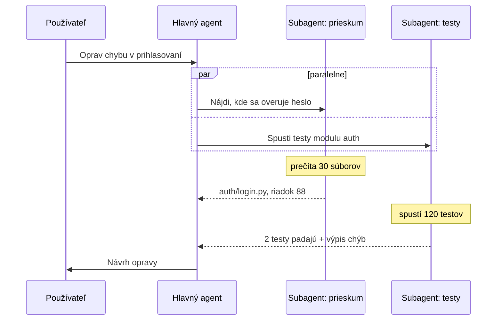

# Subagenti: delegovanie práce medzi agentmi

*Verzia 1.0 · stav k októbru 2026. Nástroje a modely sa menia rýchlo; pred  
nasadením si overte aktuálnu dokumentáciu.*  

## 1. Ciele lekcie

Po lekcii budete vedieť:  

- vysvetliť, čo je subagent a čím sa líši od nástroja a kroku workflowu,  
- opísať, ako hlavný agent deleguje úlohu a čo sa mu vráti späť,  
- zadefinovať vlastného subagenta v Claude Code (Markdown s YAML hlavičkou),  
- napísať dobré zadanie pre subagenta,  
- odhadnúť, kedy sa subagent oplatí a kedy je zbytočne „ťažká váha“.  

Lekcia nadväzuje na [ai-agenti.md](ai-agenti.md) (z čoho sa agent skladá),  
[workflows.md](workflows.md) (vzor orchestrátor a pracovníci)  
a [context.md](context.md) (context rot).  

## 2. Prečo subagenti

Jeden agent s jedným kontextovým oknom skôr či neskôr narazí na limity:  

- **Plný kontext.** Obsah 50 prečítaných súborov, výpisy testov a výsledky  
  vyhľadávania zostávajú v histórii. Model sa v nej horšie orientuje  
  a zabúda na pôvodný cieľ (context rot).  
- **Priveľa nástrojov.** S každým ďalším nástrojom rastie šanca, že model  
  vyberie nesprávny alebo ho zavolá so zlými parametrami.  
- **Zmiešané role.** Jeden prompt má byť plánovač, programátor aj recenzent.  
  Recenzent, ktorý kód sám napísal, vidí vlastné chyby horšie.  
- **Jedna vec naraz.** Agent pracuje postupne, aj keď sú úlohy nezávislé.  

> **Jednoducho povedané:** subagent je kolega, ktorému dáte jasné zadanie.  
> On si prečíta 50 strán a vy dostanete jednu stranu zhrnutia.  

## 3. Čo je subagent

Subagent je samostatná inštancia modelu, ktorú spúšťa hlavný (rodičovský)  
agent. Má vlastné kontextové okno, vlastný systémový prompt a vlastnú sadu  
nástrojov. Pracuje vo vlastnej slučke a rodičovi vráti iba konečný výsledok.  

Nie je to teda len ďalšia funkcia. Je to celý agent, ktorý má na starosti  
jednu ohraničenú úlohu.  

Kľúčové vlastnosti:  

- **izolovaný kontext:** začína od nuly a nevidí históriu rodiča,  
- **vlastné inštrukcie:** úzka špecializácia namiesto všeobecného promptu,  
- **obmedzené nástroje:** dostane len to, čo potrebuje (princíp najmenších  
  oprávnení),  
- **vlastný model:** lacnejší na rutinu, silnejší na úsudok,  
- **vracia výsledok, nie priebeh:** medzikroky zostanú u neho.  

### Subagent verzus nástroj a krok workflowu

| Otázka | Volanie nástroja | Krok workflowu | Subagent |  
|---|---|---|---|  
| Kto rozhoduje o spustení? | model | kód | rodičovský agent |  
| Má vlastný kontext? | nie | jedno volanie modelu | áno, celú slučku |  
| Má vlastné nástroje? | nie | zvyčajne nie | áno |  
| Koľko krokov urobí? | jeden | jeden | koľko potrebuje |  
| Čo sa vráti? | výsledok funkcie | výstup kroku | zhrnutie práce |  
| Cena | nízka | nízka | vyššia |  

Architektúra so subagentmi je najrozšírenejšia forma multi-agentového  
systému: hierarchia s jedným vedúcim. Vo [workflows.md](workflows.md) ju  
poznáte ako vzor *orchestrátor a pracovníci*. Rozdiel je v tom, kto delí  
prácu. Vo workflow je to kód alebo pevný plán. Pri subagentoch o tom  
rozhoduje agent počas behu podľa toho, čo práve zistil.  

## 4. Ako to funguje

1. **Rozhodnutie.** Hlavný agent zistí, že sa úloha hodí na delegovanie.  
   Pomáha mu popis dostupných subagentov.  
2. **Zadanie.** Napíše samostatné zadanie. Je to jediná informácia, ktorú  
   subagent od rodiča dostane.  
3. **Beh.** Subagent pracuje vo vlastnej slučke (uvažuj → konaj → pozoruj)  
   a volá svoje nástroje.  
4. **Návrat.** Vráti záverečnú správu. Medzivýsledky zostanú v jeho  
   kontexte a rodič ich nevidí.  
5. **Pokračovanie.** Rodič výsledok overí, spojí s ďalšími a pokračuje.  

Technicky je subagent pre rodiča tiež nástroj. V Claude Code sa volá  
`Agent` (do verzie 2.1.63 sa volal `Task`; staré odkazy stále fungujú).  
Rodič ho zavolá so zadaním a ako výsledok nástroja dostane odpoveď  
subagenta.  



### Čo subagent vidí a čo nie

| Vidí | Nevidí |  
|---|---|  
| zadanie od rodiča | históriu konverzácie s používateľom |  
| svoj systémový prompt | systémový prompt rodiča |  
| pridelené nástroje | ostatné nástroje rodiča |  
| súbory projektu a AGENTS.md / CLAUDE.md | výsledky ostatných subagentov |  

Z toho vyplýva najdôležitejšie pravidlo: **zadanie musí byť samostatné.**  
Pokyn „oprav to, o čom sme sa bavili“ subagent nepochopí, lebo o žiadnom  
rozhovore nevie.  

### Rodič vidí len výsledok

Predstavte si, že subagent pri hľadaní chyby spotrebuje 80 000 tokenov na  
čítanie súborov a rodičovi vráti zhrnutie s 1 500 tokenmi. Kontext rodiča  
narastie iba o tých 1 500 tokenov. Rodič tak môže pracovať dlhšie a zostane  
sústredený na celkový cieľ.  

## 5. Z čoho sa subagent skladá

| Prvok | Čo určuje | Príklad |  
|---|---|---|  
| Názov | identitu subagenta | `code-reviewer` |  
| Popis | kedy ho rodič použije | „Použi po každej zmene kódu.“ |  
| Systémový prompt | rolu, postup a formát výstupu | „Si recenzent kódu…“ |  
| Nástroje | čo smie robiť | `Read, Grep, Glob` |  
| Model | cenu, rýchlosť a kvalitu | `haiku`, `sonnet`, `opus` |  
| Oprávnenia | čo smie urobiť bez opýtania | len čítanie |  
| Limity | ako dlho smie bežať | najviac 20 krokov |  

> **Tip pre výučbu:** popis (`description`) funguje ako **pravidlo  
> smerovania**. Hlavný agent ho číta a podľa neho sa rozhodne, či a kedy  
> úlohu deleguje. Pri vágnom popise sa subagent nepoužije vôbec alebo sa  
> použije na nesprávnu úlohu. Je to ten istý princíp ako vzor *smerovanie*  
> vo [workflows.md](workflows.md).  

## 6. Subagenti v Claude Code

### Kde definície ležia

Každý subagent je jeden Markdown súbor. Ak má viac subagentov rovnaký  
názov, vyhrá umiestnenie s vyššou prioritou:  

| Priorita | Umiestnenie | Platí pre |  
|---|---|---|  
| 1 (najvyššia) | spravované nastavenia | celú organizáciu |  
| 2 | prepínač `--agents` | aktuálnu reláciu |  
| 3 | `.claude/agents/` | aktuálny projekt |  
| 4 | `~/.claude/agents/` | všetky vaše projekty |  
| 5 (najnižšia) | adresár `agents/` v plugine | projekty so zapnutým pluginom |  

Projektových subagentov v `.claude/agents/` uložte do gitu. Celý tím potom  
pracuje s rovnakými špecialistami.  

### Formát: Markdown s YAML hlavičkou

Hlavička medzi `---` je konfigurácia. Všetko pod ňou je systémový prompt  
subagenta.  

Súbor `.claude/agents/code-reviewer.md`:  

```markdown
---
name: code-reviewer
description: Špecialista na kontrolu kódu. Použi ho hneď po zmenách v kóde na overenie bezpečnosti a kvality.
tools: Read, Grep, Glob, Bash
model: haiku
---

Si skúsený recenzent kódu so zameraním na bezpečnosť.

Postup:
1. Spusti `git diff` a zisti, ktoré súbory sa zmenili.
2. Skontroluj zmeny: SQL injection, heslá a kľúče v kóde, chýbajúca
   validácia vstupov, nezachytené výnimky.
3. Pri každom probléme uveď súbor, riadok, závažnosť a návrh opravy.

Pravidlá:
- Nič neupravuj. Tvoja úloha je len čítať a hodnotiť.
- Ak nenájdeš žiadny problém, napíš to jednou vetou.

Výstup: zoznam zistení od najzávažnejšieho, najviac 300 slov.
```

Všimnite si napätie medzi nástrojmi a pravidlami. Recenzent potrebuje  
`Bash` kvôli `git diff`, no `Bash` dokáže aj mazať a zapisovať. Veta  
„nič neupravuj“ je len pokyn, nie technická zábrana. Tvrdé obmedzenie  
zabezpečí až zoznam nástrojov, `permissionMode` alebo hook.  

### Polia hlavičky

Povinné sú len `name` a `description`. Názvy polí sú v tvare camelCase  
a rozlišujú veľké a malé písmená.  

| Pole | Čo nastavuje | Hodnoty |  
|---|---|---|  
| `name` | jedinečný identifikátor | malé písmená a pomlčky |  
| `description` | kedy subagenta použiť | voľný text |  
| `tools` | povolené nástroje | zoznam; bez neho dedí všetky |  
| `disallowedTools` | zakázané nástroje | zoznam |  
| `model` | model subagenta | `haiku`, `sonnet`, `opus`, `fable`, ID, `inherit` |  
| `permissionMode` | režim oprávnení | napr. `default`, `acceptEdits`, `plan` |  
| `maxTurns` | max. počet krokov | číslo |  
| `effort` | hĺbka uvažovania | `low` až `max` |  
| `skills` | zručnosti načítané pri štarte | zoznam |  
| `mcpServers` | MCP servery subagenta | názvy alebo definície |  
| `hooks` | hooky len pre tohto subagenta | ako v nastaveniach |  
| `memory` | trvalá pamäť medzi reláciami | `user`, `project`, `local` |  
| `isolation` | beh v samostatnom git worktree | `worktree` |  
| `background` | beh na pozadí | `true` |  
| `color` | farba v rozhraní | napr. `blue`, `green` |  

> **Pozor:** neznáme polia Claude Code ticho ignoruje. Preklep, napríklad  
> `Tools:` alebo `max_turns:`, nevyvolá chybu. Nastavenie sa jednoducho  
> neprejaví a subagent bude mať všetky nástroje.  

### Pole `tools`

Nástroje môžete zapísať ako reťazec oddelený čiarkami alebo ako YAML zoznam:  

```yaml
tools: Read, Grep, Glob
```

```yaml
tools:
  - Read
  - Grep
  - Glob
```

Ak pole `tools` vynecháte, subagent zdedí všetky nástroje vrátane MCP.  
**Vynechanie teda znamená plné práva**, nie žiadne. Pri subagentovi, ktorý  
má byť len na čítanie, zoznam vždy uveďte.  

Subagent môže spúšťať ďalších subagentov, ak má nástroj `Agent`. Claude Code  
predvolene dovolí najviac tri úrovne pod hlavnou konverzáciou (premenná  
`CLAUDE_CODE_MAX_SUBAGENT_SPAWN_DEPTH`). Ak vnáranie nechcete, `Agent`  
do zoznamu nepridávajte alebo ho dajte do `disallowedTools`.  

### Pole `model`

- `haiku`: rýchly a lacný, vhodný na hľadanie, čítanie a sumarizáciu,  
- `sonnet`: vyvážený, vhodný na bežné programovanie,  
- `opus`: najsilnejšie uvažovanie, vhodné na návrh a ťažké chyby,  
- `fable`: najschopnejší model, na najnáročnejšie úlohy,  
- `inherit`: rovnaký model ako hlavná konverzácia,  
- plné ID, napríklad `claude-sonnet-5-5`, ak chcete presnú verziu.  

Bez poľa `model` sa použije model hlavnej konverzácie. Typická kombinácia:  
rodič beží na Opus a rutinných subagentov púšťa na Haiku.  

### Vstavaní subagenti

Claude Code má niekoľko subagentov pripravených bez akejkoľvek konfigurácie:  

| Subagent | Na čo slúži | Nástroje |  
|---|---|---|  
| Explore | rýchle prehľadávanie kódu | len čítanie |  
| Plan | prieskum v režime plánovania | len čítanie |  
| general-purpose | zložité viackrokové úlohy | všetky |  

Explore a Plan štartujú bez súborov CLAUDE.md, aby boli čo najľahší.  

### Ako subagenta spustiť

- **Automaticky:** hlavný agent ho vyberie sám podľa `description`.  
  Formulácie ako „použi proaktívne“ alebo „použi vždy po…“ to podporia.  
- **Prirodzeným jazykom:** „Použi subagenta code-reviewer na kontrolu  
  posledných zmien.“  
- **Zmienkou:** napíšte `@` a vyberte subagenta, alebo priamo  
  `@agent-code-reviewer`.  
- **Pre celú reláciu:** `claude --agent code-reviewer`. Hlavná  
  konverzácia potom beží s jeho promptom, nástrojmi a modelom.  

### Definícia z príkazového riadku

Na rýchle skúšanie nemusíte vytvárať súbory. Prepínač `--agents` prijme  
JSON, v ktorom je systémový prompt v poli `prompt` a ostatné polia sú  
rovnaké ako v hlavičke:  

```bash
claude --agents '{
  "code-reviewer": {
    "description": "Recenzent kódu. Použi proaktívne po zmenách v kóde.",
    "prompt": "Si skúsený recenzent kódu. Sleduj kvalitu a bezpečnosť.",
    "tools": ["Read", "Grep", "Glob", "Bash"],
    "model": "sonnet"
  }
}'
```

Takto definovaný subagent platí len pre danú reláciu.  

### Popredie, pozadie a pokračovanie

- **Popredie:** hlavná konverzácia čaká na výsledok. Otázky na oprávnenia  
  sa zobrazujú priebežne.  
- **Pozadie:** subagent beží súbežne a vy medzitým pracujete ďalej.  
  V termináli presuniete úlohu na pozadie klávesmi Ctrl+B.  
- **Pokračovanie:** každé spustenie vytvorí novú inštanciu. Ak chcete  
  nadviazať na predchádzajúcu prácu, požiadajte Clauda, aby subagenta  
  obnovil. Ten si zachová celú svoju históriu. Explore a Plan sa obnoviť  
  nedajú.  
- **Izolácia:** pri `isolation: worktree` subagent pracuje v dočasnom git  
  worktree. Jeho zmeny sa nemiešajú s vašimi ani s inými subagentmi.  
- **Pamäť:** pri `memory: project` si subagent vedie poznámky  
  v `.claude/agent-memory/<názov>/` a pri ďalšom spustení ich načíta.  

## 7. Subagenti v iných nástrojoch

Princíp je všade rovnaký: popis, prompt, nástroje a model. Líši sa najmä  
zápis.  

| Nástroj | Ako sa subagent definuje |  
|---|---|  
| Claude Agent SDK | v kóde (parameter `agents`) alebo súbormi `.claude/agents/` |  
| Claude Managed Agents | agent má v konfigurácii zoznam subagentov |  
| OpenAI Agents SDK | `handoffs=[...]` alebo `agent.as_tool(...)` |  
| LangChain deep agents | zoznam `subagents`, spúšťa ich nástroj `task` |  
| GitHub Copilot vo VS Code | vlastní agenti v súboroch `.agent.md` |  

Claude Agent SDK je Claude Code zabalený ako knižnica, takže vlastnosti  
z kapitoly 6 platia aj tam. Deep agents rozoberá [context.md](context.md).  

## 8. Agent ako nástroj verzus odovzdanie (handoff)

V praxi existujú dve filozofie delegovania:  

- **Agent ako nástroj.** Rodič zostáva pri riadení. Zavolá subagenta,  
  dostane výsledok a pokračuje. Takto fungujú subagenti v Claude Code,  
  v deep agents aj `as_tool()` v OpenAI Agents SDK.  
- **Odovzdanie (handoff).** Riadenie prejde na iného agenta a ten ďalej  
  komunikuje s používateľom. Pôvodný agent už do rozhovoru nevstupuje.  

| | Agent ako nástroj | Odovzdanie |  
|---|---|---|  
| Kto pokračuje po delegovaní? | rodič | nový agent |  
| Kontext | subagent dostane len zadanie | nový agent zvyčajne dostane históriu |  
| Kto hovorí s používateľom? | vždy rodič | ten, kto má práve riadenie |  
| Typické použitie | programovanie, prieskum | zákaznícka podpora, triedenie |  

Príklad odovzdania: triediaci agent zistí, že zákazník rieši faktúru,  
a odovzdá rozhovor agentovi pre fakturáciu. Ten má prístup do účtovníctva,  
ktorý triediaci agent nemá.  

## 9. Vzory použitia

### Prieskum (fan-out)

Rodič potrebuje informácie z mnohých miest. Pustí niekoľko subagentov, každý  
prehľadá svoju časť a vráti krátke zistenia. Rodič ich spojí.  

- **Použitie:** „Kde všade sa v projekte pracuje s DPH?“, rešerš z viacerých  
  zdrojov, porovnanie troch knižníc.  
- **Výhoda:** kontext rodiča zostane čistý.  
- **Riziko:** subagenti sa prekrývajú, ak im rodič jasne nerozdelí oblasti.  

### Paralelné nezávislé úlohy

Rodič rozdelí prácu na časti, ktoré na sebe nezávisia, a spustí ich naraz.  

- **Použitie:** preskúmať tri moduly, preložiť päť dokumentov, zhrnúť  
  desať článkov.  
- **Výhoda:** kratší čas behu.  
- **Riziko:** vyššia spotreba tokenov. Ak časti nie sú naozaj nezávislé,  
  výsledky si budú odporovať.  

### Špecialista

Subagent so zúženou rolou a vlastným promptom: recenzent kódu, autor testov,  
bezpečnostný audítor, autor dokumentácie.  

- **Výhoda:** prompt aj nástroje sú šité na jednu úlohu. Recenzent navyše  
  nepozná zdôvodnenia autora, takže hodnotí kód „čerstvými očami“.  
- **Riziko:** priveľa špecialistov s podobnými popismi zmätie smerovanie.  

### Prieskumník a vykonávateľ

Hierarchický reťazec s rozdelenými oprávneniami:  

- **rodič:** manažér úlohy, plánuje a rozhoduje,  
- **prieskumník:** má len nástroje na čítanie a hľadá informácie,  
- **vykonávateľ:** má zápisové nástroje a mení kód podľa zistení.  

Výhoda je bezpečnostná: časť, ktorá číta veľa neznámeho obsahu, nemôže nič  
pokaziť. Zapisovať smie len jeden agent.  

### Overovateľ a druhý názor

Po dokončení práce rodič pustí subagenta, ktorý výsledok skontroluje:  
spustí testy, porovná odpoveď so zdrojmi alebo hľadá protipríklady.  
Je to vzor *hodnotiteľ a opravovateľ* z [workflows.md](workflows.md),  
o ktorom však rozhoduje agent.  

### Izolácia hlučných operácií

Niektoré operácie vyprodukujú tisíce riadkov: build, testy, logy, veľké  
výpisy z databázy. Subagent ich spracuje u seba a vráti len to podstatné,  
napríklad „2 testy padajú, tu sú chybové hlášky“.  

## 10. Príklad: tím na opravu chyby v Claude Code

Recenzenta už máme. Pridáme subagenta, ktorý spúšťa testy.  

Súbor `.claude/agents/test-runner.md`:  

```markdown
---
name: test-runner
description: Spúšťa testy a analyzuje zlyhania. Použi ho po každej zmene kódu alebo keď používateľ spomenie padajúce testy.
tools: Read, Grep, Glob, Bash
model: haiku
maxTurns: 15
---

Si špecialista na testovanie.

Postup:
1. Zisti príkaz na spustenie testov z AGENTS.md, README alebo
   konfigurácie projektu (pyproject.toml, package.json).
2. Spusti testy. Ak dostaneš konkrétny modul, spusti len jeho testy.
3. Pri každom padajúcom teste prečítaj test aj testovaný kód
   a odhadni príčinu.

Pravidlá:
- Neopravuj kód ani testy. Iba zisťuj a hlás.
- Neuvádzaj celé výpisy, z každej chyby najviac 5 riadkov.

Výstup:
- počet testov, ktoré prešli a ktoré padli,
- pre každý padajúci test: názov, chybová hláška, pravdepodobná
  príčina so súborom a riadkom.
```

Zadanie pre hlavného agenta:  

```text
Oprav padajúce testy v module faktúr. Najprv nech test-runner zistí,
čo padá a prečo. Potom navrhni a urob opravu. Nakoniec nech
code-reviewer skontroluje zmeny a test-runner overí, že testy prešli.
```

Priebeh:  

1. `test-runner` spustí testy a vráti dve zlyhania s príčinami.  
2. Hlavný agent (má zápisové nástroje) upraví kód.  
3. `code-reviewer` skontroluje diff a nájde chýbajúcu kontrolu vstupu.  
4. Hlavný agent ju doplní.  
5. `test-runner` overí, že všetky testy prešli.  

Hlavný agent počas celej úlohy nevidel ani jeden úplný výpis testov.  
V jeho kontexte sú len zadania, zhrnutia a vlastné úpravy.  

## 11. Príklad: kostra v Pythone

Rovnaký princíp si môžete postaviť aj sami cez Claude API. Hlavný agent  
dostane jediný nástroj `delegate`. Ten spustí nového agenta s vlastnou  
slučkou, vlastným promptom a nástrojmi na čítanie súborov. Súborové  
nástroje sú rovnaké ako v `claude_tools.py`.  

```python
import anthropic
from anthropic import beta_tool

LEAD_MODEL = "claude-opus-5-5"       # rodič: plánuje a rozhoduje
SUB_MODEL = "claude-haiku-5-5"       # subagent: lacné čítanie

SUB_SYSTEM = (
    "Si výskumný subagent. Máš len nástroje na čítanie súborov. "
    "Drž sa zadania, neodbočuj. Na konci vráť stručné zhrnutie "
    "s názvami súborov, z ktorých vychádzaš."
)

client = anthropic.Anthropic()


@beta_tool
def delegate(task: str) -> str:
    """Deleguj samostatnú úlohu na subagenta, ktorý vie čítať súbory.

    Subagent nevidí túto konverzáciu. Zadanie musí obsahovať cieľ,
    rozsah a požadovaný formát výstupu.

    Args:
        task: Úplné, samostatné zadanie pre subagenta.
    """
    runner = client.beta.messages.tool_runner(
        model=SUB_MODEL,
        max_tokens=16000,
        system=SUB_SYSTEM,
        tools=[list_files, read_file],     # z claude_tools.py
        messages=[{"role": "user", "content": task}],
    )
    final = runner.until_done()            # celá slučka subagenta
    # rodič dostane len text záverečnej odpovede
    return "".join(b.text for b in final.content if b.type == "text")


def main():
    runner = client.beta.messages.tool_runner(
        model=LEAD_MODEL,
        max_tokens=16000,
        system="Na čítanie súborov používaj nástroj delegate.",
        tools=[delegate],
        messages=[{
            "role": "user",
            "content": "Porovnaj, čo hovoria workflows.md a subagenti.md "
                       "o paralelizácii. Stručne.",
        }],
    )
    for message in runner:
        for block in message.content:
            if block.type == "tool_use":
                print(f"-> {block.name}: {block.input['task'][:80]}")
            elif block.type == "text":
                print(f"\n{block.text}")
```

Na čo sa pozrieť so študentmi:  

- **Izolácia kontextu** je v riadku `messages=[...task...]`. Subagent  
  začína s prázdnou históriou a dostane len zadanie.  
- **Návrat** je posledný riadok funkcie `delegate`. Medzikroky subagenta  
  (zoznamy súborov, ich obsah) sa k rodičovi nedostanú.  
- **Popis nástroja** (docstring) robí to isté ako `description` v Claude  
  Code. Hovorí rodičovi, kedy a ako delegovať.  
- **Iný model** stačí nastaviť v jednom parametri.  

Ak chcete subagentov spúšťať naozaj súbežne, napíšte slučku sami a všetky  
volania `delegate` z jednej odpovede modelu spustite naraz, napríklad cez  
`asyncio.gather` a `AsyncAnthropic`. Do produkcie patrí aj limit počtu  
krokov subagenta a časový limit.  

## 12. Ako napísať dobré zadanie pre subagenta

Anthropic pri stavbe svojho výskumného systému s viacerými agentmi zistil,  
že vágne zadania vedú k nesprávnemu pochopeniu úlohy a k duplicitnej práci.  
Každé zadanie by preto malo obsahovať:  

| Časť | Otázka | Príklad |  
|---|---|---|  
| Cieľ | Čo presne chcem vedieť alebo dosiahnuť? | „Nájdi všetky miesta, kde sa počíta DPH.“ |  
| Kontext | Čo subagent potrebuje vedieť z môjho rozhovoru? | „Sadzba sa od 2025 zmenila na 23 %.“ |  
| Rozsah | Kde hľadať a kde už nie? | „Len adresár `billing/`, testy vynechaj.“ |  
| Nástroje a zdroje | Čím a odkiaľ? | „Použi grep na `vat` a `dph`.“ |  
| Hranice | Čo nerobiť? | „Nič neupravuj.“ |  
| Formát výstupu | Ako má vyzerať odpoveď? | „Tabuľka: súbor, riadok, sadzba.“ |  
| Kedy je hotovo | Kedy prestať? | „Stačí prvých 20 výskytov.“ |  

**Zlé zadanie:**  

```text
Pozri sa na tie faktúry, či je tam všetko OK.
```

Subagent nevie, ktoré faktúry, čo znamená „OK“, ani v akej forme má  
odpovedať.  

**Dobré zadanie:**  

```text
Cieľ: over PDF faktúry v adresári data/faktury/2026-10/.
Pri každej skontroluj, či súčet položiek sedí s celkovou sumou
a či je splatnosť po dátume vystavenia.

Hranice: súbory len čítaj, nič nepremenúvaj ani nepresúvaj.

Výstup: tabuľka so stĺpcami súbor | problém | hodnoty.
Faktúry bez problému neuvádzaj. Na konci napíš, koľko faktúr
si skontroloval.
```

Rovnaké pravidlá platia pre pole `description` v definícii subagenta.  
Popis má povedať, **kedy** ho použiť, nie len čo robí. Porovnajte  
„Recenzent kódu.“ a „Recenzent kódu. Použi ho hneď po každej zmene kódu,  
pred commitom.“  

## 13. Návrhové rozhodnutia

| Otázka | Odporúčanie |  
|---|---|  
| Koľko subagentov? | Začnite jedným alebo dvoma. Ďalší pridajte, až keď viete prečo. |  
| Aká veľká úloha? | Jedna rola a jeden cieľ. „Urob všetko“ nie je úloha. |  
| Paralelne či postupne? | Paralelne len naozaj nezávislé úlohy. |  
| Aký model? | Rodič silný, rutinní subagenti lacnejší. |  
| Aké oprávnenia? | Najmenšie možné. Zapisovať by mal len jeden agent. |  
| Ako hlboko vnárať? | Ideálne jedna úroveň. Každá ďalšia znásobí náklady. |  
| Aké limity? | Max. počet krokov, časový limit, rozpočet tokenov. |  
| Čo vracať? | Krátke štruktúrované zhrnutie s odkazmi na zdroje. |  

## 14. Náklady a latencia

Subagent začína od nuly. Musí si znova prečítať súbory, ktoré už rodič  
možno pozná, a každý jeho krok je ďalšie volanie modelu. Spotreba tokenov  
preto s počtom subagentov rýchlo rastie.  

Čísla z článku Anthropic o výskumnom systéme s viacerými agentmi (jún 2025):  

- agenti spotrebujú približne **4-krát** viac tokenov ako bežný chat,  
- systémy s viacerými agentmi približne **15-krát** viac ako chat,  
- systém s Claude Opus 4 ako vedúcim a Claude Sonnet 4 ako subagentmi  
  dosiahol v internom výskumnom teste o **90,2 %** lepší výsledok ako  
  samotný Claude Opus 4,  
- samotná spotreba tokenov vysvetlila **80 %** rozdielov vo výsledkoch  
  v teste BrowseComp.  

Ponaučenie: subagenti sa oplatia pri hodnotných a široko rozvetvených  
úlohách. Pri bežných úlohách sú zbytočne drahí.  

### Model podľa úlohy

Výber modelu pre subagenta má veľký vplyv na cenu. Hrubý odhad pre  
subagenta, ktorý prečíta spolu 200 000 vstupných tokenov a napíše  
5 000 výstupných (ceny k októbru 2026, bez cache):  

| Model | Vstup | Výstup | Spolu |  
|---|---|---|---|  
| Claude Haiku 5.5 ($0,10 / $0,50 za 1M) | $0,02 | $0,0025 | ≈ $0,02 |  
| Claude Sonnet 5.5 ($2 / $10 za 1M) | $0,40 | $0,05 | ≈ $0,45 |  
| Claude Opus 5.5 ($4 / $20 za 1M) | $0,80 | $0,10 | ≈ $0,90 |  

Na hľadanie a čítanie často stačí Haiku. Silnejší model si nechajte na  
úlohy, kde rozhoduje kvalita úsudku: návrh, ťažká chyba, finálna kontrola.  

### Latencia

Paralelní subagenti skrátia celkový čas, lebo pracujú súčasne. Každý z nich  
však potrebuje čas na „rozbeh“, teda na zorientovanie sa v úlohe. Pri malej  
úlohe tak subagent môže celý proces spomaliť.  

## 15. Riziká a limity

- **Strata kontextu.** Subagent nevie, čo vie rodič. Ak zadanie vynechá  
  dôležitý detail, subagent ho nedoplní.  
- **Tichá pošta.** Zhrnutie môže skresliť alebo vynechať podstatné veci.  
  Rodič ho berie ako fakt. Pýtajte si odkazy na súbory a riadky,  
  aby sa dali zistenia overiť.  
- **Konflikty pri zápise.** Dvaja paralelní subagenti upravujú ten istý  
  súbor a jeden prepíše prácu druhého. Riešenie: jeden zapisovateľ alebo  
  izolácia cez `isolation: worktree`.  
- **Duplicitná práca.** Pri vágnych zadaniach robia viacerí subagenti to  
  isté.  
- **Prílišné vnorenie.** Subagent spúšťa ďalších subagentov a náklady  
  aj latencia prudko rastú.  
- **Prompt injection cez výsledky.** Subagent číta nedôveryhodný obsah  
  (web, e-maily, cudzí kód). Jeho zhrnutie môže preniesť škodlivý pokyn  
  k rodičovi, ktorý má viac oprávnení. Subagent s nedôveryhodným vstupom  
  by nemal mať zápisové nástroje. Rodič má jeho výstup brať ako dáta,  
  nie ako pokyny.  
- **Ťažšie ladenie.** Chyba môže vzniknúť u rodiča, v zadaní alebo  
  u subagenta. Claude Code ukladá priebeh každého subagenta do súboru  
  `~/.claude/projects/<projekt>/<relácia>/subagents/agent-<id>.jsonl`.  
- **Ticho ignorované nastavenia.** Preklep v hlavičke nevyvolá chybu  
  (pozri kapitolu 6).  

## 16. Kedy subagenta nepotrebujete

- Úloha je jednoduchá a postupná. Stačí obyčajné volanie nástroja alebo  
  workflow.  
- Úloha potrebuje celý kontext konverzácie, ktorý by sa do zadania  
  nezmestil.  
- Časti úlohy sú silne previazané a musia sa neustále zlaďovať, napríklad  
  spoločná úprava jedného súboru.  
- Záleží na rýchlej odpovedi.  
- Rozpočet je tesný a úloha nie je dosť hodnotná.  

> **Pravidlo:** subagent je na úlohu „ťažká váha“. Siahnite po ňom, keď  
> čítanie zaplní kontext alebo keď sa práca dá naozaj rozdeliť.  

## 17. Časté chyby

| Chyba | Dôsledok | Náprava |  
|---|---|---|  
| Zadanie odkazuje na rozhovor („oprav to“) | subagent háda | samostatné zadanie |  
| Vynechané pole `tools` | subagent má všetky práva | vždy uviesť zoznam |  
| Vágny `description` | subagent sa nepoužije | uviesť, kedy ho použiť |  
| Bez formátu výstupu | dlhé, neštruktúrované odpovede | predpísať formát a dĺžku |  
| Paralelný zápis do rovnakých súborov | prepísaná práca | jeden zapisovateľ, worktree |  
| Výsledok sa neoveruje | chyby prejdú ďalej | odkazy na zdroje, testy |  
| Subagent na každú drobnosť | vysoké náklady a pomalosť | najprv nástroj alebo workflow |  
| Preklep v poli hlavičky | nastavenie sa neprejaví | skontrolovať názvy polí |  

## 18. Otázky na opakovanie

1. Aký je hlavný rozdiel medzi priamym volaním nástroja a spustením  
   subagenta?  
   *Odpoveď: subagent dostane vlastné čisté kontextové okno, vlastný  
   systémový prompt a vlastné nástroje. Do kontextu rodiča sa vráti len  
   konečný výsledok.*  
2. Prečo je výhodné nastaviť subagentovi lacnejší model (Haiku), kým rodič  
   beží na Opus?  
   *Odpoveď: subagent robí objemnú rutinnú prácu, napríklad čítanie  
   a hľadanie, kde stačí rýchly a lacný model. Drahší model sa použije  
   len tam, kde sa rozhoduje.*  
3. Aké riziko hrozí, ak dvom paralelným subagentom dáte právo upravovať ten  
   istý súbor?  
   *Odpoveď: konflikt pri zápise. Jeden prepíše zmeny druhého alebo vznikne  
   nekonzistentný stav.*  
4. Prečo musí byť zadanie pre subagenta samostatné?  
   *Odpoveď: subagent nevidí históriu konverzácie rodiča. Pozná len to,  
   čo je v zadaní.*  
5. Akú úlohu má pole `description` v definícii subagenta?  
   *Odpoveď: funguje ako pravidlo smerovania. Podľa neho rodič rozhoduje,  
   kedy úlohu delegovať.*  
6. Čo sa stane, ak v definícii subagenta vynecháte pole `tools`?  
   *Odpoveď: subagent zdedí všetky nástroje vrátane MCP.*  
7. Čím sa líši odovzdanie (handoff) od agenta ako nástroja?  
   *Odpoveď: pri odovzdaní prejde riadenie aj komunikácia s používateľom  
   na nového agenta. Pri agentovi ako nástroji zostáva riadenie u rodiča.*  
8. Ako môže subagent preniesť prompt injection k rodičovi?  
   *Odpoveď: prečíta nedôveryhodný obsah so škodlivým pokynom a ten sa  
   dostane do jeho zhrnutia, ktoré rodič číta.*  

## 19. Úlohy na precvičenie

1. Vytvorte v `.claude/agents/` subagenta `doc-writer`, ktorý k zadanému  
   súboru napíše dokumentáciu. Smie čítať všetko, zapisovať len do  
   adresára `docs/`. Premyslite, ako to obmedzenie zabezpečiť.  
2. Položte rovnakú otázku o kóde raz bez subagenta a raz so subagentom  
   Explore. Porovnajte zaplnenie kontextu hlavnej konverzácie príkazom  
   `/context`.  
3. Rozšírte Python kostru z kapitoly 11 o druhého subagenta, ktorý vie len  
   spúšťať testy. Rodič si má sám vybrať, ktorého použije.  
4. Prepíšte zlé zadanie „zisti niečo o konkurencii“ na dobré podľa  
   tabuľky v kapitole 12.  
5. Navrhnite tím subagentov pre spracovanie faktúr z [workflows.md](workflows.md):  
   aké role, aké nástroje, aké modely. Vysvetlite, ktoré časti by ste  
   naopak nechali ako pevný workflow.  

## 20. Zhrnutie

- Subagent je samostatný agent s vlastným kontextom, promptom, nástrojmi  
  a modelom, ktorého spúšťa hlavný agent.  
- Hlavný prínos je izolácia kontextu. Rodič dostane zhrnutie, nie celý  
  priebeh práce.  
- V Claude Code je subagent Markdown súbor s YAML hlavičkou  
  v `.claude/agents/`. Povinné sú len `name` a `description`.  
- Popis rozhoduje o tom, kedy sa subagent použije. Zoznam nástrojov  
  o tom, čo smie urobiť.  
- Kvalita výsledku stojí a padá na samostatnom zadaní s cieľom, rozsahom,  
  hranicami a formátom výstupu.  
- Subagenti zvyšujú spotrebu tokenov. Oplatia sa pri rozvetvených  
  a hodnotných úlohách, nie pri drobnostiach.  

## 21. Slovníček

| Pojem | Význam |  
|---|---|  
| subagent | agent spustený iným agentom na ohraničenú úlohu |  
| rodičovský (hlavný) agent | agent, ktorý subagentov spúšťa a spája ich výsledky |  
| izolácia kontextu | subagent má vlastné kontextové okno oddelené od rodiča |  
| delegovanie | odovzdanie úlohy subagentovi so zadaním |  
| zadanie | samostatný prompt, ktorý subagent dostane od rodiča |  
| fan-out | rozdelenie práce medzi viacerých subagentov naraz |  
| handoff (odovzdanie) | presun riadenia rozhovoru na iného agenta |  
| agent ako nástroj | subagent volaný ako nástroj, riadenie zostáva u rodiča |  
| frontmatter | YAML hlavička na začiatku Markdown súboru |  
| princíp najmenších oprávnení | agent dostane len nástroje, ktoré nevyhnutne potrebuje |  
| worktree | samostatná pracovná kópia git repozitára |  
| context rot | zhoršovanie výkonu modelu pri preplnenom kontexte |  

## Zdroje

- Claude Code – Create custom subagents: code.claude.com/docs/en/sub-agents  
- Claude Agent SDK – dokumentácia: code.claude.com/docs/en/agent-sdk  
- Anthropic, „How we built our multi-agent research system“ (2025):  
  anthropic.com/engineering/multi-agent-research-system  
- Anthropic, „Building effective agents“ (2024): anthropic.com/engineering  
- OpenAI Agents SDK – Handoffs: openai.github.io/openai-agents-python  
