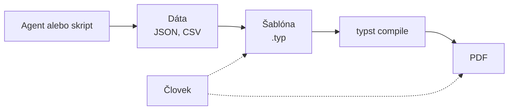

# Typst: generovanie PDF dokumentov v AI workflowoch

*Verzia 1.0 · stav k novembru 2026. Nástroje sa menia rýchlo; pred  
nasadením si overte aktuálnu dokumentáciu Typst.*  

## 1. Prečo Typst v AI školení

Agent veľmi často končí svoju prácu dokumentom: reportom, faktúrou,  
zmluvou alebo týždenným prehľadom. Ľudia čakajú PDF, nie JSON ani  
konzolový výpis. Treba teda spoľahlivý a opakovateľný spôsob, ako z dát  
vyrobiť pekný PDF súbor.  

**Typst** je moderný sádzací systém: z textového súboru vyrobí PDF.  
Sádzací systém je program, ktorý rozloží text, tabuľky a obrázky na  
stránky podľa pravidiel typografie. Typst vznikol ako jednoduchšia  
alternatíva k LaTeXu. Je to jeden malý program, kompiluje v zlomku  
sekundy a má zrozumiteľné chybové hlásenia.  



> **Jednoducho povedané:** Šablóna je formulár s vyznačenými miestami,  
> dáta sú vyplnené políčka a Typst je tlačiareň, ktorá z toho urobí  
> hotový list papiera. Formulár navrhnete raz, vyplňujete ho stokrát.  

### Typst a iné cesty k PDF

| Cesta | Silné stránky | Slabé stránky |  
|---|---|---|  
| HTML + Chromium | známe HTML a CSS | čísla strán, zalamovanie |  
| LaTeX | obrovský ekosystém | zložitý, pomalý, nezrozumiteľné chyby |  
| Word / DOCX | ľudia ho poznajú | zle sa generuje programom |  
| Knižnice (ReportLab) | plná kontrola | veľa kódu na každú tabuľku |  
| **Typst** | rýchly, čitateľný, dáta | mladší ekosystém |  

Cestu cez HTML a Chromium popisuje kapitola o reportoch. Typst  
je vhodnejší, keď potrebujete číslovanie strán, hlavičky a päty,  
presné zalamovanie tabuliek alebo desiatky rovnakých dokumentov.  

## 2. Ako Typst funguje

Typst súbor (prípona `.typ`) je obyčajný text. Obsahuje tri druhy  
zápisu, ktoré sa miešajú v jednom súbore.  

| Režim | Značenie | Príklad |  
|---|---|---|  
| značky (markup) | špeciálne znaky | `= Nadpis`, `*tučné*`, `_kurzíva_` |  
| kód | začína znakom `#` | `#let x = 5`, `#table(...)` |  
| matematika | medzi znakmi `$` | `$ 117 / 128 $` |  

Zoznamy sa píšu pomlčkou (`-`), číslované plusom (`+`). Nadpisy  
začínajú znakom `=`, počet znakov určuje úroveň.  

### Pravidlá `set` a `show`

Vzhľad dokumentu sa nastavuje dvoma príkazmi. **`set`** zmení  
predvolenú hodnotu, napríklad veľkosť písma alebo okraje strany.  
**`show`** zmení spôsob, akým sa vykreslí celý druh prvkov, napríklad  
všetky nadpisy prvej úrovne.  

```typst
#set text(lang: "sk", size: 11pt)
#show heading.where(level: 1): set text(fill: blue)
```

### Funkcie a šablóny

Funkciu definujete pomocou `#let`. Šablóna je funkcia, ktorá dostane  
obsah dokumentu a vráti ho upravený. Použijete ju príkazom  
`#show: nazov-sablony.with(...)`. Týmto spôsobom oddelíte vzhľad  
od obsahu, čo je pre agentov kľúčové: agent píše obsah, vzhľad ostáva  
pevný.  

### Dáta a vstupy

Typst vie načítať dáta priamo: `json()`, `csv()`, `yaml()` a `read()`.  
Hodnoty zvonka (z príkazového riadka) sa odovzdávajú cez  
`--input kluc=hodnota` a v dokumente sa čítajú ako `sys.inputs`.  

## 3. Príprava prostredia

Potrebujete jediný program `typst`. Oficiálne spôsoby inštalácie sú  
na stránke github.com/typst/typst. Balík z správcu balíkov môže byť  
o niečo staršia verzia než posledné vydanie.  

### Windows

Otvorte PowerShell (kláves Windows, napíšte „PowerShell“) a spustite:  

```powershell
winget install --id Typst.Typst
```

Po inštalácii **zatvorte a znova otvorte** terminál, aby sa našla nová  
cesta k programu. Overenie:  

```powershell
typst --version
```

Ak `winget` nemáte, stiahnite archív pre Windows zo stránky vydaní  
(github.com/typst/typst/releases), rozbaľte `typst.exe` do priečinka  
podľa vlastného výberu a pridajte ho do premennej prostredia `Path`.  
Tretia možnosť je Rust nástroj: `cargo install --locked typst-cli`.  

> **Tip:** V PowerShelli volajte Python príkazom `py` alebo `python`,  
> podľa toho, čo máte nainštalované. V kapitole je uvedené `python3`  
> (Linux, macOS).  

### macOS a Linux

```bash
brew install typst
```

Príkaz `brew` platí pre macOS. Na Ubuntu Linuxe, kde boli príklady  
overené, stačí:  

```bash
sudo snap install typst
```

> **Pozor:** Typst nainštalovaný cez snap vidí len domovský priečinok.  
> Súbory v `/tmp` nenájde a kompilácia môže skončiť bez chybovej správy.  
> Pracujte v priečinku pod svojím domovským adresárom.  

Overenie inštalácie:  

```bash
typst --version
```

Príklady v tejto kapitole boli otestované s verziou **Typst 0.15.1**.  
Typst je stále vo vývoji a niektoré funkcie sa medzi verziami menia,  
preto pri inej verzii skontrolujte chybové hlásenia a dokumentáciu.  

### Príkazy

| Príkaz | Čo robí |  
|---|---|  
| `typst compile vstup.typ` | vyrobí `vstup.pdf` |  
| `typst compile vstup.typ von.png` | vyrobí PNG (podľa prípony) |  
| `typst watch vstup.typ` | prekompiluje po každom uložení |  
| `typst fonts` | vypíše dostupné písma |  
| `typst init` | založí projekt zo šablóny |  

Pre prácu vo VS Code existuje doplnok Tinymist s živým náhľadom.  
Overte si jeho aktuálny názov a nastavenie v Marketplace.  

### Písma a slovenčina

Typst obsahuje vlastné základné písma (napríklad Libertinus Serif),  
ktoré podporujú slovenskú diakritiku. Ďalšie písma z počítača nájde  
sám. Cestu k vlastným písmam zadáte prepínačom `--font-path`. Jazyk  
nastavte vždy: `#set text(lang: "sk")`. Ovplyvní delenie slov  
a typografiu.  

> **Tip:** Ak PDF vyzerá inak na počítači a inak na serveri, zvyčajne  
> chýba písmo. Príkaz `typst fonts` ukáže, ktoré písma Typst vidí.  

## 4. Vysvetlené príklady

Príklady sú samostatné: všetok kód je priamo v tejto kapitole. Vytvorte  
si pracovný priečinok `typst-kurz`, súbory ukladajte doň a príkazy  
spúšťajte v termináli v tomto priečinku. Najprv vyskúšajte malé príklady,  
potom väčšie.  

> **Tip:** Priečinok vytvoríte príkazom `mkdir typst-kurz`, do neho  
> vstúpite príkazom `cd typst-kurz`. Príkazy fungujú v Bash aj  
> v PowerShelli.  

### 4.1 Malé príklady na vyskúšanie

Každý príklad je krátky samostatný súbor. Vytvorte si pracovný priečinok  
`typst-kurz`, uložte do neho súbory a skompilujte ich príkazmi z príkladov.  
Výsledné PDF otvorte v ľubovoľnom prehliadači PDF.  

| Súbor | Téma |  
|---|---|  
| `ahoj.typ` | Najmenší dokument |  
| `zoznamy.typ` | Zoznamy, písmo a veľkosť stránky |  
| `farby.typ` | Pravidlá show |  
| `funkcia.typ` | Vlastná funkcia |  
| `cyklus.typ` | Cyklus a pole |  
| `tabulka-csv.typ` | Tabuľka z CSV |  
| `vstup.typ` | Hodnota z príkazového riadka |  
| `obrazok-vzorec.typ` | Obrázok s popisom a vzorec |  

#### Príklad 4.1.1: Najmenší dokument

Súbor `ahoj.typ`:  

```typst
= Ahoj, svet

Toto je *tučný* a _kurzívny_ text. Slová s diakritikou: ľščťžýáíé.
```

```bash
typst compile ahoj.typ
```

Skúste zmeniť text a znova skompilovať.  

#### Príklad 4.1.2: Zoznamy, písmo a veľkosť stránky

Súbor `zoznamy.typ`:  

```typst
#set page(width: 10cm, height: auto, margin: 1cm)
#set text(lang: "sk", font: "Libertinus Serif", size: 14pt)

= Nákupný zoznam

- chlieb,
- mlieko,
- jablká.

+ prvý krok
+ druhý krok
```

```bash
typst compile zoznamy.typ
```

Stránka sa prispôsobí výške obsahu (`height: auto`), takže je vhodná  
na rýchle skúšky.  

#### Príklad 4.1.3: Pravidlá show

Súbor `farby.typ`:  

```typst
#set page(width: 10cm, height: auto, margin: 1cm)
#show heading: set text(fill: rgb("#1f4e79"))
#show "agent": set text(weight: "bold")

= Farebný nadpis

Každý agent je tu zvýraznený.
```

```bash
typst compile farby.typ
```

`show` zmení vzhľad všetkých nadpisov a zvýrazní každé slovo „agent“.  

#### Príklad 4.1.4: Vlastná funkcia

Súbor `funkcia.typ`:  

```typst
#set page(width: 10cm, height: auto, margin: 1cm)
#let karta(titulok, text) = block(
  fill: luma(240), inset: 10pt, radius: 4pt, width: 100%,
)[*#titulok* \ #text]

#karta("Pozor", "Nasadenie schvaľuje človek.")
#karta("Tip", "Funkciu definujete raz a použijete viackrát.")
```

```bash
typst compile funkcia.typ
```

Funkcia `karta` sa použije dvakrát. Zmeňte `fill` a `radius`.  

#### Príklad 4.1.5: Cyklus a pole

Súbor `cyklus.typ`:  

```typst
#set page(width: 10cm, height: auto, margin: 1cm)
#let ovocie = ("jablko", "hruška", "slivka")

#for (i, o) in ovocie.enumerate() [
  #(i + 1). #o \
]

Počet: #ovocie.len()
```

```bash
typst compile cyklus.typ
```

Cyklus `for` vypíše položky poľa aj s poradovým číslom.  

#### Príklad 4.1.6: Tabuľka z CSV

Súbor `tabulka-csv.typ`:  

```typst
#set page(width: 12cm, height: auto, margin: 1cm)
#let riadky = csv("mesta.csv")

#table(
  columns: riadky.first().len(),
  ..riadky.flatten(),
)
```

Súbor `mesta.csv`:  

```text
Mesto,Obyvatelia
Bratislava,475000
Košice,229000
Prešov,87000
```

```bash
typst compile tabulka-csv.typ
```

Vedľa súboru potrebujete `mesta.csv` (nižšie).  

#### Príklad 4.1.7: Hodnota z príkazového riadka

Súbor `vstup.typ`:  

```typst
#set page(width: 10cm, height: auto, margin: 1cm)
#let meno = sys.inputs.at("meno", default: "neznámy")

Dobrý deň, *#meno*!
```

```bash
typst compile vstup.typ
typst compile --input meno=Eva vstup.typ vstup-eva.pdf
```

Spustite bez `--input` a potom s ním, rozdiel je v mene.  

#### Príklad 4.1.8: Obrázok s popisom a vzorec

Súbor `obrazok-vzorec.typ`:  

```typst
#set page(width: 10cm, height: auto, margin: 1cm)
#set text(lang: "sk")

#figure(
  rect(width: 100%, height: 2cm, fill: rgb("#cfe2f3")),
  caption: [Zástupný obrázok],
)

Matematika: $ sum_(i=1)^n i = (n (n + 1)) / 2 $
```

```bash
typst compile obrazok-vzorec.typ
```

Zástupný obdĺžnik nahraďte vlastným obrázkom: `image("logo.png")`.  

### 4.2 Prvý dokument

Súbor `dokument.typ`:  

```typst
// Prvý dokument: nadpisy, odseky, zoznamy, tabuľka a vzorec.
#set document(title: "Týždenný prehľad", author: "Ján Bodnár")
#set page(paper: "a4", margin: 2.5cm, numbering: "1 / 1")
#set text(lang: "sk", size: 11pt)
#set par(justify: true)
#set heading(numbering: "1.")

#align(center)[
  #text(size: 20pt, weight: "bold")[Týždenný prehľad agentov] \
  #datetime.today().display("[day].[month].[year]")
]

= Zhrnutie

Agenti tento týždeň spracovali *128 úloh*. Z toho _117_ skončilo úspešne
a 11 vyžadovalo zásah človeka.

= Výsledky podľa agenta

#table(
  columns: (1fr, auto, auto),
  align: (left, right, right),
  table.header[*Agent*][*Úlohy*][*Chyby*],
  [Triedenie pošty], [64], [3],
  [Prepis zmlúv], [41], [5],
  [Reporty], [23], [3],
)

= Poznámky

- Chyby pri prepise zmlúv spôsobili naskenované dokumenty,
- opakované chyby treba preveriť ručne,
- vzorec úspešnosti: $ "úspešnosť" = 117 / 128 approx "91,4 %" $
```

Spustenie:  

```bash
typst compile dokument.typ
```

Výsledkom je `dokument.pdf`. Funkcia `datetime.today()` vloží dnešný  
dátum, `table.header` zopakuje hlavičku tabuľky na každej strane.  

#### Vyskúšajte

1. Zmeňte `margin` na `1.5cm` a sledujte, ako sa zmení rozloženie,  
2. pridajte tretiu úroveň nadpisu a zapnite jej číslovanie,  
3. spustite `typst watch dokument.typ` a upravujte súbor za chodu.  

### 4.3 Šablóna

Súbor `sablona.typ`:  

```typst
// Znovupoužiteľná šablóna: jedna funkcia nastaví vzhľad celého dokumentu.
#let clanok(nazov: "", autor: "", body) = {
  set document(title: nazov, author: autor)
  set page(
    paper: "a4",
    margin: (x: 2.5cm, y: 2.5cm),
    header: align(right, text(size: 9pt, fill: gray)[#nazov]),
    footer: context align(center, text(size: 9pt)[
      Strana #counter(page).display() z #counter(page).final().first()
    ]),
  )
  set text(lang: "sk", size: 11pt)
  set par(justify: true)
  set heading(numbering: "1.")
  show heading.where(level: 1): set text(fill: rgb("#1f4e79"))

  align(center)[
    #text(size: 22pt, weight: "bold")[#nazov] \
    #text(fill: gray)[#autor]
  ]
  v(1em)
  body
}
```

Súbor `clanok.typ`:  

```typst
#import "sablona.typ": clanok

#show: clanok.with(
  nazov: "Pravidlá práce s agentmi",
  autor: "Ján Bodnár",
)

= Úvod

Tento dokument vznikol zo šablóny. Vzhľad sa mení na jednom mieste,
v súbore `sablona.typ`.

= Pravidlá

+ Agent nikdy nenasadzuje bez schválenia.
+ Tajomstvá patria do premenných prostredia.
+ Každý beh sa zapisuje do logu.
```

Príkaz `#import` načíta funkciu z iného súboru. Päta používa  
`context`, lebo číslo strany je známe až pri rozložení dokumentu.  

#### Vyskúšajte

1. Zmeňte farbu nadpisov v `sablona.typ` a znova skompilujte `clanok.typ`,  
2. pridajte do šablóny parameter `verzia` a zobrazte ho v hlavičke,  
3. vytvorte druhý dokument, ktorý použije rovnakú šablónu.  

### 4.4 Faktúra z JSON

Dokument môže byť len vyplnená šablóna. Dáta sú v samostatnom súbore,  
ktorý môže vytvoriť agent alebo skript.  

Súbor `data.json`:  

```json
{
  "cislo": "2026-014",
  "datum": "2026-11-02",
  "odberatel": "Príklad s. r. o.",
  "polozky": [
    { "popis": "Školenie AI agenti", "mnozstvo": 2, "cena": 450.0 },
    { "popis": "Konzultácia", "mnozstvo": 3.5, "cena": 80.0 }
  ]
}
```

Súbor `faktura.typ`:  

```typst
// Dokument sa skladá z dát: JSON načíta, spočíta a vysádza.
#let data = json("data.json")
#set page(paper: "a4", margin: 2.5cm)
#set text(lang: "sk", size: 11pt)

#let cislo(x) = {
  let casti = str(calc.round(x, digits: 2)).split(".")
  let halier = if casti.len() == 1 { "00" } else { (casti.at(1) + "0").slice(0, 2) }
  casti.at(0) + "," + halier
}
#let eur(x) = cislo(x) + " €"
#let spolu = data.polozky.map(p => p.mnozstvo * p.cena).sum()

= Faktúra č. #data.cislo

*Odberateľ:* #data.odberatel \
*Dátum:* #data.datum

#table(
  columns: (1fr, auto, auto, auto),
  align: (left, right, right, right),
  table.header[*Popis*][*Množstvo*][*Cena*][*Spolu*],
  ..data.polozky.map(p => (
    p.popis, str(p.mnozstvo).replace(".", ","), eur(p.cena), eur(p.mnozstvo * p.cena),
  )).flatten(),
)

#align(right)[*Celkom: #eur(spolu)*]
```

Operátor `..` rozloží zoznam riadkov do buniek tabuľky. Sumu počíta  
Typst, nie jazykový model, takže výsledok je spoľahlivý.  

> **Pozor:** Toto je ukážka formátovania, nie účtovný doklad. Skutočná  
> faktúra vyžaduje zákonné náležitosti, ktoré tu nie sú.  

#### Vyskúšajte

1. Pridajte do `data.json` tretiu položku a skompilujte znova,  
2. pridajte do tabuľky stĺpec s DPH a spočítajte ho,  
3. zmeňte `data.json` tak, aby bol neplatný, a prečítajte si chybu.  

### 4.5 Report s hodnotami zo vstupu

Súbor `report.typ`:  

```typst
// Report s hodnotami zo vstupu: typst compile --input subor=vysledky.json
#let subor = sys.inputs.at("subor", default: "vysledky.json")
#let v = json(subor)

#set page(paper: "a4", margin: 2.5cm)
#set text(lang: "sk", size: 11pt)

= Report behu #v.beh

*Agent:* #v.agent \
*Stav:* #if v.chyby == 0 [úspešný] else [#text(fill: red)[s chybami]]

#table(
  columns: (1fr, auto),
  table.header[*Krok*][*Trvanie (s)*],
  ..v.kroky.map(k => (k.nazov, str(k.sekundy))).flatten(),
)

// Text od agenta vkladáme ako obyčajný reťazec, nie ako kód.
== Poznámka agenta

#raw(v.poznamka, block: true)
```

Vzorové dáta, súbor `vysledky.json`:  

```json
{
  "beh": "2026-11-02-001",
  "agent": "Triedenie pošty",
  "chyby": 0,
  "kroky": [
    { "nazov": "Načítanie správ", "sekundy": 2.1 },
    { "nazov": "Klasifikácia", "sekundy": 14.8 },
    { "nazov": "Zápis do databázy", "sekundy": 0.9 }
  ],
  "poznamka": "Spracovaných 64 správ.\nText ako #panic() sa nevykoná."
}
```

Spustenie s vlastným vstupom:  

```bash
typst compile --input subor=vysledky.json report.typ report.pdf
```

Poznámka obsahuje text `#panic()`. V PDF sa objaví doslovne a nič sa  
nevykoná, pretože hodnota z JSON je pre Typst reťazec, nie kód. Funkcia  
`raw` navyše zachová zalomenie riadkov a použije písmo s pevnou šírkou.  

#### Vyskúšajte

1. Spustite príkaz s iným súborom a porovnajte výstupy,  
2. nastavte `chyby` na 2 a overte, že sa stav zmení na „s chybami“,  
3. odstráňte `raw` a vložte poznámku ako `#v.poznamka`. Čo sa zmení  
   a čo ostalo rovnaké?  

## 5. Praktický projekt: dávka reportov

Cieľ: skript prejde všetky súbory `vysledky*.json` a pre každý vyrobí  
PDF. Takto by vyzeral záver práce agenta, ktorý spracoval viac behov.  

### Krok 1: dáta

Agent uloží výsledok každého behu do súboru `vysledky*.json`  
so štruktúrou z príkladu 4.5. V priečinku sú dva vzorové súbory,  
`vysledky.json` a `vysledky-2.json` (beh s chybami).  

### Krok 2: skript

Súbor `vytvor_report.py`:  

```python
"""Vytvorí PDF reporty zo všetkých súborov vysledky*.json v tomto priečinku."""
import json
import subprocess
import sys
from pathlib import Path

priecinok = Path(__file__).parent
vystup = priecinok / "vystup"
vystup.mkdir(exist_ok=True)

subory = sorted(priecinok.glob("vysledky*.json"))
if not subory:
    sys.exit("Nenašiel sa žiadny súbor vysledky*.json")

for subor in subory:
    json.loads(subor.read_text(encoding="utf-8"))  # skorá kontrola platnosti
    pdf = vystup / f"{subor.stem}.pdf"
    prikaz = [
        "typst", "compile",
        "--input", f"subor={subor.name}",
        str(priecinok / "report.typ"),
        str(pdf),
    ]
    vysledok = subprocess.run(prikaz, capture_output=True, text=True)
    if vysledok.returncode != 0:
        print(f"CHYBA pri {subor.name}:\n{vysledok.stderr}")
        continue
    print(f"OK: {pdf}")
```

Príkaz sa skladá ako zoznam argumentov, nie ako jeden reťazec. Názov  
súboru tak nemôže vložiť do príkazu ďalšie príkazy.  

### Krok 3: spustenie

```bash
python3 vytvor_report.py
```

V PowerShelli použite `py vytvor_report.py`.

PDF súbory sa uložia do podpriečinka `vystup/`.  

### Krok 4: kontrola

Otvorte aspoň jedno PDF a skontrolujte tabuľku a stav. Skript hlási  
chybu kompilácie s textom z Typstu, takže ju môže agent prečítať  
a opraviť.  

## 6. Typst s Claude Code a agentmi

Typst je pre agentov výhodný z jedného dôvodu: je to text. Agent  
dokáže napísať aj opraviť `.typ` súbor tak ako akýkoľvek iný kód  
a chybové hlásenia hovoria, na ktorom riadku je problém.  

### Overená slučka

1. Agent napíše alebo upraví `.typ` súbor,  
2. spustí `typst compile` a prečíta chyby,  
3. opraví chyby a opakuje, kým kompilácia nepreberie,  
4. vyrobí obrázky strán a skontroluje vzhľad,  
5. človek schváli výsledok pred odoslaním.  

Obrázok strany vyrobíte tak, že výstupu dáte príponu `.png`:  

```bash
typst compile --pages 1 --ppi 100 dokument.typ strana.png
```

Agent s podporou obrazu si PNG pozrie a odhalí pretečený text alebo  
rozbitú tabuľku, ktorú kompilátor nehlási.  

### Dve stratégie

| Stratégia | Agent píše | Vhodné pre |  
|---|---|---|  
| pevná šablóna | len dáta (JSON) | opakované reporty, faktúry |  
| voľný dokument | celý `.typ` súbor | jednorazové dokumenty |  

Pri pevnej šablóne je výstup predvídateľný a bezpečnejší. Voľný  
dokument dáva agentovi viac slobody, ale vyžaduje kontrolu.  

### Návrh zadania pre agenta

```text
Vytvor PDF report z vysledky.json pomocou šablóny report.typ.
Šablónu nemeň. Spusti typst compile, oprav prípadné chyby
a vyrob PNG prvej strany na kontrolu. Výsledok mi ukáž pred
odoslaním.
```

### Reprodukovateľné PDF

Typst vkladá do PDF čas vytvorenia. Pre rovnaké PDF pri rovnakom  
vstupe (napríklad v testoch) zadajte `--creation-timestamp` s časom  
v sekundách od roku 1970. Na archiváciu existuje prepínač  
`--pdf-standard`, napríklad `a-2b` pre PDF/A-2b. Tento prepínač sme  
na príklade 4.2 overili, súlad s normou sme ale neskúmali  
validátorom.  

## 7. Bezpečnosť

Dokument je kód. Typst síce beží v obmedzenom prostredí, ale  
nedôverujte slepo cudziemu `.typ` súboru ani balíku.  

- **Text od agenta alebo používateľa** vkladajte ako reťazec  
  (`#v.poznamka`, `raw`), nikdy ho nevkladajte do zdroja `.typ`  
  spájaním reťazcov. Funkcia `eval` text vykoná ako kód, preto ju  
  s cudzím vstupom nepoužívajte.  
- **Čítanie súborov:** `read`, `json` a `image` čítajú len v rámci  
  koreňa projektu. Koreň nastavuje prepínač `--root`; nenastavujte ho  
  na domovský priečinok.  
- **Balíky:** import `@preview/...` stiahne balík z internetu pri  
  prvom použití. V automatizácii preferujte vlastné šablóny alebo  
  pevnú verziu balíka a skontrolujte jeho obsah.  
- **Osobné údaje:** faktúry a zmluvy obsahujú citlivé dáta. Neposielajte  
  ich do online služieb bez dôvodu. Typst beží lokálne, čo je výhoda.  
- **Odoslanie:** PDF nech pred odoslaním klientovi schváli človek.  

> **Pozor:** Číslo, ktoré vyráta jazykový model, môže byť zlé. Sumy  
> a súčty počítajte kódom (ako v príklade 4.4), nie v texte od modelu.  

## 8. Časté chyby

| Problém | Príčina | Riešenie |  
|---|---|---|  
| `unknown variable` | chýba `#` pred názvom | pred kód pridajte `#` |  
| `file not found` | zlá cesta alebo `--root` | skontrolujte cestu |  
| tichý koniec bez chyby | snap nevidí priečinok | pracujte v ~/ |  
| chýbajú znaky `ľ`, `š` | písmo ich neobsahuje | `typst fonts`, iné písmo |  
| zlé delenie slov | nenastavený jazyk | `#set text(lang: "sk")` |  
| číslo strany je `0` | chýba `context` | použite `context` |  
| nezhoda verzie | iná verzia Typstu | `typst --version` |  

## 9. Úlohy na precvičenie

1. Nainštalujte Typst a skompilujte príklad 4.2.  
2. Prepíšte svoj životopis alebo list do Typstu a pridajte číslovanie  
   strán.  
3. Upravte šablónu `sablona.typ`: pridajte logo alebo farebný pásik  
   v hlavičke.  
4. Do faktúry v príklade 4.4 pridajte DPH a súčet bez DPH aj s DPH.  
5. Vytvorte tabuľku z CSV súboru pomocou funkcie `csv()`.  
6. Požiadajte Claude Code, aby podľa vášho popisu vytvoril šablónu  
   a pomocou PNG overil, že vyzerá správne.  
7. Rozšírte `vytvor_report.py` tak, aby zlyhanie jedného reportu  
   zastavilo skript s nenulovým návratovým kódom.  
8. Navrhnite postup, v ktorom agent vyrobí PDF, ale odoslanie  
   e-mailom vždy schvaľuje človek.  

## 10. Zhrnutie

- **Typst** je sádzací systém, ktorý z textového súboru `.typ` vyrobí  
  PDF jedným príkazom `typst compile`.  
- Súbor mieša **značky**, **kód** (`#`) a **matematiku** (`$`).  
- Vzhľad riadia pravidlá **`set`** a **`show`**, opakovateľný vzhľad  
  zabezpečí **šablóna**.  
- Dáta sa načítajú z **JSON** alebo **CSV**, hodnoty zvonka cez  
  **`--input`** a `sys.inputs`.  
- Pre agentov je najbezpečnejšia **pevná šablóna** a dáta ako vstup.  
- Výsledok kontrolujte **kompiláciou a PNG náhľadom**, nasadenie  
  a odoslanie nechajte na **schválenie človekom**.  

## 11. Slovníček

| Anglicky | Slovensky | Význam |  
|---|---|---|  
| Typst | sádzací systém | program na tvorbu PDF z textu |  
| typesetting | sadzba | rozloženie textu a prvkov na stranu |  
| markup | značkovanie | zápis štruktúry textu špeciálnymi znakmi |  
| template | šablóna | funkcia, ktorá určí vzhľad dokumentu |  
| compile | kompilácia | premena zdroja na PDF |  
| package | balík | hotový kód z katalógu Typst Universe |  
| font | písmo | sada tvarov znakov |  
| PDF/A | archívne PDF | norma na dlhodobé uchovanie |  
| root | koreň projektu | priečinok, z ktorého smie Typst čítať |  
| CLI | príkazový riadok | ovládanie programu príkazmi |  

## Zdroje

- Typst – domovská stránka a dokumentácia: typst.app/docs  
- Typst – tutoriál: typst.app/docs/tutorial  
- Typst – referenčná príručka: typst.app/docs/reference  
- Typst Universe (balíky a šablóny): typst.app/universe  
- Zdrojový kód a inštalácia: github.com/typst/typst  
- Fórum: forum.typst.app  
