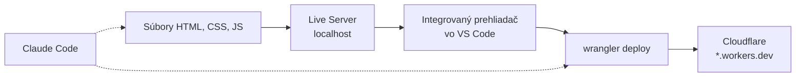
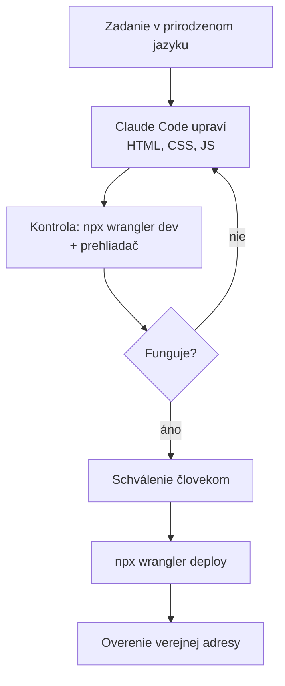

# Základy webu: HTML, CSS, JavaScript a nasadenie

*Verzia 1.0 · stav k októbru 2026. Nástroje sa menia rýchlo; pred  
nasadením si overte aktuálnu dokumentáciu VS Code a Cloudflare.*  

## 1. Prečo web v AI školení

AI nástroje dnes dokážu vygenerovať celú webovú stránku za pár sekúnd.  
Aby ste ich výstup vedeli posúdiť, opraviť a bezpečne zverejniť, potrebujete  
rozumieť tomu, z čoho sa stránka skladá. Nemusíte byť programátor. Stačí  
poznať tri základné jazyky webu a cestu od súboru na disku po verejnú  
adresu na internete.  

V tejto kapitole prejdeme celý postup:  

1. napíšeme jednoduché stránky v HTML, CSS a JavaScripte,  
2. otestujeme ich vo VS Code v integrovanom prehliadači a s Live Serverom,  
3. nasadíme ich na Cloudflare pomocou nástroja Wrangler,  
4. celý proces zautomatizujeme pomocou Claude Code.  



> **Jednoducho povedané:** HTML je kostra domu, CSS je fasáda a nábytok,  
> JavaScript sú vypínače a spotrebiče. Cloudflare je pozemok s adresou,  
> na ktorom dom stojí.  

## 2. Ako funguje webová stránka

Keď do prehliadača napíšete adresu, prehliadač pošle požiadavku na server.  
Server vráti súbory: HTML, CSS, JavaScript, obrázky. Prehliadač ich spojí  
a vykreslí stránku. Celé sa to deje cez protokol HTTP, dnes takmer vždy  
šifrovaný (HTTPS).  

| Vrstva | Jazyk | Úloha | Príklad |  
|---|---|---|---|  
| obsah a štruktúra | HTML | čo na stránke je | nadpis, odsek, tlačidlo |  
| vzhľad | CSS | ako to vyzerá | farby, písmo, rozloženie |  
| správanie | JavaScript | čo sa deje po akcii | klik pridá položku |  

Stránky v tejto kapitole sú **statické**. Server len posiela hotové súbory,  
nič nepočíta. Taký web je rýchly, lacný (často zadarmo) a bezpečný, lebo  
na serveri nebeží žiadny váš kód. Všetka logika beží v prehliadači  
návštevníka.  

## 3. Príprava prostredia

Budete potrebovať:  

- **VS Code** vo verzii 1.116 alebo novšej (kvôli integrovanému  
  prehliadaču),  
- doplnok **Live Server** (autor Ritwick Dey),  
- **Node.js** vo verzii 20 alebo novšej (kvôli nástroju Wrangler),  
- bezplatný účet na **cloudflare.com**,  
- **Claude Code** pre poslednú časť kapitoly.  

Overenie v termináli:  

```bash
code --version
node --version
npm --version
claude --version
```

### Doplnok Live Server

1. Otvorte panel Extensions (`Ctrl+Shift+X`).  
2. Vyhľadajte „Live Server“ a nainštalujte doplnok od Ritwicka Deya.  
3. V stavovom riadku dole vpravo sa objaví tlačidlo **Go Live**.  

Live Server spustí malý lokálny webový server, štandardne na adrese  
`http://127.0.0.1:5500`. Hlavná výhoda: keď uložíte súbor, stránka sa  
v prehliadači sama obnoví.  

### Integrovaný prehliadač vo VS Code

Od verzie 1.109 má VS Code vlastný prehliadač priamo v editore. Stránku  
tak vidíte vedľa kódu a nemusíte prepínať okná. Otvoríte ho takto:  

- príkazom **Browser: Open Integrated Browser** v Command Palette  
  (`Ctrl+Shift+P`),  
- cez menu **View > Browser** alebo skratkou `Ctrl+Alt+/`,  
- ikonou zemegule v hornom paneli VS Code,  
- kliknutím na odkaz `localhost` alebo `127.0.0.1` v termináli či chate.  

Prehliadač má aj vývojárske nástroje (DevTools) s konzolou a inšpektorom  
prvkov. Môžete v ňom označiť prvok stránky a poslať ho ako kontext do  
AI chatu.  

Ak chcete, aby Live Server neotváral systémový prehliadač, pridajte do  
nastavení (`Ctrl+,` → ikona Open Settings JSON):  

```json
{
  "liveServer.settings.NoBrowser": true
}
```

Potom kliknite na **Go Live** a adresu `http://127.0.0.1:5500` otvorte  
v integrovanom prehliadači.  

> **Tip:** Rozdeľte editor na dve časti. Vľavo kód, vpravo integrovaný  
> prehliadač. Každé uloženie (`Ctrl+S`) okamžite uvidíte.  

### Príklady na vyskúšanie

Všetky príklady z kapitoly sú pripravené v priečinku `web-priklady`:  

```
web-priklady/
├── 01-html/index.html
├── 02-css/index.html, style.css
├── 03-js/index.html, script.js
└── projekt/
    ├── wrangler.jsonc
    └── public/index.html, style.css, app.js
```

Otvorte priečinok vo VS Code (**File > Open Folder**), kliknite pravým  
tlačidlom na `index.html` a zvoľte **Open with Live Server**.  

## 4. HTML: štruktúra stránky

HTML (HyperText Markup Language) opisuje, z čoho sa stránka skladá. Obsah  
sa obaľuje do **značiek** (tagov). Väčšina značiek má otvárací a zatvárací  
tvar: `<p>` a `</p>`. Značky môžu mať **atribúty**, napríklad adresu  
odkazu `href`.  

```html
<a href="https://example.com">Text odkazu</a>
```

### Príklad 1: prvá stránka

Súbor `01-html/index.html`:  

```html
<!DOCTYPE html>
<html lang="sk">
<head>
  <meta charset="UTF-8">
  <meta name="viewport" content="width=device-width, initial-scale=1.0">
  <title>Moja prvá stránka</title>
</head>
<body>
  <header>
    <h1>Ahoj, web!</h1>
    <p>Toto je môj prvý <strong>odstavec</strong> na webe.</p>
  </header>

  <main>
    <h2>Čo sa naučím</h2>
    <ul>
      <li>HTML – štruktúra a obsah</li>
      <li>CSS – vzhľad</li>
      <li>JavaScript – správanie</li>
    </ul>

    <h2>Rozvrh školenia</h2>
    <table>
      <tr><th>Čas</th><th>Téma</th></tr>
      <tr><td>9:00</td><td>HTML</td></tr>
      <tr><td>10:30</td><td>CSS</td></tr>
      <tr><td>13:00</td><td>JavaScript</td></tr>
    </table>

    <p>Viac informácií nájdete na
      <a href="https://developer.mozilla.org/">MDN Web Docs</a>.</p>
  </main>

  <footer>
    <p>&copy; 2026 Moje školenie</p>
  </footer>
</body>
</html>
```

Čo znamenajú jednotlivé časti:  

- `<!DOCTYPE html>` hovorí prehliadaču, že ide o moderné HTML5,  
- `<html lang="sk">` obaľuje celú stránku a určuje jazyk,  
- `<head>` obsahuje informácie o stránke, ktoré sa nezobrazujú priamo,  
- `<meta charset="UTF-8">` zabezpečí správne zobrazenie diakritiky,  
- `<meta name="viewport">` je dôležitý pre mobilné telefóny,  
- `<body>` obsahuje všetko, čo návštevník vidí.  

### Najčastejšie značky

| Značka | Význam |  
|---|---|  
| `<h1>` až `<h6>` | nadpisy podľa úrovne |  
| `<p>` | odsek textu |  
| `<a href="...">` | odkaz |  
| `` | obrázok, `alt` je popis pre nevidiacich |  
| `<ul>`, `<ol>`, `<li>` | zoznam s odrážkami, číslovaný zoznam, položka |  
| `<table>`, `<tr>`, `<th>`, `<td>` | tabuľka, riadok, hlavička, bunka |  
| `<div>`, `<span>` | všeobecný blok a všeobecný úsek textu |  
| `<header>`, `<main>`, `<footer>` | sémantické časti stránky |  
| `<form>`, `<input>`, `<button>` | formulár, vstupné pole, tlačidlo |  

**Sémantické značky** ako `<header>`, `<main>`, `<nav>` alebo `<article>`  
nemenia vzhľad, ale opisujú význam obsahu. Pomáhajú čítačkám obrazovky,  
vyhľadávačom aj AI nástrojom, ktoré stránku spracúvajú.  

### Vyskúšajte

1. Spustite stránku cez Live Server a otvorte ju v integrovanom  
   prehliadači.  
2. Zmeňte text nadpisu, uložte súbor a sledujte automatické obnovenie.  
3. Pridajte do rozvrhu ďalší riadok tabuľky.  
4. Pridajte obrázok: ``.  

## 5. CSS: vzhľad stránky

CSS (Cascading Style Sheets) určuje, ako prvky vyzerajú. Pravidlo CSS sa  
skladá zo **selektora** (ktoré prvky) a **deklarácií** (aké vlastnosti).  

```css
h1 {
  color: navy;
  font-size: 2rem;
}
```

CSS sa dá zapísať tromi spôsobmi. Odporúčaný je samostatný súbor, ktorý  
pripojíte v `<head>`:  

```html
<link rel="stylesheet" href="style.css">
```

| Spôsob | Zápis | Kedy |  
|---|---|---|  
| externý súbor | `<link rel="stylesheet" href="style.css">` | takmer vždy |  
| blok v stránke | `<style> ... </style>` v `<head>` | malé ukážky |  
| priamo v prvku | `<p style="color: red">` | výnimočne |  

### Selektory

| Selektor | Vyberie | Príklad |  
|---|---|---|  
| `p` | všetky prvky daného typu | všetky odseky |  
| `.karta` | prvky s triedou `class="karta"` | opakované komponenty |  
| `#menu` | prvok s `id="menu"` | jeden konkrétny prvok |  
| `nav a` | odkazy vnútri `<nav>` | vnorené prvky |  
| `a:hover` | odkaz pod kurzorom myši | stav prvku |  

### Príklad 2: vizitka

Súbor `02-css/index.html`:  

```html
<!DOCTYPE html>
<html lang="sk">
<head>
  <meta charset="UTF-8">
  <meta name="viewport" content="width=device-width, initial-scale=1.0">
  <title>Vizitka</title>
  <link rel="stylesheet" href="style.css">
</head>
<body>
  <article class="karta">
    <div class="avatar">JN</div>
    <h1>Jana Nováková</h1>
    <p class="pozicia">Webová vývojárka</p>
    <p>Robím jednoduché a rýchle webové stránky.</p>
    <a class="tlacidlo" href="mailto:jana@example.com">Napíšte mi</a>
  </article>
</body>
</html>
```

Súbor `02-css/style.css`:  

```css
:root {
  --farba: #2563eb;
  --pozadie: #f1f5f9;
  --text: #1e293b;
}

body {
  margin: 0;
  min-height: 100vh;
  display: flex;
  align-items: center;
  justify-content: center;
  background: var(--pozadie);
  color: var(--text);
  font-family: system-ui, sans-serif;
}

.karta {
  width: min(90%, 360px);
  padding: 2rem;
  text-align: center;
  background: white;
  border-radius: 16px;
  box-shadow: 0 10px 30px rgb(0 0 0 / 0.1);
}

.avatar {
  width: 80px;
  height: 80px;
  margin: 0 auto 1rem;
  display: grid;
  place-items: center;
  border-radius: 50%;
  background: var(--farba);
  color: white;
  font-size: 1.5rem;
  font-weight: bold;
}

.pozicia {
  color: var(--farba);
  font-weight: 600;
}

.tlacidlo {
  display: inline-block;
  margin-top: 1rem;
  padding: 0.6rem 1.2rem;
  border-radius: 8px;
  background: var(--farba);
  color: white;
  text-decoration: none;
  transition: transform 0.2s;
}

.tlacidlo:hover {
  transform: scale(1.05);
}

@media (prefers-color-scheme: dark) {
  :root {
    --pozadie: #0f172a;
    --text: #e2e8f0;
  }
  .karta {
    background: #1e293b;
  }
}
```

### Kľúčové pojmy z príkladu

- **CSS premenné** (`--farba`) definujete raz v `:root` a používate cez  
  `var(--farba)`. Zmenou jednej hodnoty zmeníte farbu na celej stránke.  
- **Box model:** každý prvok je obdĺžnik s obsahom, vnútorným odsadením  
  (`padding`), okrajom (`border`) a vonkajším odsadením (`margin`).  
- **Flexbox** (`display: flex`) rozkladá prvky v riadku alebo stĺpci.  
  Tu vycentruje kartu na stred obrazovky.  
- **Grid** (`display: grid`) rozkladá prvky do mriežky. Tu ním centrujeme  
  iniciály v kruhu.  
- **Media query** (`@media`) mení štýl podľa podmienky, napríklad podľa  
  šírky obrazovky alebo tmavého režimu systému.  
- **Jednotky:** `px` sú pixely, `rem` je násobok veľkosti písma,  
  `%` je podiel z rodiča, `vh` je percento výšky okna.  

### Vyskúšajte

1. Zmeňte hodnotu `--farba` na `#db2777` a sledujte, čo všetko sa zmení.  
2. V integrovanom prehliadači otvorte DevTools, kliknite na kartu  
   a meňte vlastnosti CSS priamo v paneli Styles.  
3. Pridajte pravidlo, ktoré na úzkej obrazovke zmenší písmo nadpisu:  

```css
@media (max-width: 400px) {
  h1 { font-size: 1.4rem; }
}
```

## 6. JavaScript: správanie stránky

JavaScript je programovací jazyk, ktorý beží priamo v prehliadači. Vie  
čítať a meniť obsah stránky, reagovať na kliknutia a písanie, ukladať  
údaje a komunikovať so servermi.  

Stránku vidí JavaScript ako strom objektov, ktorý sa volá **DOM**  
(Document Object Model). Typický postup má tri kroky:  

1. **nájdi** prvok: `document.querySelector("#plus")`,  
2. **počúvaj** udalosť: `.addEventListener("click", ...)`,  
3. **zmeň** stránku: `prvok.textContent = "nový text"`.  

### Základy jazyka

```js
// Premenné
const meno = "Jana";      // nemenná hodnota
let pocet = 0;            // hodnota, ktorá sa mení

// Podmienka
if (pocet > 10) {
  console.log("Veľa");
} else {
  console.log("Málo");
}

// Pole a cyklus
const ovocie = ["jablko", "hruška", "slivka"];
for (const kus of ovocie) {
  console.log(kus);
}

// Funkcia
function pozdrav(kto) {
  return `Ahoj, ${kto}!`;
}

// Objekt
const uloha = { text: "Kúpiť mlieko", hotovo: false };
```

Výstup `console.log` uvidíte v DevTools na karte **Console**. Je to  
najjednoduchší spôsob, ako zistiť, čo sa v kóde deje.  

### Príklad 3: počítadlo, pozdrav a tmavý režim

Súbor `03-js/index.html`:  

```html
<!DOCTYPE html>
<html lang="sk">
<head>
  <meta charset="UTF-8">
  <meta name="viewport" content="width=device-width, initial-scale=1.0">
  <title>JavaScript</title>
  <style>
    body { font-family: system-ui, sans-serif; max-width: 480px;
           margin: 2rem auto; padding: 0 1rem; }
    button { padding: 0.4rem 1rem; font-size: 1rem; cursor: pointer; }
    .tmavy { background: #0f172a; color: #e2e8f0; }
  </style>
</head>
<body>
  <h1>Počítadlo</h1>
  <p>Hodnota: <strong id="hodnota">0</strong></p>
  <button id="minus">−</button>
  <button id="plus">+</button>

  <h2>Pozdrav</h2>
  <input id="meno" placeholder="Vaše meno">
  <p id="pozdrav"></p>

  <h2>Režim</h2>
  <button id="rezim">Prepnúť tmavý režim</button>

  <script src="script.js"></script>
</body>
</html>
```

Súbor `03-js/script.js`:  

```js
// Počítadlo
let pocet = 0;
const hodnota = document.querySelector("#hodnota");

document.querySelector("#plus").addEventListener("click", () => {
  pocet++;
  hodnota.textContent = pocet;
});

document.querySelector("#minus").addEventListener("click", () => {
  pocet--;
  hodnota.textContent = pocet;
});

// Pozdrav sa mení pri každom stlačení klávesy
const meno = document.querySelector("#meno");
const pozdrav = document.querySelector("#pozdrav");

meno.addEventListener("input", () => {
  pozdrav.textContent = meno.value ? `Ahoj, ${meno.value}!` : "";
});

// Tmavý režim
document.querySelector("#rezim").addEventListener("click", () => {
  document.body.classList.toggle("tmavy");
});

console.log("Skript je načítaný.");
```

Značka `<script>` je na konci `<body>`. Keď sa skript spustí, prvky  
stránky už existujú a `querySelector` ich nájde.  

> **Pozor:** Na vkladanie textu od používateľa používajte `textContent`,  
> nie `innerHTML`. Ak niekto do poľa napíše HTML kód, `innerHTML` ho  
> vykoná, `textContent` ho zobrazí len ako text.  

### Vyskúšajte

1. Otvorte Console v DevTools a overte, že sa vypísala správa  
   „Skript je načítaný.“  
2. Pridajte tlačidlo **Vynulovať**, ktoré nastaví počítadlo na 0.  
3. Zmeňte farbu hodnoty na červenú, keď je počítadlo záporné  
   (`hodnota.style.color = "red"`).  
4. Do konzoly napíšte `document.querySelector("h1").textContent = "Test"`  
   a sledujte, ako sa stránka zmení.  

## 7. Projekt: zoznam úloh

Teraz spojíme všetky tri jazyky do malej aplikácie, ktorú v ďalšej časti  
nasadíme na internet. Zoznam úloh si pamätá položky aj po obnovení  
stránky, lebo ich ukladá do `localStorage` prehliadača.  

Súbor `projekt/public/index.html`:  

```html
<!DOCTYPE html>
<html lang="sk">
<head>
  <meta charset="UTF-8">
  <meta name="viewport" content="width=device-width, initial-scale=1.0">
  <title>Zoznam úloh</title>
  <link rel="stylesheet" href="style.css">
</head>
<body>
  <main class="aplikacia">
    <h1>Zoznam úloh</h1>
    <form id="formular">
      <input id="nova" placeholder="Čo treba urobiť?" required>
      <button type="submit">Pridať</button>
    </form>
    <ul id="zoznam"></ul>
    <p id="stav"></p>
  </main>
  <script src="app.js"></script>
</body>
</html>
```

Súbor `projekt/public/app.js`:  

```js
const formular = document.querySelector("#formular");
const vstup = document.querySelector("#nova");
const zoznam = document.querySelector("#zoznam");
const stav = document.querySelector("#stav");

// Úlohy si pamätáme v prehliadači, aby prežili obnovenie stránky
let ulohy = JSON.parse(localStorage.getItem("ulohy") || "[]");

function uloz() {
  localStorage.setItem("ulohy", JSON.stringify(ulohy));
}

function vykresli() {
  zoznam.innerHTML = "";

  ulohy.forEach((uloha, index) => {
    const li = document.createElement("li");
    if (uloha.hotovo) li.classList.add("hotovo");

    const check = document.createElement("input");
    check.type = "checkbox";
    check.checked = uloha.hotovo;
    check.addEventListener("change", () => {
      uloha.hotovo = check.checked;
      uloz();
      vykresli();
    });

    const text = document.createElement("span");
    text.textContent = uloha.text;

    const zmaz = document.createElement("button");
    zmaz.textContent = "✕";
    zmaz.title = "Zmazať";
    zmaz.addEventListener("click", () => {
      ulohy.splice(index, 1);
      uloz();
      vykresli();
    });

    li.append(check, text, zmaz);
    zoznam.append(li);
  });

  const zostava = ulohy.filter((u) => !u.hotovo).length;
  stav.textContent = `Zostáva: ${zostava} z ${ulohy.length}`;
}

formular.addEventListener("submit", (e) => {
  e.preventDefault();
  ulohy.push({ text: vstup.value.trim(), hotovo: false });
  vstup.value = "";
  uloz();
  vykresli();
});

vykresli();
```

Štýly sú v súbore `projekt/public/style.css`. Používajú rovnaké techniky  
ako vizitka: premenné, flexbox a tmavý režim.  

Čo sa v aplikácii deje:  

- `e.preventDefault()` zabráni tomu, aby formulár obnovil stránku,  
- pole `ulohy` je jediný zdroj pravdy; funkcia `vykresli` z neho vždy  
  znova postaví zoznam,  
- `JSON.stringify` a `JSON.parse` prevádzajú pole na text a späť, lebo  
  `localStorage` vie uložiť iba text,  
- text úlohy sa vkladá cez `textContent`, takže je bezpečný.  

Otestujte aplikáciu cez Live Server. Pridajte niekoľko úloh, niektoré  
označte ako hotové a obnovte stránku (`F5`). Úlohy musia zostať. V DevTools  
na karte **Application > Local Storage** uvidíte uložené údaje.  

## 8. Nasadenie na Cloudflare

Cloudflare je sieť dátových centier po celom svete. Statické stránky na nej  
hosťuje bezplatne, s HTTPS a rýchlym doručením z najbližšieho miesta  
k návštevníkovi.  

Pre nové projekty Cloudflare odporúča **Workers so statickými súbormi**  
(static assets). Starší produkt **Pages** stále funguje, nové funkcie však  
pribúdajú hlavne do Workers. Stránka bez vlastného serverového kódu je  
pre Workers len priečinok súborov, ktorý Cloudflare doručuje.  

Nástroj **Wrangler** je oficiálny príkazový riadok Cloudflare. Vie spustiť  
stránku lokálne, nasadiť ju a spravovať nastavenia účtu.  

### Konfigurácia projektu

V priečinku `projekt` je súbor `wrangler.jsonc`:  

```jsonc
{
  "$schema": "./node_modules/wrangler/config-schema.json",
  "name": "zoznam-uloh",
  "compatibility_date": "2026-10-31",
  "assets": {
    "directory": "./public"
  }
}
```

| Kľúč | Význam |  
|---|---|  
| `name` | názov projektu, je aj súčasťou adresy |  
| `compatibility_date` | dátum, podľa ktorého sa správa prostredie Workers |  
| `assets.directory` | priečinok so súbormi, ktoré sa nahrajú |  

Do priečinka `public` dávajte iba to, čo má byť verejné. Všetko v ňom  
bude dostupné na internete.  

### Postup nasadenia

Všetky príkazy spúšťajte v priečinku `projekt` v termináli VS Code  
(`` Ctrl+` ``):  

```bash
cd web-priklady/projekt

# 1. Inštalácia Wranglera do projektu
npm init -y
npm install --save-dev wrangler

# 2. Prihlásenie (otvorí prehliadač a požiada o súhlas)
npx wrangler login
npx wrangler whoami

# 3. Lokálny test v prostredí, ktoré napodobňuje Cloudflare
npx wrangler dev

# 4. Nasadenie
npx wrangler deploy
```

Príkaz `wrangler dev` spustí stránku na `http://localhost:8787`. Kliknite  
na adresu v termináli a otvorí sa v integrovanom prehliadači. Live Server  
je rýchlejší na ladenie vzhľadu, `wrangler dev` je bližší tomu, ako sa  
stránka bude správať v cloude.  

Po príkaze `wrangler deploy` uvidíte adresu podobnú:  

```
https://zoznam-uloh.vas-ucet.workers.dev
```

Stránka je verejne dostupná. Pri ďalšej zmene stačí znova spustiť  
`npx wrangler deploy`. Nasadenie trvá niekoľko sekúnd.  

### Užitočné príkazy Wranglera

| Príkaz | Čo robí |  
|---|---|  
| `npx wrangler login` | prihlási vás k účtu Cloudflare |  
| `npx wrangler whoami` | ukáže, pod akým účtom ste prihlásený |  
| `npx wrangler dev` | spustí lokálny server na porte 8787 |  
| `npx wrangler deploy` | nasadí projekt |  
| `npx wrangler deployments list` | zoznam posledných nasadení |  
| `npx wrangler rollback` | vráti predchádzajúcu verziu |  
| `npx wrangler tail` | živé záznamy požiadaviek |  
| `npx wrangler delete` | zmaže projekt z Cloudflare |  

### Vlastná doména

Adresa `*.workers.dev` stačí na testovanie. Ak máte doménu spravovanú  
v Cloudflare, pridáte ju v dashboarde: **Workers & Pages > projekt >  
Settings > Domains & Routes > Add > Custom domain**. Certifikát HTTPS  
vytvorí Cloudflare automaticky.  

### Skripty v package.json

Aby ste nemuseli pamätať príkazy, pridajte ich do `package.json`:  

```json
{
  "scripts": {
    "dev": "wrangler dev",
    "deploy": "wrangler deploy"
  }
}
```

Potom stačí `npm run dev` a `npm run deploy`. Rovnaké príkazy neskôr  
použije aj Claude Code.  

## 9. Automatizácia s Claude Code

Doteraz sme všetko robili ručne: písali kód, spúšťali server, kontrolovali  
stránku a nasadzovali. Claude Code je AI agent v termináli, ktorý vie  
čítať a upravovať súbory a spúšťať príkazy. Môže preto prejsť celý postup  
za vás. Vy zadávate cieľ a schvaľujete dôležité kroky.  



### Krok 1: vytvorenie stránky zadaním

Spustite Claude Code v prázdnom priečinku:  

```bash
mkdir moja-stranka && cd moja-stranka
claude
```

A zadajte úlohu:  

```
Vytvor jednoduchú statickú stránku pre kaviareň „U Lipy“ v slovenčine.
Súbory daj do priečinka public: index.html, style.css, app.js.
Stránka má mať úvod, menu s cenami v tabuľke, otváracie hodiny a mapu
cez odkaz. JavaScript nech zvýrazní, či je kaviareň práve otvorená.
Použi čisté HTML, CSS a JS bez frameworkov. Pridaj wrangler.jsonc
pre Cloudflare Workers so static assets z priečinka public.
```

Claude Code navrhne súbory a pred zápisom sa vás opýta na povolenie. Potom  
si stránku otvorte cez Live Server v integrovanom prehliadači. Úpravy  
zadávate ďalej v prirodzenom jazyku: „zväčši nadpis“, „pridaj tmavý  
režim“, „menu nech je na mobile v jednom stĺpci“.  

### Krok 2: súbor CLAUDE.md s pravidlami projektu

Claude Code si pri každom spustení prečíta súbor `CLAUDE.md` v koreni  
projektu. Zapíšte doň, ako projekt funguje a čo má agent dodržiavať:  

```markdown
# Projekt: statická stránka kaviarne

## Štruktúra
- Verejné súbory sú iba v priečinku public/.
- Bez frameworkov a bez build kroku: čisté HTML, CSS, JS.

## Príkazy
- Lokálny test: npm run dev (http://localhost:8787)
- Nasadenie: npm run deploy

## Pravidlá
- Texty na stránke sú po slovensky.
- Text od používateľa vkladaj cez textContent, nie innerHTML.
- Pred nasadením over, že wrangler dev beží bez chýb.
- Nikdy nenasadzuj bez môjho výslovného súhlasu.
- Do public/ nikdy nedávaj kľúče, heslá ani súbory .env.
```

### Krok 3: povolenia pre Wrangler

Claude Code sa pri každom príkaze v termináli pýta na povolenie. Bezpečné  
príkazy môžete povoliť natrvalo a nasadenie nechať vždy na potvrdenie.  
Súbor `.claude/settings.json` v projekte:  

```json
{
  "permissions": {
    "allow": [
      "Bash(npx wrangler whoami)",
      "Bash(npx wrangler dev:*)",
      "Bash(npm run dev)",
      "Bash(npx wrangler deployments list)"
    ],
    "ask": [
      "Bash(npx wrangler deploy:*)",
      "Bash(npm run deploy)",
      "Bash(npx wrangler rollback:*)"
    ],
    "deny": [
      "Bash(npx wrangler delete:*)"
    ]
  }
}
```

- `allow` sa vykoná bez pýtania,  
- `ask` sa vždy opýta, aj keby ste inak povolili všetko,  
- `deny` sa nevykoná nikdy.  

### Krok 4: vlastný príkaz /deploy

Opakovaný postup si uložte ako **skill**. Vytvorte súbor  
`.claude/skills/deploy/SKILL.md`:  

```markdown
---
name: deploy
description: Skontroluje a nasadí statickú stránku na Cloudflare Workers.
disable-model-invocation: true
---

Nasaď stránku na Cloudflare takto:

1. Over prihlásenie príkazom `npx wrangler whoami`.
2. Skontroluj, že v public/ nie sú súbory .env, kľúče ani heslá.
3. Skontroluj HTML: každý obrázok má alt, stránka má title a lang="sk".
4. Spusti `npx wrangler dev` na pozadí a over, že stránka vracia 200.
5. Ukáž mi zoznam zmenených súborov a počkaj na môj súhlas.
6. Spusti `npx wrangler deploy`.
7. Otvor verejnú adresu a over, že sa stránka načíta.
8. Napíš mi adresu a krátke zhrnutie zmien.
```

Nastavenie `disable-model-invocation: true` znamená, že skill spustíte len  
vy príkazom `/deploy`. Agent ho sám od seba nespustí, čo je pri nasadení  
na internet žiaduce.  

Celý cyklus potom vyzerá takto:  

```
> Pridaj na stránku sekciu s recenziami zákazníkov.
  (Claude upraví súbory, vy skontrolujete v prehliadači)
> /deploy
  (Claude prejde kontroly, ukáže zmeny, po súhlase nasadí)
```

### Krok 5: vizuálna kontrola prehliadačom

Agent vidí len kód, nie výsledok. Ak mu dáte prístup k prehliadaču, vie  
si stránku pozrieť sám. Možnosti:  

- **Playwright MCP** v Claude Code: agent otvorí stránku, urobí snímku  
  obrazovky, klikne na tlačidlá a skontroluje konzolu,  
- **integrovaný prehliadač VS Code**: prvok stránky označíte a pošlete  
  ako kontext do chatu („toto tlačidlo je príliš malé“).  

Pridanie Playwright MCP:  

```bash
claude mcp add playwright -- npx @playwright/mcp@latest
```

Zadanie potom môže znieť: „Spusti wrangler dev, otvor stránku v Playwright,  
urob snímku na šírke 375 px aj 1280 px a oprav, čo sa na mobile rozbije.“  

### Krok 6: nasadenie bez človeka (CI)

Pri tímovej práci sa stránka často nasadzuje automaticky po každom  
`git push`. Na to už nie je potrebné prihlásenie cez prehliadač, ale  
**API token**:  

1. V dashboarde Cloudflare: **My Profile > API Tokens > Create Token**,  
   šablóna **Edit Cloudflare Workers**.  
2. Token uložte ako tajomstvo `CLOUDFLARE_API_TOKEN` v GitHub  
   (Settings > Secrets and variables > Actions), spolu  
   s `CLOUDFLARE_ACCOUNT_ID`.  
3. Požiadajte Claude Code: „Vytvor GitHub Actions workflow, ktorý pri  
   push do vetvy main spustí npx wrangler deploy.“  

Druhá možnosť bez GitHub Actions: v dashboarde Cloudflare prepojte projekt  
s repozitárom (**Settings > Build > Connect**). Cloudflare potom nasadí  
každý push sám.  

Token nikdy nevkladajte do kódu, do `CLAUDE.md` ani do chatu.  

## 10. Bezpečnosť

- **Všetko v `public/` je verejné.** Kľúče, heslá, súbory `.env` a interné  
  dokumenty tam nepatria. Ani do JavaScriptu, ktorý beží v prehliadači.  
- **Nasadenie je akcia smerom von.** Nechajte ho v režime `ask` a pred  
  potvrdením si pozrite, čo agent mení.  
- **Kód od AI kontrolujte.** Hľadajte `innerHTML` s textom od používateľa,  
  skripty z neznámych adries a odkazy na cudzie domény.  
- **Obsah z webu je nedôveryhodný.** Ak agent číta cudzie stránky, môžu  
  obsahovať skryté pokyny (prompt injection). Nedávajte mu vtedy zároveň  
  právo nasadzovať.  
- **API token s minimálnymi právami.** Token pre CI má vedieť len nasadiť  
  Workers, nie spravovať DNS ani fakturáciu.  
- **Rollback poznajte vopred.** `npx wrangler rollback` vráti  
  predchádzajúcu verziu za pár sekúnd.  

## 11. Časté chyby

| Problém | Príčina | Riešenie |  
|---|---|---|  
| zlá diakritika | chýba `<meta charset="UTF-8">` | doplniť do `<head>` |  
| CSS sa neprejaví | zlá cesta v `<link href>` | overiť cestu k súboru |  
| JS hlási `null` | skript beží pred prvkami | `<script>` na koniec `<body>` |  
| stránka sa neobnovuje | súbor nie je uložený | `Ctrl+S` alebo Auto Save |  
| Live Server ukáže zoznam súborov | zlý priečinok | otvoriť priečinok projektu |  
| `wrangler: command not found` | chýba inštalácia | použiť `npx wrangler` |  
| `Not logged in` | chýba prihlásenie | `npx wrangler login` |  
| po nasadení stará verzia | cache prehliadača | `Ctrl+Shift+R` |  
| na webe chýba súbor | súbor nie je v `public/` | presunúť ho do `public/` |  
| na mobile je stránka malá | chýba `viewport` | doplniť `<meta>` do `<head>` |  

## 12. Úlohy na precvičenie

1. **Osobná stránka.** Vytvorte ručne stránku o sebe: nadpis, fotka,  
   krátky text, zoznam záľub a odkaz na e-mail. Otestujte ju cez Live  
   Server v integrovanom prehliadači.  
2. **Štýl.** Pridajte k nej CSS s vlastnou farebnou paletou cez premenné  
   a tmavý režim. V DevTools overte zobrazenie na šírke mobilu.  
3. **Interakcia.** Doplňte tlačidlo, ktoré zobrazí alebo skryje sekciu  
   „Viac o mne“.  
4. **Zoznam úloh.** Rozšírte projekt o tlačidlo „Zmazať hotové“  
   a o počítadlo v nadpise karty prehliadača (`document.title`).  
5. **Nasadenie.** Nasaďte zoznam úloh cez `npx wrangler deploy`  
   a pošlite adresu kolegovi. Otvorte ju na mobile.  
6. **Agent.** V novom priečinku nechajte Claude Code vytvoriť stránku  
   podľa vlastného zadania. Napíšte `CLAUDE.md`, povolenia  
   v `.claude/settings.json` a skill `/deploy`. Nasaďte ju jedným  
   príkazom.  
7. **Porovnanie.** Porovnajte ručne písanú a vygenerovanú stránku. Čo  
   urobil agent lepšie? Čo by ste museli opraviť, keby ste kódu  
   nerozumeli?  

## 13. Zhrnutie

- Webová stránka sa skladá z **HTML** (štruktúra), **CSS** (vzhľad)  
  a **JavaScriptu** (správanie).  
- Vo VS Code testujete stránky cez **Live Server** a **integrovaný  
  prehliadač**, ktorý má aj DevTools a vie posielať prvky do AI chatu.  
- Statické stránky nasadíte zadarmo na **Cloudflare Workers so static  
  assets** nástrojom **Wrangler**: `wrangler login`, `wrangler dev`,  
  `wrangler deploy`.  
- **Claude Code** vie celý cyklus zautomatizovať: písať kód, testovať,  
  kontrolovať prehliadačom a nasadzovať.  
- Pravidlá projektu patria do **`CLAUDE.md`**, povolenia do  
  **`.claude/settings.json`**, opakovaný postup do **skillu**.  
- Nasadenie je verejná akcia. Ponechajte ho na **schválenie človekom**  
  a do `public/` nedávajte nič tajné.  

## 14. Slovníček

| Anglicky | Slovensky | Význam |  
|---|---|---|  
| HTML | značkovací jazyk | štruktúra a obsah stránky |  
| CSS | kaskádové štýly | vzhľad a rozloženie stránky |  
| JavaScript | skriptovací jazyk | správanie stránky v prehliadači |  
| tag | značka | prvok HTML, napríklad `<p>` |  
| attribute | atribút | doplnková vlastnosť značky, napríklad `href` |  
| selector | selektor | pravidlo, ktoré vyberá prvky pre CSS |  
| DOM | objektový model dokumentu | stránka ako strom objektov pre JS |  
| event | udalosť | klik, písanie, odoslanie formulára |  
| DevTools | vývojárske nástroje | konzola, inšpektor, sieť v prehliadači |  
| localhost | lokálny počítač | adresa vášho vlastného počítača |  
| static site | statická stránka | web z hotových súborov bez servera |  
| deploy | nasadenie | zverejnenie stránky na serveri |  
| static assets | statické súbory | HTML, CSS, JS a obrázky na doručenie |  
| CLI | príkazový riadok | ovládanie programu príkazmi v termináli |  
| API token | prístupový token | kľúč pre automatické nasadenie |  
| CI/CD | priebežné nasadzovanie | automatický test a nasadenie po zmene |  
| rollback | návrat verzie | obnovenie predchádzajúceho nasadenia |  

## Zdroje

- MDN Web Docs – HTML, CSS, JavaScript: developer.mozilla.org  
- VS Code – Integrated browser:  
  code.visualstudio.com/docs/debugtest/integrated-browser  
- Live Server (Ritwick Dey): marketplace.visualstudio.com,  
  ritwickdey.LiveServer  
- Cloudflare Workers – Static Assets:  
  developers.cloudflare.com/workers/static-assets  
- Wrangler – príkazy a konfigurácia:  
  developers.cloudflare.com/workers/wrangler  
- Claude Code – dokumentácia: code.claude.com/docs  
- Playwright MCP: github.com/microsoft/playwright-mcp  
